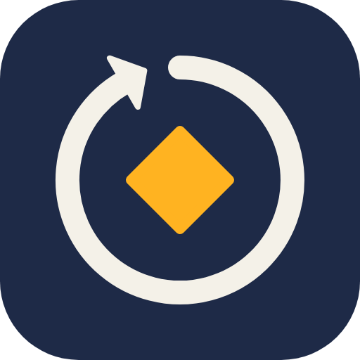
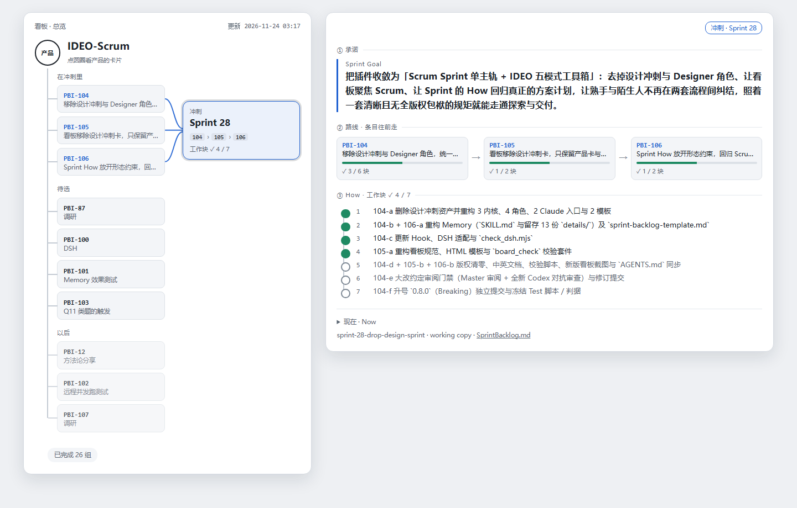
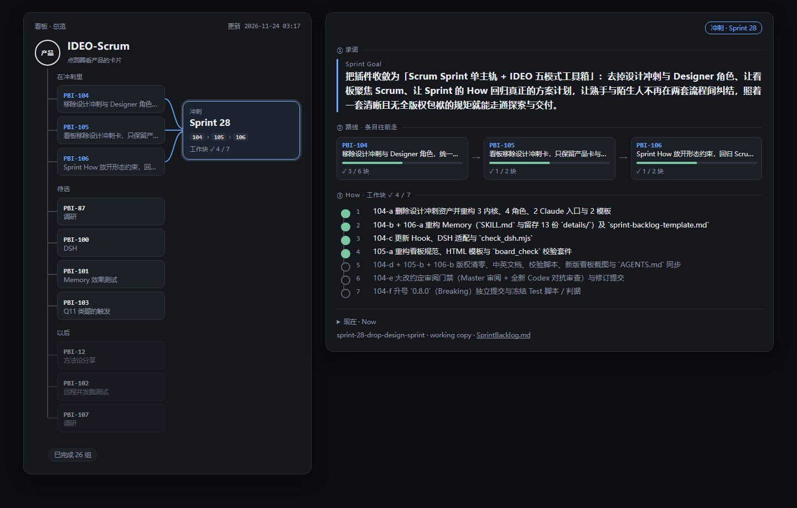

<p align="center"></p>

# IDEO-Scrum

A plugin for Claude Code and DeepSeek Harness (DSH) that brings Design Thinking and Scrum Sprints to a project you build alone with AI. **v6.0.3**

[中文](README.zh-CN.md) · [Install](#install) · [Quick start](docs/quick-start.md) · [Glossary](docs/glossary.md) · [Changelog](CHANGELOG.md)

> **License note.** The d.school material in this plugin is licensed for non-commercial use only, so this repository is not open-source software in the OSI sense. See [License and attribution](#license-and-attribution).

## What it is

When you build a project alone with an AI, the rules and the state of the work live in your head and in the chat. A session ends or is compacted, and they go with it. The AI can drift, and no one but the builder looks at what it built.

IDEO-Scrum puts a Scrum team around the work. You are the Product Owner: you decide the direction, the goals, which items enter a Sprint, and when building may start. The AI plays the Scrum Master, the Developer, the Designer and the Stakeholder, one role per command. When the question is what people want, or what counts as good, it brings the design thinking of IDEO and Stanford's d.school: the five modes, or a design sprint. Everything is written into plain Markdown logs in your repository, so a new session reads the log and carries on.

It is not a project-management tool: no JIRA or Linear integration, and not a platform for a team.

## A session, shortened

A shortened Claude Code example, not a transcript; the wording will differ. The stops are the point: the work waits for your permission before starting or returning to a Sprint or design stage, not just for approval of the previous result.

```text
You:            /ideo-scrum:scrum-master
                I'm building a small CLI that prints one quote a day. Help me get started.
Scrum Master:   First the product log: what is the product, and what should it achieve next?
You:            It prints a quote every morning. Done means I still enjoy it after a month.
Scrum Master:   Written to scrum/ProductBacklog.md: the product, the Product Goal, three items.
                Shall we open a Sprint?
You:            Open it and start Why.
Scrum Master:   Why, the Sprint Goal: "Daily quote: it prints one quote from a list; adding a quote
                takes one command." That is the goal. Do you decide it, and move on to What?
You:            Set that goal and start What.
                ... What: you pick and refine the items; you then authorize How, and the Developer writes a plan ...
Developer:      The plan is in chapter 3 of the sprint log. I won't build until you give the go-ahead.
You:            Go ahead.
                ... the Developer builds, checks, and keeps notes; you authorize Test; someone else reviews; you decide when to close ...
```

What this leaves in your repository is plain Markdown you can read and edit: `scrum/ProductBacklog.md` and `scrum/sprint-01-<name>/SprintBacklog.md`. The [quick start](docs/quick-start.md) walks through the whole thing, step by step.

## Who it is for

A good fit:

- You build your own project with Claude Code or DSH, and you know Scrum, or will read the Scrum Guide beside this plugin (it ships with it).
- You want the rules to follow the plugin instead of being dictated again in every session, and a session that breaks off or is compacted to pick up where it stopped.

Not a fit:

- You need JIRA or Linear integration, or a platform for a whole team.
- You want the AI to run a project on its own: by default, starting or returning to a Sprint or design stage waits for your permission.
- You want Scrum to the letter of the Scrum Guide: see [How it differs from textbook Scrum](#how-it-differs-from-textbook-scrum).

## Install

A git repository for your project is recommended; the Scrum Master can set one up for you.

**Claude Code.** In a Claude Code session:

```text
/plugin marketplace add seapawn1/IDEO-Scrum
/plugin install ideo-scrum@ideo-scrum
/reload-plugins
```

To check, run `claude plugin list` in a terminal: it shows `ideo-scrum@ideo-scrum` as enabled.

**DeepSeek Harness (DSH `0.2.2-rc.5`).** Clone this repository to a location you plan to keep. In the DSH sidebar, open **Plugins → Add plugin**. Enter the absolute path to the repository root (the folder with `package.json`) in **Package name or address** and select **Install**. DSH links `@seapawn/ideo-scrum` to that directory rather than copying it. Open a new **Standard** session in the project you want to work on.

## Upgrade

**Claude Code.** Run this in a terminal:

```sh
claude plugin update ideo-scrum@ideo-scrum
```

Then run `/reload-plugins` in a session that is already open. Third-party marketplaces do not update themselves by default: to have Claude Code do it, open `/plugin`, go to Marketplaces, select `ideo-scrum` and choose Enable auto-update. What changed in each release is in the [changelog](CHANGELOG.md).

**DSH.** Update the linked checkout in place, restart DSH, and open a new **Standard** session. If the checkout moves, use **Uninstall** in **Plugins** for the old link before adding the new path with **Add plugin**.

## Your first sentence

In a Claude Code session, call a role:

```text
/ideo-scrum:scrum-master    # facilitates Planning, checkpoints, Review and Retro; reviews the work; serves you, the Product Owner
/ideo-scrum:developer       # runs a Sprint: the plan, the Increment, the sprint log
/ideo-scrum:designer        # five modes without stage gates; in a design sprint, agree how to diverge and authorize Ideate before ideas
/ideo-scrum:stakeholder     # an outside view of the product, or a standing assistant for chores such as the board
```

In a DSH **Standard** session, use its native skill entries:

```text
/scrum-master
/developer
/designer
/stakeholder
```

Type the entry or choose it from the `/` suggestions. You can add the request in the same message: `/scrum-master Help me plan the next Sprint.` The role brings in IDEO and Scrum in order; Sprint and Design load only as needed. To explicitly load both for a task that spans them, start with `/scrum-master /sprint-kernel /design-kernel`. DSH also recognizes a standalone `/name` in the middle of a sentence; wrap it in backticks when you are only mentioning it.

In Claude Code, you can also say it in your own words:

```text
Use ideo-scrum to plan the next Sprint; I have five items to refine.
I'm not sure this feature is worth building. Run a round of user research first.
```

What loads, and when: the Scrum, Sprint and design-sprint material comes only when summoned, by a role, by naming ideo-scrum or one of its kernels, or by asking to create or change its logs; a general question about Scrum is answered as usual. In Claude Code, the IDEO methods often step in by themselves for prototyping and testing. For brainstorming and defining a problem the model usually answers directly: name `ideo-kernel` if you want its methods (a known limitation).

## How it differs from textbook Scrum

The plugin departs from the official guides in seven places, on purpose. Each is stated once, with its reason, in [`overview.md`](plugins/ideo-scrum/skills/scrum-kernel/overview.md#departures-from-the-official-guides); this is the short version.

| Here | Why |
| --- | --- |
| Only the Product Owner must be human | One person works with AI and keeps the value decisions |
| Designs sit beside Sprints | A design delivers no Increment, may span several Sprints, and the Designer and the Developer are peers |
| The Product Owner decides the items with the Scrum Master | The Product Owner sets the value direction, and the others say how much fits |
| The How is a plan, and building waits for the go-ahead | The Scrum Master and the Product Owner check the plan, because AI may drift |
| Checkpoints replace the Daily Scrum | AI works by session, not by day |
| A reviewer is required | A Developer may drift, and a second look catches it |
| No Sprint end date | AI works by session, so the Product Owner watches at checkpoints for a Sprint that drags on |

## Where the work lives

Your project grows a `scrum/` folder. This is the author's layout; use your project's own places if it has them.

| Path | What it holds |
| --- | --- |
| `scrum/ProductBacklog.md` | The product log: the product, the Product Goal, the items |
| `scrum/sprint-NN-<name>/SprintBacklog.md` | One Sprint, from Why to Test, with its notes |
| `scrum/design-<name>/DesignBacklog.md` | One design: research and prototypes |
| `scrum/ideo-<name>/IdeoBacklog.md` | One run of the five modes |
| `scrum/ScrumBoard.html` | The board: a one-page view of where the project stands, written from the logs; it keeps no state of its own |
| `scrum/documents/` | Archived logs, the original material of finished designs, and files serving the whole project |

The plugin calls these files logs: the product log is the Product Backlog, the sprint log is the Sprint Backlog. A real example is this repository's own `scrum/` folder, written in Chinese: start with [`ProductBacklog.md`](scrum/ProductBacklog.md) and one archived sprint log, [`sprint-19-board-hook.md`](scrum/documents/sprint/sprint-19-board-hook.md).

## Board and hook

Two small things help you find your place when a project has several logs.

**The board.** Ask the Scrum Master, or a standing helper session, for the board: it writes `scrum/ScrumBoard.html` from your logs. Open it in a browser. A flow diagram shows the product, the items not done, and the Sprint or design each one flows into; pressing a Sprint or a design opens its card with the goal, the route, and the work items done so far. It is made to be read at a glance, on a wide screen, a portrait screen, or a phone, and it follows your system's light or dark setting. A cheap model can write it, following [`board-log.md`](plugins/ideo-scrum/skills/scrum-kernel/conventions/board-log.md); delete it any time and ask again.





**Commitments.** The product, Product Goal, Sprint Goal and design goal come from the logs’ commitment tables, word for word. The reminders look for Sprint and design logs at active paths (`scrum/sprint-*/`, `scrum/design-*/`), where a concluded log awaiting archival may still sit; current multiple-log notices still phrase that count as `"open"`, so neither presence nor that count proves work is open or authorized: check `Now` and the recorded permission.

- **Claude Code:** A small hook puts them in context when a session starts, resumes, or is compacted, and when a commitment changes. The hook needs a POSIX `sh`: on Windows, install Git for Windows. It has not been tried on macOS.
- **DSH:** Before a model step, the plugin reads the current checkout's logs. It adds the commitment snapshot on first use, when the text changes, or when compaction removes the previous snapshot. If it finds several Sprint logs or several design logs at active paths, it gives that count rather than picking one goal. If the automatic read cannot supply a commitment, have the role reread its source log. No shell hook is needed.
- To switch this off, set `IDEO_SCRUM_COMMITMENTS=off` in the `env` of a Claude Code settings file or in its shell. For DSH, set it in the environment before starting DSH.

## Learn more

- [Quick start](docs/quick-start.md): one page, from installing to your first closed Sprint
- [Glossary](docs/glossary.md): the plugin's own terms
- [`overview.md`](plugins/ideo-scrum/skills/scrum-kernel/overview.md): how the pieces fit, and every departure from the official guides
- [Changelog](CHANGELOG.md): what changed in each release

## License and attribution

The original parts of this repository (the plugin's structure, how its skills are organized, and the work records in `scrum/`) are released under the [MIT license](LICENSE). The methods the plugin carries come from four sources, each under its own terms, which MIT does not cover:

| Source | License |
| --- | --- |
| *The Scrum Guide* 2020, Ken Schwaber and Jeff Sutherland | CC BY-SA 4.0 |
| *Scrum Guide Expansion Pack* 2026.1, Ralph Jocham, John Coleman and Jeff Sutherland | CC BY-SA 4.0 |
| *Design Thinking Bootleg*, Stanford d.school | CC BY-NC-SA 4.0 (non-commercial) |
| *Sprint*, Jake Knapp with John Zeratsky and Braden Kowitz (Simon & Schuster, 2016) | All rights reserved |

The d.school license forbids commercial use, so this repository is not open-source software in the OSI sense. If you plan a commercial use, read [ATTRIBUTION.md](ATTRIBUTION.md) first (it is in Chinese).

From *Sprint* the plugin carries cut-down excerpts of the chapters that describe the method, with no illustrations and not the whole book; if the method helps you, please buy the book. Every excerpt names its source and license, and [ATTRIBUTION.md](ATTRIBUTION.md) lists where each one lives. IDEO-Scrum is an independent work, not affiliated with Scrum.org, scrumexpansion.org, Stanford d.school, IDEO or Simon & Schuster.

## Feedback

Found a problem, or have an idea? Open an [issue](https://github.com/seapawn1/IDEO-Scrum/issues). It helps to say where you run it (Claude Code or DSH, its version, your operating system), what you said, and what you saw.

## Files

| Path | What it is |
| --- | --- |
| `plugins/ideo-scrum/` | The Claude Code plugin and the shared source for the four roles and the four kernels (ideo, scrum, sprint, design) |
| `dsh/`, `package.json`, `cordis.patch.yml` | The DSH integration and bundle entry points |
| `docs/` | The quick start and the glossary |
| `scrum/` | This project's own Scrum work, in Chinese: its product log and its archived sprint logs |
| `scripts/` | Documentation and board checks, and tests for a first Sprint |
| `.claude-plugin/` | The Claude Code marketplace list |
| `LICENSE`, `ATTRIBUTION.md`, `CHANGELOG.md`, `CLAUDE.md` | The license, the sources and their terms, the release notes, and the instructions for working on this repository |
