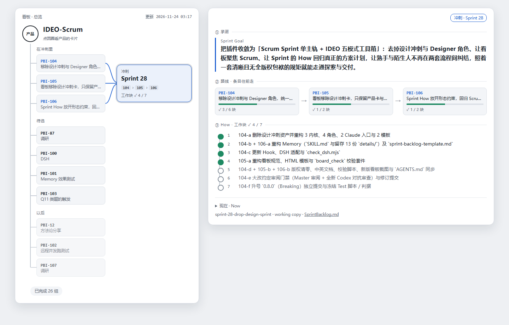
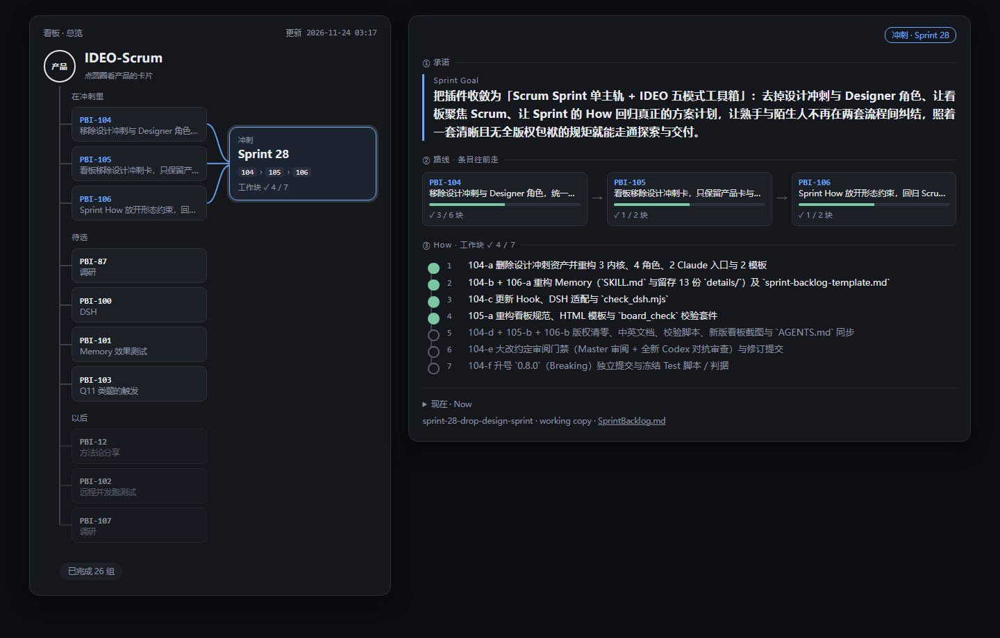

<p align="center"></p>

# IDEO-Scrum

一个面向 Claude Code 和 DeepSeek Harness（DSH）的插件：把 Design Thinking 与 Scrum Sprint 带给你一个人加 AI 做的项目。**v0.7.0**

[English](README.md) · [安装](#安装) · [快速上手](docs/quick-start.zh-CN.md) · [词汇表](docs/glossary.md) · [更新记录](CHANGELOG.md)（英文）

> **授权提示。** 本插件里 d.school 的材料只许非商业使用，所以本仓库不算 OSI 意义上的开源软件。见[授权与署名](#授权与署名)。

## 这是什么

一个人带着 AI 做项目，规矩和工作的进度都在你脑子里和聊天里。会话结束，或者被压缩，它们就跟着没了。AI 会跑偏，除了做的那一个，没有别人看它做了什么。

IDEO-Scrum 给这份工作配一支 Scrum 团队。你当 Product Owner：方向、目标、哪些条目进冲刺、什么时候可以动手，都由你定。AI 扮演 Scrum Master、Developer、Designer、Stakeholder 和 Supporter（秘书），一个角色一个命令。遇到「人要什么」「什么样算好」这类问题，它会带上 IDEO 和斯坦福 d.school 的设计思维：五模式，或者一次设计冲刺。所有东西都写进你仓库里的纯 Markdown 日志，换一个新会话，读日志就能接着干。

它不是项目管理工具：不接 JIRA 或 Linear，也不是给团队用的平台。

## 一次会话大概什么样

这是 Claude Code 里的简化示例，不是实录；措辞会不一样。要看的是它在哪儿停：进入或返回冲刺、设计冲刺的阶段前，工作都等你放行，不把认可上个结果当成继续做的许可。

```text
你：           /ideo-scrum:scrum-master
               我想一个人做个小命令行工具，每天打印一句名言。帮我起个头。
Scrum Master： 先写产品日志：这个产品是什么，接下来要做到什么？
你：           每天早上打印一句名言。一个月后我还乐意用，就算做到了。
Scrum Master： 已写进 scrum/ProductBacklog.md：产品、Product Goal、三条条目。
               要开一个冲刺吗？
你：           开，先开始 Why。
Scrum Master： Why，Sprint Goal：「每日一句：从清单里打印一句名言；加一句名言只要一条命令。」
               这就是目标。你来定，然后进 What？
你：           目标定了，开始 What。
               ……What：你选条目、一起精化；再放行 How，Developer 写计划……
Developer：    计划写在冲刺日志第 3 章。你说「放行」之前，我不动手。
你：           放行。
               ……Developer 动手、自检、记笔记；你放行 Test，别人来审阅；你定什么时候收官……
```

留在你仓库里的是可以直接读、直接改的纯 Markdown：`scrum/ProductBacklog.md` 和 `scrum/sprint-01-<名字>/SprintBacklog.md`。[快速上手](docs/quick-start.zh-CN.md)一步一步带你走完全程。

## 适合谁

适合：

- 你用 Claude Code 或 DSH 做自己的项目，懂 Scrum，或者愿意把 Scrum Guide 放在旁边读（插件自带）。
- 你想让规矩跟着插件走，不用每个会话重新口述；会话断了、被压缩了，能从停下的地方接上。

不适合：

- 你要接 JIRA 或 Linear，或者要一个给整个团队用的平台。
- 你想让 AI 自己把项目跑完：默认进入或返回冲刺、设计冲刺的阶段前，都停下来等你放行。
- 你要一字不差的 Scrum Guide：见[和教科书上的 Scrum 有什么不同](#和教科书上的-scrum-有什么不同)。

## 安装

你的项目最好是个 git 仓库；没有的话，Scrum Master 可以替你建。

**Claude Code。** 在 Claude Code 会话里：

```text
/plugin marketplace add seapawn1/IDEO-Scrum
/plugin install ideo-scrum@ideo-scrum
/reload-plugins
```

检查：在终端里运行 `claude plugin list`，里面 `ideo-scrum@ideo-scrum` 显示已启用。

**DeepSeek Harness（DSH `0.2.2-rc.5`）。** 这里的版本号是 DSH 宿主版本，不是 IDEO-Scrum 插件版本（`0.7.0`）。把本仓库克隆到会一直保留的目录。在 DSH 侧栏打开**插件 → 添加插件**，在**包名或地址**里填本仓库根目录（有 `package.json` 的目录）的绝对路径，然后点**安装**。DSH 把 `@seapawn/ideo-scrum` 链接到这个目录，不会复制一份。到你要做的项目目录新开一个 **Standard** 会话。

## 升级

**Claude Code。** 在终端里运行：

```sh
claude plugin update ideo-scrum@ideo-scrum
```

然后在已经打开的会话里运行 `/reload-plugins`。第三方市场默认不会自动更新：想让 Claude Code 代劳，打开 `/plugin`，进 Marketplaces，选 `ideo-scrum`，选 Enable auto-update。每个版本改了什么，见[更新记录](CHANGELOG.md)（英文）。

从 `6.0.3` 升到 `0.7.0` 预计是同一条更新路径（版本号变小是正常的）。`0.6.3` 的这条路径已在 Claude Code `2.1.329` 上验证过，不用卸载重装；`0.7.0` 的核对待推送并更新本机之后补。要核对实际加载的是哪一版，以及 DSH 的迁移，见[已装用户怎样迁移](docs/maintaining.zh-CN.md#已装用户怎样迁移)。

**DSH。** 在 DSH `0.2.2-rc.5` 上，指向本地目录的链接在插件详情页没有原地更新按钮，只有**卸载**。`6.0.3 → 0.6.3` 实测通过的路径是：在**插件**页**卸载**旧链接，再用**添加插件**填新路径，重启 DSH，然后新开一个 **Standard** 会话。原地更新链接仓库未单独实测。

## 第一句话怎么说

在 Claude Code 会话里，叫出一个角色：

```text
/ideo-scrum:scrum-master    # 主持 Planning、检查点、Review 和 Retro；审阅工作；服务你这位 Product Owner
/ideo-scrum:developer       # 跑一个冲刺：计划、增量、冲刺日志
/ideo-scrum:designer        # 五模式不设阶段门；设计冲刺先定发散安排、放行 Ideate，再出方案
/ideo-scrum:stakeholder     # 对产品的外部视角
/ideo-scrum:supporter       # 秘书：不碰源码的杂活——看板、汇总、传已定的事、收齐等你定的问题
```

每个 Claude Code 角色命令都会先按顺序调用所需内核和 Memory，再开始工作（见[角色规矩](plugins/ideo-scrum/skills/memory/details/roles.md)）。

在 DSH **Standard** 会话里，用原生的技能入口：

```text
/scrum-master
/developer
/designer
/stakeholder
/supporter
```

可以直接输入，也可以从 `/` 提示里选。任务可以跟在同一条消息里：`/scrum-master 帮我规划下个冲刺。` 在 DSH 中，角色按顺序带入 IDEO 内核、Scrum 内核和 Memory，Sprint 和 Design 按需加载。任务横跨冲刺与设计冲刺时，可以用 `/scrum-master /sprint-kernel /design-kernel` 显式顺序加载。DSH 也会识别句中独立出现的 `/名称`；只是提及名称时，在输入里用反引号包住它。

在 Claude Code 中，也可以用自己的话说：

```text
用 ideo-scrum 帮我规划下个冲刺，我们有 5 个待办项要精化
这个功能要不要做我拿不准，先做一轮用户访谈的设计
```

什么时候加载什么：Scrum、冲刺、设计冲刺的材料和 Memory 只有召唤才来——叫出角色，点名 ideo-scrum、它的某个内核或 Memory，或者要求建改它的日志；泛泛问 Scrum，照常回答。在 Claude Code 里，做原型、做测试时，IDEO 的方法常会自己介入；发散、定义问题时，模型多半直接作答，想用它的方法就点名 `ideo-kernel`（已知的限制）。

## 和教科书上的 Scrum 有什么不同

插件有意在七处和官方指南不一样。每一处在 [`departures.md`](plugins/ideo-scrum/skills/memory/details/departures.md#departures-from-the-official-guides) 里只写一次，连同理由（英文）；这里是简版。

| 这里 | 为什么 |
| --- | --- |
| 只有 Product Owner 必须是人 | 一个人和 AI 一起干活，价值上的决定留在他手里 |
| 设计和冲刺并列 | 设计不交付增量，可以跨好几个冲刺，Designer 和 Developer 是平级 |
| 条目由 Product Owner 和 Scrum Master 一起定 | Product Owner 定价值方向，其他人说一次装得下多少 |
| How 是计划，放行之后才动手 | Scrum Master 和 Product Owner 查计划，因为 AI 可能跑偏 |
| 检查点代替 Daily Scrum | AI 按会话干活，不按天 |
| 必须有审阅者 | Developer 可能跑偏，再看一眼能抓住 |
| 没有冲刺截止日 | AI 按会话干活，所以由 Product Owner 在检查点盯着有没有冲刺拖太久 |

## 工作成果放在哪

你的项目里会长出一个 `scrum/` 文件夹。这是作者的布局；你的项目自己有地方放，就用自己的。

| 路径 | 里面放什么 |
| --- | --- |
| `scrum/ProductBacklog.md` | 产品日志：产品、Product Goal、条目 |
| `scrum/sprint-NN-<名字>/SprintBacklog.md` | 一个冲刺，从 Why 到 Test，连同它的笔记 |
| `scrum/design-<名字>/DesignBacklog.md` | 一次设计：研究和原型 |
| `scrum/ideo-<名字>/IdeoBacklog.md` | 一轮五模式 |
| `scrum/ScrumBoard.html` | 看板：一页看清项目走到哪，由日志写成，自己不存状态 |
| `scrum/documents/` | 归档日志、已结束设计的材料原件，以及整个项目共用的文件 |

插件把这些文件叫日志：产品日志就是 Product Backlog，冲刺日志就是 Sprint Backlog。真实的例子就是本仓库自己的 `scrum/` 文件夹，中文写的：先看 [`ProductBacklog.md`](scrum/ProductBacklog.md) 和一份归档的冲刺日志 [`sprint-19-board-hook.md`](scrum/documents/sprint/sprint-19-board-hook.md)。

## 看板和 hook

项目里日志一多，有两样小东西帮你找回方位。

**看板。** 请 Supporter（秘书）或 Scrum Master 要一份看板：它照你的日志写出 `scrum/ScrumBoard.html`，用浏览器打开。一张流向图画出产品、没做完的条目，以及每条流进哪个冲刺或设计。点冲刺卡看目标、路线和已经做完的工作块；点设计卡看设计目标、地图主线和选定方案，有没有故事板都能看方案。它是为瞥一眼做的：宽屏、竖屏、手机上都读得顺，配色跟着系统的浅色或深色。便宜的模型就能写，照 [`board-log.md`](plugins/ideo-scrum/board/board-log.md)（英文）的约定；随时可以删掉再要一份。





**承诺。** 产品、Product Goal、Sprint Goal 和设计目标都逐字来自日志的承诺表。提醒按 `scrum/` 下的活动路径（`scrum/sprint-*/`、`scrum/design-*/`）发现冲刺和设计日志，已经结束、尚待归档的日志也可能仍在那里；现行多日志提示仍把数量写为「开着」，因此发现日志或报出数量，都不代表工作仍开放或阶段已放行：要查 `Now` 和日志中的授权。

- **Claude Code：** 会话开始、恢复、压缩或承诺变化时，一个小 hook 把承诺逐字放进上下文。它要 POSIX 的 `sh`：Windows 上要装 Git for Windows。没在 macOS 上试过。
- **DSH：** 每次模型执行前，插件读取当前检出的日志。在首次使用、文字变化或压缩移除了上次快照时，把承诺快照补进上下文。压缩后的补入已在 DSH `0.2.2-rc.5` 配插件 `0.6.3` 上实机验证。活动路径下发现的冲刺日志或设计日志不止一份时，只报该数量，不替你选目标。自动读不到承诺时，让角色重读原日志。不用 shell hook。
- 要关闭此功能，Claude Code 可把 `IDEO_SCRUM_COMMITMENTS=off` 设在设置文件的 `env` 或 shell 里；DSH 在启动前设置这个环境变量。

## 了解更多

- [快速上手](docs/quick-start.zh-CN.md)：一页，从装好到走完你的第一个冲刺
- [词汇表](docs/glossary.md)：插件自己的词
- [项目 Agent 与第二意见](docs/project-agents.zh-CN.md)：在 Claude Code 中登记 Stakeholder 或请参谋给意见
- [维护 IDEO-Scrum](docs/maintaining.zh-CN.md)：两个宿主共用一份正文、仓库规则从哪里读、怎样迁移与核验候选版本
- [Memory](plugins/ideo-scrum/skills/memory/SKILL.md)：各角色共用的规矩，一条一行；和官方指南的每一处不同在它的 `details/departures.md`（英文）
- [更新记录](CHANGELOG.md)：每个版本改了什么（英文）

## 授权与署名

本仓库的原创部分（插件的结构、技能的组织方式、`scrum/` 里的工作记录）以 [MIT 许可](LICENSE)发布。插件里带的方法来自四个来源，各有各的条款，MIT 不覆盖它们：

| 来源 | 许可 |
| --- | --- |
| *The Scrum Guide* 2020，Ken Schwaber 与 Jeff Sutherland | CC BY-SA 4.0 |
| *Scrum Guide Expansion Pack* 2026.1，Ralph Jocham、John Coleman 与 Jeff Sutherland | CC BY-SA 4.0 |
| *Design Process Mini-Guide*（2010）与 *Design Thinking Bootleg*（2018），Stanford d.school | CC BY-NC-SA 3.0 Unported 与 4.0（非商业） |
| *Sprint*，Jake Knapp 与 John Zeratsky、Braden Kowitz（Simon & Schuster，2016） | 保留全部权利 |

d.school 的许可禁止商业使用，所以本仓库不算 OSI 意义上的开源软件。打算商业使用的话，先读 [ATTRIBUTION.md](ATTRIBUTION.md)。

《Sprint》一书，插件里带的是讲方法的那几章的删节摘录，没有插图，也不是全书；这套方法对你有用的话，请买原书。每一份摘录都写明了出处和许可，[ATTRIBUTION.md](ATTRIBUTION.md) 列出了它们各在哪里。IDEO-Scrum 是独立的作品，和 Scrum.org、scrumexpansion.org、Stanford d.school、IDEO、Simon & Schuster 都没有关联。

## 反馈

发现了问题，或者有想法？开一个 [issue](https://github.com/seapawn1/IDEO-Scrum/issues)。写上你在哪里用（Claude Code 还是 DSH、它的版本、你的操作系统）、你说了什么、你看到了什么，会有帮助。

## 文件

| 路径 | 是什么 |
| --- | --- |
| `plugins/ideo-scrum/` | Claude Code 插件，也是五个角色、四个内核（ideo、scrum、sprint、design）和 Memory（`skills/memory/`）的共用源；四份日志模板在 `template/`，看板的文件在 `board/` |
| `dsh/`、`package.json`、`cordis.patch.yml` | DSH 适配和插件包入口 |
| `docs/` | 快速上手、词汇表、项目 Agent 指南和维护说明 |
| `scrum/` | 本项目自己的 Scrum 工作，中文写的：它的产品日志和归档的冲刺日志 |
| `scripts/` | 文档和看板检查、首次冲刺体验测试 |
| `.claude-plugin/` | Claude Code 市场清单 |
| `LICENSE`、`ATTRIBUTION.md`、`CHANGELOG.md`、`AGENTS.md`、`CLAUDE.md` | 许可、来源和它们的条款、更新记录、改这个仓库时用的指令（正文在 `AGENTS.md`，`CLAUDE.md` 导入它） |
