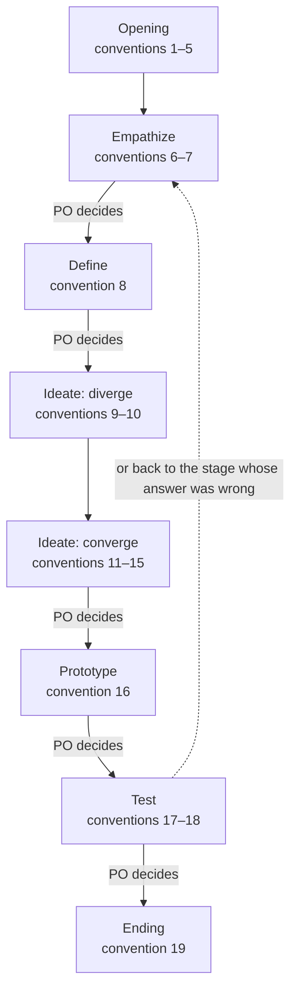

# Design Log Conventions

> Working conventions: reference, not law — follow what fits, override what doesn't, note why. Source labels and the rest: `../scrum-kernel/overview.md`, convention 15. A convention with no label is the author's practice.

The design log template is `design-backlog-template.md` in this folder. Paths here are relative to the design-kernel skill folder; the stages, the book's excerpts, and the methods are listed in this skill's `SKILL.md`. Where an excerpt describes the book's room — whiteboards, sticky notes, dot voting, a team at a table — these conventions say how a solo + AI team does that step, and they apply.

**The three loops.** Empathize and Define: the Product Owner puts in, and the session that plays the Scrum Master settles it with them and writes it into the log — the Designer joins at Ideate (convention 3). Diverge and converge: the AI does the work, a person picks the solution. Prototype and Test: the AI can run them on its own — the Product Owner may hand the decisions between them to the Scrum Master (`../scrum-kernel/overview.md`, convention 12), so the two stages run through without waiting.

Conventions 20–27 hold at every step; see Throughout, below. At each "PO decides" the Product Owner decides, as convention 26 says.

## Opening

1. **Open a design for a question with no ready answer** — When a question asks what people want or what counts as good, ask first whether a ready answer exists; if not, settle whether it needs a design sprint or the five modes (`../ideo-kernel/conventions/ideo-log.md`, convention 1); when it needs a design sprint, open a design and start with Empathize, not with solutions. A blank page — the product and its Product Goal cannot be written yet — is a case of this: the design's conclusions fill the product log (`../scrum-kernel/conventions/product-log.md`, convention 2).
2. **Hard point, not the whole item** — From a Sprint, take out only the hard point that needs design; the rest of the Sprint goes on.
3. **Who** — The Designer is accountable for the design, and the Scrum Master facilitates and records; what the Product Owner decides is listed in convention 21. Empathize and Define — the challenge, the design goal, the design questions, the map, and the How Might We questions — are settled by the Product Owner with the session that plays the Scrum Master, who writes them into the log; the Designer takes over at Ideate. A design often needs only one session; whether that session also plays the Scrum Master, or a separate Scrum Master session runs, is the Product Owner's call. When one session plays both roles, write the same name in both fields of the header; it settles Empathize and Define with the Product Owner itself.
4. **Branch** — A design opens its own branch when it opens; the on-the-spot decision is only its base — the Sprint branch or `main`. Do not name it `<sprint-branch>/<name>`: git cannot hold both `a` and `a/b` as branch names.
5. **Open a design** — Pick a suffix that says what the design is about, with no number; create `scrum/design-<suffix>/`; copy the template into it as `DesignBacklog.md`; fill in the header: where the design came from, the branch (convention 4), the Product Owner, the Designer, the Scrum Master, and the Now and Waiting for PO lines (convention 24). The folder holds the log, the prototypes, and the working material — sketches, gathered ideas, a grid of reactions; prototypes and working material never go into an Increment.

## Stages

The conventions under Stages cover only what differs from the book or adds what it leaves out; for everything else, follow the excerpts.

### Empathize

6. **Start from the people** — Start Empathize with the people concerned. When the Product Owner is the person concerned, ask first for concrete experiences — what happened, what they did, what they said — and only then ask for the Product Owner's call on what it means; otherwise start with users the Product Owner can bring. Documents and role cards come after. Write each finding where it belongs — in the challenge, the design goal, or the design questions — with its source, and say whether it is first-hand (what a person said or did) or second-hand (a record made for another purpose, or a role card's reading). Write the design goal as a vision: why we are doing this, and where we want to be — not how; a sentence that tells how belongs to Ideate. Keep the goal's one-row commitment table in section 1.2, as `../scrum-kernel/overview.md`, *Goal fixed, plan flexible*, says.
7. **Experts when needed** — Once you have heard the people concerned (convention 6), write the challenge, the design goal, and the design questions; ask experts and do research only when these are still unclear. The experts are the Product Owner, in the conversation, and the role cards (`../scrum-kernel/overview.md`, convention 7), each played by a fresh subagent. Before asking experts, draft a rough map (`steps/2-1-make-a-map.md`); the log keeps what changed, not each interview. After asking the experts or doing research, refine the challenge, the design goal, the design questions, and above all the map once more: fill the gaps and redraw the map.

### Define

8. **Map and questions in the log** — Draw the map as a Mermaid `flowchart TD`, actors at the top and the ending at the bottom, and keep it rough — five or six boxes and one loop. Draw the experience we want to reach, not what happens now: the way things are today, and where it hurts, go in chapter 1 with their sources (convention 6). *Departs from the book:* the book's step maps the situation as it is. Branches, exceptions, and solutions belong to the Ideate solution and storyboard, not in the map; if someone who never learned design cannot read it at a glance, a solution has been put inside. Write the How Might We questions against the map, with the challenge, the design goal, and the design questions of chapter 1 beside it. The map, together with the challenge, the design goal, and the design questions, is the point of view here; do not write a separate one. The Product Owner picks the How Might We questions that matter — no dot voting. There is no target step while the design runs; a design that began from a blank page picks its target when it ends (convention 19). If the map holds more than one design's worth of work, split the rest out into another design or into items (`steps/2-3-pick-a-target.md` shows how the book narrows a map).

### Ideate: diverge

9. **Lightning Demos (optional)** — When existing ideas would help, have subagents search for them in parallel; keep the list as working material, not part of the log. If subagents sketch (convention 11), the list is split among them, so that each starts from different ideas.
10. **Diverge before you converge** — Whoever sketches a solution — a subagent (convention 11), or the main thread with the Product Owner (convention 12) — diverges first: use at least two methods, at least one of them from the ideo-kernel's Ideate methods, as `SKILL.md` requires (the first steps of the book's sketch, `steps/3-2-sketch.md` — notes, ideas, Crazy 8s — may be used alongside), go for quantity, and hold judgment back — and only then converge into a sketch. When you brief a subagent, tell it so. The ideas are working material; they do not go into the log.

### Ideate: converge

11. **Isolated solutions (optional)** — When several solutions that differ in approach are wanted, have several fresh subagents, unable to see one another, each sketch one complete solution in words or Mermaid. Give each its own materials — chapters 1 and 2 and its own part of the gathered ideas, or none until it has drawn — together with `steps/3-2-sketch.md` and the ideo-kernel Ideate methods, and give any summary apart too: one summary handed to all of them makes the sketches converge on one idea (in one design, two subagents given the same summary of reference examples both drew a subway map). Beyond chapters 1 and 2, give it nothing about how things are solved today — no current design, rules, or code — and tell it not to read the project's files. Each diverges first (convention 10). Some tools hand the project's instructions to every subagent anyway; when that happens, note it in the design log. Without subagents, the main thread and the Product Owner sketch together (convention 12).
    *Decide on the spot:* whether to use subagents at all; how many, and on which model.
12. **Talk with the Product Owner** — Whether or not subagents sketch, the main thread asks the Product Owner whether they have ideas and talks them over, diverging first (convention 10), without rushing to converge. If the Product Owner has no idea, the main thread sketches one direction on their behalf, as one of the lines. All the lines — the subagents' sketches if there are any, the Product Owner's ideas, the main thread's own — come back to the main thread, are merged, and only then does it converge (convention 13).
13. **Choosing is the key step** — Run the book's decision (`steps/3-3-decide.md`) in the conversation, led by the Scrum Master; have role-card Stakeholders give a straw poll if the Product Owner wants one. The Product Owner makes the final call, with no search for consensus. Put only the chosen solution into section 3.1.
14. **Combine or rumble** — Combine winners that fit together; when two conflict, prototype both and let the test decide (`steps/3-4-rumble.md`). The Product Owner decides which.
15. **Storyboard** — Write a storyboard of about fifteen steps in section 3.2 (`steps/3-5-storyboard.md`) only when the solution needs one before the prototype; the Designer writes it.

### Prototype

16. **Just enough prototype** — *Supplement.* Build in the design folder, following the chosen solution, real enough for honest reactions (`steps/4-1-fake-it.md`): made quickly and thrown away after, while the surface the tester sees appears real. Subagents can build the parts while one session stitches them together; do a trial run against the solution and the design questions before testing, and write what it found in chapter 5. List each part of the prototype in chapter 4 with the design question it tests.
    *Decide on the spot:* how real the prototype must be when the product has no screen — a document, a service, a process; agree it with the Product Owner.

### Test

17. **Role-card test** — Test with role cards, each a fresh subagent given only its card, the prototype, and the tasks; the Product Owner tests too. The Designer runs the Five-Act Interview (`steps/5-2-interview.md`); a grid of reactions is working material; chapter 5 keeps who tested, what showed up, and the answer to each design question. The book tests five customers; here, test with the role cards the prototype is about — those who would meet it — and leave out the rest, and add runs while the patterns are unclear. When the thing is for the Product Owner alone, the Product Owner testing it is enough: do not make up a role card.
18. **Write the criteria before the test** — Before testing, write down in chapter 5 what would count as a yes, a no, or a not yet for each design question, and what role cards cannot show: they are subagents reading a card, not real people.

## Ending

19. **When the design ends** — End the design when its questions are answered or the Product Owner stops it. Write the conclusions into the product log as `../scrum-kernel/conventions/product-log.md`, convention 2, says, and pass them on to the Sprint that asked for the design; when the design began from a blank page, pick the target (`steps/2-3-pick-a-target.md`) — the steps of the map to build — and split it into items, and let the Product Owner order which come first. Delete the files in the design folder except the log and any prototype that is waiting for the Sprint that will build its conclusions (below); git keeps what is deleted. A prototype goes one of two ways. When its conclusions will be built, it goes to the Sprint that builds them, as that Sprint's specification: move it into the Sprint's folder, and it is deleted with that Sprint's working files when the Sprint closes (`../sprint-kernel/conventions/sprint-log.md`, convention 17); if no Sprint is open yet, leave it in the design folder until one is, and say in chapter 5 which Sprint gets it. A prototype whose conclusions will not be built is deleted now. A prototype never goes into an Increment. Handle the design's branch as `../sprint-kernel/conventions/sprint-log.md`, convention 19, says: merge it into its base (convention 4), then delete it. A design has no Review or Retro of its own: the first Sprint Review after the design ends archives its log (`../sprint-kernel/conventions/sprint-log.md`, convention 17), and the lessons from the design go into that Sprint's Retrospective. At the end of chapter 5, next to the Product Owner's decision, write a line or two on what the design taught about how to work, to keep for that Retrospective.

## Throughout

20. **IDEO in every stage** — Each stage of the design sprint stands on one IDEO mode: take the methodology from the mode the stage maps to, as `SKILL.md` requires. (The five modes are not the design sprint: `../ideo-kernel/conventions/ideo-log.md`, convention 2.)
21. **Ask the PO** — Ask the Product Owner whenever you are unsure (`../scrum-kernel/overview.md`, convention 10), and in any case to: decide at the end of each stage, and after the test whether to end the design or go back (convention 26); set or change the design goal (convention 25); pick the How Might We questions that matter (convention 8); choose the solution and decide between combining and a rumble (conventions 13–14); agree how real the prototype must be (convention 16); and decide that the design ends (convention 19).
22. **Five chapters, not five days** — Write one chapter per stage — Empathize, Define, Ideate, Prototype, Test — not the book's Monday to Friday, and no notes section. Each chapter records what its stage produced, not the steps taken.
23. **Renamed terms** — See the first paragraph of `SKILL.md`.
24. **Resume from the header** — Keep `> Now:` in the header with the stage and next step, followed immediately by `> Waiting for PO:` with each pending decision's number and short question, separated by semicolons, or `None`. Update both with the log change that causes them; a session that picks up the design reads them first. Before a session ends or its context is shortened, write the half-finished work into the chapter it belongs to, update the header, and commit.
25. **Goal fixed, plan flexible** — Sharpen the design goal during Empathize; once it is set, only the Product Owner changes it. The questions, the map, and the solution may change with what the work shows; write what changed and why in the chapter it belongs to (`../scrum-kernel/overview.md`, convention 17).
26. **Gates between stages** — At the end of each stage, check the log against the gate below; before the decision, read this design's exact goal from its section 1.2 commitment table — and the Product Goal too when the decision concerns product direction — check the stage against it, and write the exact text into the log, on the line that records the decision. If the exact text cannot be read from the log, the decision is not valid until it can. Show the Product Owner the text only when the goal has changed, when the decision concerns product direction, or when they ask to see it. The Product Owner decides (`../scrum-kernel/overview.md`, *Product Owner decides between stages*). After the Test, the decision is to end the design or to go back to the stage whose answer was wrong.

    | Stage | The log holds | The check |
    | --- | --- | --- |
    | Empathize | the challenge, the design goal, and the design questions, with the source of each finding | The findings come from the people concerned — what they did, what they said, where the two differ — not from a pile of facts |
    | Define | the map and the How Might We questions the Product Owner picked | The How Might We questions were written against the map and the challenge, the goal, and the questions of chapter 1 |
    | Ideate | the chosen solution, and the storyboard if one was written | Whoever sketched diverged before converging, and when several sketches were drawn, they differ in approach, not only in detail |
    | Prototype | the parts of the prototype, each with the design question it tests | It is rough, quick, and thrown away after: built to learn, not to deliver |
    | Test | the criteria written beforehand, what the trial run found, who tested and what showed up, and an answer to each design question with where it flows back | The answers come from real reactions, and "we were wrong" counts as an answer |

    At each gate ask: would someone who never learned design have produced the same thing? If so, the stage missed its focus.
27. **A small design is still a design** — Whether a question opens a design at all is settled by `../ideo-kernel/conventions/ideo-log.md`, convention 1. When the Product Owner opens a design that is small — about one session of work — still keep the log, shrink each stage to a line or two, and still have the Product Owner decide at the end of each stage. Skip no stage, least of all Empathize and divergence (convention 10).
