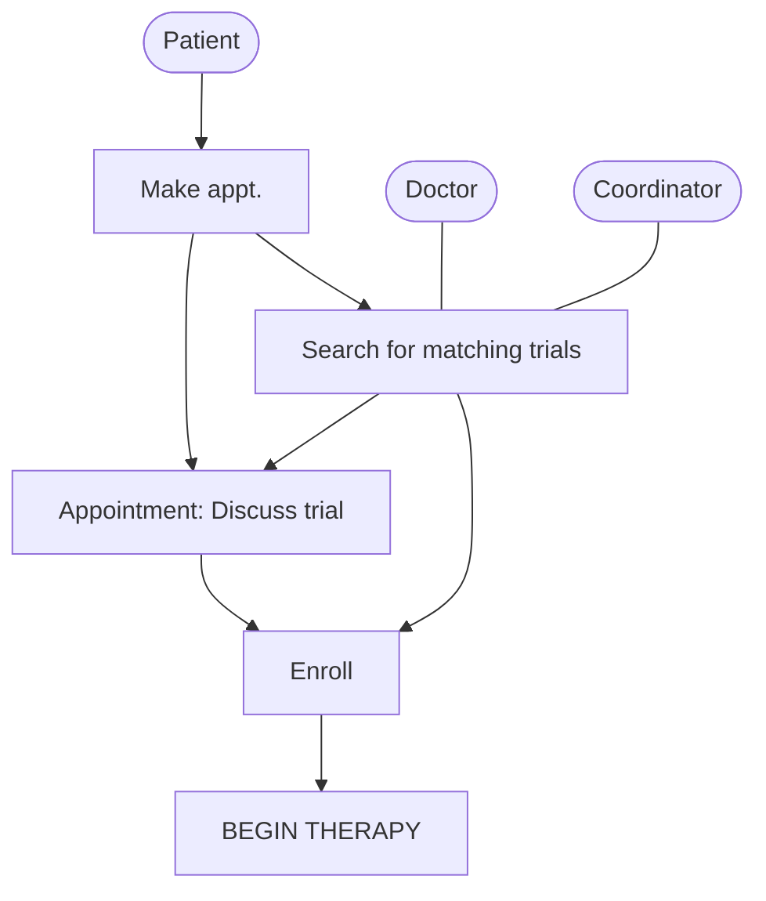
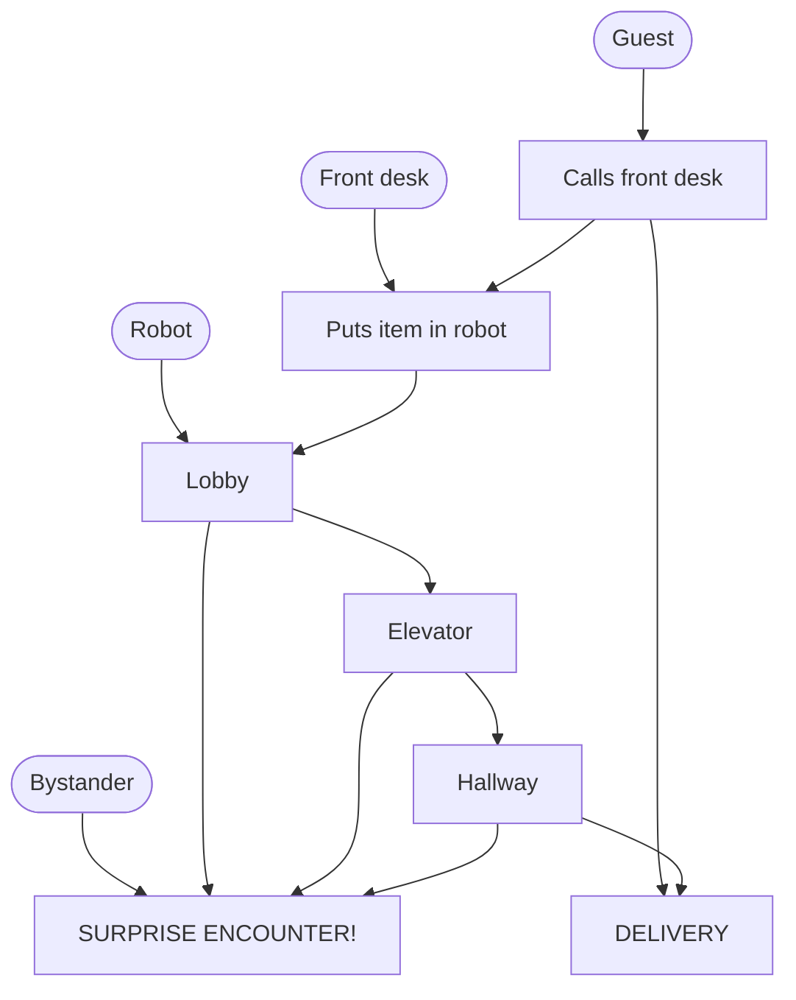
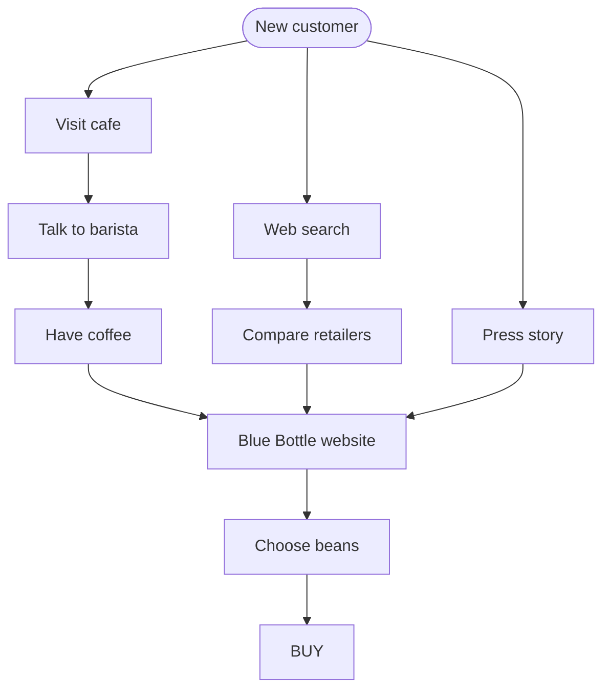

# Map

> Source: Knapp, J., Zeratsky, J., & Kowitz, B. (2016). *Sprint: How to Solve Big Problems and Test New Ideas in Just Five Days.* Simon & Schuster. Chapter: "Map."
> License: All rights reserved (see ATTRIBUTION.md).
> Excerpt: the book's own text, with parts that do not apply to a solo + AI team removed; nothing reworded. Figures that explain a method are redrawn as Mermaid diagrams or text; the others are left out. Day names, clock times, and timers are the book's schedule, not an instruction.

J.R.R. Tolkien’s The Lord of the Rings is an epic adventure, spanning three volumes and hundreds of pages. There are invented languages, histories, backstories, and subplots galore. It’s an awesome story, but it’s also complicated.

Frankly, it’s easy to get confused while reading The Lord of the Rings. But Tolkien’s got your back. At the beginning of the book is a map. As the characters travel through locations such as Mount Doom, the Mines of Moria, and the Misty Mountains, the reader can flip to the map and remind herself where the action’s happening and how it all fits together.

The map you’ll create on Monday isn’t so different: a simple diagram representing lots of complexity. Instead of elves and wizards moving through Middle Earth, your map will show customers moving through your service or product. Not quite as thrilling, but every bit as useful.

The map is a big deal throughout the week. At the end of the day on Monday, you’ll use the map to narrow your broad challenge into a specific target for the sprint. Later in the week, the map will provide structure for your solution sketches and prototype. It helps you keep track of how everything fits together, and it eases the burden on each person’s short-term memory.

But there’s one quality these maps do not have in common with the map from The Lord of the Rings: They’re simple. No matter how complicated the business challenge, it can be mapped with a few words and a few arrows. To show you what we mean, we’d like to introduce you to Flatiron Health—a company with a very complex challenge and a very simple map.

Flatiron wanted to make trials available to anyone who was eligible. They hoped to build a software tool to help cancer clinics match patients to trials—a painstaking job to do manually, and perhaps the biggest hurdle to trial enrollment. Patients with common forms of cancer might qualify for trials reexamining the efficacy of standard treatment. Patients with rare forms of the disease might qualify for a new, highly targeted therapy. There were so many unique patients and so many trials that it was too much for any human to track.

In the morning, we completed our Start at the End exercises. Choosing the goal (“More patients enrolled in clinical trials”) was easy. We turned our attention to identifying the big sprint questions.

“We have to be fast,” said Amy. She has an unusual accent: equal parts Australia (where she earned her PhD in medicine) and North Carolina (where she spent years running cancer research at Duke University). “If you’ve just been diagnosed with cancer, you can’t sit around while every clinical trial is considered. You’ve got to start treatment now.”

Jake uncapped his whiteboard marker and thought for a moment, trying to turn the problem into a question. Then he wrote on the whiteboard for everyone to see, Can we find matches fast enough?

“Each clinic already has its own ingrained process,” said Alex, the product manager. “These are teams of people who have been working together in the same way for years. We’ve got to offer something drastically better than the status quo, or they’re not going to change their workflow.” Jake added, Will clinics change their workflow?

With the sprint questions listed, we started on the map. Michael Margolis and Alex Ingram had interviewed staff at cancer clinics, and with help from Amy, they told us how trial enrollment worked.

To match patients with trials, doctors and research coordinators look at long lists of trial requirements: treatment history, blood count, DNA mutations in the cancer cells, and much more. As cancer care has become more sophisticated and targeted, those requirements have gotten more specific. “For a given trial, you might be talking about a handful of eligible patients across the country,” said Amy. “It’s like looking for needles in a haystack.”

> **LONG TERM GOAL:** More patients enrolled in trials.
>
> **SPRINT QUESTIONS**
>
> - Can we find matches fast enough?
> - Will clinics change their workflow?

*Flatiron Health’s long-term goal and sprint questions. (Redrawn from the book.)*

It was an intricate and messy system. But, after an hour of discussion and a lot of revision, we were able to create a simple map:

*Flatiron Health’s clinical trial enrollment map. (Redrawn from the book.)*

On the left was a list of the people involved in trial enrollment: the patient and the doctor (who were central to the treatment decision) and the clinic’s research coordinator (who was easy to overlook but might be the best informed about trial availability). From there, the map showed the patient scheduling an appointment, the doctor and staff searching for matching trials, the appointment, the complete enrollment, and finally, the beginning of treatment.

Behind those few simple steps were all kinds of difficulties with the enrollment process: overworked staff, missing data, and communication gaps. As Amy had explained to us, many of the doctors who were supposed to suggest trials didn’t even know which trials were open at their clinic. In the afternoon, we would have time to go through all of the problems and opportunities. But for now, with this map, we had enough to start.

Flatiron Health had a complicated problem and a straightforward map. Your map should be simple, too. You won’t have to capture every detail and nuance. Instead, you’ll just include the major steps required for customers to move from beginning to completion, in this case from cancer diagnosis to trial enrollment.

Let’s look at a couple more examples. (For bonus points, see if you can spot the common elements in every map.) On Monday of their sprint, Savioke had to organize information about robotics, navigation, hotel operations, and guest habits. This is their map:

*Savioke’s robot delivery map. (Redrawn from the book.)*

On the first day of their sprint, Blue Bottle Coffee sorted through information about coffee selection, customer support, café operations, and distribution channels. Here is their map:

*Blue Bottle Coffee’s online sales map. (Redrawn from the book.)*

The common elements? Each map is customer-centric, with a list of key actors on the left. Each map is a story, with a beginning, a middle, and an end. And, no matter the business, each map is simple. The diagrams are composed of nothing more than words, arrows, and a few boxes. So now that you know what a map looks like, you’re ready to make your own.

## Make a map

You’ll draw the first draft of your map on Monday morning, as soon as you’ve written down your long-term goal and sprint questions. Use the same whiteboard you wrote your goal on and dive in. When we’re drawing our maps, we follow these steps:

### 1. List the actors (on the left)

The “actors” are all the important characters in your story. Most often, they’re different kinds of customers. Sometimes, people other than customers—say, your sales team or a government regulator—are important actors and should be listed as well. And sometimes, of course, there’s a robot.

### 2. Write the ending (on the right)

It’s usually a lot easier to figure out the end than the middle of the story. Flatiron’s story ended with treatment. Savioke’s story ended with a delivery. And Blue Bottle’s story ended with buying coffee.

### 3. Words and arrows in between

The map should be functional, not a work of art. Words and arrows and the occasional box should be enough. No drawing expertise required.

### 4. Keep it simple

Your map should have from five to around fifteen steps. If there are more than twenty, it’s probably too complicated. By keeping the map simple, the team can agree on the structure of the problem without getting tied up in competing solutions.

### 5. Ask for help

As you draw, you should keep asking the team, “Does this map look right?”

You should be able to make the first quick draft of your map in thirty to sixty minutes. Don’t be surprised if you continue to update and correct it throughout the day as you discuss the problem. We never get ours right the first time, but you have to start somewhere.

At this point, you will have reached an important milestone. You have a rough draft of your long-term goal, sprint questions, and map. You can already see the basic outline of your sprint: the unknowns you’ll try to answer in Friday’s test and the plotline of your solutions and prototype. The long-term goal is your motivation and your measuring stick.

For the rest of the day, you’ll interview the experts on your team to gather more information about the problem space. As you go, you’ll add more questions, make updates to your map, and perhaps even adjust the phrasing of your long-term goal. And you’ll take notes as a team, to add more depth to the map on the whiteboard.

Your job on Monday afternoon will be to assemble one cohesive picture from everyone’s pooled knowledge and expertise.
