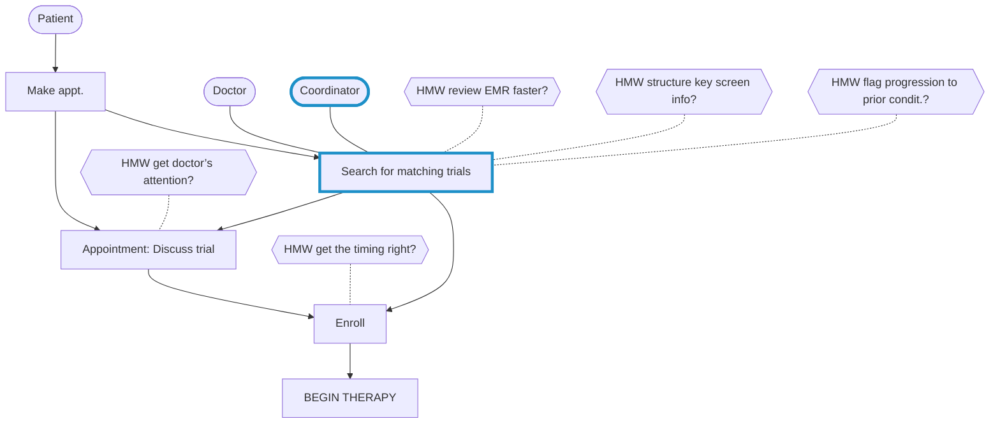

# Target

> Source: Knapp, J., Zeratsky, J., & Kowitz, B. (2016). *Sprint: How to Solve Big Problems and Test New Ideas in Just Five Days.* Simon & Schuster. Chapter: "Target."
> License: All rights reserved (© Jake Knapp, John Zeratsky, and Braden Kowitz; Simon & Schuster, 2016).
> Excerpt: the book's own text, with parts that do not apply to a solo + AI team removed; nothing reworded. Figures that explain a method are redrawn as Mermaid diagrams or text; the others are left out. Day names, clock times, and timers are the book's schedule, not an instruction.

In 1948, a young scientist named Marie Tharp moved to New York and found a job in the geology department at Columbia University. There she took on an unusual assignment: making the world’s first detailed map of the ocean floor. Tharp plotted thousands of sonar soundings with painstaking precision. Where there were gaps between data points, she used her expertise in geology and math to figure out what was missing.

As Tharp inked her map, she discovered something surprising. What had appeared to be isolated undersea mountains were in fact one long, interconnected chain of volcanic ranges and deep valleys. It jumped right out of her map: a thick, unbroken band stretching for thousands of miles.

Today, you can easily see the Mid-Ocean Ridge (as it’s now known) using Google Earth. In the Atlantic Ocean the ridge shows up as a dark blue line snaking from the waters north of Greenland, through Iceland, and all the way into the South Atlantic. There, at tiny Bouvet Island, it connects with another jagged blue band and runs east toward the Indian Ocean. On and on it goes, one ridge connecting to another, from ocean to ocean, around the entire earth.

Tharp was the first to see it. The ridge, she hypothesized, was a massive crack where the earth’s shell pulled apart. At the time, plate tectonics—the idea that giant pieces of the earth’s crust are in constant motion, moving continents and shaping landscapes—was generally considered to be a wacky idea. But it was difficult to argue with Tharp’s map. By the late 1960s, plate tectonics was accepted as fact.

---

At the end of the day on Monday, you’re set up for a Marie Tharp moment. Tharp didn’t go looking for the Mid-Ocean Ridge, but when she compiled the data and made a map, she couldn’t miss it. After interviewing the experts and organizing your notes, the most important part of your project should jump right out of your map, almost like a crack in the earth.

Your final task on Monday is to choose a target for your sprint. Who is the most important customer, and what’s the critical moment of that customer’s experience? The rest of the sprint will flow from this decision. Throughout the week, you’ll be focused on that target—sketching solutions, making a plan, and building a prototype of that moment and the events around it.

Savioke decided to target the hotel guest (rather than the hotel staff) and to focus on the moment of delivery (rather than the elevator or lobby). The other scenarios were important, but the biggest risk and opportunity were at the guestroom door. And they knew that if they got the delivery right, they could apply what they learned elsewhere.

Blue Bottle Coffee decided to target their most challenging audience: Customers who had never heard of their cafés and who were shopping for beans they had never tasted. If they could convince strangers that their beans were worth buying, they could be sure the new online store would work well for their fans.

What about Flatiron Health? They had plenty of viable targets. They might try to help patients better understand how the clinical trials worked, and that they wouldn’t be treated as guinea pigs. They might try to streamline the many steps that happened after patients agreed to a trial. They might send a message to doctors before every appointment, reminding them to consider a trial therapy. The possibilities went on and on, but Amy, the Decider, had to pick one target.

Everyone had a chance to share an opinion about what we should focus on. Bobby Green, the VP of clinical strategy, thought it would be best to build a tool for doctors. The engineers wanted to focus on research coordinators. Both had excellent arguments.

At last, it was time to make the final decision about where to focus the sprint. Amy needed to choose one target customer and one target moment on the map. Those of us from GV were bracing for a long discussion. But when Jake asked Amy if she was ready, she nodded and grabbed a marker.

“Right here.” Amy made two circles on the whiteboard:

*Flatiron Health’s map, with target customer and target moment. (Redrawn from the book.)*

“The research coordinators,” she said, “when they’re searching to see if a new patient matches a trial. It’s the top of the funnel, where we can evaluate the most patients. And it’s the coordinators’ primary job to match patients with trials. We won’t be competing for attention like we would be with the doctors.”

Around the room, the Flatiron team nodded, as if Amy’s choice was obvious. We looked at Bobby Green. Earlier that afternoon, he’d made a great argument for focusing on doctors, since they were closer to the treatment decision. Like Amy, Bobby was an oncologist, and he’d spent years running a cancer clinic. He knew what he was talking about. But Bobby had come around. “Doctors’ behavior is tough to change, and our system won’t be perfect at first. The research coordinators will be more tolerant when we make mistakes.”

“This is the right target,” Amy said. “If we can help coordinators find more matches, it’ll be a giant first step.”

---

In all of our sprints with startups, we’ve never encountered anything more convoluted than clinical trial enrollment. Yet for Amy, the target was as obvious as the Mid-Ocean Ridge. It jumped right out of the map. And the rest of the team found it easy to commit to her decision.

Of course, we shouldn’t have been surprised. Amy wasn’t the Decider by accident. She had deep expertise and a strong vision. As for the rest of the team? Throughout the day, they had all heard the same information, seen the same notes, and agreed to the same map. Everyone had a chance to register his or her opinion. By Monday afternoon, they had clarity about the challenge, the opportunity, and the risk. The target was obvious to them, too.

Once you’ve clustered your team’s How Might We notes, the decision about where to focus your sprint will likely be easy. It’s the place on your map where you have the biggest opportunity to do something great (and also, perhaps, the greatest risk of failure).

## Pick a target

The Decider needs to choose one target customer and one target event on the map. Whatever she chooses will become the focus of the rest of the sprint—the sketches, prototype, and test all flow from this decision.

### Ask the Decider to make the call

It’s easiest if the Decider just makes the decision without a lot of discussion and process. After all, you’ve been discussing and processing all day. By Monday afternoon, most Deciders will be able to make the decision as easily as Amy did. But sometimes, the Decider wants input before she chooses. If that’s the case, conduct a quick, silent “straw poll” to collect opinions from the team.

### Straw poll (if the Decider wants help)

Ask everyone on the team to choose the customer and the event each of them believes are most important and to write down those choices on a piece of paper. Once everyone has privately made a selection, register the votes on the map with a whiteboard marker. After the votes have been tallied, discuss any big differences of opinion. That should be enough input for the Decider. Turn it back over to her for the final decision.

Once you’ve selected a target, take a look back at your sprint questions. You usually can’t answer all those questions in one sprint, but one or more should line up with the target. In our sprint with Flatiron, the target (coordinators searching for matching trials) matched the sprint question “Will clinics change their workflow?” By testing a solution with real coordinators, we hoped to learn the answer.

> **LONG TERM GOAL:** More patients enrolled in trials.
>
> **SPRINT QUESTIONS**
>
> - Can we find matches fast enough?
> - **Will clinics change their workflow?** ← matches the target

*Flatiron Health’s target matched one of their sprint questions. (Redrawn from the book.)*

By Monday afternoon, you’ve identified a long-term goal and the questions to answer along the way. You’ve made a map and circled the target for your sprint. Everyone on the team will have the same information, and everyone will understand the week’s objective. Next, on Tuesday, it’ll be time to come up with solutions.
