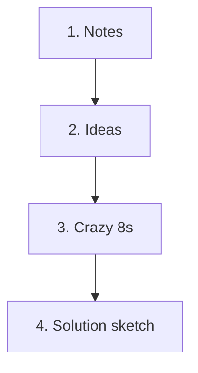

# Sketch

> Source: Knapp, J., Zeratsky, J., & Kowitz, B. (2016). *Sprint: How to Solve Big Problems and Test New Ideas in Just Five Days.* Simon & Schuster. Chapter: "Sketch."
> License: All rights reserved (© Jake Knapp, John Zeratsky, and Braden Kowitz; Simon & Schuster, 2016).
> Excerpt: the book's own text, with parts that do not apply to a solo + AI team removed; nothing reworded. Figures that explain a method are redrawn as Mermaid diagrams or text; the others are left out. Day names, clock times, and timers are the book's schedule, not an instruction.

On Tuesday afternoon, it’s time to come up with solutions. But there will be no brainstorming; no shouting over one another; no deferring judgment so wacky ideas can flourish. Instead, you’ll work individually, take your time, and sketch.

Even though we’re total tech nerds, we’re believers in the importance of starting on paper. It’s a great equalizer. Everyone can write words, draw boxes, and express his or her ideas with the same clarity. If you can’t draw (or rather, if you think you can’t draw), don’t freak out. Plenty of people worry about putting pen to paper, but anybody—absolutely anybody—can sketch a great solution.

To show you what we’re talking about, let’s take a look at one of the sketches that came out of Blue Bottle Coffee’s sprint—a solution called “The Mind Reader.” Each sticky note represents one page on Blue Bottle’s website.

The big idea behind “The Mind Reader” was to organize the online store the same way a barista might talk with a customer. As you can see in the three frames, this solution leads with a welcome, then asks how the customer prepares coffee at home, before offering recommendations and a brewing guide. There’s a lot of complexity to the idea, but the drawing itself was straightforward: mostly boxes and text, the kind of thing anyone can draw.

See, Tuesday afternoon is about sketching, but more importantly, it’s about solutions. When your team evaluates these sketches on Wednesday to decide which are best, and when you test your prototype on Friday, it will be the quality of the solutions that matters, not the artistry of the drawings from which they came.

## The power of sketching

On Tuesday, we’re not asking you to sketch because we think it’s fun. We’re asking you to sketch because we’re convinced it’s the fastest and easiest way to transform abstract ideas into concrete solutions. Once your ideas become concrete, they can be critically and fairly evaluated by the rest of the team— without any sales pitch. And, perhaps most important of all, sketching allows every person to develop those concrete ideas while working alone.

## Work alone together

We know that individuals working alone generate better solutions than groups brainstorming out loud. Working alone offers time to do research, find inspiration, and think about the problem. And the pressure of responsibility that comes with working alone often spurs us to our best work.

But working alone isn’t easy. The individual has to not only solve the problem, but also invent a strategy for solving the problem. If you’ve ever sat down to work on a big project and wound up reading the news instead, you know how hard this work can be.

In our sprints, we work alone, but we follow specific steps to help everyone focus and make progress. When each person sketches alone, he or she will have time for deep thought. When the whole team works in parallel, they’ll generate competing ideas, without the groupthink of a group brainstorm. You might call this method “work alone together.”

The sketches you create on Tuesday will become the fuel for the rest of the sprint. On Wednesday, you’ll critique everyone’s sketches and pick the best ones. On Thursday, you’ll turn them into a prototype. And on Friday you’ll test the ideas with customers. That’s a lot of mileage out of a few drawings, and it might make you think we’re expecting a work of genius straight out of Leonardo da Vinci’s notebook. Not so. To put the power of the sketch in perspective, let’s check out a few more solutions from the Blue Bottle sprint:

As you can see, these sketches are detailed, but they’re not works of art. Each sketch consists of words, boxes, and the occasional stick figure, drawn on normal printer paper and normal sticky notes with a normal pen.

That blank sheet of paper always intimidates us. So, inspired by productivity expert David Allen, we break the process into steps. In his book Getting Things Done, Allen provides a smart strategy for daunting jobs. The secret, Allen writes, is not to think about the task as one monolithic effort (like “Pay taxes”), but instead to find the first small action needed to make progress (like “Collect tax paperwork”) and go from there.

## The four-step sketch

When Jake first started running sprints, he tried to re-create his own most successful work sessions. He was most effective when he took time to “boot up” by reviewing key information, started his design work on paper, considered multiple variations, and then took time to create a detailed solution. And, since Jake is a world-class procrastinator, he was also most effective when under a tight deadline.

*(The four-step sketch. Redrawn from the book.)*

The four-step sketch contains each of these important elements. You’ll start with twenty minutes to “boot up” by taking notes on the goals, opportunities, and inspiration you’ve collected around the room. Then you’ll have another twenty minutes to write down rough ideas. Next, it’s time to limber up and explore alternative ideas with a rapid sketching exercise called Crazy 8s. And finally, you’ll take thirty minutes or more to draw your solution sketch—a single well-formed concept with all the details worked out.

### 1. Notes

This first step is super-easy. You and your team will walk around the room, look at the whiteboards, and take notes. These notes are a “greatest hits” from the past twenty-four hours of the sprint. They’re a way to refresh your memory before you commit to a solution.

First, copy down the long-term goal. Next, look at the map, the How Might We questions, and the notes from your Lightning Demos. Write down anything that looks useful. Don’t worry about coming up with any new ideas, and don’t worry about being neat. These notes are for your eyes only.

Give your team twenty minutes to take notes. During this time, feel free to look up reference material on your laptop or phone. Sometimes people want to take a second look at something they saw in the morning’s Lightning Demos or research some specific details from their company’s own product or website. Whatever the purpose, this moment is a rare exception to the no-devices rule. And don’t forget to reexamine old ideas. Remember, they’re often the strongest solutions of all.

At the end of notes time, the team closes their laptops and phones. Take another three minutes to review what you wrote down. Circle the notes that stand out. They’ll help you in the next step.

### 2. Ideas

Now that everyone has a pile of notes, it’s time to switch into idea mode. In this step, each person will jot down rough ideas, filling a sheet of paper with doodles, sample headlines, diagrams, stick figures doing stuff—anything that gives form to his or her thoughts.

It doesn’t matter if these ideas are messy or incomplete. Just like the notes, these pages won’t be shared with the whole team. Think of them as a “scratch pad.” And there’s no wrong way to do it. As long as everyone is thinking and writing stuff on paper, you’re on the golden path.

Take twenty minutes for idea generation. When you’re finished, spend an extra three minutes to review and circle your favorite ideas. In the next step, you’ll refine those promising elements.

### 3. Crazy 8s

Crazy 8s is a fast-paced exercise. Each person takes his or her strongest ideas and rapidly sketches eight variations in eight minutes. Crazy 8s forces you to push past your first reasonable solutions and make them better, or at least consider alternatives.

And before you get the wrong idea, the “crazy” in Crazy 8s refers to the pace, not the nature of the ideas. Forget about the traditional brainstorm advice to be goofy. We want you to focus on good ideas—the ones you believe will work and help you hit your goals—and use Crazy 8s to tweak and expand on those good ideas.

The exercise works best when you sketch several variations of the same idea. Take a favorite piece from your ideas sheet and ask yourself, “What would be another good way to do this?” Keep going until you can’t think of any more variations, then look back at your ideas sheet, choose a new idea, and start riffing on it instead.

Crazy 8s is also a great writing exercise. If your idea contains words or marketing headlines or any other bits of text, you can use Crazy 8s to improve your phrasing. As you’ll see in the next step, writing is often the most important component of the solution sketch.

Sometimes Crazy 8s leads to a revelation. You might come away with several new ways of looking at your ideas. Other times, it feels less productive. Sometimes that first idea really is the best idea. Either way, Crazy 8s helps you consider alternatives—and also serves as an excellent warm-up for the main event.

### 4. Solution sketch

Remember how we kept saying, “Don’t worry, nobody’s going to look at this”? That time is over. The solution sketch is each person’s best idea, put down on paper in detail. Each one is an opinionated hypothesis for how to solve the challenge at hand. These sketches will be looked at—and judged!—by the rest of the team. They need to be detailed, thought-out, and easy to understand.

Each sketch will be a three-panel storyboard drawn on sticky notes, showing what your customers see as they interact with your product or service. We like this storyboard format because products and services are more like movies than snapshots. Customers don’t just appear in one freeze frame and then disappear in the next. Instead, they move through your solution like actors in a scene. Your solution has to move right along with them.

We usually use the three-panel format, but there are exceptions. Sometimes, a sprint will be focused on a single part of the customer experience. For instance: the home page, the front page of a medical report, the office lobby, or even the cover of a book. If your team has a “single scene” challenge, you might want to create a full-page sketch so you can show even more detail.

With either format, there are a few important rules to keep in mind:

#### 1. Make it self-explanatory

On Wednesday morning, you’ll post your sketch on the wall for everyone to see. It needs to explain itself. Think of this sketch as the first test for your idea. If no one can understand it in sketch form, it’s not likely to do any better when it’s polished.

#### 2. Keep it anonymous

Don’t put your name on your sketch, and be sure that everyone uses the same paper and the same black pens. On Wednesday, when you evaluate everyone’s sketch, this anonymity will make it much easier to critique and choose the best ideas.

#### 3. Ugly is okay

Your sketch does not have to be fancy (boxes, stick figures, and words are fine), but it does have to be detailed, thoughtful, and complete. Be as neat as you can, but don’t worry if you’re not much of an artist. However ...

#### 4. Words matter

We’ve used sprints with startups in all kinds of industries. One surprising constant: the importance of writing. Strong writing is especially necessary for software and marketing, where words often make up most of the screen. But choosing the right words is critical in every medium. So pay extra close attention to the writing in your sketch. Don’t use “lorem ipsum” or draw those squiggly lines that mean “text will go here.” That text will go a long way to explain your idea—so make it good and make it real!

#### 5. Give it a catchy title

Since your name won’t be on your sketch, give it a title. Later, these titles will help you keep track of the different solutions as you’re reviewing and choosing. They’re also a way to draw attention to the big idea in your solution sketch. (Byard Duncan titled his “The Mind Reader,” partly for fun and partly to highlight the idea of making the perfect coffee match.)

Each person is responsible for creating one solution sketch. If a few folks get inspired and want to sketch more than one, that’s okay, but don’t overdo it. Each additional sketch means more work reviewing and narrowing down on Wednesday. Not only that, but we’ve noticed that the first batch tend to be the strongest and there are diminishing returns beyond ten to twelve solution sketches. Thirty minutes should be enough time for everyone to finish one sketch.

Once everybody is finished, put the solution sketches in a pile, but resist the urge to look at them. You’ll only see them for the first time once, and you should save those fresh eyes for Wednesday.

By Wednesday morning, you and your team will have a stack of solutions. That’s great, but it’s also a problem. You can’t prototype and test them all—you need one solid plan. In the morning, you’ll critique each solution, and decide which ones have the best chance of achieving your long-term goal. Then, in the afternoon, you’ll take the winning scenes from your sketches and weave them into a storyboard: a step-by-step plan for your prototype.
