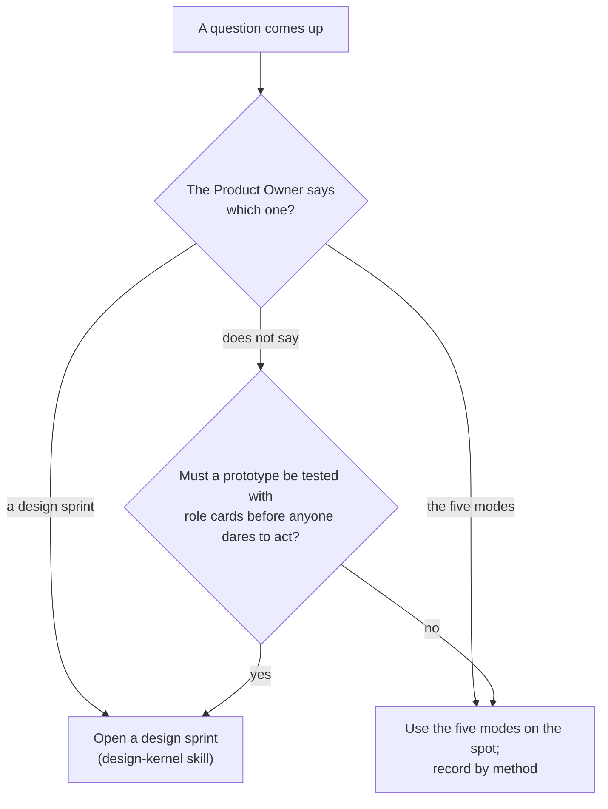

# Conventions — Design Sprint or the Five Modes

> Working conventions: reference, not law — follow what fits, override what doesn't, note why. Source labels and the rest: `../scrum-kernel/overview.md`, convention 15. A convention with no label is the author's practice.

Paths here are relative to the ideo-kernel skill folder. The five modes and the method catalog are this skill's; the design sprint — a research module from a challenge to a tested prototype — is the design-kernel skill's.

## Which One

1. **Design sprint or the five modes** — The Product Owner says which one a question gets. When they do not, the default split is: open a design sprint when a prototype must be tested with role cards before anyone dares to act; otherwise use the five modes on the spot and record by method — each method's output goes into the log it serves (a Sprint's Increment notes, the product log's Notes). A design sprint is the heavy one — a research module beside the Sprint, with its own log and stages; the five modes are the base, with few rules. When a chat turns up something to research, you can open the design there and then: the chat counts as empathize material, and the Empathize stage still runs.
