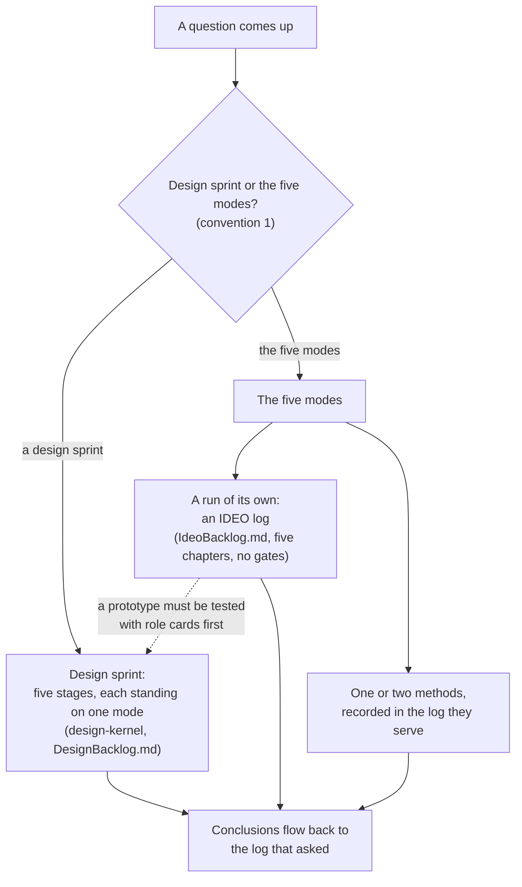

# IDEO Log Conventions

> Working conventions: reference, not law — follow what fits, override what doesn't, note why. Source labels and the rest: `../scrum-kernel/overview.md`, convention 15. A convention with no label is the author's practice.

Paths here are relative to the ideo-kernel skill folder. The five modes and the method catalog are this skill's; the design sprint is the design-kernel skill's.

## The Boundary

1. **Design sprint or the five modes** — The Product Owner says which one a question gets. When they do not, the default split is: open a design sprint when a prototype must be tested with role cards before anyone dares to act; otherwise use the five modes; convention 3 says how to record them. When a chat turns up something to research, you can open the design there and then: the chat counts as empathize material, and the Empathize stage still runs.

## The Two Together

2. **The five modes and the design sprint** — They share five names and are two different things. The five modes are modes, not stages: no fixed order, you can go back and forth, and they are the plugin's base and shared toolbox. The design sprint's five stages each stand on one mode, and add the book's steps, a Product Owner decision between stages, and a prototype tested with role cards — a heavy research module beside the Sprint. What a user calls "the IDEO five-stage method" is the five modes themselves, not the design sprint. Do not mix them: an IDEO log does not run the design sprint's steps (no map, Lightning Demos, or storyboard), and a design sprint does not open an IDEO log — its own log already has five chapters. If an IDEO log shows that a prototype must be tested with role cards before anyone dares to act, switch to a design sprint; the IDEO log counts as empathize material, and the Empathize stage still runs.

## The IDEO Log

3. **When to open an IDEO log** — Use one or two methods when that is enough; their output goes into the log they serve — a Sprint's Increment notes, the product log's Notes. When the five modes make a run of their own — more than one or two methods, or more than one session — open an IDEO log: `scrum/ideo-<suffix>/IdeoBacklog.md`, five chapters, one per mode, with no Product Owner gate between them (how this differs from a design sprint: convention 2). Each chapter holds what that mode produced, not every step taken. Before a mode, read its file in `IDEO-modes/`; before a method, read the method's file, as this skill's Use Protocol says.
4. **Where it lives and how it ends** — The log, the prototypes, and the working material live in `scrum/ideo-<suffix>/`. It has no commitment of its own: For holds the relative path to the product log or sprint log it serves, where the commitment is kept. Keep `> Now:` on its own header line with the current mode and next step, followed by `> Waiting for PO:` with the number and short question of each pending decision, separated by semicolons, or `None`. Update both with the log change that causes them; this adds no gate between modes. The conclusions flow back to the log that asked for it — the product log or the sprint log — and the Product Owner decides what changes. When the work is done, keep the log: the first Sprint Review after that archives it (`../sprint-kernel/conventions/sprint-log.md`, convention 17). A prototype whose conclusions will be built goes to the Sprint that builds them, as that Sprint's specification (`../design-kernel/conventions/design-log.md`, convention 19); any other prototype is deleted when the work is done.
