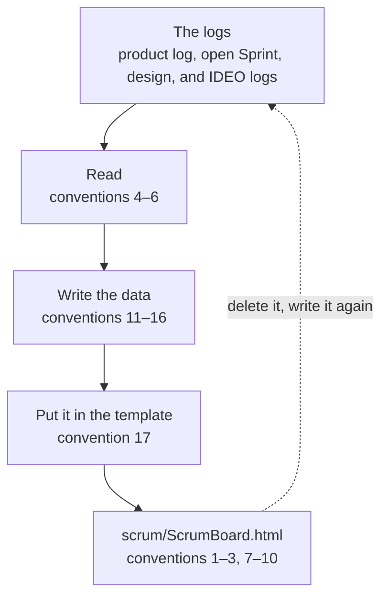

# Scrum Board Conventions

> Working conventions: reference, not law — follow what fits, override what doesn't, note why. Source labels and short names are explained in convention 15 of `overview.md`, in the skill folder, beside `SKILL.md`. A convention with no label is the author's practice.

The Scrum board is one page that shows where the project stands. Its template is `scrum-board-template.html`, beside this file; this file is also the brief for whoever writes the page. Paths starting with `../` are relative to the scrum-kernel skill folder.

## What the board is

1. **One board for the project** — Keep one page for the whole project: the product, the items not done, and every open Sprint and design. It answers one question without opening a log: where does the project stand, and what is each line of work doing. It is meant to be glanced at — hung on a screen, read from a few steps away, on a wide screen, a portrait screen, or a phone — so it shows few things, and shows them large.
2. **It owns nothing** — The board only reads the logs. It keeps no state, and no log is ever changed from it. Delete it and write it again, and every fact is the same; only the time it was made differs. For that reason the page need not go into version control; the project decides, for example with a `.gitignore` entry.
3. **Where it lives, who writes it, and when** — Name it `scrum/ScrumBoard.html`, beside the product log. A cheap model writes it, because the work is copying and summarizing, not judging: a fresh subagent told to read this file and the template and to follow them, or a standing helper session of the Product Owner's. Write it when the Product Owner wants to look, or after a log has changed.

## What it reads

4. **The logs** — The product log is `scrum/ProductBacklog.md`. The open logs are `scrum/sprint-*/SprintBacklog.md`, `scrum/design-*/DesignBacklog.md`, and `scrum/ideo-*/IdeoBacklog.md`; nothing in `scrum/documents/`, which holds the archive. A Sprint or design that is open on another branch counts too: read its log as committed on that branch (git can show a file at a branch's latest commit), and give `branch <name> @ <commit>` as its source, the commit as its first seven characters. A log that is in this working copy is read from the working copy, with any change not yet committed, and its source is `working copy`. If one log is found on several branches, use the version with the newest commit.
5. **What it takes from a log** — Read these where the conventions say they are, and look for nothing else:
    - the commitments: a one-row table whose first cell is `Commitment` (`承诺` in a Chinese log) and whose second cell is the exact text; the heading above it says which one it is (`overview.md`, convention 17): the Product, the Product Goal, the Sprint Goal, the design goal;
    - `> Now:` in a Sprint log (`../sprint-kernel/conventions/sprint-log.md`, convention 22), a design log (`../design-kernel/conventions/design-log.md`, convention 24), and an IDEO log (`../ideo-kernel/conventions/ideo-log.md`, convention 4); the product log has none;
    - in the product log, section 3.1: the item table has seven columns (`conventions/product-log.md`, convention 10); take the number, title, status, and size of each row and leave the rest in the log; and the number of rows in section 3.2;
    - in a Sprint log, section 2.1: the numbers of the items it took, in the order the table lists them; and chapter 3: each row's `#` cell, its Work item cell, and whether its Done when cell begins with `✓` (`../sprint-kernel/conventions/sprint-log.md`, convention 9);
    - in a design log: the `From` field of the header, which says what the design is for; and section 3, the chosen solution, which the plan is told from;
    - in an IDEO log: its `For` field, which points to the log it serves, and its Now line.
6. **Maps** — The product log's map is the Mermaid diagram in section 2.2; a design log's map is the one in its section 2.1. A node's label is the text inside the quotation marks of `["…"]`, `("…")`, or `{"…"}`; arrows and their labels are not nodes.

## What the page shows

7. **The overview** — A tall flow diagram. At the top, a circle for the product. Below it, the items that are not done, in four groups: in a Sprint, in a design, up next, later; the later ones fade. Each item that sits in a Sprint or a design is joined by a line to that Sprint's or design's node on the right: blue to a Sprint, purple to a design, and a dashed line between a Sprint and the design made for one of its items. Pressing an item lights up where it goes. Pressing the circle, a Sprint, or a design opens its card. One colour, amber, is kept for "here": where the open work stands on the map.
8. **The cards** — Each card has three layers. The product card: the Product and the Product Goal, word for word; the architecture as one line of a few stops, with "here" at the stop where the open Sprint is; the items not done, grouped. A Sprint card: the Sprint Goal, word for word; the route, its items in order with how many of their work items are done; the work items of chapter 3, done ones marked. A design card: the design goal, word for word; its map, the main line only; the plan, a few frames that say how the solution is used. The foot of a card holds the Now line, folded away until opened, any IDEO log it serves, and where the log was read.
9. **What the page works out itself** — These are never written in the data, so they cannot be wrong: a Sprint's name from its folder (`sprint-20-presentable` is Sprint 20); a short name from the text before the first colon of a goal, and from the text before the first `——` of an item's title; a design with no colon in its goal is named by its folder's suffix; the count of work items and how many are done; the order of the items; the links.
10. **Links and sources** — The page is written to `scrum/ScrumBoard.html`, so a card links to its log relative to the `scrum/` folder (`sprint-01-alpha/SprintBacklog.md`), and only when its source is `working copy`. When the log is only on another branch, the card names the branch and the commit instead, so that no link is dead. Every card's foot starts with its folder's name.

## The data

11. **One block of data** — The page draws itself from one JSON object in `<script type="application/json" id="board-data">`. These are its fields; those marked with a star are copied from a log, the others are summaries or plain values (convention 12):

    | Field | What it holds |
    | --- | --- |
    | `lang` | `zh` when the logs are written in Chinese, otherwise `en`; the labels on the page follow it |
    | `generated` | when the page was made, `YYYY-MM-DD HH:MM` |
    | `product.name` | the words before the first colon of the Product commitment, or the whole commitment when it has none |
    | `product.statement`, `product.goal` ★ | the Product and the Product Goal commitments |
    | `product.source` | `working copy`, or `branch <name> @ <commit>` |
    | `product.map` | the architecture as a list of stops: `{"text", "note", "here", "branch"}`; `note`, `here`, and `branch` are optional |
    | `product.closed` | the number of rows in section 3.2 of the product log; the page calls them "done groups", because a row can be a Sprint, or a clean-up |
    | `items` | each item not done: `{"id", "title", "status", "size", "group"}`; the first four ★ |
    | `sprints` | each open Sprint: `{"id", "goal", "now", "items", "blocks", "source", "ideo"}`; `id` is the folder's name; `goal` and `now` ★; `items` lists the numbers in section 2.1; `blocks` is `[{"n", "title", "done"}]` for each row of chapter 3, `n` and `title` ★; `ideo` is optional |
    | `designs` | each open design: `{"id", "for", "goal", "now", "map", "story", "source", "ideo"}`; `goal` and `now` ★; `for` lists the item numbers the `From` field names; `map` and `story` are summaries; `ideo` is optional |
    | `ideo` | each IDEO log the Sprint or design serves: `{"id", "now"}`, `now` ★ |

12. **Copied, and summarized** — What is marked ★ goes into the data exactly as the log has it: the same characters, the same language; never reworded, shortened, translated, or tidied. A long text such as a Now line is copied mechanically — with a command or a script — rather than retyped: a long text copied by hand loses a character. Three things are summaries, and only those: `product.map`, a design's `map`, and its `story`. A map stop's `text` is taken from the map's node labels: it may be cut shorter, never reworded, and a run of stops may be joined with ` → `; keep the main line, five to eight stops, and leave out branches and loops. `note` holds the item numbers in the brackets of the stop's label, as `62 · 64`. `here` lists the ids of the open Sprints and designs that stand at that stop: a Sprint at the stop its Now line names (planning, building, or testing), a design at the stop for the design sprint; leave it out when no stop fits. `branch` is true for a stop drawn beside the main line, such as the design sprint. `story` is two to four frames, each a short `title` and a `text`, saying how the chosen solution is used, from the design log's section 3; it adds no fact the log does not hold. Where the log does not give a fact, leave the field out.
13. **Groups and order** — An item's `group` is `sprint` when its number is in an open Sprint's section 2.1; otherwise `design` when an open design's `From` field names it; otherwise `later` when its status says it is for later; otherwise `next`. Keep the items in the product log's order: the page puts the items of a Sprint or a design in that Sprint's or design's own order.
14. **Work items and items** — A work item belongs to an item when its Work item cell names the item's number as written, or the number alone, as `68-a`. A work item that names no item belongs to none. The page counts only these; when no work item of a Sprint names one of its items, that Sprint's route lists the items without a bar.
15. **Escaping** — In the JSON, write every `<` as `\u003c`, so that no text can end the script early.
16. **Left out on purpose** — The page does not show what waits for the Product Owner, nor the five stages a Sprint passes through: the Product Owner asks the Scrum Master for those, and they change faster than a page is written. Items in section 3.2 are done or closed and are not shown, only counted.

## How to write it

17. **Steps** — Follow these steps:
    1. Read `scrum-board-template.html`; its first comment says how to use it.
    2. Find the logs (convention 4) and read what each one holds (conventions 5 and 6).
    3. Copy the template to `scrum/ScrumBoard.html` with a command (`cp`, `Copy-Item`), replacing the old page. Do not retype it.
    4. Write the data (conventions 11–16) and put it in place of the single placeholder line in the data block. Change nothing else on the page.
    5. Check the page (convention 18).
18. **Check** — Check the page against the logs: the JSON reads; every ★ field is found in its log, character for character; every stop of a map is found in the log's map; every number in `items`, `for`, and `here` exists; open the page and see that it shows the board, not a message. Fix what is not.
19. **What the board does not do** — Nothing on it changes anything: an item lights up where it goes, a node opens a card, and that is all. It edits no log and keeps no state between pages. Nothing becomes true because it is on the board.
