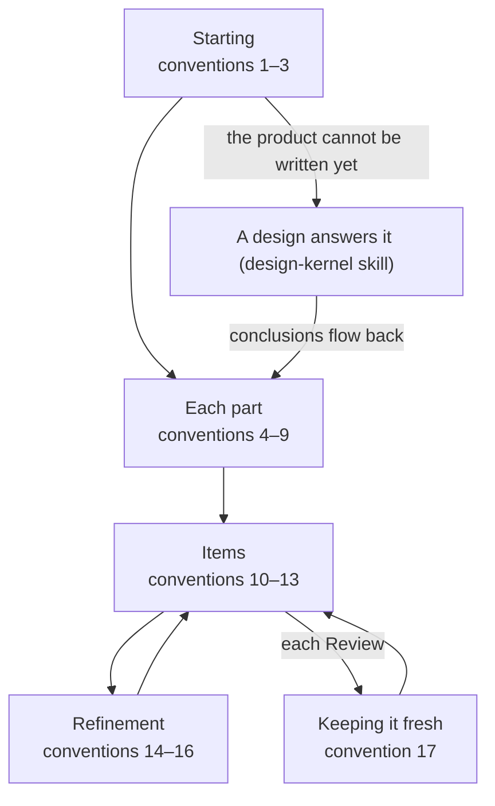

# Product Log Conventions

> Working conventions: reference, not law — follow what fits, override what doesn't, note why. Source labels and short names are explained in convention 15 of `overview.md`, in the skill folder, beside `SKILL.md`. A convention with no label is the author's practice.

> Source: quotations from The Scrum Guide 2020 (Ken Schwaber & Jeff Sutherland), marked where they appear.
> License: the quotations are CC BY-SA 4.0 (© 2020 Ken Schwaber and Jeff Sutherland).

The product log is the first layer. Its template is `product-backlog-template.md`; the Scrum Master usually writes it with the Product Owner. Paths starting with `../` are relative to the scrum-kernel skill folder.

Convention 18 holds at every step; see Throughout, below.

## Starting

1. **One product log** — Write the product log from the template (`overview.md`, convention 1). For an old project, write it from what already exists — the README, the open issues, the old plans — and leave the history in version control; what cannot be written yet follows convention 2.
2. **Blank page** — Write into the product log what you can define; replace what you cannot with the matching item of a design, and let the design answer it. When the product and its Product Goal cannot be written, the IDEO methods alone will not make them clear; start from a design (design-kernel skill), which adds the design sprint, a prototype, and a test to those methods. The design's items stand in for the product log's like this:

    | The design log | Product log |
    | --- | --- |
    | The challenge | 1.1 Product |
    | The design goal | 1.2 Product Goal |
    | The design questions, once the test has answered them | 1.3 Definition of Done (the Outcome Done measures); the ones not answered become items |
    | The people at the top of the map | 2.1 Stakeholders |
    | The map | 2.2 Map |
    | The target (`../design-kernel/steps/2-3-pick-a-target.md`) | 3 Product Backlog Items, each placed on a step of the map |

    In a section a design is answering, say which design answers it and link to it; do not copy the design log. The stakeholder table can be written first, because a design uses role cards from its first stage.
3. **Facts first, then questions** — *Supplement.* Have the Scrum Master look up the facts itself; what the Product Owner must decide goes into one message, numbered, each question with a recommended answer.

## Each part

4. **Product and Product Goal** — Fill sections 1.1 and 1.2 as the template shows; the vision line is optional.
5. **Two kinds of Done** — Outcome Done covers the value the product delivers to its stakeholders; Output Done covers the quality of every Increment. A Sprint picks the items that matter to it; the whole Definition of Done still applies. Write the Definition of Done precisely: add an item only when it holds in every case you can foresee, not just because it came up; one you are unsure of goes into the acceptance criteria instead.
6. **Stakeholders in a short table** — List the stakeholders in section 2.1 in a short table, not a long profile per person. A Stakeholder subagent gets one row as its identity, and the AI fills in the details. If the table is empty, ask the Product Owner who belongs in it, and add the rows.
7. **Architecture as a map** — Start section 2.2 with one map, drawn as `../design-kernel/steps/2-1-make-a-map.md` describes: actors on top, AI roles included, the ending at the bottom, five to fifteen steps between, as a Mermaid `flowchart TD`. Add a subsection only for a step that needs more words.
8. **No TBD** — Turn an unclear point into an item; a Sprint or a design works it out.
9. **Technical design stays out** — Keep technical design out: modules and interfaces are the Developer's; they live in the Increment.

## Items

10. **Seven columns**

    | Column | What goes in it |
    | --- | --- |
    | # | PBI- and three digits, counting up: PBI-001, PBI-002, and so on |
    | Title | A short name |
    | User story | "As <someone from section 2.1>, I want …, so that …" |
    | Place | A step of the map, or a subsection of section 2.2 |
    | Status | Where the item stands: waiting, in Sprint NN, in a design |
    | Size | S — one or two sessions; M — three to five sessions; L — more than five sessions, to be split when refining |
    | Notes | Source, open points, draft acceptance criteria, refinement notes |
11. **Numbers, not ranks** — Number items to count them, and keep every number unique; ranking is another matter — moving an item up the list — and the Product Owner does it when an order is needed.
12. **Items with the Scrum Master** — Let the Product Owner decide the items together with the Scrum Master, who works as a secretary. At Planning the Product Owner leads the selection, and the Scrum Master and the Developer say when it is too much or too little. The measure is the Sprint Goal: every selected item serves it, and an item the goal still needs is added — never one just to fill the Sprint. This departs from the Scrum Guide: see the Departures section of `overview.md`.
13. **Status lives here** — Write an item's status in the product log only; a sprint log names items by number.

## Refinement

14. **Refine any time, finish in the Sprint** — Refine in the product log only to add detail; finish the refinement in the sprint log's section 2.2 (`../sprint-kernel/conventions/sprint-log.md`, convention 6). The product log has no refinement section.
15. **Seven steps** — Refine one item at a time in the seven steps of `../sprint-kernel/conventions/sprint-log.md`, convention 6. Acceptance criteria already written in full here are not repeated in the sprint log.
16. **Where refined content goes** — Put refined content where it belongs: a split-off item becomes a new row; long design content goes into the architecture, and the Place column points to it; short notes go into Notes; large material goes into `scrum/documents/` (`overview.md`, convention 5), referenced from Notes.

## Keeping it fresh

17. **Fresh at every Review** — At every Review, move done items to section 3.2, one line each, with the source, usually the archived sprint log in `scrum/documents/`; delete outdated architecture text and resolved open points; send unfinished items back to section 3.1. Keep no revision record; version control keeps the history. Fresh means more than the items: the Review keeps the rest of `scrum/` fresh too (`../sprint-kernel/conventions/sprint-log.md`, convention 17).

## Throughout

18. **Goal fixed, plan flexible** — Refine items and acceptance criteria at any time; let only the Product Owner change the Product Goal, and only on evidence against it. Write an item's change and its reason in its Notes, and a Product Goal change with its date and reason in section 1.2 (`overview.md`, convention 17).
