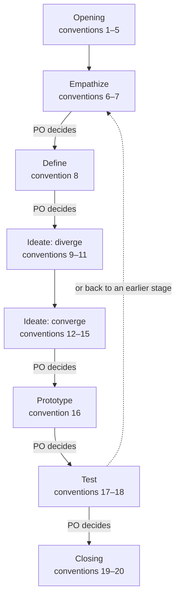

# Design Log Conventions (v1)

> Working conventions, v1: reference, not law — follow what fits, override what doesn't, note why. Source labels and the rest: `../scrum-kernel/overview.md`, convention 14. A convention with no label is the author's practice.

The design log template is `design-backlog-template.md` in this folder. Paths here are relative to the design-kernel skill folder; the stages, the book's excerpts, and the methods are listed in this skill's `SKILL.md`. Where an excerpt describes the book's room — whiteboards, sticky notes, dot voting, a team at a table — these conventions say how a solo + AI team does that step, and they apply.

Conventions 21–27 hold at every step; see Throughout, below. At each "PO decides" the Product Owner settles the result of the stage and decides whether to move on (convention 26).

## Opening

1. **Open a design for a question with no ready answer** — When a question asks what people want or what counts as good, ask first whether a ready answer exists; if not, open a design and start with Empathize, not with solutions. If what you know is not enough to write the product and its Product Goal, start from a design and let it fill the product log (`../scrum-kernel/conventions/product-log.md`, convention 2).
2. **Hard point, not the whole item** — From a Sprint, take out only the hard point that needs design; the rest of the Sprint goes on.
3. **Who** — The Designer is accountable for the design, and the Scrum Master facilitates and records; what the Product Owner decides is listed in convention 21. When one session plays both the Designer and the Scrum Master, write the same name in both fields of the header.
4. **Branch** — *Decide on the spot.* Decide when the design opens whether it branches from the Sprint branch or from `main`. Do not name it `<sprint-branch>/<name>`: git cannot hold both `a` and `a/b` as branch names.
5. **Open a design** — Pick a suffix that says what the design is about, with no number; create `scrum/design-<suffix>/`; copy the template into it as `DesignBacklog.md`; fill in the header: where the design came from, the branch (convention 4), the Product Owner, the Designer, the Scrum Master, and the Now line (convention 24). The folder holds the log, the prototypes, and the working material — sketches, gathered ideas, a grid of reactions; prototypes and working material never go into an Increment.

## Stages

The conventions under Stages cover only what differs from the book or adds what it leaves out; for everything else, follow the excerpts.

### Empathize

6. **Start from the people** — Start Empathize with the people concerned. When the Product Owner is the person concerned, ask first for concrete experiences — what happened, what they did, what they said — and only then ask for the Product Owner's call on what it means; otherwise start with users the Product Owner can bring. Documents and role cards come after. Write each finding where it belongs — in the challenge, the design goal, or the design questions — with its source, and say whether it is first-hand (what a person said or did) or second-hand (a record made for another purpose, or a role card's reading).
7. **Experts when needed** — Once you have heard the people concerned (convention 6), write the challenge, the design goal, and the design questions; ask experts and do research only when these are still unclear. The experts are the Product Owner, in the conversation, and the role cards (`../scrum-kernel/overview.md`, convention 6), each played by a fresh subagent. Before asking experts, draft a rough map (`define/make-a-map.md`); the log keeps what changed, not each interview. After asking the experts or doing research, refine the challenge, the design goal, the design questions, and above all the map once more: fill the gaps and redraw the map.

### Define

8. **Map and questions in the log** — Draw the map as a Mermaid `flowchart TD`, actors at the top and the ending at the bottom. Write the How Might We questions against the map, with the challenge, the design goal, and the design questions of chapter 1 beside it. The Product Owner picks the How Might We questions that matter — no dot voting. There is no target step: if the map holds more than one design's worth of work, split the rest out into another design or into items (`define/pick-a-target.md` shows how the book narrows a map).

### Ideate: diverge

9. **IDEO always in play** — Run the book's steps and the stage's IDEO mode together in every stage, as `SKILL.md` requires. Above all in Ideate, use the ideo-kernel's Ideate methods — How Might We Questions, Brainstorming, Analogous Empathy, Yes, And! Brainstorm, Brainstorm selection — alongside the book's steps.
10. **Lightning Demos** — Have subagents search for existing ideas in parallel; keep the list as working material, not part of the log.
11. **Diverge before you converge** — When you brief each subagent that sketches a solution (convention 12), have it diverge first — use at least two methods, the ideo-kernel's Ideate methods (convention 9) or the first steps of the book's sketch (`ideate/sketch.md`: notes, ideas, Crazy 8s), go for quantity, and hold judgment back — and only then converge into its own sketch. The ideas are working material; they do not go into the log.

### Ideate: converge

12. **Isolated solutions** — Have several fresh subagents, unable to see one another, each diverge first (convention 11) and then produce one complete solution sketch, in words or Mermaid, from chapters 1 and 2, the gathered ideas, `ideate/sketch.md`, and the ideo-kernel Ideate methods.
    *Decide on the spot:* how many subagents to run, and on which model.
13. **Choosing is the key step** — Run the book's decision (`ideate/decide.md`) in the conversation, led by the Scrum Master; have role-card Stakeholders give a straw poll if the Product Owner wants one. The Product Owner makes the final call, with no search for consensus. Put only the chosen solution into section 3.1.
14. **Combine or rumble** — Combine winners that fit together; when two conflict, prototype both and let the test decide (`ideate/rumble.md`). The Product Owner decides which.
15. **Storyboard** — Write a storyboard of about fifteen steps in section 3.2 (`ideate/storyboard.md`) only when the solution needs one before the prototype; the Designer writes it.

### Prototype

16. **Just enough prototype** — *Supplement.* Build in the design folder, following the chosen solution, real enough for honest reactions (`prototype/fake-it.md`): made quickly and thrown away after, while the surface the tester sees appears real. Subagents can build the parts while one session stitches them together; do a trial run against the solution and the design questions before testing, and write what it found in chapter 5. List each part of the prototype in chapter 4 with the design question it tests.
    *Decide on the spot:* how real the prototype must be when the product has no screen — a document, a service, a process; agree it with the Product Owner.

### Test

17. **Role-card test** — Test with role cards, each a fresh subagent given only its card, the prototype, and the tasks; the Product Owner tests too. The Designer runs the Five-Act Interview (`test/interview.md`); a grid of reactions is working material; chapter 5 keeps who tested, what showed up, and the answer to each design question. The book tests five customers; here, test every role card the design touches, and add runs while the patterns are unclear.
18. **Write the criteria before the test** — Before testing, write down in chapter 5 what would count as a yes, a no, or a not yet for each design question, and what role cards cannot show: they are subagents reading a card, not real people.

## Closing

19. **Close as a Review** — Close the design when its questions are answered or the Product Owner stops it. Compress the log to its key decisions, rename it `design-<suffix>.md`, and move it to `scrum/documents/`; it keeps the challenge and the design questions (chapter 1), the chosen solution (chapter 3), the commit that holds the prototype (chapter 4), and each question's test conclusion and where it flowed back (chapter 5). Write the conclusions into the product log as `../scrum-kernel/conventions/product-log.md`, convention 2, says; when the design began from a blank page, split the steps of the map into items, and let the Product Owner order which come first. Delete the prototypes and other files; git keeps them. Handle the design's branch as `../scrum-kernel/conventions/sprint-log.md`, convention 19, says: merge it, then delete it. Refresh the product log.
20. **Retro as in a Sprint** — Write no Retro chapter; write the lessons as in `../scrum-kernel/conventions/sprint-log.md`, convention 18.

## Throughout

21. **Ask the PO** — Ask the Product Owner whenever you are unsure (`../scrum-kernel/overview.md`, convention 9), and in any case to: decide at the end of each stage, and after the test whether to close or go back (convention 26); set or change the design goal (convention 25); pick the How Might We questions that matter (convention 8); choose the solution and decide between combining and a rumble (conventions 13, 14); agree how real the prototype must be (convention 16); and decide that the design is done (convention 19).
22. **Five chapters, not five days** — Write one chapter per stage — Empathize, Define, Ideate, Prototype, Test — not the book's Monday to Friday, and no notes section. Each chapter records what its stage produced, not the steps taken.
23. **Renamed terms** — See the first paragraph of `SKILL.md`.
24. **Resume from the header** — Keep the header's Now line current: the stage, and the next step. A session that picks up the design reads it first. Before a session ends or its context is shortened, write the half-finished work into the chapter it belongs to, update the Now line, and commit.
25. **Goal fixed, plan flexible** — Sharpen the design goal during Empathize; once it is set, only the Product Owner changes it. The questions, the map, and the solution may change with what the work shows; write what changed and why in the chapter it belongs to (`../scrum-kernel/overview.md`, convention 17).
26. **Gates between stages** — At the end of each stage, check the log against the gate below; then the Product Owner settles the result of the stage and decides whether to move on (`../scrum-kernel/overview.md`, *Product Owner decides between stages*). The Scrum Master checks that the work was done right; the Product Owner decides. Write the decision as the last line of the stage's chapter. After the Test, the decision is to close the design or to go back to the stage whose answer was wrong.

    | Stage | The log holds | The check |
    | --- | --- | --- |
    | Empathize | the challenge, the design goal, and the design questions, with the source of each finding | The findings come from the people concerned — what they did, what they said, where the two differ — not from a pile of facts |
    | Define | the map and the How Might We questions the Product Owner picked | The How Might We questions were written against the map and the challenge, the goal, and the questions of chapter 1 |
    | Ideate | the chosen solution, and the storyboard if one was written | Each sketch diverged before it converged, and the sketches differ in approach, not only in detail |
    | Prototype | the parts of the prototype, each with the design question it tests | It is rough, quick, and thrown away after: built to learn, not to deliver |
    | Test | the criteria written beforehand, what the trial run found, who tested and what showed up, and an answer to each design question with where it flows back | The answers come from real reactions, and "we were wrong" counts as an answer |

    At each gate ask: would someone who never learned design have produced the same thing? If so, the stage missed its focus.
27. **A small design is still a design** — When a design is small — about one session of work — still keep the log, shrink each stage to a line or two, and still have the Product Owner decide at the end of each stage. Skip no stage, least of all Empathize and divergence (convention 11).
