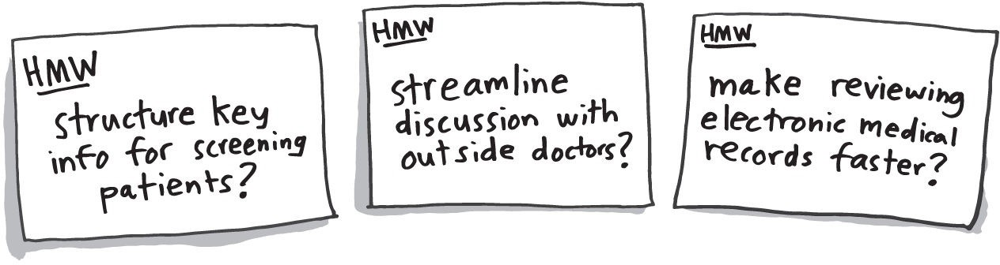
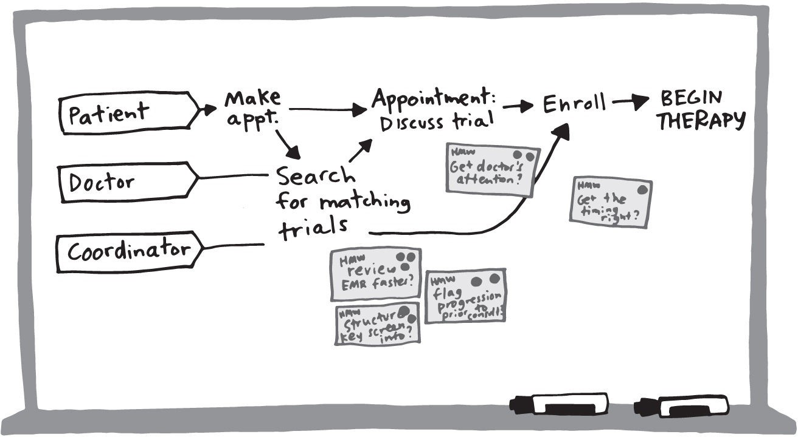

# How Might We

> Source: Knapp, J., Zeratsky, J., & Kowitz, B. (2016). *Sprint: How to Solve Big Problems and Test New Ideas in Just Five Days.* Simon & Schuster. Chapter: "Ask the Experts."
> License: All rights reserved (see ATTRIBUTION.md).
> Excerpt: the book's own text, with parts that do not apply to a solo + AI team removed; nothing reworded. Day names are the book's schedule, not an instruction.

Your experts will provide a ton of information. So how are you going to keep track of it all? By tomorrow, when the team sketches solutions, a lot of the interesting details will have faded from your short-term memory. The whiteboards will be helpful, but they’re not enough. You’re going to need some additional notes.

The method is called How Might We. It was developed at Procter & Gamble in the 1970s, but we learned about it from the design agency IDEO. It works this way: Each person writes his or her own notes, one at a time, on sticky notes. At the end of the day, you’ll merge the whole group’s notes, organize them, and choose a handful of the most interesting ones. These standout notes will help you make a decision about which part of the map to target, and on Tuesday, they’ll give you ideas for your sketches.

With this technique, you take notes in the form of a question, beginning with the words “How might we ... ?” For example, with Blue Bottle, we could ask, “How might we re-create the café experience?” or “How might we ensure coffee arrives fresh?”

Now, some folks will bristle at the slightly unnatural “How might we” phrasing. After all, most people don’t talk like that in real life, and, combined with writing on sticky notes, it can feel a little silly. We had the same concerns ourselves when we first learned about the How Might We method.

When we tried it, we came to appreciate how the open-ended, optimistic phrasing forced us to look for opportunities and challenges, rather than getting bogged down by problems or, almost worse, jumping to solutions too soon. And because every question shares the same format, it’s possible to read, understand, and evaluate a whole wall full of these notes at once (which is what you’ll do later in the afternoon).

## Take How Might We notes

To take notes, follow these steps:

Wait.

When you hear something interesting, convert it into a question (quietly).

Each person will end up with a little stack of notes—you’ll organize them later.

There’s no denying that this method is awkward at first, but every team we work with figures it out once they start writing. To better illustrate how all this Ask the Experts and How Might We stuff works, let’s look at part of an actual interview, and the notes that came out of it. In this scene from Flatiron’s sprint, we’re interviewing Dr. Bobby Green, their VP of clinical strategy. This is roughly the first two minutes of his fifteen-minute interview.

---

“All right, Bobby,” said Jake. “What’s missing on our map?”

“Well, I can talk a little more about this part.” Bobby pointed to the whiteboard, where the diagram said Search for matching trials. “I’ll give you the doctor’s perspective here.”

Bobby handed around a few copies of a three-page printout. “This is a typical list of criteria for a clinical trial,” he said. “When we’re trying to decide if a patient might be a match, we’re comparing what we know about the patient to lists like this.”

The pages were filled with requirements. There were fifty-four in all, everything from “Age 18 or over” to “At least four weeks since prior sargramostim (G M-C SF), interferon alfa-2b, or interleukin-2.” For Jake, Braden, and John, it was tough to decipher. But the point was clear: It was a long list.

Alex Ingram, Flatiron’s product manager, looked up from his printout. “The clinics don’t have all of this information about their patients, right?”

Bobby nodded. “Some of these criteria are in the electronic medical record, but a lot aren’t.”

“Remind us how it works when the info isn’t in the medical record,” Amy Abernethy, Flatiron’s chief medical officer, said. It was obvious that she already knew the answer, but she also knew the rest of us would benefit from hearing it.

“Well, it depends,” said Bobby. “For example, many trials call for ‘no uncontrolled cardiac disease.’ That’s pretty vague, but it probably means the patient hasn’t had a recent heart attack. That kind of thing won’t be easy to find in the electronic medical record. So someone from the clinic has to talk to the patient or to the patient’s cardiologist. At the end of the day, the oncologist might have to make a judgment call.”

Bobby set his own stack of papers on the table. “To match a patient to a trial, we’ve got to answer a dozen or two dozen open questions. Now multiply that by the number of new patients every week, and the number of trials at each clinic.”

He gave a tired smile. “And as an oncologist, you were already busy anyway.”

Around the room, people nodded. Then we all wrote furiously on our sticky notes.

---

A recap: First, Jake, as the sprint’s Facilitator, began the interview by asking Bobby about the map on the whiteboard. That gave us all context for how the new information would fit with what we’d already discussed.

Next, the team asked a lot of questions. Amy’s phrase “Remind us ...” is useful, because most interviews include content the team has heard before, at some point or another. That’s okay. Covering it again refreshes everyone’s memory and reveals new details. The “Remind us” phrase is also a nice way to make your expert feel comfortable. Bobby didn’t need that—he’s a confident public speaker—but by asking questions in this way, you can draw out great information from even the quietest person on your team.

Let’s talk about note-taking. Here’s a basic outline of the problems Bobby presented:

The information required to screen patients is hard to find in their medical records.

Filling in missing information requires a lot of time and effort.

The number of patients, trials, and requirements is overwhelming.

Ugh. That’s depressing, right? But the entire time Bobby was talking, the Flatiron team was turning those problems into How Might We opportunities. Here are some of the notes they took:

Reading the How Might We list feels a lot better than reading the problem list. It was exciting when the interviews ended and we saw each other’s notes on the wall. Each How Might We note captured a problem and converted it into an opportunity.

What’s more, each question could be answered in many different ways. They weren’t too broad (“How might we reinvent health care?”) or too narrow (“How might we put our logo in the top right corner?”) Instead, Flatiron’s How Might We notes were just specific enough to inspire multiple solutions. On Tuesday, they would provide the perfect inspiration for our sketches.

Bobby’s interview illustrates the basic formula for Monday afternoon. You’ll interview experts, using your map as an outline. You’ll take notes as a team, turning each problem you hear into an opportunity. By the time you finish your interviews, your team will have generated a pile of notes. In most sprints, we end up with somewhere between thirty and a hundred. Unfortunately, you can’t make good use of that many How Might We questions. Once you turn your attention to sketching, it will be too many opportunities for the poor human brain to track. You’ve got to narrow them down.

## Organize How Might We notes

As soon as the expert interviews are finished, everybody should gather his or her How Might We notes and stick them on the wall. Just put them up in any haphazard fashion, like this:

Wow, what a mess! Now you’ll organize the notes into groups. Working together, find How Might We questions with similar themes and physically group them together on the wall.

You won’t know what themes to use ahead of time. Instead, the themes will emerge as you go. For example, imagine you were working with Flatiron Health. You might look at the wall and notice a few notes about electronic medical records. You’d pick those notes up and put them near each other. Bingo. You’ve got a theme.

As the organization goes on, it’ll be useful to label the themes. Just write a title on a fresh sticky note and put it above the group. (We usually end up with a “Misc” theme of notes that don’t fit anywhere else. Those misfit notes often end up being some of the best ones.)

This process could go on forever if you let it, but the organization doesn’t have to be perfect. After ten minutes, the notes will be sorted enough to move on to prioritization.

## Vote on How Might We notes

To prioritize the notes, you’ll use dot voting. It’s one of our favorite shortcuts for skipping lengthy debate. Dot voting works pretty much the way it sounds:

Ask everyone to review the goal and sprint questions.

Ask everyone to vote in silence for the most useful How Might We questions.

When the voting is over, take the How Might We notes with multiple votes, remove them from the wall, and find a place to stick them on your map. Most notes will probably correspond with a specific step in the story. Here’s Flatiron’s map again:

*Flatiron Health’s map with top How Might We notes.*

The prioritization process isn’t perfect: There’s little time for deliberation, and early votes will sometimes bias later votes. But it leads to pretty good decisions, and it happens fast enough to leave time for the most important job of the day: After a look back over your long-term goal, your sprint questions, your map, and the notes you took this afternoon, your team will choose one specific target for the rest of your sprint’s efforts.
