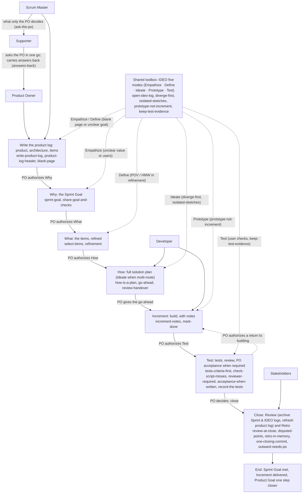
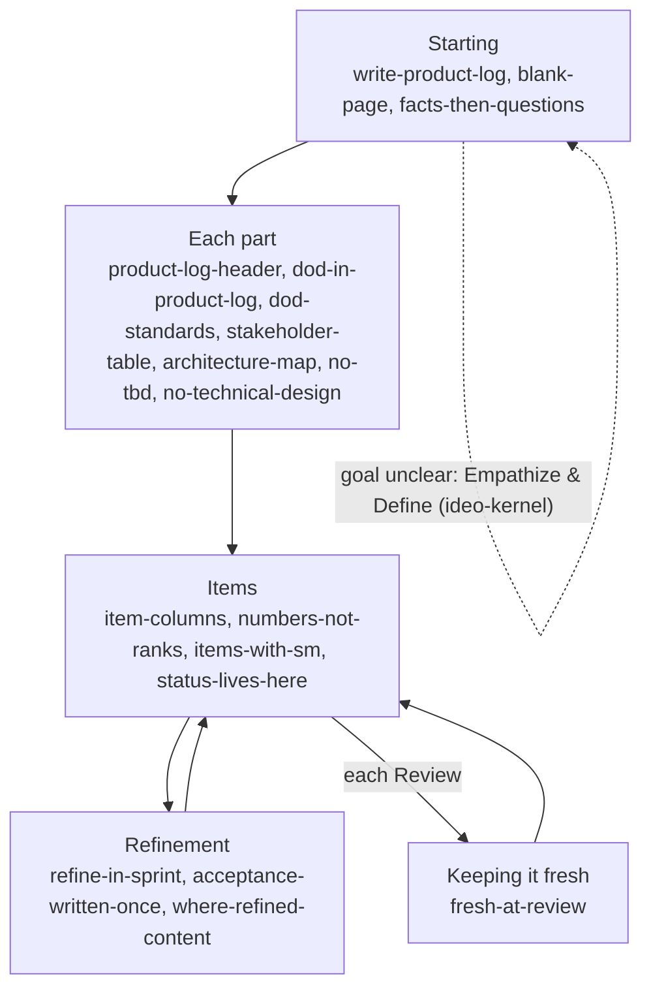
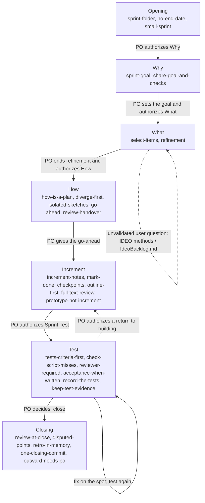
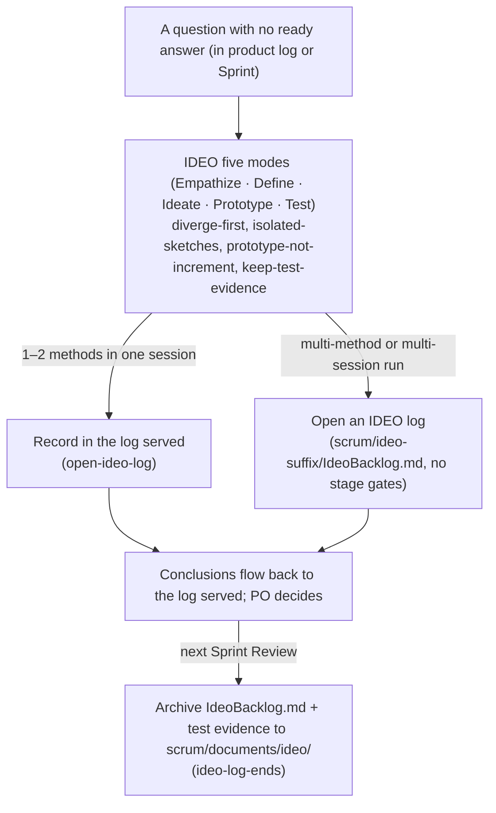
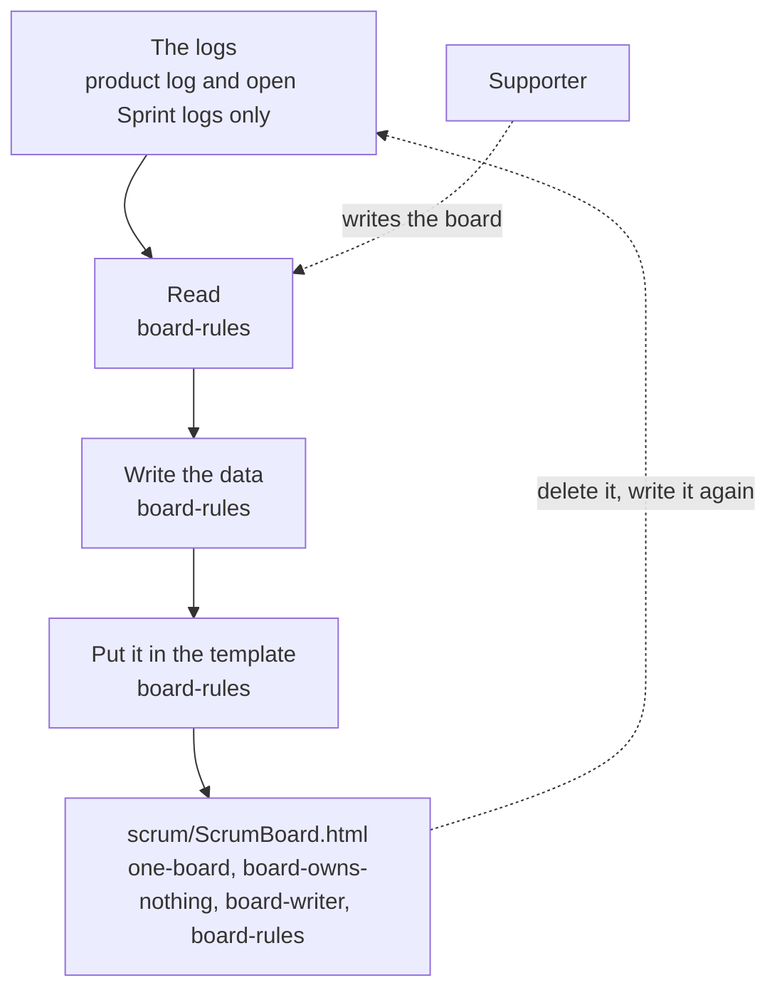

# The process maps

The process maps of the whole flow and of each log, with the lines (handles) that apply at each step written into the boxes, so each map is also an index. Read it to see where a rule sits in the flow.

## The whole flow

Scrum Sprint is the single delivery track below the product log. The IDEO five modes are the shared toolbox supporting every step on demand — not a separate parallel track beside Sprints.

## The product log

## A Sprint

## The five modes and the IDEO log

## The board

