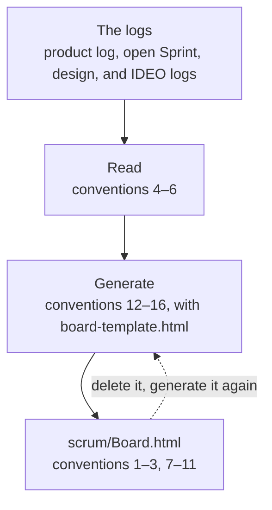

# Board Conventions

> Working conventions: reference, not law — follow what fits, override what doesn't, note why. Source labels and short names are explained in convention 15 of `overview.md`, in the skill folder, beside `SKILL.md`. A convention with no label is the author's practice.

The board is one page that shows where the project stands. Its template is `board-template.html`, beside this file; this file is also the brief for whoever generates the page. Paths starting with `../` are relative to the scrum-kernel skill folder.

## What the board is

1. **One board for the project** — Keep one page for the whole project: the product log, and every open Sprint and design, one card each. It answers two questions without opening a log: where does the project stand, and what is waiting for the Product Owner.
2. **It owns nothing** — The board only reads the logs. It keeps no state, and no log is ever changed from it. Delete it and generate it again, and every fact is the same; only the time of generation differs. For that reason the page need not go into version control; the project decides, for example with a `.gitignore` entry.
3. **Where it lives, who writes it, and when** — Name it `scrum/Board.html`, beside the product log. A cheap model writes it, because the work is copying and laying out, not judging: a fresh subagent told to read this file and the template and to follow them, or a standing helper session of the Product Owner's. Generate it when the Product Owner wants to look, or after a log has changed.

## What it reads

4. **The logs** — The product log is `scrum/ProductBacklog.md`. The open logs are `scrum/sprint-*/SprintBacklog.md`, `scrum/design-*/DesignBacklog.md`, and `scrum/ideo-*/IdeoBacklog.md`; nothing in `scrum/documents/`, which holds the archive. A Sprint or design that is open on another branch counts too: read its log as committed on that branch (git can show a file at a branch's latest commit), and say "as of commit" with the commit's id on its card. A log that is in this working copy is read from the working copy, with any change not yet committed, and its card says "working copy". If one log is found on several branches, use the version with the newest commit.
5. **What it takes from a log** — Four things, each written where the conventions say; read them there and look for nothing else:
    - the commitments: a one-row table whose first cell is `Commitment` (`承诺` in a Chinese log) and whose second cell is the exact text; the heading above it says which one it is (`overview.md`, convention 17);
    - `> Now:`, in a Sprint log (`../sprint-kernel/conventions/sprint-log.md`, convention 22), a design log (`../design-kernel/conventions/design-log.md`, convention 24), and an IDEO log (`../ideo-kernel/conventions/ideo-log.md`, convention 4); the product log has none;
    - `> Waiting for PO:`, on the line after it in those three logs: the number and short question of each pending decision, or `None`;
    - the done mark: in a Sprint log's chapter 3 table, a row whose Done when cell begins with `✓` is done, and an unmarked row is not (`../sprint-kernel/conventions/sprint-log.md`, convention 9).

    An IDEO log has no commitment of its own: its `For` field points to the log it serves.
6. **Items and the map** — From the product log: the item table in section 3.1 has seven columns (`conventions/product-log.md`, convention 10); take the number, title, status, and size of each row and leave the rest in the log. The map is the Mermaid diagram in section 2.2; copy its source as it stands. A Sprint log's section 2.1 lists the items that Sprint took; an item's status is always the product log's. A design log's map is the diagram in its section 2.1, and its chosen solution is the title in its section 3.1.

    Group the items the way the project groups them. When the status cells carry a word in brackets, group by that word, in the order the words first appear. Otherwise group by status, as `conventions/product-log.md`, convention 10, lists the values: in a Sprint, in a design, waiting; whatever else goes under Other.

## What the page shows

7. **Waiting for the Product Owner comes first** — At the top, list everything that waits for the Product Owner: each log's `Waiting for PO` text, with the log it comes from. A log that says `None` adds nothing. When nothing waits, one line says so.
8. **The product card** — The Product and the Product Goal, word for word; the map, folded away until opened; the items that are not done, grouped as in convention 6, each with its number, title, size, and status. Items in section 3.2 are done or closed and are not shown. A status that names an open Sprint or design links to that card.
9. **A Sprint card** — The Sprint's name; its Sprint Goal; its Now line; the stage it is in, marked among the five stages — Why, What, How, Increment, Test — the one the Now line names, or none when it names none; the items it took, each with the status the product log gives it (the card does not work out how far an item is done); the work items of chapter 3, with the done ones marked; its Waiting for PO; and where the log was read (convention 4). When no Sprint is open, one line says so in place of the cards.
10. **A design card** — The design's name; its design goal; its Now line; its map; the solution being worked on; its Waiting for PO; and where the log was read. An IDEO log has no card of its own: one line on the card of the log it serves, with its Now line. When no design is open, one line says so. A design whose `From` field names a Sprint is linked from that Sprint's card.
11. **Links** — Each card links to the log it was made from when that file is in this working copy, as a link relative to `scrum/Board.html` — the page is in `scrum/`, so the product log is `ProductBacklog.md` and a Sprint log is `sprint-01-alpha/SprintBacklog.md`. When it is not — the log is only on another branch — the card names the branch and the commit instead, so that no link is dead. The product card links to every Sprint and design card.

## How to generate it

12. **Steps** — Follow these steps:
    1. Read `board-template.html`; its comments say what goes where.
    2. Find the logs (convention 4) and read what each one holds (conventions 5 and 6).
    3. Copy each fact from its log into the template's markers (convention 13). Repeat a card for every open Sprint and design.
    4. Write the page to `scrum/Board.html`, replacing the old one.
    5. Check the page against the logs: every fact on it is found in a log, and every link opens. Fix what is not.
13. **Word for word** — Commitments, Now lines, Waiting for PO texts, item titles, and statuses go onto the page exactly as the log has them: the same characters, the same language; never reworded, shortened, translated, or tidied. Escape what HTML needs escaped, and no more. The labels around the facts are the template's own. Keep the template's `data-fact` markers: they say what each piece of text is, so that the page can be checked against the logs. A fact the logs do not give is not written; where a card needs one that is missing, write `not found` there.
14. **Say what was read** — The page says when it was made and, for each log, which version was read: the working copy, or a branch and a commit.
15. **The map offline** — The map is drawn by Mermaid, which the page loads from the internet. The page also keeps the map's source as text, so a reader who is offline still has it.
16. **What the board does not do** — It has no buttons, edits no log, and keeps no state between pages. Nothing becomes true because it is on the board.
