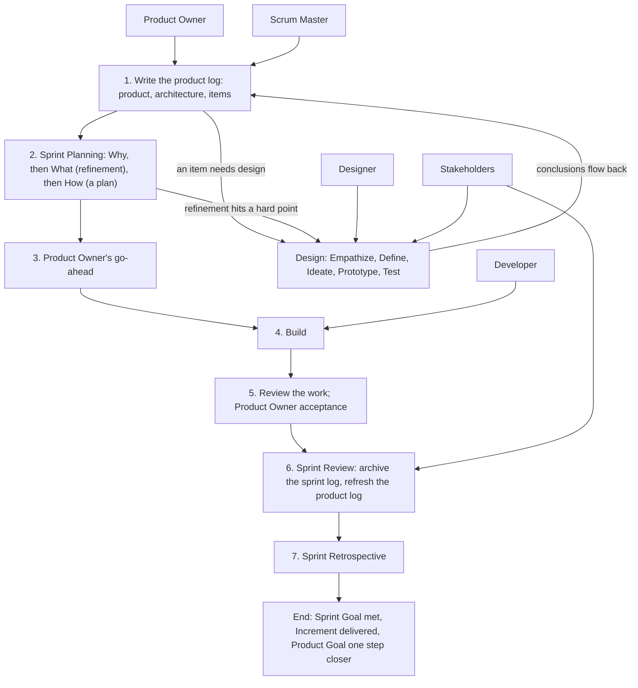

# Overview — How the Pieces Fit (v1)

> These are working conventions, v1 — the author's reading of Scrum and design thinking for solo + AI teams. They are less precise than the official guides. Use them as reference: follow what fits, override what doesn't, and note why. Where a convention departs from the official guide on purpose, it says so and gives the reason.

> Source: quotations from The Scrum Guide 2020 (Ken Schwaber & Jeff Sutherland) and the Scrum Guide Expansion Pack v2026.1 (Ralph Jocham, John Coleman, Jeff Sutherland), marked where they appear; the rest is the author's working conventions.
> License: the quotations are CC BY-SA 4.0 (© 2020 Ken Schwaber and Jeff Sutherland; © 2025 Ralph Jocham, John Coleman, and Jeff Sutherland).

Each convention has a short name, so it can be referred to in conversation, and one source label:

- **Author's practice** — how the author works.
- **Supplement** — inferred by the author's assistant; not yet confirmed in practice.
- **Decide on the spot** — no fixed rule; decide when it comes up.

This file shows how the product log, Sprints, and designs fit together. The details are in the files next to it, and in the design-kernel skill:

| File | What it covers |
| --- | --- |
| `product-log.md` | Product log conventions: how to write the product log and refine its items |
| `product-backlog-template.md` | Product log template; a product log made from it is `ProductBacklog.md` |
| `sprint-log.md` | Sprint log conventions: Planning, building, review, and closing |
| `sprint-backlog-template.md` | Sprint log template; a sprint log made from it is `SprintBacklog.md` |
| design-kernel skill: `conventions/design-log.md`, `conventions/design-backlog-template.md` | Design log conventions and template; a design log is `DesignBacklog.md` |

## The map

People and roles at the top, the ending at the bottom, the steps in between.



## Where things live

1. **One product log** — *Author's practice.* Every project, new or old, starts from one product log: the product, its goal and Definition of Done, its stakeholders and architecture, and its Product Backlog items. It is the first layer, and everything else answers to it. How to write it is in `product-log.md`.
2. **Sprints and designs side by side** — *Author's practice.* Below the product log sit two peer modules. A Sprint is the Developer's and delivers an Increment; a design is the Designer's and delivers a prototype and conclusions. Open a Sprint to build. Open a design when something needs designing first: a product backlog item that needs design, or a hard point that Sprint refinement runs into. A design is its own module, not part of a Sprint; the two can be combined in any way, and both answer to the product log. Three more points:
   - Decide item by item whether design is needed; many items need it.
   - A design's conclusions still land through a Sprint that delivers an Increment.
   - An Increment need not be code; the Definition of Done says what it is.

   *Departs from the Scrum Guide on purpose.* The Scrum Guide says: "All the work necessary to achieve the Product Goal, including Sprint Planning, Daily Scrums, Sprint Review, and Sprint Retrospective, happen within Sprints." Reason: a design's output is a prototype and conclusions, not an Increment; a design lives as long as its design questions are open, which may span several Sprints; and the Designer and the Developer are peers, both accountable to the product.
3. **Three layers** — *Author's practice.* The files fall into three layers, matching Scrum's artifacts and their commitments:

   | Layer | File | Commitment | Accountable | Facilitates |
   | --- | --- | --- | --- | --- |
   | 1 | Product log, `ProductBacklog.md` | Product Goal | Product Owner, with the Scrum Master | — |
   | 2 | Sprint log, `SprintBacklog.md` | Sprint Goal | Developer | Scrum Master |
   | 2 | Design log, `DesignBacklog.md` | Design goal | Designer | Scrum Master |
   | 3 | Increment: code or documents, as the Definition of Done says | Definition of Done | Developer | — |
   | 3 | Prototype: kept in the design folder, never part of an Increment, deleted when the design closes | Design questions | Designer | — |

   The third layer is not a log and has no prescribed method; it relies on the skills of whoever does the work, and comes back for review when done. Increments add up into the product. Prototypes are thrown away, and only what was learned flows back.
4. **Folders** — *Author's practice.* `scrum/` holds the current state and nothing else: the product log, and one folder for each Sprint or design in progress. Sprint numbers have two digits; the suffix says what the Sprint or design is about.

   ```
   scrum/
   ├── ProductBacklog.md       product log
   ├── sprint-NN-<suffix>/     a Sprint: SprintBacklog.md and working files
   └── design-<suffix>/        a design: DesignBacklog.md and prototypes (no number)
   ```

   When a Sprint or a design closes, its log moves to the document folder (convention 5). This is the author's layout; if your project already has its own places for these files, use them.
5. **The document folder** — *Author's practice.* What a log cannot hold goes into the project's document folder, and the log references it: archived sprint logs and design Reviews, refinement material, background material, reference material, expert interviews, deep research, design documents. A document a log references counts as part of the Scrum record, and `scrum/` stays clean. Use the folder the project already has for documents, such as `docs/` at the root; if there is none, create one, for example `scrum/docs/`.
6. **File names** — *Author's practice.* The templates sit in the `conventions/` folders of the scrum-kernel and design-kernel skills. A file made from a template is named `ProductBacklog.md`, `SprintBacklog.md`, or `DesignBacklog.md`, whatever the template itself is called.

## Who does what

7. **Roles** — *Author's practice.*

   | Role | Home turf | Accountable for | Loads these kernels |
   | --- | --- | --- | --- |
   | Product Owner | The product log, and its handoffs to sprint and design logs | Value direction; the Product Goal and each Sprint Goal; which items enter a Sprint; the go-ahead to build; decides the product backlog items together with the Scrum Master | — (a person) |
   | Scrum Master | Sprint logs and design logs | Facilitates Planning and refinement; records; tracks progress; reviews the How and the Increment; acts as the Product Owner's secretary | ideo-kernel, scrum-kernel, design-kernel |
   | Developer | The Sprint | Keeps the sprint log; writes the How; builds the Increment; joins refinement and gives the final check that nothing is unclear | ideo-kernel, scrum-kernel |
   | Designer | The design | Design research and prototypes; the conclusions flow back to the product log and to the Sprint that asked | ideo-kernel, design-kernel |
   | Stakeholder | An outside view | Looks at the product, an Increment, or a prototype as one identity from the product log's stakeholder table; summoned at Sprint Review, and for review when the Product Owner names it | ideo-kernel |

   Every AI role loads the ideo-kernel skill first: it is the shared toolbox, and its methods can be used at any step. The Product Owner, the Scrum Master, and the Developer keep the sprint log together; a simple project with no Developer is run by the Product Owner and the Scrum Master alone.
8. **Only the Product Owner must be human** — *Author's practice.* The Scrum Master, Developer, Designer, and Stakeholder roles may all be taken by AI.
   *Departs from the Scrum Guide Expansion Pack on purpose.* It says: "The Product Owner must be human." and "The Scrum Master must be human." Reason: this is a method for one person working with AI; the person keeps the value decisions, and the AI roles are watched through go-ahead and review (sprint-log.md, conventions 8 and 16).
9. **Ask the Product Owner** — *Author's practice.* When anyone on the team is unsure — the Developer while building, the Scrum Master while facilitating — they ask the Product Owner to decide, unless the Product Owner has said that a kind of question goes to someone else.
10. **Product Owner as Developer** — *Author's practice.* The Product Owner sometimes builds. Then they take part as a Developer, as the Scrum Guide says: "If the Product Owner or Scrum Master are actively working on items in the Sprint Backlog, they participate as Developers." The How is then worked out with the Product Owner, not decided by the Developer alone.

## Sessions

11. **One Scrum Master per project** — *Author's practice.* Each project has one session acting as its Scrum Master, leading that project's Developer, Designer, and Stakeholders. Someone running several projects may keep one more session above them to summarize across projects; each project's facts stay in its own logs, and questions about a project go to that project's Scrum Master.
12. **Who gets which work** — *Author's practice.*

    | Work | Goes to | Why |
    | --- | --- | --- |
    | Review: checking commits, adversarial review | The Scrum Master by default; a Stakeholder or a fresh subagent when the Product Owner names one. When there is a lot to read, the Scrum Master may send a subagent to read it, and still owns the conclusion | Long diffs need not fill the Scrum Master's context |
    | Long-running upkeep: the board, summaries, tracking progress | A standing Stakeholder session with a working identity the project writes down | It runs continuously, and the Product Owner can talk to it directly |
    | A small edit to one or two files | The Scrum Master itself | Briefing someone else costs more than doing it |
    | Building | A new Developer session, when a paragraph can brief it; a Developer that shares the Scrum Master's context, when the work needs much of the discussion | Shared context saves the briefing, but such a Developer carries the Scrum Master's views, so it cannot review its own work |

    Before handing work out, ask whether there is more to read or more to explain. A review subagent gets the task, the project's rules, and the decisions already issued (sprint-log.md, convention 16).

## About these conventions

13. **Working conventions** — *Author's practice.* These conventions are the author's reading of Scrum and design thinking for solo + AI teams: reference, not law. Follow what fits, override what doesn't, and note why. Each convention carries a source label (above) and a short name, so it can be named in conversation. The guidance sits in three places: the templates carry the flow, since every log is filled in from one; the convention files give the reasons and say when a step can be skipped, to be read when needed; each role command holds one line pointing to this file. The conventions describe roles and steps, not the mechanics of any particular tool, because tools change.
14. **Revise them weekly** — *Author's practice.* The conventions will keep changing; that is the agile way. When one does not fit, note it — in the sprint log's notes, for example — and revise them together about once a week. A revised convention applies from the next Sprint; do not change conventions in the middle of a Sprint.
15. **Templates record outputs** — *Author's practice.* A template's chapters follow the flow, and its sections hold only what each step produced. How to do each step is written in the conventions, not added to the template as sections. Before a new template or a new structure is used, show its chapter list on its own to whoever reviews it (sprint-log.md, convention 12).

## What stays fixed

16. **Goal fixed, plan flexible** — *Author's practice.* Each log has one commitment that stays fixed: the Product Goal for the product log, the Sprint Goal for the sprint log, the design goal for the design log. The Definition of Done is not weakened either. Everything under a commitment may change as you learn — product backlog items, refinement points, acceptance criteria, the How, the chosen design solution — and each log records what changed and why. Only the Product Owner changes a commitment; when a Sprint Goal can no longer be met, the Product Owner cancels the Sprint.

    The Scrum Guide puts each part in its own words. On the Product Goal: "They must fulfill (or abandon) one objective before taking on the next." During the Sprint: "No changes are made that would endanger the Sprint Goal", "Quality does not decrease", and "Scope may be clarified and renegotiated with the Product Owner as more is learned." And: "Only the Product Owner has the authority to cancel the Sprint."

    What this means for each log: `product-log.md`, convention 18; `sprint-log.md`, convention 3; the design-kernel skill's `conventions/design-log.md`, convention 22.

## Where we depart from the official guides

Each departure is also explained in the convention named in the last column.

| Here | The official guide | Reason | See |
| --- | --- | --- | --- |
| Only the Product Owner must be human | Scrum Guide Expansion Pack: the Product Owner and the Scrum Master must be human | One person working with AI keeps the value decisions | Convention 8 |
| Designs sit beside Sprints; design work need not happen inside a Sprint | Scrum Guide: all the work happens within Sprints | A design delivers a prototype and conclusions, not an Increment, and may span several Sprints | Convention 2 |
| Product backlog items are numbered, not ranked | Scrum Guide: the Product Backlog is an ordered list | The AI roles rarely need the order; the Product Owner orders items when a person needs it | `product-log.md`, convention 11 |
| The Product Owner decides the items together with the Scrum Master; at Planning the Product Owner leads the selection, and the Scrum Master and Developer advise | Scrum Guide: the Product Owner is accountable for the Product Backlog and may delegate; the Developers select items in discussion with the Product Owner | The Scrum Master works as the Product Owner's secretary; the Product Owner sets the value direction, and the Scrum Master and Developer say how much fits | `product-log.md`, convention 12 |
| The How is a plan, not steps; building starts only after the Product Owner's go-ahead | Scrum Guide: how the work gets done is the Developers' call | AI cannot be fully trusted yet, a Developer may drift, and the Product Owner sometimes builds | `sprint-log.md`, conventions 7 and 8 |
| Checkpoints replace the Daily Scrum, and the Product Owner takes part | Scrum Guide: the Daily Scrum is a 15-minute event for the Developers | AI works by session, not by day; it stops and asks the Product Owner | `sprint-log.md`, convention 10 |
| A reviewer is required: the Scrum Master by default, or a Stakeholder or a fresh subagent the Product Owner names | The Developers are accountable for their Increment | Same as above | `sprint-log.md`, convention 16 |
| No Sprint end date: a Sprint closes when its goal is met or the Product Owner stops it | Scrum Guide: Sprints are fixed-length events of one month or less | AI works by session, so dates carry little meaning; the cost is that only the Product Owner notices a Sprint that drags on | `sprint-log.md`, convention 2 |
| Closed logs are kept: a sprint log compressed, a design log rewritten as a Review, both in the document folder | — | The record stays in the project, and the product log can point to it | Convention 5 |
