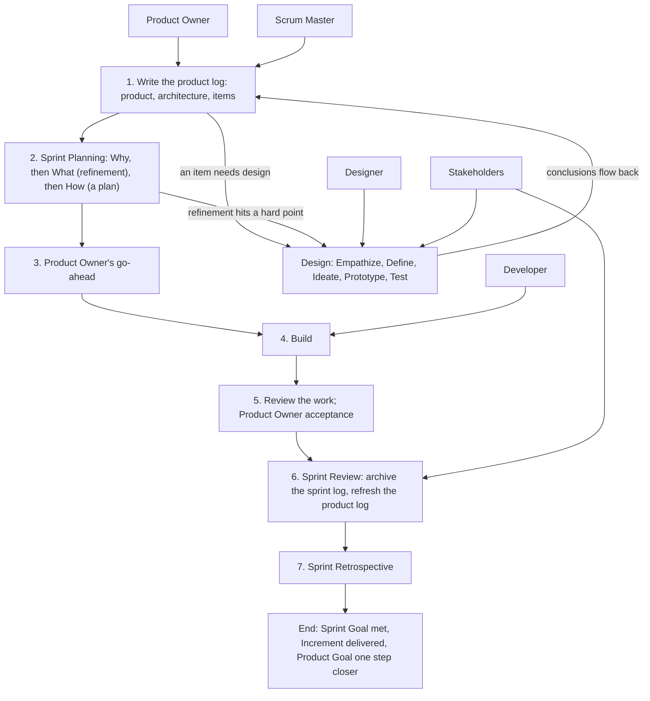

# Overview — How the Pieces Fit (v1)

> These are working conventions, v1 — the author's reading of Scrum and design thinking for solo + AI teams. They are less precise than the official guides. Use them as reference: follow what fits, override what doesn't, and note why. Where a convention departs from the official guide on purpose, it says so and gives the reason.

> Source: quotations from The Scrum Guide 2020 (Ken Schwaber & Jeff Sutherland) and the Scrum Guide Expansion Pack v2026.1 (Ralph Jocham, John Coleman, Jeff Sutherland), marked where they appear; the rest is the author's working conventions.
> License: the quotations are CC BY-SA 4.0 (© 2020 Ken Schwaber and Jeff Sutherland; © 2025 Ralph Jocham, John Coleman, and Jeff Sutherland).

Source labels and short names are explained in convention 13.

The other files: `product-log.md` and `product-backlog-template.md`; `sprint-log.md` and `sprint-backlog-template.md`; for designs, `../design-kernel/conventions/design-log.md` and `../design-kernel/conventions/design-backlog-template.md` (paths starting with `../` are relative to the scrum-kernel skill folder).

## The map

## Where things live

1. **One product log** — *Author's practice.* Every project, new or old, starts from one product log.
2. **Sprints and designs side by side** — *Author's practice.* Below the product log sit two peers: a Sprint, the Developer's, delivers an Increment; a design, the Designer's, delivers a prototype and conclusions. Open a design when an item needs design or Sprint refinement hits a hard point; it is not part of a Sprint. Decide item by item whether design is needed; a design's conclusions still land through a Sprint; an Increment need not be code — the Definition of Done says what it is.
   *Departs from the Scrum Guide on purpose*, which has all the work "happen within Sprints": a design delivers no Increment, may span several Sprints, and the Designer and the Developer are peers.
3. **Three layers** — *Author's practice.*

   | Layer | File | Commitment | Accountable | Facilitates |
   | --- | --- | --- | --- | --- |
   | 1 | Product log | Product Goal | Product Owner, with the Scrum Master | — |
   | 2 | Sprint log | Sprint Goal | Developer | Scrum Master |
   | 2 | Design log | Design goal | Designer | Scrum Master |
   | 3 | Increment: code or documents, as the Definition of Done says | Definition of Done | Developer | — |
   | 3 | Prototype: kept in the design folder, never in an Increment | Design questions | Designer | — |

   The third layer is not a log and has no prescribed method; it relies on the skills of whoever does the work. Increments add up into the product; prototypes are thrown away when the design closes, and only what was learned flows back.
4. **Folders** — *Author's practice.* `scrum/` holds all of the Scrum work: `ProductBacklog.md`; one folder for each Sprint or design in progress — `sprint-NN-<suffix>/` with its `SprintBacklog.md` and working files, `design-<suffix>/`, unnumbered, with its `DesignBacklog.md` and prototypes; and `documents/` (convention 5). This is the author's layout; use your project's own places if it has them.
5. **The documents folder** — *Author's practice.* A file that serves only one Sprint or design stays in its folder and is deleted at close; git keeps it. A file that serves the whole Scrum goes into `scrum/documents/`, and the logs reference it: design documents, background material, long content written for the product log, and the archives made at close — compressed sprint logs and design Reviews. At each Review, glance at `scrum/documents/` and delete what is outdated. The project's own documentation, such as a user manual or API notes, is outside these conventions; keep it where the project keeps it, such as `docs/` at the root.
6. **Names** — *Author's practice.* The terms used in all the conventions are defined here once:
   - the **product log** is the Product Backlog, kept in `ProductBacklog.md`; the **sprint log** is the Sprint Backlog, kept in `SprintBacklog.md`; the **design log** is kept in `DesignBacklog.md` — a file made from a template takes these names, whatever the template is called;
   - a **product backlog item (PBI)** is one row of the product log's item table;
   - a **role card** is one row of the product log's stakeholder table.

## Who does what

7. **Roles** — *Author's practice.* Every AI role loads the ideo-kernel skill first, the shared toolbox.

   | Role | Home turf | Accountable for | Kernels |
   | --- | --- | --- | --- |
   | Product Owner | The product log and its handoffs | Value direction; the Product Goal and Sprint Goals; which items enter a Sprint; the go-ahead; the items, decided with the Scrum Master | — (a person) |
   | Scrum Master | Sprint logs and design logs | Facilitating Planning and refinement; recording; tracking; reviewing the How and the Increment; the Product Owner's secretary | ideo, scrum, design |
   | Developer | The Sprint | The sprint log, the How, the Increment; the last check that nothing in refinement is unclear | ideo, scrum |
   | Designer | The design | Design research and prototypes; conclusions back to the product log and the Sprint that asked | ideo, design |
   | Stakeholder | An outside view | Looking as one row of the product log's stakeholder table; summoned at Review, or to review when the Product Owner names it | ideo |

   The Product Owner, the Scrum Master, and the Developer keep the sprint log together; without a Developer, the Product Owner and the Scrum Master run the Sprint alone.
8. **Only the Product Owner must be human** — *Author's practice.* The other roles may all be AI. *Departs from the Scrum Guide Expansion Pack on purpose*, which says the Product Owner and the Scrum Master "must be human" and that "At least one Product Developer should be human": here one person works with AI and keeps the value decisions.
9. **Ask the Product Owner** — *Author's practice.* Whoever is unsure asks the Product Owner, unless the Product Owner has sent that kind of question elsewhere.
10. **Product Owner as Developer** — *Author's practice.* When the Product Owner builds, they take part as a Developer, and the How is worked out with them.

## Sessions

11. **One Scrum Master per project** — *Author's practice.* Each project has one session as its Scrum Master, leading its Developer, Designer, and Stakeholders. A session above several projects only summarizes; each project's facts stay in its own logs.
12. **Who gets which work** — *Author's practice.* Review goes to the Scrum Master by default (`sprint-log.md`, convention 16). Long-running upkeep — the board, summaries, tracking — goes to a standing Stakeholder session with a working identity the project writes down. A small edit to one or two files the Scrum Master makes itself. Building goes to a new Developer session when a paragraph can brief it, or to a Developer that shares the Scrum Master's context when the work needs much of the discussion; such a Developer cannot review its own work.

## About these conventions

13. **Working conventions** — *Author's practice.* Reference, not law. Each convention has a short name, for use in conversation, and one source label: **Author's practice** — how the author works; **Supplement** — inferred by the author's assistant, not yet confirmed in practice; **Decide on the spot** — no fixed rule, decide when it comes up. The templates carry the flow; the convention files say how, and when a step may be skipped. They describe roles and steps, not the mechanics of any tool.
14. **Revise them weekly** — *Author's practice.* Note what does not fit, and revise the conventions about once a week; a revision applies from the next Sprint, never in the middle of one.
15. **Templates record outputs** — *Author's practice.* A template's chapters follow the flow, and its sections hold only what each step produced; how to do a step belongs in the conventions.

## What stays fixed

16. **Goal fixed, plan flexible** — *Author's practice.* Each log has one fixed commitment: the Product Goal, the Sprint Goal, the design goal; the Definition of Done is not weakened either. Everything under a commitment — items, refinement points, acceptance criteria, the How, the chosen design solution — may change as you learn, and each log records what changed and why. Only the Product Owner changes a commitment, and only the Product Owner cancels a Sprint whose goal can no longer be met.
    The Scrum Guide says it this way. On the Product Goal: "They must fulfill (or abandon) one objective before taking on the next." During the Sprint: "No changes are made that would endanger the Sprint Goal", "Quality does not decrease", and "Scope may be clarified and renegotiated with the Product Owner as more is learned." And: "Only the Product Owner has the authority to cancel the Sprint."

## Departures from the official guides

Each reason is in the convention named in the last column.

| Here | The official guide | See |
| --- | --- | --- |
| Only the Product Owner must be human | SGEP: the Product Owner and the Scrum Master must be human, and at least one Product Developer should be | Convention 8 |
| Designs sit beside Sprints | Scrum Guide: all the work happens within Sprints | Convention 2 |
| Items are numbered, not ranked | Scrum Guide: the Product Backlog is ordered | `product-log.md`, convention 11 |
| The Product Owner decides the items with the Scrum Master | Scrum Guide: the Developers select items with the Product Owner | `product-log.md`, convention 12 |
| The How is a plan, and building waits for the go-ahead | Scrum Guide: how is the Developers' call | `sprint-log.md`, conventions 7 and 8 |
| Checkpoints replace the Daily Scrum | Scrum Guide: a daily event for the Developers | `sprint-log.md`, convention 10 |
| A reviewer is required | Scrum Guide: the Developers instill quality | `sprint-log.md`, convention 16 |
| No Sprint end date | Scrum Guide: fixed length, one month or less | `sprint-log.md`, convention 2 |
| Closed logs are kept in `scrum/documents/` | — | Convention 5 |
