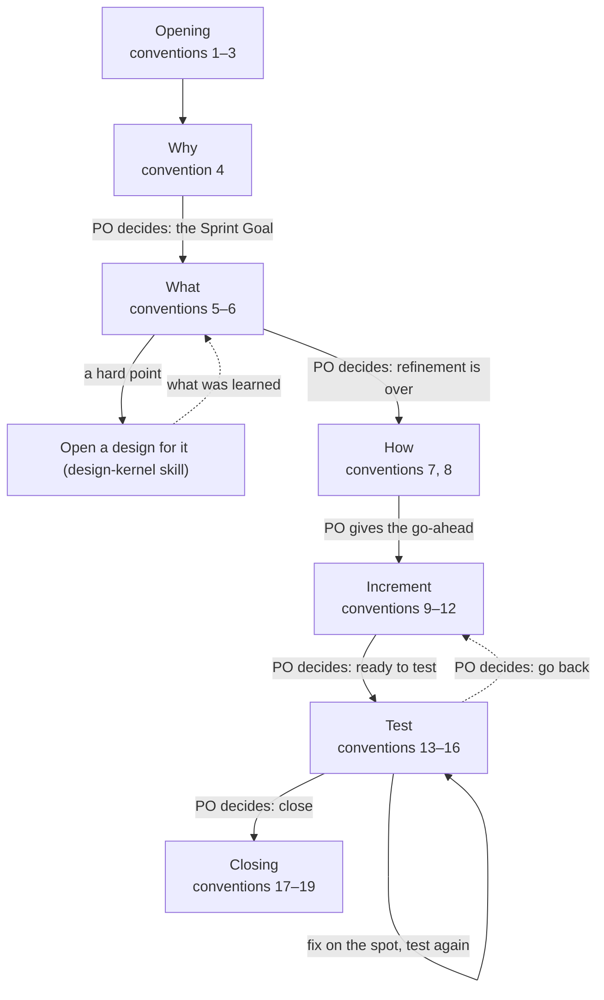

# Sprint Log Conventions (v1)

> Working conventions, v1: reference, not law — follow what fits, override what doesn't, note why. Source labels and the rest: `overview.md` (in the skill folder, beside `SKILL.md`), convention 14. A convention with no label is the author's practice.

> Source: quotations from The Scrum Guide 2020 (Ken Schwaber & Jeff Sutherland), marked where they appear.
> License: the quotations are CC BY-SA 4.0 (© 2020 Ken Schwaber and Jeff Sutherland).

A Sprint turns selected items into an Increment. Its template is `sprint-backlog-template.md`; each section's comment says who writes it.

Conventions 20–24 hold at every step; see Throughout, below. At each "PO decides" the Product Owner decides as convention 24 says.

## Opening

1. **One branch, one folder** — Give each Sprint one branch, with a separate working copy if wanted, and one folder, `scrum/sprint-NN-<suffix>/`: a two-digit number — the previous Sprint's plus one, starting at 01 — and a suffix saying what the Sprint is about. The folder's name is also the branch's name, and the tag's at close.
2. **No end date** — Close a Sprint when its goal is met or the Product Owner stops it; the Product Owner watches at checkpoints for a Sprint that drags on. This departs from the Scrum Guide: see the Departures section of `overview.md`.
3. **Small work, small Sprint** — Open a Sprint even for work of half an hour to one session, each step shrunk to a line or two; the go-ahead, the review, and the close still happen, and the Product Owner still decides at the end of each stage.

## Stages

### Why

4. **Stage 1: Why** — Set the Sprint Goal, drafted in the Product Owner's own style, and pick the Definition of Done items that matter; the Product Owner leads, usually with the Scrum Master. When even the Sprint Goal cannot be set, IDEO methods can help set it, as they can help at any hard point: they underlie every stage (`overview.md`, convention 7). Share the result with the Scrum Master and the Developer.

### What

5. **Stage 2: What — select the items** — Select the items and copy each into section 2.1 word for word, five columns — number, title, user story, place, size. Add a missing item to the product log first.
6. **Stage 2: Refinement** — Refine the items one at a time, led by the Scrum Master with the Product Owner; the Developer joins. Write into section 2.2 what was settled and who decided it, the acceptance criteria, and the tests. Take these seven steps:
    1. Take one item; it is the point of view.
    2. Confirm the point of view, copied from the goal or the item without change.
    3. Open the item into How Might We questions and unclear points.
    4. Place each point: the Product Owner decides it, the Developer proposes a solution, or it needs research — a question about what people want or what counts as good, with no ready answer — which opens a design (`../design-kernel/conventions/design-log.md`, convention 1).
    5. Cut the item into items of a few sessions at most, with acceptance criteria.
    6. Check that no questions are left — the Developer's about what is meant, the Product Owner's about what will be built: the Developer restates each point, and the Product Owner agrees.
    7. The Product Owner says when refinement is over.

### How

7. **How is a plan, not steps** — The Developer writes chapter 3 as a plan for making the selected items: the work items in order, each done within one session, each with its output and how to tell it is done; the key choices and their reasons; the known risks and open points. Write it to the level of approach, not steps: no step-by-step instructions, no file contents, no polishing of the plan; if you can write the steps, do the work. It is not the solution a design chose: if a design gave a solution, the plan is how to build it. The Scrum Guide's measure, "decomposing Product Backlog items into smaller work items of one day or less", becomes one session here. The Scrum Master and the Product Owner check the plan. This departs from the Scrum Guide: see the Departures section of `overview.md`.
8. **Go-ahead** — Start building only after the Product Owner's go-ahead; approving a plan is not a go-ahead. Write it as the last line of chapter 3, with the date and how far it reaches: commit, merge, tag, release, push. The Product Owner may hand the review of the How, of new structures, and of full texts to the Scrum Master; write the handover in the log.

### Increment

9. **Notes as you go** — Keep chapter 4, Increment notes, as the full record, so a new session can pick the Sprint up from the log alone. A session that picks up the Sprint goes by the notes and does not work everything out again. The notes take whatever form helps; they need not be a running account of what was done. The How in chapter 3 is a note too, and chapter 4 may refine it.
10. **Checkpoints, not stand-ups** — Stop and check the work against the Sprint Goal at the end of each stage (convention 24), whenever the AI is stuck, and whenever the Product Owner asks how things stand. This departs from the Scrum Guide's Daily Scrum: see the Departures section of `overview.md`.
11. **Structure before full text** — Show a new template or structure, as a chapter list on its own, to whoever reviews it (convention 8) before writing the full text.
12. **Full text for review** — Put a new lasting document's full text — word for word, not an outline — where the reviewer (convention 8) can annotate it, with the problems you found and a recommendation for each; change the source files only after approval. The version on disk wins: read before you overwrite.

### Test

13. **Tests: criteria first** — Commit the test method and the pass lines in section 2.2 before running; do not change them after seeing results; check a script's wrong calls one by one, and write down why.
14. **A reviewer is required** — Have someone other than the builder review: the Scrum Master by default, or a Stakeholder or a fresh subagent when the Product Owner names one. A Stakeholder named as reviewer checks the work item by item against the Definition of Done and the acceptance criteria. When the Scrum Master also built the work, a fresh subagent reviews, checking only whether the work was done right. When the Developer only shares the Scrum Master's context, the Scrum Master still reviews: a shared context does not make it the builder. Brief a review subagent with the task, the project's rules, and the decisions already issued. The Scrum Master may send a subagent to do the review or to read a long diff, and still owns the conclusion. This departs from the Scrum Guide: see the Departures section of `overview.md`.
15. **Product Owner acceptance when written** — Ask for formal acceptance only when the Definition of Done or the acceptance criteria call for it; sometimes a glance is enough.
16. **Stage 5: Test** — Record in chapter 5 the Developer's tests, the reviewer's check (by default the Scrum Master), the Product Owner's end-to-end test, and the result of each Definition of Done item and acceptance criterion. Fix a problem on the spot and test again.

## Closing

17. **Review** — Close with a Review: compress the log to its key decisions, rename it `sprint-NN-<suffix>.md`, and move it to `scrum/documents/`; then delete the other working files. Write the Stakeholders' views and the changes to the product log and the Product Goal into the product log, and refresh it (`product-log.md`, convention 17); keep `scrum/` fresh (`overview.md`, convention 5). For an outside view, the Product Owner or the Scrum Master — never the builder — summons Stakeholders from the product log's table.
18. **Retrospective** — Hold the Retrospective as an action at close, with no chapter in the log: the Developer writes the lessons into the project's memory or instructions file (starting an instructions file if there is neither), as principles — what broke, why, and the rule — so that someone who was not there can use them. An especially good improvement goes into the Definition of Done with the Product Owner's consent. Check whether the product log is still fresh.
    *Supplement:* ask where the Product Owner held up the AI — waiting for a decision, waiting for a go-ahead.
19. **One closing commit** — Close in this order:
    1. Before the closing commit, search the whole project for old paths until none remain; the fixes go into that same commit.
    2. Make one commit holding the Review and the Retrospective.
    3. Tag it with the Sprint folder's name; the tag's message says what the Sprint achieved.
    4. Merge into the main branch.
    5. Close the working copy.
    6. Delete the branch of the same name.

    Judge the project's health by `scrum/` alone: it holds all of the Scrum work (`overview.md`, convention 4); elsewhere, usually only the README needs updating. Pushing and other outward actions need the Product Owner's consent.

## Throughout

20. **Goal fixed, plan flexible** — Hold the Sprint Goal and the Definition of Done (`overview.md`, convention 17). The How may change at any time; refinement points and acceptance criteria may be renegotiated with the Product Owner, or with the Scrum Master as the Product Owner's secretary. Write each change and its reason in chapter 4, Increment notes.
21. **New work gets registered** — New work goes into the product log as an item first; the Product Owner decides whether it enters this Sprint. The scope can be renegotiated; the Sprint Goal stays.
22. **The log is the handoff** — Write no separate handoff documents: before a session ends or its context is shortened, write what matters into the log, commit, and stop at a complete point.
23. **Special cases** — Two cases need a rule of their own:

    | Case | What happens |
    | --- | --- |
    | Something outside the team blocks the work | The Scrum Master tells the Product Owner at once |
    | A release is ready mid-Sprint | Release it; the Sprint does not end |
24. **The Product Owner decides at the end of each stage** — At the end of each stage the Product Owner decides, as `overview.md`, *Product Owner decides between stages*, says: Why — the Sprint Goal; What — that refinement ends here; How — the go-ahead; Increment — that it can go into testing; Test — to close (then the Review and the Retrospective) or to go back. Write the decision as the last line of the stage's chapter.
