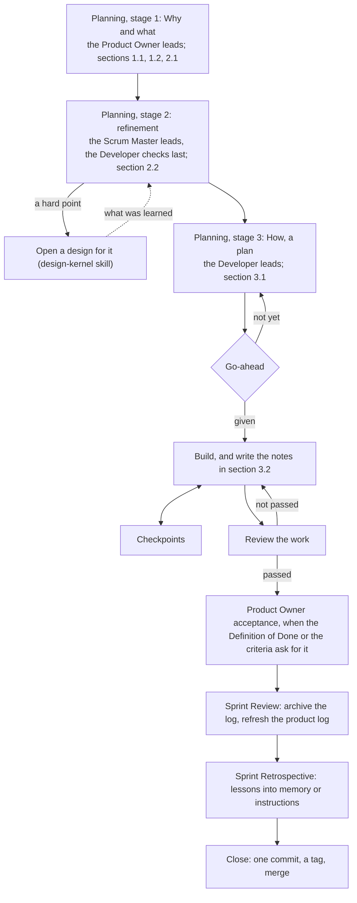

# Sprint Log Conventions (v1)

> These are working conventions, v1 — the author's reading of Scrum and design thinking for solo + AI teams. They are less precise than the official guides. Use them as reference: follow what fits, override what doesn't, and note why. Where a convention departs from the official guide on purpose, it says so and gives the reason.

> Source: quotations from The Scrum Guide 2020 (Ken Schwaber & Jeff Sutherland), marked where they appear; the rest is the author's working conventions.
> License: the quotations are CC BY-SA 4.0 (© 2020 Ken Schwaber and Jeff Sutherland).

Each convention has a short name, so it can be referred to in conversation, and one source label:

- **Author's practice** — how the author works.
- **Supplement** — inferred by the author's assistant; not yet confirmed in practice.
- **Decide on the spot** — no fixed rule; decide when it comes up.

A Sprint is the Developer's module below the product log: it turns selected product backlog items into an Increment. Its log is made from `sprint-backlog-template.md` in this folder and named `SprintBacklog.md`. How the logs fit together is in `overview.md`; how to write and refine product backlog items is in `product-log.md`.

## The flow

Who writes each section:

| Section | What | Who |
| --- | --- | --- |
| 1.1 Sprint Goal | What this Sprint is to achieve | The Product Owner decides |
| 1.2 Definition of Done | The Definition of Done items that matter to this Sprint | The Product Owner picks |
| 2.1 Product Backlog Items | The selected items | The Product Owner leads; the Scrum Master and the Developer say when it is too much or too little |
| 2.2 Refinement | Everything refinement settled, with acceptance criteria and tests | The Scrum Master leads |
| 3.1 How | The plan, and the go-ahead line | The Developer |
| 3.2 Notes | The running record | Whoever did the thing |
| 4 Review | Written at close | The Product Owner, the Scrum Master, and the Developer |

## Opening a Sprint

1. **One branch, one folder** — *Author's practice.* Each Sprint has one branch; a separate working copy for it is optional. Its folder is `scrum/sprint-NN-<suffix>/`: a two-digit number, and a suffix that says what the Sprint is about. The folder holds `SprintBacklog.md`, made from the template, and any working files. The folder's name is also the branch's name, and the tag's name at close (convention 20).
2. **No end date** — *Author's practice.* A Sprint closes when its goal is met or when the Product Owner stops it. The log has no end date.
   *Departs from the Scrum Guide on purpose.* The Scrum Guide says Sprints "are fixed length events of one month or less to create consistency." Reason: AI works by session, so dates carry little meaning. The cost: only the Product Owner notices a Sprint that drags on, so the Product Owner watches for it at checkpoints.
3. **Goal fixed, plan flexible** — *Author's practice.* The Sprint Goal and the Definition of Done hold; the Scrum Guide says that during the Sprint "No changes are made that would endanger the Sprint Goal" and "Quality does not decrease". Everything else in chapters 1 to 3 may change as you learn: the How at any time, and the refinement points and acceptance criteria with the Product Owner — "Scope may be clarified and renegotiated with the Product Owner as more is learned." Write each change and its reason in the notes; the notes are only ever added to. When the Sprint Goal can no longer be met, the Product Owner cancels the Sprint: "Only the Product Owner has the authority to cancel the Sprint." The whole rule, for all three logs, is in `overview.md`, convention 16.
4. **Small work, small Sprint** — *Author's practice.* Work that takes half an hour to one session still gets a Sprint. Every step shrinks to a line or two; the go-ahead, the review, and the close still happen.

## Planning

5. **Stage 1: Why and what** — *Author's practice.* The Product Owner leads, usually with the Scrum Master, sometimes with the Developer too. Set the Sprint Goal, select the items, and pick the Definition of Done items that matter (sections 1.1, 1.2, and 2.1). Draft the Sprint Goal in the Product Owner's own style: read the goals the Product Owner wrote before. When nothing can be selected, the IDEO methods in the ideo-kernel skill can guide the choice. When the product log lacks an item, add it there first. When stage 1 is done, show it to the Developer.
6. **Stage 2: Refinement** — *Author's practice.* The Scrum Master leads, with the Product Owner; the Developer joins the discussion. Use the seven steps in `product-log.md`, convention 15. Write into section 2.2 what was settled and who decided each point, the acceptance criteria not already in the product log, and the tests (convention 15). A point that needs research becomes a design (design-kernel skill), and the rest of the Sprint goes on. Last, the Developer checks that nothing is unclear.
7. **How is a plan, not steps** — *Author's practice.* The Developer leads. Section 3.1 holds three things:
   - the work items, in order, each done within one session, each with its output and how to tell it is done;
   - the key choices, with the reasons;
   - the known risks and open points.

   It does not say what each file will contain, does not give step-by-step instructions, and does not polish the plan itself: if you can write down the steps, do the work instead. The Scrum Guide says planning "is often done by decomposing Product Backlog items into smaller work items of one day or less", and that the Sprint Backlog "should have enough detail that they can inspect their progress in the Daily Scrum." Here one day becomes one session, and the Daily Scrum becomes a checkpoint (convention 10). Nothing in the Increment changes yet. The Scrum Master and the Product Owner check that the plan is right; the detailed review comes later, on the Increment (convention 16).
   *Departs from the Scrum Guide on purpose.* The Scrum Guide says: "How this is done is at the sole discretion of the Developers." Reason: AI cannot be fully trusted yet, a Developer may drift, and the Product Owner sometimes builds.
8. **Go-ahead** — *Author's practice.* Building starts once the How is settled and the Product Owner gives the go-ahead; approving a plan is not a go-ahead. Write the go-ahead as one line at the end of section 3.1, with the date and how far it reaches: committing, merging, tagging, releasing, pushing. The Product Owner may hand the review of the How, of a new structure, or of full texts to the Scrum Master; write the handover in the log, and from then on the Scrum Master's approval counts.

## Building

9. **Notes as you go** — *Author's practice.* Section 3.2 is the full record: when a session ends, a new one can pick up the Sprint from the log alone, so a long log is fine. Each row gives the date, what was done, the decision and its reason, the evidence (a commit, a test result), and the next step. A session that picks up the Sprint goes by the notes and does not work everything out again.
10. **Checkpoints, not stand-ups** — *Author's practice.* Checkpoints have no fixed time: the AI stops and asks the Product Owner, or the Product Owner asks how things stand. Either way, check the work against the Sprint Goal.
    *Departs from the Scrum Guide on purpose.* The Scrum Guide says: "The Daily Scrum is a 15-minute event for the Developers of the Scrum Team." Reason: AI works by session, not by day, and it stops to ask the Product Owner whenever it needs to.
11. **New work gets registered** — *Author's practice.* New work that turns up during a Sprint goes into the product log as an item first. Then the Product Owner decides whether it enters this Sprint — the scope can be renegotiated, the Sprint Goal stays — or waits for the next.
12. **Structure before full text** — *Author's practice.* For a new template or any new structure, show its chapter list on its own to whoever reviews it — the Product Owner, or the Scrum Master if the Product Owner handed the review over (convention 8) — before writing the full text, and again before acceptance.
13. **Full text for review** — *Author's practice.* For a new lasting document, put the full text where the Product Owner can annotate it paragraph by paragraph, together with the problems you found yourself, each with a recommendation. Change the source files only after approval. The version on disk wins: the Product Owner may edit files directly, so read a file before you overwrite it.
14. **The log is the handoff** — *Author's practice.* There are no separate handoff documents. Before a session ends, or before its context is shortened, write what matters into the log, commit, and stop at a complete point.
15. **Tests: criteria first** — *Author's practice.* Write the test method and the pass lines into section 2.2 and commit them on their own; then run the tests. Do not change the criteria after seeing results. When a script judges a case, check its wrong calls one by one and write down the reason for each correction.

## Review and acceptance

16. **A reviewer is required** — *Author's practice.* Someone other than the builder reviews the work, because a Developer may drift. The Scrum Master reviews by default; when the Product Owner names one, a Stakeholder or a fresh subagent reviews instead. When the Scrum Master also built the work, or the Developer shares the Scrum Master's context, the review goes to a fresh subagent that only checks whether the work was done right. Give a review subagent the task, the project's rules, and the decisions already issued; without the decisions it reports problems that are not there.
    *Departs from the Scrum Guide on purpose.* The Scrum Guide makes the Developers accountable for "Instilling quality by adhering to a Definition of Done". Reason: AI cannot be fully trusted yet, and a second look catches drift early.
17. **Product Owner acceptance when written** — *Author's practice.* The Product Owner accepts the work formally only when the Definition of Done or the acceptance criteria call for it, such as an end-to-end test; sometimes a glance is enough.

## Closing

18. **Review** — *Author's practice.* Close the Sprint with its Review, in this order:
    1. Prepare: the Increment, the Definition of Done item by item, the acceptance criteria, the changes to the product log and the Product Goal, and the input for the Retrospective.
    2. Delete the working files in the Sprint folder, all but `SprintBacklog.md`.
    3. Compress the log to its key decisions, and write chapter 4.
    4. Rename it `sprint-NN-<suffix>.md`, after the folder, and move it to the document folder (`overview.md`, convention 5).
    5. Refresh the product log (`product-log.md`, convention 17).

    When an outside view is needed, the Product Owner or the Scrum Master summons Stakeholders from the product log's stakeholder table to look at the Increment. The builder does not summon them to judge its own Increment.
19. **Retrospective** — *Author's practice.* The log has no Retrospective chapter. The Developer writes the lessons into the project's memory or its instructions file, as principles: what broke, why, and the rule that follows, so that someone who was not there can use them. An especially good improvement goes into the Definition of Done, with the Product Owner's consent. Ask once where the Product Owner held up the AI — waiting for a decision, waiting for a go-ahead — and glance at whether the product log is still fresh.
20. **One closing commit** — *Author's practice.* The Review and the Retrospective go into a single commit. Tag it with the Sprint folder's name, and write in the tag's message what the Sprint achieved. Delete the branch of the same name right away, so the tag and the branch do not share a name. After renaming or moving files, search the whole project for the old paths. Merge into the main branch, and close the Sprint's branch and working copy. Judge the project's health mainly by `scrum/`, above all the product log; elsewhere, usually only the project's README needs updating. Pushing, publishing, and other outward actions happen only with the Product Owner's consent.

## When things change

21. **Special cases** — *Author's practice.*

    | Case | What happens |
    | --- | --- |
    | The review or the acceptance fails | Write down what is missing, and go back to building |
    | Something outside the team blocks the work | The Scrum Master tells the Product Owner at once |
    | Refinement hits a hard point | Open a design for it (design-kernel skill); the rest of the Sprint goes on |
    | A release is ready in the middle of the Sprint | Release it; the Sprint does not end |
    | An item is not finished at close | It goes back to the product log; it is not carried over |
    | The Sprint Goal becomes obsolete | Only the Product Owner can cancel the Sprint |
    | The work is small | Open a small Sprint (convention 4) |
