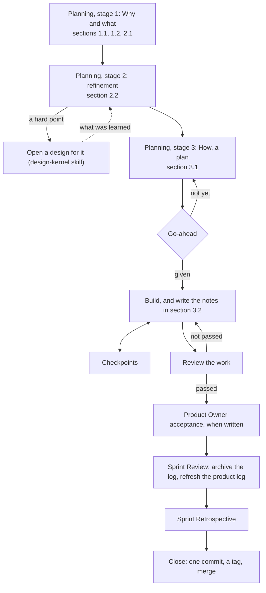

# Sprint Log Conventions (v1)

> Working conventions, v1: reference, not law — follow what fits, override what doesn't, note why. Source labels and the rest: `overview.md`, convention 13.

> Source: quotations from The Scrum Guide 2020 (Ken Schwaber & Jeff Sutherland), marked where they appear.
> License: the quotations are CC BY-SA 4.0 (© 2020 Ken Schwaber and Jeff Sutherland).

A Sprint turns selected items into an Increment. Its template is `sprint-backlog-template.md`; each section's comment says who writes it.

## Opening a Sprint

1. **One branch, one folder** — *Author's practice.* Each Sprint has one branch, with a separate working copy if wanted, and one folder, `scrum/sprint-NN-<suffix>/`: a two-digit number — the previous Sprint's plus one, starting at 01 — and a suffix saying what the Sprint is about. The folder's name is also the branch's name, and the tag's at close.
2. **No end date** — *Author's practice.* A Sprint closes when its goal is met or the Product Owner stops it. *Departs from the Scrum Guide on purpose*, where Sprints are "fixed length events of one month or less": AI works by session, so the Product Owner watches at checkpoints for a Sprint that drags on.
3. **Goal fixed, plan flexible** — *Author's practice.* The Sprint Goal and the Definition of Done hold. The How may change at any time; refinement points and acceptance criteria may be renegotiated with the Product Owner. Write each change and its reason in the notes, which are only ever added to (`overview.md`, convention 16).
4. **Small work, small Sprint** — *Author's practice.* Work of half an hour to one session still gets a Sprint, each step shrunk to a line or two; the go-ahead, the review, and the close still happen.

## Planning

5. **Stage 1: Why and what** — *Author's practice.* The Product Owner leads, usually with the Scrum Master. Set the Sprint Goal, drafted in the Product Owner's own style; select the items and copy each into section 2.1 word for word, five columns — number, title, user story, place, size; pick the Definition of Done items that matter. A missing item is added to the product log first. When nothing can be chosen, IDEO methods can guide the choice. Show the result to the Developer.
6. **Stage 2: Refinement** — *Author's practice.* The Scrum Master leads with the Product Owner; the Developer joins. Use the seven steps (`product-log.md`, convention 15), and write into section 2.2 what was settled and who decided it, the acceptance criteria, and the tests. A point that needs research becomes a design. Last, the Developer confirms that nothing is unclear.
7. **How is a plan, not steps** — *Author's practice.* The Developer writes in section 3.1: the work items in order, each done within one session, each with its output and how to tell it is done; the key choices and their reasons; the known risks and open points. No step-by-step instructions, no file contents, no polishing of the plan: if you can write the steps, do the work. The Scrum Guide's measure, "decomposing Product Backlog items into smaller work items of one day or less", becomes one session here. *Departs from the Scrum Guide on purpose*, where how to build is "at the sole discretion of the Developers": the Scrum Master and the Product Owner check the plan, because AI may drift.
8. **Go-ahead** — *Author's practice.* Building starts after the Product Owner's go-ahead; approving a plan is not a go-ahead. Write it as the last line of section 3.1, with the date and how far it reaches: commit, merge, tag, release, push. The Product Owner may hand the review of the How, of new structures, and of full texts to the Scrum Master; write the handover in the log.

## Building

9. **Notes as you go** — *Author's practice.* Section 3.2 is the full record, so a new session can pick the Sprint up from the log alone. A session that picks up the Sprint goes by the notes and does not work everything out again.
   *Supplement:* each row gives the date, what was done, the decision and its reason, the evidence, and the next step.
10. **Checkpoints, not stand-ups** — *Author's practice.* At no fixed time, the AI stops to ask the Product Owner, or the Product Owner asks how things stand; either way, check the work against the Sprint Goal. *Departs from the Scrum Guide on purpose*, where the Daily Scrum is "a 15-minute event for the Developers": AI works by session, not by day.
11. **New work gets registered** — *Author's practice.* New work goes into the product log as an item first; the Product Owner decides whether it enters this Sprint. The scope can be renegotiated; the Sprint Goal stays.
12. **Structure before full text** — *Author's practice.* Show a new template or structure, as a chapter list on its own, to whoever reviews it (convention 8) before writing the full text.
13. **Full text for review** — *Author's practice.* Put a new lasting document's full text — word for word, not an outline — where the reviewer (convention 8) can annotate it, with the problems you found and a recommendation for each; change the source files only after approval. The version on disk wins: read before you overwrite.
14. **The log is the handoff** — *Author's practice.* No separate handoff documents: before a session ends or its context is shortened, write what matters into the log, commit, and stop at a complete point.
15. **Tests: criteria first** — *Author's practice.* Commit the test method and the pass lines in section 2.2 before running; do not change them after seeing results; check a script's wrong calls one by one, and write down why.

## Review and acceptance

16. **A reviewer is required** — *Author's practice.* Someone other than the builder reviews: the Scrum Master by default, or a Stakeholder or a fresh subagent when the Product Owner names one. A Stakeholder named as reviewer checks the work item by item against the Definition of Done and the acceptance criteria. When the Scrum Master also built the work, or the Developer shares the Scrum Master's context, a fresh subagent reviews, checking only whether the work was done right. Brief a review subagent with the task, the project's rules, and the decisions already issued. The Scrum Master may send a subagent to read a long diff, and still owns the conclusion. *Departs from the Scrum Guide on purpose*, where the Developers are accountable for "Instilling quality by adhering to a Definition of Done": a Developer may drift, and a second look catches it.
17. **Product Owner acceptance when written** — *Author's practice.* Formal acceptance happens only when the Definition of Done or the acceptance criteria call for it; sometimes a glance is enough.

## Closing

18. **Review** — *Author's practice.* Prepare the Increment, the Definition of Done and the acceptance criteria item by item, the product log changes, and the input for the Retrospective; delete the working files except `SprintBacklog.md`; compress the log to its key decisions and write chapter 4; rename it `sprint-NN-<suffix>.md` and move it to `scrum/documents/`; glance at `scrum/documents/` and delete what is outdated (`overview.md`, convention 5); refresh the product log (`product-log.md`, convention 17). For an outside view, the Product Owner or the Scrum Master — never the builder — summons Stakeholders from the product log's table.
19. **Retrospective** — *Author's practice.* The log has no Retrospective chapter. The Developer writes the lessons into the project's memory or instructions file, as principles — what broke, why, and the rule — so that someone who was not there can use them. An especially good improvement goes into the Definition of Done with the Product Owner's consent. Check whether the product log is still fresh.
    *Supplement:* ask where the Product Owner held up the AI — waiting for a decision, waiting for a go-ahead.
20. **One closing commit** — *Author's practice.* Close in this order:
    1. Before the closing commit, search the whole project for old paths until none remain; the fixes go into that same commit.
    2. Make one commit holding the Review and the Retrospective.
    3. Tag it with the Sprint folder's name; the tag's message says what the Sprint achieved.
    4. Merge into the main branch.
    5. Close the working copy.
    6. Delete the branch of the same name.

    Judge the project's health mainly by `scrum/`, above all the product log; elsewhere, usually only the README needs updating. Pushing and other outward actions need the Product Owner's consent.

## When things change

21. **Special cases** — *Author's practice.*

    | Case | What happens |
    | --- | --- |
    | The review or the acceptance fails | Write down what is missing, and go back to building |
    | Something outside the team blocks the work | The Scrum Master tells the Product Owner at once |
    | Refinement hits a hard point | Open a design for it; the rest of the Sprint goes on |
    | A release is ready mid-Sprint | Release it; the Sprint does not end |
    | An item is not finished at close | It goes back to the product log; it is not carried over |
    | The Sprint Goal becomes obsolete | Only the Product Owner can cancel the Sprint |
    | The work is small | Open a small Sprint (convention 4) |
