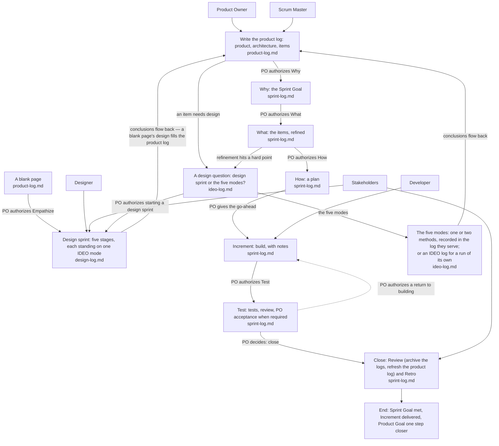

# Overview — How the Pieces Fit

> These are working conventions — the author's reading of Scrum and design thinking for solo + AI teams. They are less precise than the official guides. Use them as reference: follow what fits, override what doesn't, and note why. Where a convention departs from the official guide on purpose, the Departures section says so and gives the reason.

> Source: quotations from The Scrum Guide 2020 (Ken Schwaber & Jeff Sutherland) and the Scrum Guide Expansion Pack v2026.1 (Ralph Jocham, John Coleman, Jeff Sutherland), marked where they appear; the rest is the author's working conventions.
> License: the quotations are CC BY-SA 4.0 (© 2020 Ken Schwaber and Jeff Sutherland; © 2025 Ralph Jocham, John Coleman, and Jeff Sutherland).

Source labels and short names are explained in convention 15.

The other files: `conventions/product-log.md` and `conventions/product-backlog-template.md`; `../sprint-kernel/conventions/sprint-log.md` and `../sprint-kernel/conventions/sprint-backlog-template.md`; for designs, `../design-kernel/conventions/design-log.md` and `../design-kernel/conventions/design-backlog-template.md`; for the five modes, `../ideo-kernel/conventions/ideo-log.md` and `../ideo-kernel/conventions/ideo-backlog-template.md` (paths are relative to the scrum-kernel skill folder, where this file sits beside `SKILL.md`; the Sprint files belong to the sprint-kernel skill, the design files to the design-kernel skill, the IDEO files to the ideo-kernel skill — read them when you open or resume a design, a Sprint, or a run of the five modes).

## The map

## Conventions

### Where things live

1. **One product log** — Start every project, new or old, from one product log.
2. **Sprints and designs side by side** — Treat Sprints and designs as peers under the product log: a Sprint, the Developer's, delivers an Increment; a design, the Designer's, delivers a prototype and conclusions. Open a design when an item needs design, when Sprint refinement hits a hard point, or for a blank page (`conventions/product-log.md`, convention 2); it is not part of a Sprint. Whether a question needs a design sprint or the five modes is `../ideo-kernel/conventions/ideo-log.md`, convention 1. Decide item by item whether design is needed; a design's conclusions still land through a Sprint; an Increment need not be code — the Definition of Done says what it is. This departs from the Scrum Guide: see Departures.
3. **Three layers**

   | Layer | File | Commitment | Accountable | Facilitates |
   | --- | --- | --- | --- | --- |
   | 1 | Product log | Product Goal | Product Owner, with the Scrum Master | — |
   | 2 | Sprint log | Sprint Goal | Developer | Scrum Master |
   | 2 | Design log | Design goal | Designer | Scrum Master |
   | 3 | Increment: code or documents, as the Definition of Done says | Definition of Done | Developer | — |
   | 3 | Prototype: built to learn, never in an Increment; a design’s prototype stays with its design evidence | Design questions | Designer | — |

   The third layer is not a log and has no prescribed method; it relies on the skills of whoever does the work. Increments add up into the product. The design’s conclusions flow back; its working material, including the prototype, stays with the design and can be referenced by the Sprint that builds those conclusions (`../design-kernel/conventions/design-log.md`, convention 19). The standalone IDEO log has its own rule (`../ideo-kernel/conventions/ideo-log.md`, convention 4).
4. **Folders** — `scrum/` holds all of the Scrum work: `ProductBacklog.md`; `ScrumBoard.html`, the board written from the logs, which keeps no state of its own (`conventions/board-log.md`); `sprint-NN-<suffix>/` with `SprintBacklog.md` and its working files; `design-<suffix>/`, unnumbered, with `DesignBacklog.md`, prototypes, and other working material; `ideo-<suffix>/`, unnumbered, with `IdeoBacklog.md`, prototypes, and working files; and `documents/` (convention 5). The active folders may still hold work that ended and is awaiting Review; read the log’s `Now` before resuming. This is the author’s layout; use your project’s own places if it has them.
5. **Where files go** — A file that serves only one log usually stays in its working folder and can be cleaned up when that work ends. The design’s original working material is the exception: retain it with the design, then move it with its log into the existing `scrum/documents/` archive at Review (`../design-kernel/conventions/design-log.md`, convention 19; `../sprint-kernel/conventions/sprint-log.md`, convention 17). Files serving the whole Scrum also go into `scrum/documents/`, and the logs reference them. A project can use its existing archive subfolders. The project’s own documentation, such as a user manual or API notes, stays where the project keeps it, such as `docs/` at the root.
6. **Working material** — Keep working material out of the log itself; link to the retained design originals as convention 5 says. Key material of general use can go into the project’s memory or instructions, and a large important file goes into `scrum/documents/`. Retro lessons go only where `../sprint-kernel/conventions/sprint-log.md`, convention 18, says, never in instructions.
7. **Names** — The terms used in all the conventions are defined here once:
   - the **product log** is the Product Backlog, kept in `ProductBacklog.md`; the **sprint log** is the Sprint Backlog, kept in `SprintBacklog.md`; the **design log** is kept in `DesignBacklog.md` — a file made from a template takes these names, whatever the template is called;
   - an **IDEO log** is the log of a run of the five modes, kept in `IdeoBacklog.md`;
   - a **product backlog item (PBI)** is one row of the product log's item table;
   - a **role card** is one row of the product log's stakeholder table;
   - a **fresh subagent** starts from its brief alone; a fork of a session, or a copy of one, does not count. When the tool has no subagents, a new session given only the brief is the equivalent.

### Who does what

8. **Roles** — Every AI role loads the ideo-kernel skill, the shared toolbox, and the scrum-kernel skill first.

   | Role | Home turf | Accountable for | Kernels |
   | --- | --- | --- | --- |
   | Product Owner | The product log and its handoffs | Value direction; the Product Goal and Sprint Goals; which items enter a Sprint; the go-ahead; the items, decided with the Scrum Master; stage results and permissions to start or return (convention 12) | — (a person) |
   | Scrum Master | Sprint logs and design logs | Facilitating Planning and refinement; recording; tracking; reviewing the How and the Increment; serves the Product Owner; acts for them within a written handover, and the accountability stays with the Product Owner; decisions made under it are recorded | ideo, scrum |
   | Developer | The Sprint | The sprint log, the How, the Increment; the last check that nothing in refinement is unclear | ideo, scrum |
   | Designer | The design | Ideas, prototypes, and tests for a design, from Ideate on (the Product Owner and the Scrum Master settle its research and definition); conclusions back to the product log and the Sprint that asked | ideo, scrum |
   | Stakeholder | An outside view, or standing non-source chores | Looking as one row of the product log's stakeholder table; a PO assistant organizes logs, summarizes progress, relays settled work and maintains the board, but does not rank, decide, review or edit plugin files | ideo, scrum |

   Every role loads the ideo-kernel and scrum-kernel skills; the sprint-kernel skill loads when the work involves a Sprint — opening, running, resuming, or closing one — and the design-kernel skill when it involves a design sprint. Subagents a role dispatches load the ideo-kernel and scrum-kernel skills too.

   The Product Owner, the Scrum Master, and the Developer keep the sprint log together; without a Developer, the Product Owner and the Scrum Master run the Sprint alone.
9. **Only the Product Owner must be human** — The other roles may all be AI. This departs from the Scrum Guide Expansion Pack: see Departures.
10. **Ask the Product Owner** — Whoever is unsure asks the Product Owner, unless the Product Owner has sent that kind of question elsewhere.
11. **Product Owner as Developer** — When the Product Owner builds, they take part as a Developer, and the How is worked out with them.
12. **Product Owner decides between stages** — The Product Owner settles each stage’s result. Before starting or returning to a stage of a Sprint or a design sprint, wait for explicit permission for that stage and scope. Approving a result is not permission to move on, though one message can say both clearly. While waiting, record the result or why a return is needed, but do not start or delegate that stage’s work. A new session may resume the same stage within its recorded permission and scope; earlier permission does not carry over to a return. The Scrum Master acts for the Product Owner only within a written handover covering the particular decision; handing over a review or a choice inside a stage does not hand over a stage transition. Record who decided, the date and basis, and the stage and scope authorized, including the written handover if used. Keep the decision at the end of its stage chapter; if permission arrives later, add that dated decision without replacing the earlier one. Record first entry when opening the log. These are stage decisions, not reviews, formal acceptance, or approval of each step. Sprint decisions: `../sprint-kernel/conventions/sprint-log.md`, convention 24; design decisions: `../design-kernel/conventions/design-log.md`, convention 26.

### Sessions

13. **One Scrum Master per project** — Each project has one session as its Scrum Master, leading its Developer, Designer, and Stakeholders. A session above several projects only summarizes; each project's facts stay in its own logs.
14. **Who gets which work** — Reviewing the work goes to the Scrum Master by default (`../sprint-kernel/conventions/sprint-log.md`, convention 14); when the Developer works in another session or tool, `../sprint-kernel/conventions/sprint-log.md`, convention 26, says how the two work together. Long-running upkeep — the board, summaries, tracking — goes to a standing Stakeholder session with a working identity the project writes down, such as PO assistant. That assistant relays only what the Product Owner or Scrum Master already decided; scope or item changes and go-aheads go through the Scrum Master, who chooses the receiving session. It does not rank, decide, review or edit plugin files; an independent outside view still comes from a fresh subagent. A small edit to one or two files the Scrum Master makes itself. Building goes to a new Developer session when a paragraph can brief it, or to a Developer that shares the Scrum Master's context when the work needs much of the discussion; such a Developer cannot review its own work.

### About these conventions

15. **Working conventions** — Reference, not law. Each convention has a short name, for use in conversation, and only the exceptions carry a source label: a convention with no label is the author's practice — how the author works; **Supplement** — inferred by the author's assistant, not yet confirmed in practice; **Decide on the spot** — no fixed rule, decide when it comes up. When you override a convention, write what you did and why in the log's notes: the sprint log's Increment notes, or the chapter of the design log it concerns. The templates carry the flow; the convention files say how, and when a step may be skipped. They describe roles and steps, not the mechanics of any tool.
16. **Templates record outputs** — A template's chapters follow the flow, and its sections hold only what each step produced; how to do a step belongs in the conventions. A log made from a template keeps all of the template's headings, including the chapters filled in later, and adds no sections of its own; put work remarks in the sprint log’s Increment notes or the relevant design chapter. An optional explanation below a commitment table belongs in the commitment’s own section (convention 17).

### What stays fixed

17. **Goal fixed, plan flexible** — Each log has one fixed commitment: the Product Goal, the Sprint Goal, the design goal; the Definition of Done is not weakened either. Everything under a commitment — items, refinement points, acceptance criteria, the How, the chosen design solution — may change as you learn, and each log records what changed and why. Only the Product Owner changes a commitment, and only the Product Owner cancels a Sprint whose goal can no longer be met.
    Keep the product statement in the product log's section 1.1, the Product Goal in its section 1.2, the Sprint Goal in the sprint log's section 1.1, and the design goal in the design log's section 1.2. Each has one one-row table: the first cell is `Commitment` (`承诺` in a Chinese log), the second is the exact text, without bold. Keep one copy, not another at the file’s top; its section heading identifies it. The table is the only source of the current commitment. Optional reasons can follow below it; they are not part of the commitment or what a reader extracts from the table. Exact text on a stage decision line is a snapshot of the commitment at that time, not a second source; do not update it when the current goal changes. Give each goal one short name and keep using that name. An IDEO log has no commitment of its own: its For field points to the log it serves.
    The Scrum Guide says it this way. On the Product Goal: "They must fulfill (or abandon) one objective before taking on the next." During the Sprint: "No changes are made that would endanger the Sprint Goal", "Quality does not decrease", and "Scope may be clarified and renegotiated with the Product Owner as more is learned." And: "Only the Product Owner has the authority to cancel the Sprint."

## Departures from the official guides

Each departure is stated here once, with its reason; the convention named in the last column points back to this table.

| Here | The official guide | Why | See |
| --- | --- | --- | --- |
| Only the Product Owner must be human | SGEP: the Product Owner and the Scrum Master "must be human", and "At least one Product Developer should be human" | One person works with AI and keeps the value decisions | Convention 9 |
| Designs sit beside Sprints | Scrum Guide: all the work "happen within Sprints" | A design delivers no Increment, may span several Sprints, and the Designer and the Developer are peers | Convention 2 |
| The Product Owner decides the items with the Scrum Master | Scrum Guide: "the Developers select items from the Product Backlog" | The Product Owner sets the value direction, and the others say how much fits | `conventions/product-log.md`, convention 12 |
| The How is a plan, and building waits for the go-ahead | Scrum Guide: how to build is "at the sole discretion of the Developers" | The Scrum Master and the Product Owner check the plan, because AI may drift | `../sprint-kernel/conventions/sprint-log.md`, conventions 7 and 8 |
| Checkpoints replace the Daily Scrum | Scrum Guide: the Daily Scrum is "a 15-minute event for the Developers" | AI works by session, not by day | `../sprint-kernel/conventions/sprint-log.md`, convention 10 |
| A reviewer is required | Scrum Guide: the Developers are accountable for "Instilling quality by adhering to a Definition of Done" | A Developer may drift, and a second look catches it | `../sprint-kernel/conventions/sprint-log.md`, convention 14 |
| No Sprint end date | Scrum Guide: Sprints are "fixed length events of one month or less" | AI works by session, so the Product Owner watches at checkpoints for a Sprint that drags on | `../sprint-kernel/conventions/sprint-log.md`, convention 2 |
