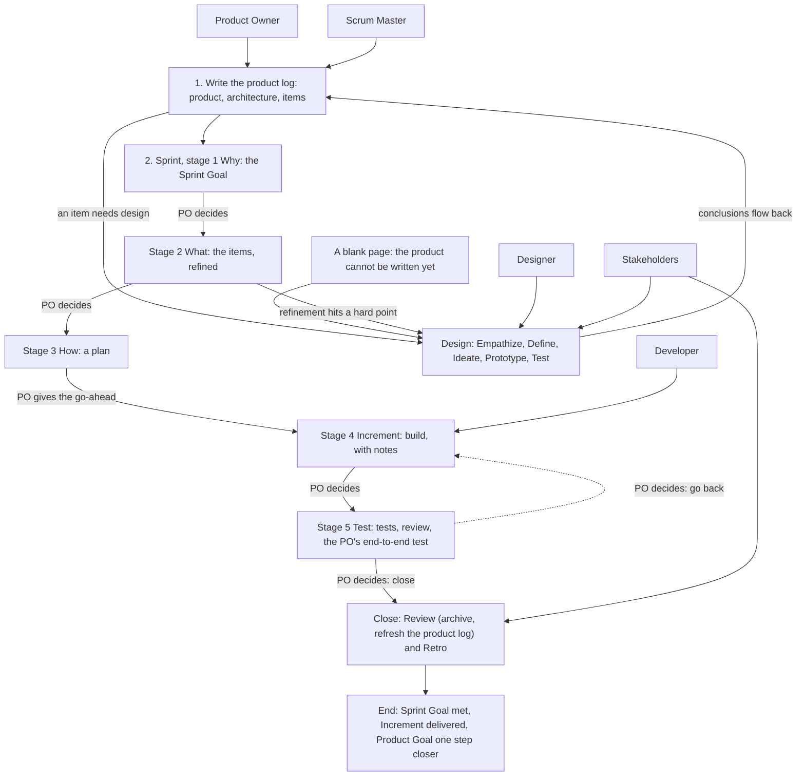

# Overview — How the Pieces Fit (v1)

> These are working conventions, v1 — the author's reading of Scrum and design thinking for solo + AI teams. They are less precise than the official guides. Use them as reference: follow what fits, override what doesn't, and note why. Where a convention departs from the official guide on purpose, the Departures section says so and gives the reason.

> Source: quotations from The Scrum Guide 2020 (Ken Schwaber & Jeff Sutherland) and the Scrum Guide Expansion Pack v2026.1 (Ralph Jocham, John Coleman, Jeff Sutherland), marked where they appear; the rest is the author's working conventions.
> License: the quotations are CC BY-SA 4.0 (© 2020 Ken Schwaber and Jeff Sutherland; © 2025 Ralph Jocham, John Coleman, and Jeff Sutherland).

Source labels and short names are explained in convention 14.

The other files: `conventions/product-log.md` and `conventions/product-backlog-template.md`; `conventions/sprint-log.md` and `conventions/sprint-backlog-template.md`; for designs, `../design-kernel/conventions/design-log.md` and `../design-kernel/conventions/design-backlog-template.md` (paths are relative to the scrum-kernel skill folder, where this file sits beside `SKILL.md`; the two design files belong to the design-kernel skill — read them when you open or resume a design).

## The map

## Conventions

### Where things live

1. **One product log** — Every project, new or old, starts from one product log.
2. **Sprints and designs side by side** — Treat Sprints and designs as peers under the product log: a Sprint, the Developer's, delivers an Increment; a design, the Designer's, delivers a prototype and conclusions. Open a design when an item needs design, when Sprint refinement hits a hard point, or when the product and its Product Goal cannot yet be written (a blank page: `conventions/product-log.md`, convention 2); it is not part of a Sprint. Decide item by item whether design is needed; a design's conclusions still land through a Sprint; an Increment need not be code — the Definition of Done says what it is. This departs from the Scrum Guide: see Departures.
3. **Three layers**

   | Layer | File | Commitment | Accountable | Facilitates |
   | --- | --- | --- | --- | --- |
   | 1 | Product log | Product Goal | Product Owner, with the Scrum Master | — |
   | 2 | Sprint log | Sprint Goal | Developer | Scrum Master |
   | 2 | Design log | Design goal | Designer | Scrum Master |
   | 3 | Increment: code or documents, as the Definition of Done says | Definition of Done | Developer | — |
   | 3 | Prototype: kept in the design folder, never in an Increment | Design questions | Designer | — |

   The third layer is not a log and has no prescribed method; it relies on the skills of whoever does the work. Increments add up into the product; prototypes are thrown away when the design closes, and only what was learned flows back.
4. **Folders** — `scrum/` holds all of the Scrum work: `ProductBacklog.md`; one folder for each Sprint or design in progress — `sprint-NN-<suffix>/` with its `SprintBacklog.md` and working files, `design-<suffix>/`, unnumbered, with its `DesignBacklog.md`, prototypes, and working files; and `documents/` (convention 5). This is the author's layout; use your project's own places if it has them.
5. **Where files go** — A file that serves only one Sprint or design stays in its folder and is deleted at close; git keeps it. A file that serves the whole Scrum goes into `scrum/documents/`, and the logs reference it: design documents, background material, long content written for the product log, and the archives made at close — compressed sprint logs and compressed design logs. At each Review, glance at `scrum/documents/` and delete what is outdated. The project's own documentation, such as a user manual or API notes, is outside these conventions; keep it where the project keeps it, such as `docs/` at the root. Working material does not go into a log; what is truly key can go into the project's memory or instructions file, and a large important file goes into `scrum/documents/`.
6. **Names** — The terms used in all the conventions are defined here once:
   - the **product log** is the Product Backlog, kept in `ProductBacklog.md`; the **sprint log** is the Sprint Backlog, kept in `SprintBacklog.md`; the **design log** is kept in `DesignBacklog.md` — a file made from a template takes these names, whatever the template is called;
   - a **product backlog item (PBI)** is one row of the product log's item table;
   - a **role card** is one row of the product log's stakeholder table.

### Who does what

7. **Roles** — Every AI role loads the ideo-kernel skill first, the shared toolbox.

   | Role | Home turf | Accountable for | Kernels |
   | --- | --- | --- | --- |
   | Product Owner | The product log and its handoffs | Value direction; the Product Goal and Sprint Goals; which items enter a Sprint; the go-ahead; the items, decided with the Scrum Master; the decision at the end of each stage (convention 11) | — (a person) |
   | Scrum Master | Sprint logs and design logs | Facilitating Planning and refinement; recording; tracking; reviewing the How and the Increment; the Product Owner's secretary | ideo, scrum, design |
   | Developer | The Sprint | The sprint log, the How, the Increment; the last check that nothing in refinement is unclear | ideo, scrum |
   | Designer | The design | Design research and prototypes; conclusions back to the product log and the Sprint that asked | ideo, design |
   | Stakeholder | An outside view | Looking as one row of the product log's stakeholder table; summoned at Review, or to review when the Product Owner names it | ideo |

   The Product Owner, the Scrum Master, and the Developer keep the sprint log together; without a Developer, the Product Owner and the Scrum Master run the Sprint alone.
8. **Only the Product Owner must be human** — The other roles may all be AI. This departs from the Scrum Guide Expansion Pack: see Departures.
9. **Ask the Product Owner** — Whoever is unsure asks the Product Owner, unless the Product Owner has sent that kind of question elsewhere.
10. **Product Owner as Developer** — When the Product Owner builds, they take part as a Developer, and the How is worked out with them.
11. **Product Owner decides between stages** — At the end of each stage of a Sprint or a design, the Product Owner decides: they settle the result of the stage and decide whether to move on to the next one, unless the Product Owner has handed this to the Scrum Master. It is a decision, not a review or an acceptance: checking that the work was done right is the Scrum Master's job. It reaches the level of the stage, not each step inside it. A Sprint has five stages (`conventions/sprint-log.md`, convention 24) and a design has five (`../design-kernel/conventions/design-log.md`, convention 26).

### Sessions

12. **One Scrum Master per project** — Each project has one session as its Scrum Master, leading its Developer, Designer, and Stakeholders. A session above several projects only summarizes; each project's facts stay in its own logs.
13. **Who gets which work** — Review goes to the Scrum Master by default (`sprint-log.md`, convention 14). Long-running upkeep — the board, summaries, tracking — goes to a standing Stakeholder session with a working identity the project writes down. A small edit to one or two files the Scrum Master makes itself. Building goes to a new Developer session when a paragraph can brief it, or to a Developer that shares the Scrum Master's context when the work needs much of the discussion; such a Developer cannot review its own work.

### About these conventions

14. **Working conventions** — Reference, not law. Each convention has a short name, for use in conversation, and only the exceptions carry a source label: a convention with no label is the author's practice — how the author works; **Supplement** — inferred by the author's assistant, not yet confirmed in practice; **Decide on the spot** — no fixed rule, decide when it comes up. When you override a convention, write what you did and why in the log's notes: the sprint log's Increment notes, or the chapter of the design log it concerns. The templates carry the flow; the convention files say how, and when a step may be skipped. They describe roles and steps, not the mechanics of any tool.
15. **When a revision applies** — Note what does not fit; a revision of the conventions applies from the next Sprint, never in the middle of one.
16. **Templates record outputs** — A template's chapters follow the flow, and its sections hold only what each step produced; how to do a step belongs in the conventions. A log made from a template keeps all of the template's headings, including the chapters filled in later, and adds no sections of its own; remarks go in the sprint log's Increment notes, or in the chapter of the design log they belong to.

### What stays fixed

17. **Goal fixed, plan flexible** — Each log has one fixed commitment: the Product Goal, the Sprint Goal, the design goal; the Definition of Done is not weakened either. Everything under a commitment — items, refinement points, acceptance criteria, the How, the chosen design solution — may change as you learn, and each log records what changed and why. Only the Product Owner changes a commitment, and only the Product Owner cancels a Sprint whose goal can no longer be met.
    The Scrum Guide says it this way. On the Product Goal: "They must fulfill (or abandon) one objective before taking on the next." During the Sprint: "No changes are made that would endanger the Sprint Goal", "Quality does not decrease", and "Scope may be clarified and renegotiated with the Product Owner as more is learned." And: "Only the Product Owner has the authority to cancel the Sprint."

## Departures from the official guides

Each departure is stated here once, with its reason; the convention named in the last column points back to this table.

| Here | The official guide | Why | See |
| --- | --- | --- | --- |
| Only the Product Owner must be human | SGEP: the Product Owner and the Scrum Master "must be human", and "At least one Product Developer should be human" | One person works with AI and keeps the value decisions | Convention 8 |
| Designs sit beside Sprints | Scrum Guide: all the work "happen within Sprints" | A design delivers no Increment, may span several Sprints, and the Designer and the Developer are peers | Convention 2 |
| The Product Owner decides the items with the Scrum Master | Scrum Guide: "the Developers select items from the Product Backlog" | The Product Owner sets the value direction, and the others say how much fits | `product-log.md`, convention 12 |
| The How is a plan, and building waits for the go-ahead | Scrum Guide: how to build is "at the sole discretion of the Developers" | The Scrum Master and the Product Owner check the plan, because AI may drift | `sprint-log.md`, conventions 7 and 8 |
| Checkpoints replace the Daily Scrum | Scrum Guide: the Daily Scrum is "a 15-minute event for the Developers" | AI works by session, not by day | `sprint-log.md`, convention 10 |
| A reviewer is required | Scrum Guide: the Developers are accountable for "Instilling quality by adhering to a Definition of Done" | A Developer may drift, and a second look catches it | `sprint-log.md`, convention 14 |
| No Sprint end date | Scrum Guide: Sprints are "fixed length events of one month or less" | AI works by session, so the Product Owner watches at checkpoints for a Sprint that drags on | `sprint-log.md`, convention 2 |
| Closed logs are kept in `scrum/documents/` | — | — | Convention 5 |
