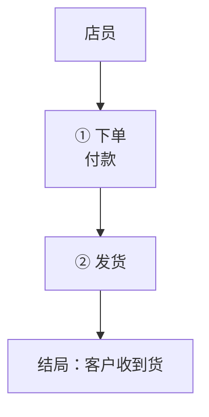

# 一、Product

## 1.1 Product

| 承诺 | Acme 订单台：把订单从下单到发货放在一个页面里。 |
| --- | --- |

## 1.2 Product Goal

| 承诺 | 看得清：每笔订单现在在哪一步，一眼就知道。（PO 2026-11-13 定） |
| --- | --- |

## 1.3 Definition of Done

| 维度 | 标准 |
| --- | --- |
| 无死链 | 链接都能打开 |

# 二、架构

## 2.2 架构

# 三、Product Backlog Items

## 3.1 当前的 PBI

| 编号 | 标题 | 用户故事 | 架构定位 | 当前状态 | 规模 | 备注 |
| --- | --- | --- | --- | --- | --- | --- |
| PBI-1 | 订单列表 | 作为店员，我想要订单列表 | ① | 在 Sprint 01（主线） | M | 备注一 |
| PBI-2 | 发货单 | 作为店员，我想要发货单 | ② | 在 Sprint 02（主线） | S | 备注二 |
| PBI-3 | 退款流程 | 作为客户，我想要退款 | ② | 待选（副线） | M | 备注三 |
| PBI-4 | 客户标签 | 作为店员，我想要给客户打标签 | ① | 以后 | L | 备注四 |
| PBI-5 | 批量重试 | 作为店员，我想要失败的单子自动重试 | ② | 在设计 design-gamma 中（副线） | M | 备注五 |

## 3.2 已完成 / 已关闭的 PBI

| 编号 | 标题 | 结果 | 出处 |
| --- | --- | --- | --- |
| PBI-0 | 旧的导入功能 | 已做完 | documents/sprint-00-old.md |
