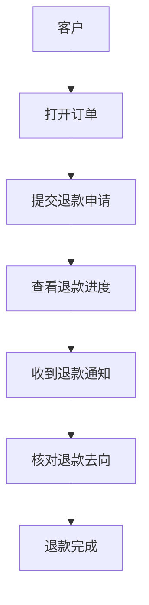

# Design Backlog — choosing

> Opened 2026-11-13 | From: PBI-3 | Product Owner: SeaPawn
> Now: Ideate：比较「原路退回」与「退回余额」的草图，尚未选定方案
> Waiting for PO: 1. 选定退款方案？

## 1. Empathize

### 1.2 设计目标

| 承诺 | 退款去向说得清楚。 |
| --- | --- |

## 2. Define

### 2.1 地图

## 3. Ideate

### 3.1 方案

<!-- PO 尚未选定方案，草图不是定案。 -->

### 3.2 故事板（可选）

<!-- 未填写。 -->
