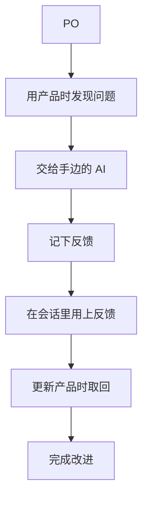

# Design Backlog — feedback-sample

> Opened 2026-11-13 | From: 产品日志中的反馈问题（验收夹具） | Product Owner: SeaPawn
> Now: Ideate：方案已定；不单设故事板
> Waiting for PO: None

## 1. Empathize

### 1.2 设计目标

| 承诺 | 反馈随手记，更新产品时找得回来。 |
| --- | --- |

## 2. Define

### 2.1 地图

## 3. Ideate

### 3.1 方案

<!-- 方案段取自归档 design-feedback-loop.md §3.1；本文件只是验收夹具，不把原设计移回在办目录。 -->

**记一下就够：全局说明管路线，反馈进全局记忆**

2. **交出去**：PO 说「记一下：……」，不说位置。
3. **记下**：手边的 AI 照产品表判断是哪个产品，不拿当前项目当默认；拿不准就放待认领，不硬猜；是做事的规矩、不是产品反馈的，照普通记忆写。一个点一个文件：日期、在哪个项目的会话里、原话、当时在做什么、它理解的意思；Feedback 一节加一行。已经有的点不重复记，把新的原话补进原来的文件。回一行「记下了 · IDEO-Scrum · 可改」，不追问，回到手上的活。
4. **马上用起来**：Feedback 一节每个会话都加载，产品还没改，AI 就照着做；用着用着，PO 才知道这个点对不对。
5. **更新时拿出来**：开始更新一个产品时（精化产品日志、开冲刺之前），那个产品的会话先读它的 Feedback 行和待认领，按主题列给 PO；PO 定下要做的进产品日志；处理过的点删掉那一行和文件，git 留着。

PO 2026-11-11：方案定为 3.1——反馈进全局记忆（MEMORY.md 加 Feedback 一节，文件放 GlobalMemory/feedback/<产品>/），为的是点能马上用、用着验证；原型和测试交给辅助会话自动做，中间不用 PO 参与，最后把结果给 PO；进 Prototype。（上一版这一行写着「进 Prototype」，没经 PO 确认，Master 越过了关卡，已改。）

## 4. Prototype
