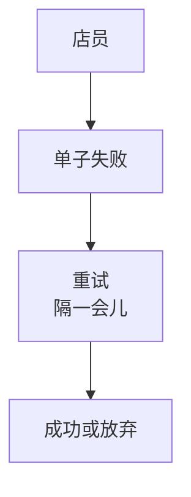

# Design Backlog — gamma

> Opened 2026-11-13 | From: Sprint 02 里「批量重试」这个难点 | Branch: sprint-02-beta | Product Owner: SeaPawn | Designer: AI
> Now: Ideate：评审三个草图
> Waiting for PO: PBI-5 选哪个草图
> How to write this log: `design-log.md`.

## 1. Empathize

### 1.1 Challenge

失败的单子怎么自动重试。

### 1.2 设计目标

| 承诺 | 弄清失败的单子重试几次、隔多久才让店员放心。 |
| --- | --- |

## 2. Define

### 2.1 Map

## 3. Ideate

### 3.1 Solution

分批重试流程

失败的批次单独重试，成功的批次不动。
