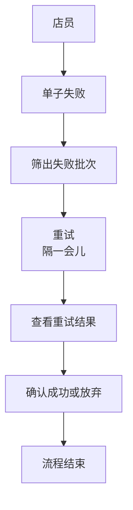

# Design Backlog — gamma

> Opened 2026-11-13 | From: PBI-5（Sprint 02 里「批量重试」这个难点） | Branch: sprint-02-beta | Product Owner: SeaPawn | Designer: AI
> Now: Prototype：已选分批重试流程，准备验证故事板
> Waiting for PO: None
> How to write this log: `design-log.md`.

## 1. Empathize

### 1.1 Challenge

失败的单子怎么自动重试。

### 1.2 设计目标

| 承诺 | 弄清失败的单子重试几次、隔多久才让店员放心。 |
| --- | --- |

## 2. Define

### 2.1 Map

## 3. Ideate

### 3.1 Solution

分批重试流程

失败的批次单独重试，成功的批次不动。PO 已选定这个方案。

### 3.2 Storyboard

1. **发现失败**：店员在订单台看到失败的批次。
2. **单独重试**：店员只重试失败批次，成功批次无需重试。
