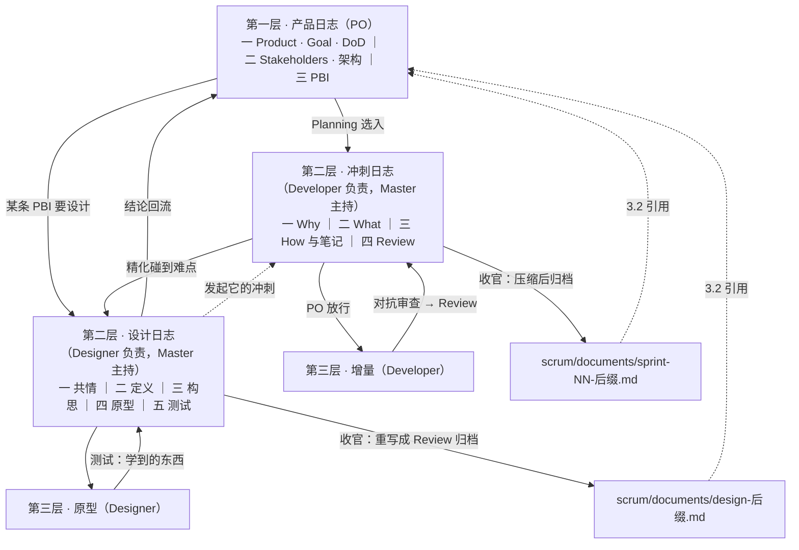
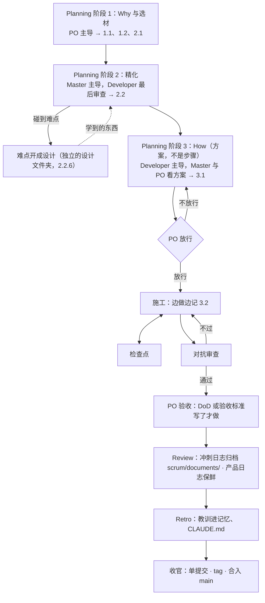

> 按 Scrum Guide Expanded v2026.1 的 Product / Increment / Product Backlog artifact 框架定义。
> Product Owner: SeaPawn

# 一、Product

## 1.1 Product

**IDEO-Scrum** 是一个 Claude Code marketplace 插件：将 Design Thinking 与 Scrum Sprint 两套方法论集成到 Claude Code，通过 skills 和 commands 提供结构化的方法论引导与流程框架。

**边界**：不做项目管理工具本身，不做 JIRA/Linear 集成，也不做团队协作平台——只提供方法论引导和流程框架。

## 1.2 Product Goal

**远景**（原 Product Vision 一节，2026-11-07 并入；SGEP：Vision 是 Product Goal 的输入）：让 Claude Code 成为一个随身的设计思维与敏捷教练——有方法论需求的人打开 Claude Code 调用 IDEO-Scrum，就能获得结构化、忠于原文、可操作的方法论引导。

（2026-10-24 PO 定）IDEO-Scrum 4.0：让插件带着流程走——角色、内核、流程参考与模板成体系，新项目照着就能跑通。

**之后的方向**（PO 2026-11-07）：当前 Product Goal 是把流程全部落地——模板、流程都纳入插件，拟分几个冲刺：08 设计内核独立（PBI-29、34、28、36，已完成，v5.0.0），09 设计日志模板改正（PBI-38，小冲刺，已完成，v5.0.1），10 流程全部进插件（PBI-23、31、32、37、39；原定的 11 并进来）（2026-11-08）。08 由 Master 兼 Developer 在一个会话里做；09、10 由 Master fork 出的 Developer 做（PO 2026-11-08）。之后分两条线：① 产品化：从作者能用到陌生人好用（PBI-30）；② 分享：把方法论写成成熟的文档、网页或视频，发到博客、GitHub 等处（PBI-12）。

（上一总目标「实现 IDEO-Scrum v2.0.0」已随 2026-08-31 发布达成，原文见 git 历史。）

## 1.3 Definition of Done

### Definition of Outcome Done

| 度量 | 目标信号 |
| --- | --- |
| 一次会话走通方法论环节：完整引导（结构化、忠于原文） | 用户不反复追问 |

### Definition of Output Done

| 维度 | 标准 |
| --- | --- |
| 内容忠实 | 忠于源材料（SGEP / d.school / Sprint）；方法论设计部分（融合、solo+AI）标注来源与依据 |
| 可导航 | 从 SKILL.md 入口 ≤2 跳到达任意 reference |
| 无死链 | 所有 markdown 内部链接可解析，无 404 |

# 二、架构（v1，2026-11-07 精化定稿）

> 本章分两节：2.1 Stakeholders（谁），2.2 架构（以 Map 为骨架，写法见 2.2.4）。2.2 是 2026-11-07 产品日志精化的结论（三轮）：PO 口述，Master 整理；标「（补充）」的是 Master 的建议，PO 未逐条定。取代 2026-08-30 的「研究 → 实施」流水线草案（原文见 git 历史）。本章是本仓库的设计记录；写进插件时改成英文的「约定 v1」，见 2.2.7。

## 2.1 Stakeholders

> 角色卡借 Grok Bot（`roster/README.md`）：每张卡写是谁、要什么、怎么算满意、看得到什么、何时召唤。召唤 stakeholder 时报卡名，它按卡上的身份看，只看卡上写的东西。常驻会话（如看板维护）另加「负责 / 不负责」两栏（Grok Bot："The *does not own* list is … the part that stops sprawl"）；本项目目前没有常驻会话。**派子代理时，能用角色卡就用**（PO 2026-11-08）：审阅、外部视角、测试、方案评议等，都可以拿这里的卡派全新子代理——正式做项目时产品日志里会写下很多利益相关者，正好用上。不是只能用角色卡，需要时用。

| | 熟手 | 陌生人 | 读者 |
| --- | --- | --- | --- |
| 是谁 | 像作者这样的 solo 开发者：用 Claude Code 和本插件做自己的项目，熟悉这套流程 | 第一次装本插件的 solo 开发者：会用 Claude Code，没见过本仓库，也没有作者的记忆和配置 | 不装插件、只看公开分享（文章、网页、视频）的人：想学 solo + AI 怎么用 Scrum 与设计思维 |
| 要什么 | 流程跟着插件走，不用每次口述规矩；会话断了、压缩了能接上 | 装上就知道第一句说什么；术语有解释；很快进入干活 | 一套讲得清、能照着做的方法 |
| 怎么算满意 | 不用反复提醒 AI 规矩；冲刺照约定开、记、收 | 不问作者也能走完第一个冲刺 | 读完能在自己的项目里用起来 |
| 看得到什么 | 全部：插件、产品日志、冲刺日志 | 只有插件和 README（体验测试只给这些） | 只有公开发布的内容 |
| 何时召唤 | Review 看增量；改约定前看顺不顺手 | 体验测试（PBI-30）；Review 涉及入口、说明、术语时 | 分享内容的草稿（PBI-12） |

## 2.2 架构

### 2.2.1 Map

> 照 Make a Map 画（写法见 2.2.4）：上面是人，下面是结局，中间是步骤；要细说的步骤在后面各小节展开。不明白的地方登记成 PBI，这里不写「待定」。


### 2.2.2 主线与分层

**产品日志之下两个平级模块：冲刺与设计**（PO 2026-11-07 第四轮定，取代第三轮的「Target 开在冲刺里」）：新老项目都从产品日志开始。做事开冲刺（Developer 负责，产出增量）；要设计时开设计（Designer 负责，产出原型与结论）——产品日志里某条 PBI 要设计，或冲刺精化碰到难点，都开成独立的设计，不放在冲刺下面。两者可以任意组合，都对产品日志负责。设计日志按 IDEO 五阶段写（design-kernel），ideo-kernel 是整个插件共用的工具箱，也是设计各阶段的基础：IDEO 五模式与方法库，设计和冲刺都用（PO 2026-11-08）。不另设第一层的设计日志：设计冲刺第一层的挑战、长期目标、冲刺问题、Map，在产品日志里都有对应（Product、Product Goal、DoD、架构）。PBI-21（v4.0.0 的「Two Schemes」）保持完成、不回改；内核拆分归 PBI-29、PBI-34。

**三层**，与 Scrum 的工件一一对应：

| 层 | 文件 | 承诺 | 负责 | 主持 |
| --- | --- | --- | --- | --- |
| 1 | 产品日志 | Product Goal | PO（与 Master 一起） | — |
| 2 | 冲刺日志 | Sprint Goal | Developer | Master |
| 2 | 设计日志（DesignBacklog）：某条 PBI 要设计时开，与冲刺平级 | 设计目标 | Designer | Master |
| 3 | 增量：代码或文档，是什么由 DoD 定 | DoD | Developer | — |
| 3 | 原型：留在设计文件夹里，不进增量；设计收官时删掉，只有学到的东西回流 | 设计问题 | Designer | — |

- 以 PBI 为单位判断要不要做设计：很多 PBI 都要；设计的结论要落地，照样开冲刺交增量（PO 2026-11-07：增量不一定是代码，是什么由 DoD 定）。
- 第三层不是日志，也不规定方法——靠干活人自己的技能；做完在 Review 交回 PO 与 Master。增量累加进产品；原型用完即弃，只有学到的东西回流。
- **文件**（PO 2026-11-07；2026-11-08 改）：`scrum/` 放 Scrum 的全部工作：产品日志、两类文件夹和 `documents/`；做完的都归档进 `scrum/documents/`。看板以后再设计（PBI-35）。

```
scrum/
├── ProductBacklog.md     产品日志
├── sprint-NN-后缀/       冲刺：SprintBacklog.md + 中间文件
├── design-后缀/          设计：DesignBacklog.md + 原型（不编号）
└── documents/            为整个 Scrum 服务的文档
    ├── sprint-NN-后缀.md 冲刺收官归档
    └── design-后缀.md    设计收官归档（Review 文档）
```



### 2.2.3 角色与主场

- **PO**（唯一必须是人的角色，PBI-20）：主场是产品日志，以及产品日志向冲刺日志、设计日志的交接；和 Master 一起定 PBI（Master 是 PO 的秘书）；定价值方向、Sprint Goal、选入的 PBI；放行施工；自己用插件，用着不顺就记下来，每周集中改一次（见 2.2.7）。PO 有时也动手施工，这时以 Developer 身份参与（Scrum Guide："If the Product Owner or Scrum Master are actively working on items in the Sprint Backlog, they participate as Developers."），How 必须和 PO 深入商量，不由 Developer 独自决定。
- **Master**（项目会话里的 scrum-master）：主场是冲刺日志与设计日志——主持 Planning 与精化、记录、跟进度；审阅 How 与增量。
- **Developer**：对冲刺负责：维护冲刺日志、写 How、做增量；在 Planning 阶段 2 参与讨论，并做最后的「没有不明白的点」审查。
- **Designer**：对设计负责：做设计研究和原型，结论回流产品日志和发起它的冲刺；与 Developer 同等，都对产品负责（PO 2026-11-07）。
- **Stakeholder**：外部视角，身份写在 2.1；Review 时由 PO 或 Master 召唤；PO 指定时，对抗审查也交给它（见 2.2.5 单元 7）。
- **加载的内核**（PO 2026-11-07）：每个角色先加载 ideo-kernel；Master 三个都加载，Developer 再加 scrum-kernel，Designer 再加 design-kernel；Stakeholder 只加载 ideo-kernel（PO 2026-11-08 改，原为不加载：Stakeholder 有时也要用 IDEO 的方法；PBI-36）。
- **拿不准就问 PO**（PO 2026-11-08）：Developer 做事时、Master 也一样，碰到拿不准的点，找 PO 问、由 PO 裁决；只有 PO 说过某类事不想下结论、以后改问 Master 或别人，才照 PO 指定的去问。这样才是一个团队。
- 冲刺日志由 PO、Master、Developer 三方一起做；简单项目没有 Developer 时，Master 和 PO 直接走完。

### 2.2.4 产品日志（第一层）

PO 2026-11-07 第三轮定；本产品日志是第一个样例（PBI-31）。

- **只有一份、一种写法**：新老项目都先写产品日志。白纸起步时，第一部分不清楚就用 IDEO 的方法（共情、定义、采访）弄清。（补充）事实由 Master 自己查；要 PO 定的事在一条消息里编号问完，每条附推荐（DS-Bot goal-grill："Facts are your job; decisions are the user's."）。
- **结构**：

| 章 | 节 | 写什么 |
| --- | --- | --- |
| 一 Product | 1.1 Product | 是什么、边界 |
| | 1.2 Product Goal | 开头一句远景（可空）；当前的 Product Goal；之后的方向 |
| | 1.3 DoD | Outcome Done、Output Done |
| 二 架构 | 2.1 Stakeholders | 角色卡：是谁、要什么、怎么算满意、看得到什么、何时召唤 |
| | 2.2 架构 | 先一张 Map，再按需分小节 |
| 三 PBI | 3.1 当前的 PBI | 七列表 |
| | 3.2 已完成 | 一行一条，附出处 |
| 修订记录 | — | 最近三条 |

- **架构照 Make a Map 写**：上面列人（2.1 的 Stakeholders；AI 角色也算——Make a Map："And sometimes, of course, there's a robot."），下面写结局，中间 5～15 步，只用字、箭头和少量方框，画图用 `flowchart TD`。要细说的步骤，在 Map 后面单开小节。不写「待定」：不明白的地方登记成 PBI，交给冲刺或设计去研究（2.2.6）。技术层面的架构（模块、接口）是 Developer 的技能，写在增量里，不进产品日志。
- **PBI 七列**：编号 | 标题 | 用户故事 | 架构定位 | 当前状态 | 规模 | 备注。
  - 用户故事：「作为〈2.1 里的谁〉，我想要……，以便……」。
  - 架构定位：指向 Map 的某一步，或 2.2 的某个小节。
  - 规模按会话数量：S 一两个会话，M 三到五个会话，L 五个以上，精化时要切小（PO 2026-11-08）。
  - 备注：来源、开放点、验收标准草稿、精化要点。
  - 排序暂不加列（PO：AI 不太需要，人需要时再调）。PBI 由 PO 与 Master 一起定。
- **精化**：随时可以在产品日志里做（Scrum Guide："This is an ongoing activity"），但只是放细，最终在冲刺日志 2.2 做。不单设一节，按内容分开放：
  - 切出的小条，成为表里的新行；
  - 长的设计内容进架构，由「架构定位」指过去；
  - 短的写进备注；
  - 大材料放 `scrum/documents/`，在备注里引用。

### 2.2.5 一个 Sprint（第二层）

**工作区**：一个 Sprint 一个分支，一般配一个 worktree（不强制）；文件夹 `scrum/sprint-NN-后缀/`（序号两位，后缀说明这个冲刺做什么），里面一定有 `SprintBacklog.md`，开工时空白。

**收官点**：Sprint Goal 达成，或 PO 叫停。冲刺日志不写截止日——AI 按会话工作，日期没有意义（PO 2026-11-07；与官方不同，见 2.2.8）。

**冲刺日志结构**：

| 章 | 节 | 内容 | 谁 |
| --- | --- | --- | --- |
| 一 Why | 1.1 Sprint Goal | 这次要做成什么 | PO 定 |
| | 1.2 DoD | 从产品日志挑相关条目抄入；整份 DoD 照样适用（SGEP："The Definition of Output Done is not weakened during the Sprint."） | PO 选 |
| 二 What | 2.1 PBI | 选入的 PBI，直接摘抄；不够可以补 | PO 主导，Master、Developer 提「多了 / 少了」 |
| | 2.2 精化 | 精化需要的全部内容，含验收标准与测试 | Master 主导 |
| 三 How | 3.1 How | 方案，不是步骤：工作项（按顺序，每项一个会话以内，写明产出和怎么算做完）、关键选择和理由、已知风险（还不动增量）；末行「PO 放行：日期，授权到哪一步」 | Developer |
| | 3.2 笔记 | 全程记录，只追加 | 谁做的事谁记 |
| 四 Review | — | 收官时补 | 三方 |

冲刺日志不是定稿（PO 2026-11-07）：一到三章随时可以改，改了什么、为什么记进 3.2；3.2 只往后加。这和官方一致——Sprint Backlog 本来就随着了解更新；只有 Sprint Goal 和 DoD 照官方守住，见下方特殊情况。

不设 Retro 章：Retro 的结论写进记忆和 CLAUDE.md。

**流程**：



**各单元要点**：

1. **Planning 阶段 1（Why 与选材）**：PO 主导，通常和 Master 一起（也可三方）；定 Sprint Goal、选 PBI、选相关 DoD。选不出时可以用 IDEO 的方法引导（每个角色进入时都先加载 ideo-kernel，见 2.2.3）。产品日志不够时可以增补 PBI。完成后发给 Developer 看。
2. **Planning 阶段 2（精化）**：Master 主导，和 PO 一起，Developer 参与讨论。方法用精化七步（2026-11-06 定）：
   1. 取一条 PBI（PBI 就是 POV，不再另做 POV）；
   2. 确认 POV：从 Goal / PBI 抄来，不改；
   3. 把 PBI 打开成 HMW 和不明白的点；
   4. 每个点归位：PO 决定 / Developer 方案 / 研究任务；
   5. 切成几天能做完的小 PBI，写验收标准；
   6. 两个「不用再问」：Developer 不用再问「你指的是什么」，PO 不用再问「你做的是什么」。检验办法：Developer 用自己的话复述每个点，PO 认可；
   7. 精化结束由 PO 说。

   验收标准可以写在产品日志里，也可以在冲刺日志 2.2 补；产品日志已经写全的，冲刺日志 2.2 不再写。精化也可以随时在产品日志里做，那里只是放细，最终在这里做（见 2.2.4）。归为研究任务的难点开成设计（见 2.2.6），冲刺其余部分照常。最后 Developer 审查：没有不明白的点。
3. **Planning 阶段 3（How）**：Developer 主导。**How 是方案，不是步骤**（PO 2026-11-08，取代原来的「每个点只写大致方向」）：写三样——① 工作项清单，按顺序排，每项一个会话以内做得完，写明产出和怎么算做完；② 关键选择和理由；③ 已知风险和拿不准的地方。不写每份文件里具体写什么，不写操作步骤，也不打磨计划本身；这时还不动增量。依据：Scrum Guide 讲 How 时说「This is often done by decomposing Product Backlog items into smaller work items of one day or less.」，讲 Sprint Backlog 时说「It should have enough detail that they can inspect their progress in the Daily Scrum.」。这里把「一天」换成「一个会话」，把站会换成检查点（单元 6）。Master 与 PO 看方案对不对，同意就放行；细审放到做出来的增量上（单元 7）。（PO 2026-11-07：「How 千万不能写成具体计划，具体的计划为什么不直接去干呢」；pstack 也故意不设计划技能，把「打磨抽象计划」列为坑。）
4. **PO 放行**：How 定稿、PO 放行后才能施工——计划批准不等于开工授权（2026-11-06 教训）。放行写成一行，带上这次授权到哪一步，例如「PO 放行：2026-11-08，可提交、可合入 main，不推送」。
5. **施工与笔记（3.2）**：冲刺日志是全程记录本——会话关了，新会话读日志就能接上；变长没关系。（补充）每行写：日期 · 做了什么 · 决定与理由 · 证据或提交号 · 下一步；接手的会话以笔记为准，不重新推导。
6. **检查点**（取代每日站会）：不定时。AI 停下来问 PO；或 PO 来问进度，看有没有偏离 Sprint Goal。
7. **对抗审查**：必须有审阅的一方——Developer 可能做偏。默认由 Master 审；PO 指定时，换成 Stakeholder 或全新子代理（PO 2026-11-07）。
8. **PO 验收**：DoD 或验收标准里写了（例如端到端测试）才做；有时 PO 看一眼就过。
9. **Review**：备料（增量、DoD 逐条结果、验收标准、产品日志与 Product Goal 的调整、Retro 输入）→ 删除冲刺目录里除 `SprintBacklog.md` 以外的中间文件 → 冲刺日志压缩成关键决定、补上第四章 Review → 改名为 `sprint-NN-后缀.md` 移进 `scrum/documents/` → 更新产品日志并保鲜：做完的 PBI 移入 3.2，只留一行引用（原文在归档的冲刺日志里）；过时的架构文字、已解决的开放点、超过三条的修订记录删掉（git 可查）；没做完的回 3.1。产品日志要保持新鲜、完整，不留无关内容（PO 2026-11-07）。需要外部视角时，由 PO 或 Master 召唤 Stakeholder。
10. **Retro**：教训写进记忆、CLAUDE.md 等（Developer 落笔）。写原则、不写故事：按「坏了什么 → 为什么 → 得出的规则」写，不在场的人也能看懂（Grok Bot）。特别好的改进经 PO 同意写进 DoD。顺带看一眼产品日志是否还新鲜。（补充）问一句：这次 PO 在哪里卡住了 AI（等决定、等放行）？
11. **收官**：项目健康主要看 `scrum/`，尤其是产品日志——新鲜、完整、不留无关内容；增量和其余文件一般只需同步 README（PO 2026-11-07）；改名、移动后全仓 grep 旧路径至零；Review 与 Retro 只出一个提交；tag 与冲刺文件夹同名（同名分支随即删除，避免 git 报名字有歧义）；合入 main，关分支与 worktree。

**特殊情况**：

| 情况 | 走向 |
| --- | --- |
| 对抗审查或 PO 验收不过 | 写明缺什么，回施工 |
| 外部阻碍 | Master 立刻报 PO |
| 精化碰到难点 | 难点开成设计去研究（2.2.6），冲刺其余部分照常 |
| 中途可以发版 | 照发，不结束 Sprint |
| 收官时没做完 | 没做完的 PBI 回产品日志，不顺延 |
| Sprint Goal 作废 | 只有 PO 能取消 Sprint |
| 小活（半小时到一个会话就能做完） | 单开小冲刺：正常流程照走，每一步缩到一两行；放行、审阅、收官照做（PO 2026-11-08，Sprint 09 是第一个样例） |

### 2.2.6 设计日志（DesignBacklog，与冲刺平级）

PO 2026-11-07 第四轮定，取代第三轮的「Target 日志」。

- **何时开**：产品日志里某条 PBI 要设计，或冲刺精化碰到难点（拿出来的是难点，不是整条 PBI）。都开成独立的设计，不放在冲刺下面。
- **谁**：Designer 负责，Master 主持；PO 在构思末尾拍板定方案。
- **在哪**：`scrum/design-后缀/`，不编号，放 `DesignBacklog.md` 和原型。原型不进增量，留在设计文件夹里；设计问题没答完，可以跨几个冲刺。分支从冲刺分支开还是从 main 开，用到时再定。
- **写什么**：按 IDEO 五阶段分五章，不设笔记节（PO：做原型时自然会往里写），也不按原书的五天写。每章只记产出，不按做法分节（PO 2026-11-08，Sprint 09）。方法以 design-kernel 里设计冲刺的原文为主，ideo-kernel 的方法在背后：每个阶段写明对应 IDEO 的哪个模式，链到 ideo-kernel，不重抄；原书只摘和人机协作有关的部分（PO 2026-11-08）。设计冲刺里随时可以用 IDEO 的方法，只要需要；design-kernel 加进原书的方法，是为了配合设计冲刺，不是限定只用这几个（PO 2026-11-08）。尤其是构思：设计冲刺的步骤只是一条路，IDEO 构思的方法同样要用（PO 2026-11-08，Sprint 09）。

| 章 | 写什么 |
| --- | --- |
| 一 共情 | 挑战、设计目标、设计问题。问专家、做研究不是必须的，需要时才做；问专家之前先画一张草图地图（记在第二章）；问的是 PO 和 2.1 的角色卡（PO 2026-11-08） |
| 二 定义 | Map（相当于 POV）、HMW。不设选靶：设计本身就是靶，一份装不下就拆出去另开（PO 2026-11-08，Sprint 09） |
| 三 构思 | 3.1 方案：PO 拍板定下的那一个；3.2 故事板，可选。做法：几个互不相通的子代理各出一个方案 → 组合 → PO 拍板；IDEO 构思的方法同样要用（PO 2026-11-08，Sprint 09） |
| 四 原型 | 照选定的方案做原型。「原型感」指做法和对待方式（做得快、用完就扔），测试者看到的那一层表面要像真的（PO 2026-11-08） |
| 五 测试 | 用 2.1 的角色卡召唤 Stakeholder 测，PO 也测；拿结果回答设计问题 |

- **收官**：设计问题答完，或 PO 叫停。整份设计日志重写成一份 Review 文档，覆盖原文，改名为 `design-后缀.md` 移进 `scrum/documents/`；原型等文件删掉（git 里还在）；产品日志保鲜。（补充）Review 文档写：挑战与设计问题、选定的方案、每个设计问题的测试结论、回流到哪里、原型在哪个提交。Retro 同冲刺：不设章，教训写进记忆和 CLAUDE.md。
- 模板与约定在插件 design-kernel 的 `conventions/`（PBI-28，Sprint 08 完成）。

### 2.2.7 在插件里的载体：约定 v1

- **三个内核**（PO 2026-11-07 第三轮定，取代「不新建技能」）：ideo-kernel 只放 IDEO 五模式与方法库（以现有的为底，删去设计冲刺部分，PBI-29），定位为整个插件共用的工具箱，也是设计各阶段的基础（PO 2026-11-08）；新建 design-kernel，专讲设计冲刺，从原书扩充（PBI-34）；scrum-kernel 只改与 IDEO 衔接的一节：要预研究就开一份设计（design-kernel），IDEO 的方法（ideo-kernel）随时可用（PO 2026-11-08，原为「不变」）。代价（PO 接受）：design-kernel 是 v3 用过的名字，意思变了；内核分工变，升大版本；三个内核的触发按 PBI-22 的基线重测。
- **放哪**：scrum-kernel 下新建 `conventions/`，放产品日志、冲刺日志的模板与各单元约定；共用的单元（检查点、审阅）只在这里写一份。design-kernel 下的 `conventions/` 放设计日志的模板与约定。
- **运行时**：插件装在 Claude Code 上，运行时就是 Claude Code，不造平台（PO 2026-11-07，原 PBI-30 精化记录的「定位」）。
- **三处分工**：模板为主（流程长在冲刺日志的章节里，AI 填日志时自然读到）；参考为辅（每个单元的理由、何时可以跳过，按需读）；角色命令里只放一句指路。
- **模板只记产出**（PO 2026-11-08，Sprint 09）：章按流程分，节只放产出，做法写在约定里。模板文件叫什么都行，用它建出来的文件叫 `ProductBacklog.md`、`SprintBacklog.md`、`DesignBacklog.md`。
- **身份声明**（每份约定文件开头，英文）："These are working conventions, v1 — the author's reading of Scrum and design thinking for solo + AI teams. They are less precise than the official guides. Use them as reference: follow what fits, override what doesn't, and note why. Where a convention departs from the official guide on purpose, it says so and gives the reason."
- **来源标注**：每条标「作者实践」「补充（Master 推断）」「待定（当场判断）」之一；故意和官方不同的地方写明理由（见 2.2.8）。
- **原文优先**（PO 2026-11-07）：写方法流程时能用原文就用原文；原书例图改画成 Mermaid（flowchart TD）或写成文字，不放图片文件（PO 2026-11-08）；不是原文的写法都进 `conventions/`，标为约定建议。删减的标准：和人机协作无关的删去，如日程、周几、零食与休息、白板与用品、线下投票（PO 2026-11-08）。版权由 PO 负责，发布前声明。
- **写法**：约定要短：砍字，不砍规矩，一条规矩只写一处，引文只标故意不同之处（PO 2026-11-08，取代原来的「约定文件长度不限」）；重点放前面；常驻部分（技能描述、SKILL.md 里的一张短表、命令里的一句指路）保持短；全英文、自足。每条约定起一个短名，方便口头引用（例：「How 是方案」「PO 放行」；写进插件时用英文）；短名由 Master 起（PO 2026-11-07）。
- **迭代**（PO 2026-11-07）：约定会一直改，这是敏捷的做法。用着不顺就记下来（3.2 或作者待办），大约每周集中改一次；新约定写好后，下一个冲刺就照着用；冲刺进行中不改约定。
- **取消**：第一层的设计日志（PO 2026-11-07，见 2.2.2）。
- **全局记忆**（`S:\SeaPawn-Memory\memory\GlobalMemory\` 里的 Sprint 收尾等条目）是过渡态；约定落地后，被取代的条目删除，以插件约定为准。

### 2.2.8 与官方故意不同之处（附理由）

| 不同之处 | 官方 | 理由 |
| --- | --- | --- |
| 只有 PO 必须是人 | SGEP：PO、SM 必须是人 | solo + AI 团队的作者设计（PBI-20） |
| PBI 由 PO 与 Master 一起定；选入冲刺时 PO 主导，Master、Developer 提建议 | Scrum Guide：PO 负责 Product Backlog（可委托，仍负责）；选入时 Developer 在和 PO 商量中选 | Master 是 PO 的秘书；PO 定价值方向；能做多少由 Master、Developer 提醒 |
| How 是方案，不是步骤（工作项、关键选择、风险）；Master 与 PO 看过、PO 放行才施工 | Scrum Guide：How 由 Developer 全权决定 | AI 还不能完全信任；Developer 可能做偏；PO 有时也当 Developer |
| 检查点取代每日站会，PO 参加 | 每日站会：每天 15 分钟，只有 Developer 参加 | AI 按会话工作，不按天；停下来就问 PO |
| 必须有审阅方：默认 Master，PO 可指定 Stakeholder 或子代理 | 增量由 Developer 自己负责 | 同上；Stakeholder 接审阅时，现有命令只写了外部视角，不含对 DoD 的核验（见 PBI-32） |
| 冲刺不写截止日，收官点是 Sprint Goal 达成或 PO 叫停 | Scrum Guide：Sprint 定长，不超过一个月 | AI 按会话工作，日期没有意义（PO 2026-11-07）；代价是冲刺拖长只能靠 PO 发现（Sprint 06 曾一份日志跨 55 天） |
| 设计与冲刺平级，设计可以不在冲刺里做 | Scrum Guide："All the work necessary to achieve the Product Goal, including Sprint Planning, Daily Scrums, Sprint Review, and Sprint Retrospective, happen within Sprints." | 设计的产出是原型和结论，不进增量；它的去留跟着设计问题走，可能跨几个冲刺；Designer 与 Developer 同等，都对产品负责（PO 2026-11-07）。只写在约定里，官方文件不动 |
| 冲刺日志压缩、设计日志重写成 Review 后归档 `scrum/documents/` | — | 原文留在仓库里，产品日志 3.2 可直接引用 |

# 三、Product Backlog Items

> 编号只是枚举序，不是优先级；排序以后再调。PBI 由 PO 与 Master 一起定，七列写法见 2.2.4。各 PBI 的开放点不在日志里表态，执行中由 PO 与 Developer 敲定。2026-11-07 以前的「精化记录」原文见 `git show e53650e:scrum/ProductBacklog.md`。

## 3.1 当前的 PBI

| 编号 | 标题 | 用户故事 | 架构定位 | 当前状态 | 规模 | 备注 |
| --- | --- | --- | --- | --- | --- | --- |
| PBI-12 | 方法论分享——公开系列（原「专家笔记完善」） | 作为读者，我想要一套公开的方法论分享（系列文章、网页或视频），讲清 solo + AI 怎么用 Scrum 和设计思维，以便不装插件也能学会、用到自己的项目里 | 产品之外：分享线（1.2「之后的方向」） | 待开始（排在 PBI-23 之后） | L | 作者自己也借此梳理一遍；素材：[ExpertNotes.md](documents/ExpertNotes.md) 里已写下的使用方法；公开发布前过一遍授权（d.school 非商业；版权声明由 PO 负责，PO 2026-11-07）；发布属对外动作，发前经 PO 确认；来源：seapawn.md L3，2026-10-24 PO 改为方法论分享 |
| PBI-23 | 冲刺日志约定 v1——模板与各单元约定 | 作为熟手，我想要插件自带冲刺日志模板和各单元的约定，以便每个冲刺都照同一套流程开会、记录、收官，不用我每次口述规矩 | 2.2.5 一个 Sprint（Map ③～⑧） | 进行中（Sprint 10） | L | 放 scrum-kernel 的 `conventions/`；范围：冲刺日志模板（四章）、各单元约定（Planning 三阶段与 PO 放行、施工与笔记、检查点、对抗审查、PO 验收、Review 与归档、Retro、收官）、SKILL.md 加一张短表、每份文件开头写身份声明（2.2.7）；不含产品日志模板（PBI-31）、设计日志（PBI-28）、角色命令（PBI-32）；验收草案（Planning 时 PO 定）：① 空目录冷启动，只靠插件能按约定开 Planning、建出冲刺日志骨架 ② 从角色命令进入、直接说，两条路径都找得到约定 ③ 描述可以改，改了就重跑触发测试，不能比改前差（PO 2026-11-08 改，原为「技能描述不变」）；SKILL.md 只多一张短表 ④ 全英文、自足，故意不同处写明理由 ⑤ 对抗审查通过；对抗审查单元写明：PO 指定或合适时，可拿 2.1 的角色卡派审阅子代理（PO 2026-11-08）；开放点：文件怎么拆（Developer 定）、回归测法（先写判定标准、单独提交）、约定落地后删哪些全局记忆（PO 定）；来源：#28 A4（PO 10-21：「非常重要，以后插件就这么定」），PBI-17、18 并入，2026-11-07 改写范围 |
| PBI-25 | 插件小修集合 | 作为陌生人，我想要单独装上的插件里链接、署名、触发句和标题层级都对，以便不被死链和过时的说法误导 | 2.2.7 载体（插件文件） | 待排序（随 PBI-30） | S | ① IDEO-modes 五份文件的许可行指向仓库根 ATTRIBUTION.md，插件单独分发后失效（改法实现前定；design-kernel 16 份摘录的文件头同样如此，2026-11-08 skill-reviewer 指出）；② ideo-kernel、scrum-kernel 两个 SKILL.md 没有 Source/License 头（先判定哪些段落属摘录）；③ Brainstorming 的触发句「Use after an HMW is clear」（HMW 已是可选方法；新文字由 PO 定）；④ 已解决（Sprint 08）（设计冲刺移出 ideo-kernel）；⑤ 已完成：scrum-guide-2020.md 第 297 行「Scrum Guide History」改为 `##`（PO 改的，2026-11-08 提交）；⑥ scrum-kernel SKILL.md 与 references/ 的 Artifacts、Events 两章注明出自 SGEP v2026.1，但插件里的 v2026.1 原文没有这两章，内容与 2025.6 版一致；先查 v2026.1 是否把这两章拆到了别的文档，再定是改出处还是换内容（2026-11-08，Sprint 10 发现）；来源：2026-10-25 Sprint 07 Review，⑤ 2026-11-07 登记 |
| PBI-30 | 产品化——从作者能用到陌生人好用 | 作为陌生人，我想要装上插件就知道第一句说什么、术语有解释、会话断了能接上，以便不读作者的仓库也能顺利走完第一个冲刺 | Map ①（装插件，开会话） | 待排序（流程落地后） | L | 范围：入口（没有产品日志就按模板建）、由浅入深（默认 PO + Master 一个会话走完，需要时再加 Developer、审阅、worktree）、说人话（术语第一次出现时解释，附词汇表）、接手不丢、体验测试、发布包装（用户 README、样例、CHANGELOG 与升级提示、发布渠道、授权说明、反馈渠道）；体验测试：Stakeholder 扮「陌生人」（只给 README、身份、任务），Developer 搭环境、跑、记卡点，Master 监督，跑之前先写好什么算卡住；每版都跑，发成熟版前 PO 和至少一个真人各走一遍；判据含 Sprint 07 的两个测试点；开放点：测试环境与测法（PO：到时候再说）、发布渠道、成熟版版本号、codex 分支在这里一起同步（PO 2026-11-08：Codex 最后再说）；与 PBI-12 的区别：12 是内容分享，30 是产品本身；来源：2026-11-06 PO 口述，2026-11-07 改写 |
| PBI-31 | 产品日志约定 v1——模板与精化 | 作为熟手，我想要开新项目时插件自带产品日志模板和精化约定，以便新老项目都从一份产品日志开始，白纸也知道先写什么、PBI 怎么写 | 2.2.4 产品日志（Map ②） | 进行中（Sprint 10） | M | 放 scrum-kernel 的 `conventions/`；范围：产品日志模板（按 2.2.4：三章、Stakeholders 小表、架构 Map、PBI 七列）与精化约定（精化七步；随时可做，最终在冲刺日志 2.2）；样例：本产品日志；与 PBI-23 同在 Sprint 10；2.1 用一张小表列出利益相关者，不写长的角色卡模板；派子代理时拿表里的一行当身份，细节由 AI 当场写（PO 2026-11-08，Sprint 10 Planning）；来源：2026-11-07 精化 |
| PBI-32 | 角色命令接上约定 | 作为熟手，我想要每个角色一进入就加载该加载的内核、知道该读哪份约定、清楚自己负责什么不负责什么，以便不用我提醒，角色就按约定办事 | 2.2.3 角色与主场 | 进行中（Sprint 10） | M | 范围：四个命令各加一句指路；内核加载已切成 PBI-36（Sprint 08）；拿不准就问 PO（2.2.3）；scrum-master 的「Review through fresh subagents」改为默认 Master 审、PO 可指定 Stakeholder 或子代理；PO 放行；检查点；PO 可兼 Developer；Developer 对冲刺负责、Designer 对设计负责；scrum-master 的「no ad-hoc work outside a Sprint」改为冲刺或设计之外（官方文件不动，只改命令）；stakeholder 命令里身份「写在 CLAUDE.md 或 AGENTS.md」改为指向产品日志 2.1；角色卡（Owns / Does not own / Needs approval，PBI-27 子项）：不做，命令里已写了边界，2.2.3 也定好了主场（Master 定，PO 2026-11-08 授权）；已定：PO 指定 Stakeholder 审阅时，它对照 DoD 和验收标准逐条核对（PO 2026-11-08；写进 stakeholder 命令、scrum-master 命令与冲刺日志约定第 16 条）；scrum-master 命令要提到设计与设计日志，designer 命令的产出说法与设计日志约定第 1 条对齐（2026-11-08 对抗审查）；派子代理时能用角色卡就用（审阅、外部视角、测试等，不限于此；2.1，PO 2026-11-08）；来源：2026-11-07 精化 |
| PBI-33 | 方法库改写——解除非商业限制 | 作为陌生人（在商业项目里用），我想要方法库不带非商业限制，以便商业项目里也能用 | 2.2.7 载体：ideo-kernel 方法库 | 待排序（以后再做） | L | d.school Bootleg 是 CC BY-NC-SA，插件因此带非商业限制；PO 定：先接受（README 已写明），以后再做；注意：改写成自己的话与「原文优先」（2.2.7）相反，做之前先定还做不做；改写范围、署名怎么处理，实现前定；来源：2026-11-07 精化 |
| PBI-35 | 看板（Scrum Board） | 作为熟手，我想要一块看板，一眼看到正在进行的冲刺、设计和各自的状态，以便不用翻各份日志就知道全局 | 2.2.2 文件（`scrum/` 下） | 待排序（以后再设计） | M | 主要对 PO 负责，做记录用；放 `scrum/` 下；（补充）可以交给常驻的 Stakeholder 会话维护，在 2.1 加一张带「负责 / 不负责」的卡（Grok Bot 的看板维护者："Don't prioritise, don't do the work, don't delete cards without asking"）；（补充）可以开成第一份设计日志，试 PBI-28 的模板；来源：2026-11-07 精化第四轮（PO 登记，这次不做） |
| PBI-37 | 开设计与接手——设计日志第一次就跑得起来 | 作为熟手，我想要说一句「这条 PBI 要设计」就能开出一份设计（文件夹、分支、文件头、角色卡都有着落），会话断了也能从日志看出停在哪，以便第一次用就不用我补规矩 | 2.2.6 设计日志 | 进行中（Sprint 10） | S | 来源：2026-11-08 Sprint 08 Review，「熟手」Stakeholder 的三条保留意见：① 产品日志 2.1 里还没有利益相关者时，先问 PO 有谁、补进 2.1 的小表（不写长的角色卡模板，PO 2026-11-08）② 开设计的步骤：后缀、文件夹、分支、填文件头 ③ 日志模板加一行「停在哪」；另：solo 会话里 Designer、Master 怎么署名；构思出几个子代理、用什么模型、非界面类产品的原型做到多真：当场定，不写死（Master 定，PO 2026-11-08 授权） |
| PBI-39 | 总览约定——三层、文件与 docs | 作为陌生人，我想要插件里有一份总览，讲清产品日志、冲刺、设计怎么连起来，`scrum/` 和文档文件夹各放什么，谁负责什么，以便第一次用就知道每份日志在哪、写不下的东西放哪 | 2.2.1 Map、2.2.2 主线与分层；另含 2.2.3 的角色表、2.2.7 讲约定本身的几条、2.2.8 的汇总 | 进行中（Sprint 10） | M | 放 scrum-kernel 的 `conventions/`；范围：总图；三层结构与文件布局；文档文件夹（PO 2026-11-08 定为 `scrum/documents/`：为整个 Scrum 服务的文件放这里、日志里引用，只为一个冲刺或设计服务的放它自己的文件夹，项目自己的文档不归约定管）；角色表（主场、负责什么、加载哪些内核、拿不准就问 PO）；会话分工（GlobalMemory 的会话角色分层、派活分工；不写具体工具的机制，PO 2026-11-08）；约定本身的规矩（身份声明、来源标签、迭代、模板只记产出、生成的文件叫什么）；与官方故意不同之处汇总；验收：派「陌生人」子代理只读总览，能说出每份日志在哪、写不下的放哪、谁负责什么，对照表里归 39 的每一项都在（冲刺日志 2.2）；来源：2026-11-08 Sprint 10 Planning（PO 同意 Master 的提议；docs 的地位是 PO 的设计想法） |

## 3.2 已完成 / 已关闭的 PBI

> 每条一行，附出处；细节见出处与 git 历史。Sprint 08 起，出处是 `scrum/documents/` 里归档的冲刺日志。

| # | 标题 | 结果 | 出处 |
| --- | --- | --- | --- |
| PBI-1～11 | 1.x 与 2026-08-30 废弃的条目 | 1.x 以 v1.0.2 收官；PBI-7～11 于 08-30 废弃 | git 历史；记忆档 sprint-01～05 |
| PBI-13 | 角色体系——教学位与执行位 | 已撤销（2026-08-31） | `git show 3f81260:scrum/SprintBacklog.md`；记忆档 sprint-06-dual-kernel-refactor |
| PBI-14 | 设计阶段快原则与 output-style 重构 | 完成（2026-10-04，v3.1.0） | tag `v3.1.0`；记忆档 sprint-06-dual-kernel-refactor |
| PBI-15 | ideo 与设计冲刺融合重构 | 关闭（2026-10-24）：15-B、15-C 完成，15-D 撤销 | tag `v2.0.0`；记忆档 sprint-06-dual-kernel-refactor |
| PBI-16 | 双内核联动——描述字段互链 | 完成（2026-08-31，v2.0.0） | tag `v2.0.0` |
| PBI-17 | 流程规格——关键文档与元件的预先规格设计 | 并入 PBI-23（2026-10-24） | — |
| PBI-18 | 双内核执行模板——设计冲刺与 Scrum 配套模板 | 并入 PBI-23（2026-10-24） | — |
| PBI-19 | 验收双机制——DoD 自检与 SM 证据初验 | 并入 PBI-20（2026-10-24） | — |
| PBI-20 | 角色重定义 | 完成（2026-10-25，v4.0.0） | tag `sprint-07-done`；`git show 8f3fb44:scrum/SprintBacklog.md`；记忆档 sprint-07-roles-kernels |
| PBI-21 | ideo-kernel：改名并分清两套「五步」 | 完成（2026-10-25，v4.0.0）；2026-11-07 主线改为设计冲刺，见 PBI-29 | 同 PBI-20 |
| PBI-22 | 加载机制——角色命令自动加载内核 | 完成（2026-10-25，v4.0.0） | 同 PBI-20 |
| PBI-24 | 插件全文英文化 | 完成（2026-10-25，v4.0.0） | 同 PBI-20 |
| PBI-26 | 两轮进入执行的验证与改进 | 并入 PBI-30（2026-11-07）：成为体验测试的一项判据；2026-11-08 PO 删去这条判据 | — |
| PBI-27 | Bot 工作方式研究——借鉴其思想指导改革 | 完成（2026-11-07）：结论用于架构 v1；子项「角色卡重构」并入 PBI-32 | [documents/PBI-27-bot-research.md](documents/PBI-27-bot-research.md) |
| PBI-28 | 设计日志约定 v1 | 完成（2026-11-08，v5.0.0）：design-kernel 的 `conventions/`（约定 20 条与五章模板） | [documents/sprint-08-design-kernel.md](documents/sprint-08-design-kernel.md) |
| PBI-29 | ideo-kernel 收窄——只留 IDEO 五模式与方法库 | 完成（2026-11-08，v5.0.0）：ideo-kernel 成为整个插件共用的工具箱、各阶段的基础 | [documents/sprint-08-design-kernel.md](documents/sprint-08-design-kernel.md) |
| PBI-34 | 新建 design-kernel——设计冲刺 | 完成（2026-11-08，v5.0.0）：按 IDEO 五阶段放《Sprint》原文摘录（只删不改，例图改画） | [documents/sprint-08-design-kernel.md](documents/sprint-08-design-kernel.md) |
| PBI-36 | 角色命令按新规则加载内核 | 完成（2026-11-08，v5.0.0）：四个命令都先加载 ideo-kernel | [documents/sprint-08-design-kernel.md](documents/sprint-08-design-kernel.md) |
| PBI-38 | 设计日志模板改正——只记产出 | 完成（2026-11-08，v5.0.1）：设计日志只记产出；不设选靶；构思写明 IDEO 的方法同样要用 | [documents/sprint-09-design-template.md](documents/sprint-09-design-template.md) |

# 修订记录（最近三条；更早的见 `git log -p -- scrum/ProductBacklog.md`）

- **2026-11-08（Sprint 10 Planning）**：选入 PBI-23、31、32、37，新登记 PBI-39（总览约定）；原定的 Sprint 11 并进 Sprint 10，1.2 路线随之改；PBI-25 改为随 PBI-30；PBI-31 的 2.1 改为一张小表、不写长模板，PBI-37 ① 随之改；PBI-32 不做三栏角色卡。
- **2026-11-08（Sprint 09）**：小冲刺「设计日志模板改正」收官，发版 v5.0.1。新增并完成 PBI-38（出处 `scrum/documents/sprint-09-design-template.md`）；2.2.6 设计日志只记产出、不设选靶、构思写明 IDEO 的方法同样要用；2.2.7 增「模板只记产出」；2.2.5 增小活单开小冲刺；1.2 路线顺延（10 冲刺流程进插件，11 角色接上约定），PBI-23、31、25、32 状态随之改。
- **2026-11-08（Review）**：Sprint 08 收官，发版 v5.0.0。PBI-28、29、34、36 移入 3.2（出处 `scrum/documents/sprint-08-design-kernel.md`）；新增 PBI-37（开设计与接手，来自「熟手」Stakeholder）；PBI-25 ④ 解决、① 扩到摘录；PBI-31、32 补项；1.2 路线标 08 完成；2.2.6 指向插件约定。2.1 增「派子代理时能用角色卡就用」（PO），PBI-23、32 随之补项。
