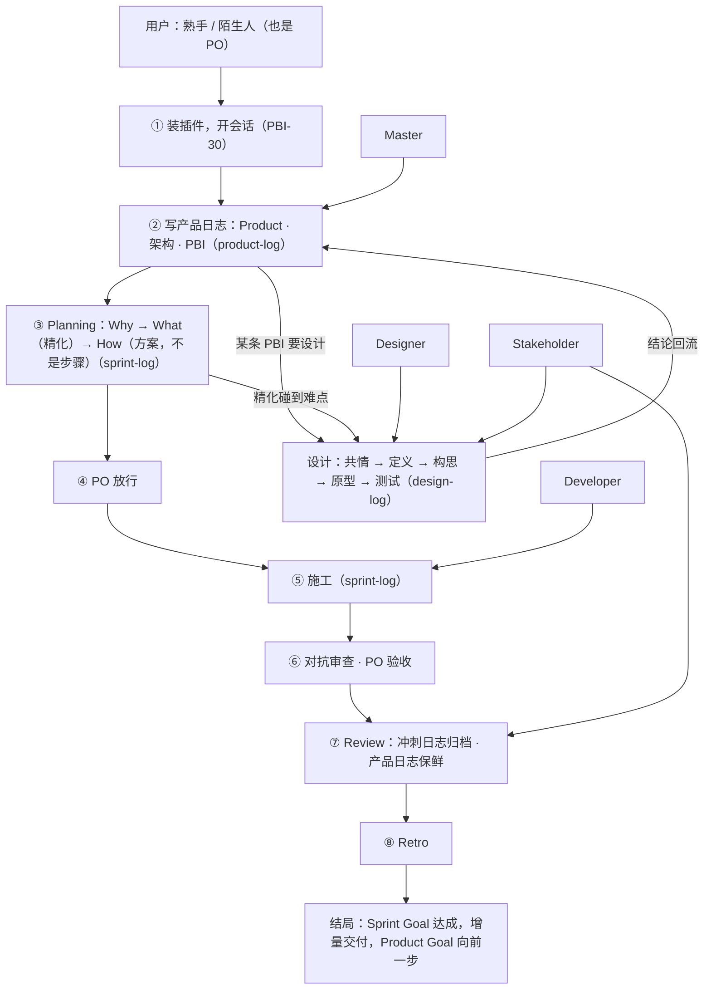

> 按 Scrum Guide Expanded v2026.1 的 Product / Increment / Product Backlog artifact 框架定义。
> Product Owner: SeaPawn

# 一、Product

## 1.1 Product

**IDEO-Scrum** 是一个 Claude Code marketplace 插件（另有同源的 Codex 分发包，Sprint 13 起）：将 Design Thinking 与 Scrum Sprint 两套方法论集成到 Claude Code，通过 skills 和 commands 提供结构化的方法论引导与流程框架。

**边界**：不做项目管理工具本身，不做 JIRA/Linear 集成，也不做团队协作平台——只提供方法论引导和流程框架。

## 1.2 Product Goal

**远景**（原 Product Vision 一节，2026-11-07 并入；SGEP：Vision 是 Product Goal 的输入）：让 Claude Code 成为一个随身的设计思维与敏捷教练——有方法论需求的人打开 Claude Code 调用 IDEO-Scrum，就能获得结构化、忠于原文、可操作的方法论引导。

（2026-10-24 PO 定）IDEO-Scrum 4.0：让插件带着流程走——角色、内核、流程参考与模板成体系，新项目照着就能跑通。

**之后的方向**（PO 2026-11-07）：当前 Product Goal 是把流程全部落地——模板、流程都纳入插件，拟分几个冲刺：08 设计内核独立（PBI-29、34、28、36，已完成，v5.0.0），09 设计日志模板改正（PBI-38，小冲刺，已完成，v5.0.1），10 流程全部进插件（PBI-23、31、32、37、39；原定的 11 并进来）（2026-11-08），11 约定照 PO 审阅改定（PBI-41，小冲刺，已完成，v5.1.1，2026-11-09），12 总览挪到 scrum-kernel 根目录（PBI-42，小冲刺，已完成，v5.1.2），13 Codex 版（PBI-43，已完成，版本不动，仍 v5.1.2，2026-11-10；PO 2026-11-09 定：算在本目标之内），14 约定精调（PBI-49，连同 47、48、50、40；PO 2026-11-10 定：算在本目标之内）。08 由 Master 兼 Developer 在一个会话里做；09、10 由 Master fork 出的 Developer 做（PO 2026-11-08）；11 由 Master 兼 Developer（PO 2026-11-09）；13 的 Developer 是 Codex（GPT），与 Master 靠冲刺日志通讯，PO 传话（PO 2026-11-09）。14 的 Developer 是从 Master 会话 fork 出的 Claude 会话，在 worktree 里干活（PO 2026-11-10）。之后分两条线：① 产品化：从作者能用到陌生人好用（PBI-30）；② 分享：把方法论写成成熟的文档、网页或视频，发到博客、GitHub 等处（PBI-12）。下一个 Product Goal：暂无新目标；开 Sprint 14 前已核对（PO 2026-11-10：约定精调在本目标之内）；以后开冲刺前照旧核对：和本目标不合就先定新目标，有了明显的新目标就先替换本目标。

（上一总目标「实现 IDEO-Scrum v2.0.0」已随 2026-08-31 发布达成，原文见 git 历史。）

## 1.3 Definition of Done

### Definition of Outcome Done

| 度量 | 目标信号 |
| --- | --- |
| 一次会话走通方法论环节：完整引导（结构化、忠于原文） | 用户不反复追问 |

### Definition of Output Done

| 维度 | 标准 |
| --- | --- |
| 内容忠实 | 忠于源材料（SGEP / d.school / Sprint）；方法论设计部分（融合、solo+AI）标注来源与依据 |
| 可导航 | 从 SKILL.md 入口 ≤2 跳到达任意 reference |
| 无死链 | 所有 markdown 内部链接可解析，无 404 |

# 二、架构

> 本章分两节：2.1 Stakeholders（谁），2.2 架构（一张 Map）。流程怎么走，见插件 scrum-kernel 的 `conventions/`。2026-11-07 精化出的架构 v1 已全部写进插件（Sprint 10），原文见 `git show 3b24287:scrum/ProductBacklog.md`。

## 2.1 Stakeholders

> 角色卡借 Grok Bot（`roster/README.md`）：每张卡写是谁、要什么、怎么算满意、看得到什么、何时召唤。召唤 stakeholder 时报卡名，它按卡上的身份看，只看卡上写的东西。常驻会话（如看板维护）另加「负责 / 不负责」两栏（Grok Bot："The *does not own* list is … the part that stops sprawl"）；本项目的常驻会话：PO 助手（2026-11-09 起，见下表最后一列）。**派子代理时，能用角色卡就用**（PO 2026-11-08）：审阅、外部视角、测试、方案评议等，都可以拿这里的卡派全新子代理——正式做项目时产品日志里会写下很多利益相关者，正好用上。不是只能用角色卡，需要时用。

| | 熟手 | 陌生人 | 读者 | PO 助手（常驻会话） |
| --- | --- | --- | --- | --- |
| 是谁 | 像作者这样的 solo 开发者：用 Claude Code 和本插件做自己的项目，熟悉这套流程 | 第一次装本插件的 solo 开发者：会用 Claude Code，没见过本仓库，也没有作者的记忆和配置 | 不装插件、只看公开分享（文章、网页、视频）的人：想学 solo + AI 怎么用 Scrum 与设计思维 | 常驻的 Claude Code 会话，替 PO 整理产品日志和同名文件（`.claude/seapawn.md`） |
| 要什么 | 流程跟着插件走，不用每次口述规矩；会话断了、压缩了能接上 | 装上就知道第一句说什么；术语有解释；很快进入干活 | 一套讲得清、能照着做的方法 | PO 或 Master 交代的改动说得清、有出处 |
| 怎么算满意 | 不用反复提醒 AI 规矩；冲刺照约定开、记、收 | 不问作者也能走完第一个冲刺 | 读完能在自己的项目里用起来 | 产品日志、同名文件与实际一致；PO 不用自己动手整理 |
| 看得到什么 | 全部：插件、产品日志、冲刺日志 | 只有插件和 README（体验测试只给这些） | 只有公开发布的内容 | 全部：插件、产品日志、冲刺日志、同名文件 |
| 何时召唤 | Review 看增量；改约定前看顺不顺手 | 体验测试（PBI-30）；Review 涉及入口、说明、术语时 | 分享内容的草稿（PBI-12） | PO 或 Master 要登记 PBI、改状态与备注、勾同名文件、要一份进度汇总时 |
| 负责 | — | — | — | 照 PO 或 Master 的话改产品日志和同名文件；汇总进度给 PO |
| 不负责 | — | — | — | 排序、定目标、替 PO 拍板；改插件文件；审阅；没问过不删条目 |

## 2.2 架构

> 照 Make a Map 画：上面是人，下面是结局，中间是步骤。流程见插件 scrum-kernel 的 conventions/。

# 三、Product Backlog Items

> 编号只是枚举序，不是优先级；排序以后再调。PBI 由 PO 与 Master 一起定，七列写法见插件 scrum-kernel 的 `conventions/product-log.md` 第 10 条。各 PBI 的开放点不在日志里表态，执行中由 PO 与 Developer 敲定。2026-11-07 以前的「精化记录」原文见 `git show e53650e:scrum/ProductBacklog.md`。

## 3.1 当前的 PBI

| 编号 | 标题 | 用户故事 | 架构定位 | 当前状态 | 规模 | 备注 |
| --- | --- | --- | --- | --- | --- | --- |
| PBI-12 | 方法论分享——公开系列（原「专家笔记完善」） | 作为读者，我想要一套公开的方法论分享（系列文章、网页或视频），讲清 solo + AI 怎么用 Scrum 和设计思维，以便不装插件也能学会、用到自己的项目里 | 产品之外：分享线（1.2「之后的方向」） | 待开始（排在 PBI-23 之后） | L | 作者自己也借此梳理一遍；素材：[ExpertNotes.md](documents/ExpertNotes.md) 里已写下的使用方法；公开发布前过一遍授权（d.school 非商业；版权声明由 PO 负责，PO 2026-11-07）；发布属对外动作，发前经 PO 确认；来源：seapawn.md L3，2026-10-24 PO 改为方法论分享 |
| PBI-25 | 插件小修集合 | 作为陌生人，我想要单独装上的插件里链接、署名、触发句和标题层级都对，以便不被死链和过时的说法误导 | 插件文件 | 待排序（随 PBI-30） | S | ① IDEO-modes 五份文件的许可行指向仓库根 ATTRIBUTION.md，插件单独分发后失效（改法实现前定；design-kernel 16 份摘录的文件头同样如此，2026-11-08 skill-reviewer 指出）；② ideo-kernel、scrum-kernel 两个 SKILL.md 没有 Source/License 头（先判定哪些段落属摘录）；③ Brainstorming 的触发句「Use after an HMW is clear」（HMW 已是可选方法；新文字由 PO 定）；④ 已解决（Sprint 08）（设计冲刺移出 ideo-kernel）；⑤ 已完成：scrum-guide-2020.md 第 297 行「Scrum Guide History」改为 `##`（PO 改的，2026-11-08 提交）；⑥ scrum-kernel SKILL.md 与 references/ 的 Artifacts、Events 两章注明出自 SGEP v2026.1，但插件里的 v2026.1 原文没有这两章，内容与 2025.6 版一致；先查 v2026.1 是否把这两章拆到了别的文档，再定是改出处还是换内容（2026-11-08，Sprint 10 发现）；来源：2026-10-25 Sprint 07 Review，⑤ 2026-11-07 登记 |
| PBI-30 | 产品化——从作者能用到陌生人好用 | 作为陌生人，我想要装上插件就知道第一句说什么、术语有解释、会话断了能接上，以便不读作者的仓库也能顺利走完第一个冲刺 | Map ①（装插件，开会话） | 待排序（流程落地后） | L | 范围：入口（没有产品日志就按模板建）、由浅入深（默认 PO + Master 一个会话走完，需要时再加 Developer、审阅、worktree）、说人话（术语第一次出现时解释，附词汇表）、接手不丢、体验测试、发布包装（用户 README、样例、CHANGELOG 与升级提示、发布渠道、授权说明、反馈渠道）；体验测试：Stakeholder 扮「陌生人」（只给 README、身份、任务），Developer 搭环境、跑、记卡点，Master 监督，跑之前先写好什么算卡住；每版都跑，发成熟版前 PO 和至少一个真人各走一遍；判据含 Sprint 07 的两个测试点；开放点：测试环境与测法（PO：到时候再说）、发布渠道、成熟版版本号；Codex 版已做完（PBI-43，Sprint 13），体验测试要连 Codex 入口一起测；与 PBI-12 的区别：12 是内容分享，30 是产品本身；「陌生人」的意见（2026-11-08 Sprint 10 Review），作为体验测试的输入：① 新项目第一句话说什么，要一页「5 分钟上手」② 明说「你就是 PO，开一个会话就够」③ 术语表：go-ahead、PBI、DoD、SGEP、role card、solo + AI ④ 不熟 git 的人怎么收官 ⑤ 哪些约定必须守；Codex 入口的意见（Sprint 13 Review）见 PBI-46 ⑤；全局记忆已精简（2026-11-09，v5.1.1 推送并装好之后）：删掉 GlobalMemory 的「Sprint 收尾做法」，其余四条只留 Claude Code 或 SeaPawn 特有的部分，规矩以插件约定为准；来源：2026-11-06 PO 口述，2026-11-07 改写 |
| PBI-33 | 方法库改写——解除非商业限制 | 作为陌生人（在商业项目里用），我想要方法库不带非商业限制，以便商业项目里也能用 | 插件：ideo-kernel 方法库 | 待排序（以后再做） | L | d.school Bootleg 是 CC BY-NC-SA，插件因此带非商业限制；PO 定：先接受（README 已写明），以后再做；注意：改写成自己的话与「原文优先」（CLAUDE.md「源材料与授权」）相反，做之前先定还做不做；改写范围、署名怎么处理，实现前定；来源：2026-11-07 精化 |
| PBI-35 | 看板（Scrum Board） | 作为熟手，我想要一块看板，一眼看到正在进行的冲刺、设计和各自的状态，以便不用翻各份日志就知道全局 | `scrum/` 下（插件约定 overview 第 4 条） | 待排序（以后再设计） | M | 主要对 PO 负责，做记录用；放 `scrum/` 下；（补充）可以交给常驻的 Stakeholder 会话维护，在 2.1 加一张带「负责 / 不负责」的卡（Grok Bot 的看板维护者："Don't prioritise, don't do the work, don't delete cards without asking"）；（补充）可以开成第一份设计日志，试 PBI-28 的模板；来源：2026-11-07 精化第四轮（PO 登记，这次不做） |
| PBI-40 | 约定 v1 第一次集中修订 | 作为熟手，我想要约定 v1 用过一轮后集中修一次，补上用起来卡手的地方，以便下一个冲刺照着走更顺 | 插件 scrum-kernel、design-kernel 的 `conventions/` | Sprint 14（作为 PBI-49 的输入） | S～M | 「熟手」的意见（2026-11-08 Sprint 10 Review）：① 设计收官没有 Review 模板 ② 「拿不准就问 PO」没有触发清单 ③ 检查点没有固定的触发时机 ④ 越过约定时，没有机制保证记下理由 ⑤ Planning 时要同时开三份约定，跨文件引用读起来累 ⑥ 新项目既没有记忆文件也没有说明文件时，Retro 的教训写到哪里 ⑦ 老项目怎么迁移成产品日志 ⑧ Developer 在别的工具里（Codex）时怎么协作，约定里还没写（Sprint 13 的做法见 CLAUDE.md「Sprint 节律」；PO 说以后常做的话会写一个更好的通讯层，2026-11-09）；约定改动照「每周集中改一次」，冲刺进行中不改；来源：2026-11-08 Sprint 10 Review |
| PBI-44 | scrum-kernel 重构——像 ideo-kernel 一样清晰可读 | 作为熟手，我想要 scrum-kernel 像 ideo-kernel 一样清晰可读，以便打开就知道里面有什么、什么时候读哪一份 | 插件 scrum-kernel | 待排序 | L | 来源：同名文件「重构整个 scrum 技能」；Sprint 10 时 PO 说以后可能要重构、Product Goal 下次再定；范围与做法实现前定；做完后跑 `scripts/sync_codex.py` 再同步 Codex 包（Sprint 13 起一条命令） |
| PBI-45 | 流程命令——关键步骤各有入口 | 作为熟手，我想要 Planning、Review、构思这些关键步骤各有一个命令或 skill，以便到了那一步直接调用，不用口述该读哪份约定 | Map ③～⑧ | 待排序 | M | 来源：同名文件两条（关键步骤写成命令或 skill；多加命令，比如 Planning，看好不好用），PO 原话「也可以成熟成熟」；Codex 没有 command，Codex 端只能做成 skill（Sprint 13：角色在 Codex 里都是 skill） |
| PBI-46 | Codex 版后续小修 | 作为熟手，我想要 Codex 包的同步和说明再顺一点，以便以后每次发版重跑同步都不用多想，陌生人在 Codex 里也能起步 | Map ①（装插件，开会话） | 待排序 | S | ① 同步脚本比较生成文件时忽略换行差异（Windows `autocrlf=true` 的新克隆第一次会重写 6 个文件，内容不变，`git status` 显示 M）；② Codex 里内核的自动触发没测过（README 只写「设置允许」）；③ 约定里「派全新子代理」在 Codex 里怎么做没核对（Codex 有没有对应功能；改不改约定原文由 PO 定，算 PBI-40 的范围）；④ scrum-master 简介补回「价值由 PO 决定」（现有 64 字符上限）；⑤ 「陌生人」对 Codex 入口的意见（Sprint 13 Review）：Codex 段加首句示例、写明你就是 PO、术语链到说明、迁移说明教怎么确认旧装的名字（`codex plugin list`）、README 写明测过的 Codex 版本（0.167.0）；⑥ 测 Codex 的脚本现在只在 git 历史里，要不要整理成可重跑的工具；来源：Sprint 13 Review |
| PBI-47 | 设计的构思——先发散后收敛 | 作为熟手，我想要设计的构思阶段先发散、再收敛，写明发散用哪些方法、做到什么程度才算够，以便不会跳过发散直接出方案 | 插件 design-kernel：SKILL.md 五阶段表的构思一行，`conventions/design-log.md` 的构思各条（7、11–15） | Sprint 14 | S | 来源：同名文件「design-apikey 的 Ideate 没发散」（2026-11-10 上午，别的项目里的一份设计）：照 design-log 约定 12 起了四个互不通气的子代理，各交一版完整方案，跳过了《Sprint》草图前三步（Notes、Ideas、Crazy 8s）的发散，四版同质；PO 问「他们只有方案，没有 ideate 是吧」，才补上 Analogous Empathy、Impose Constraints 和 Brainstorming；缺口在 design-kernel：构思一行把「收束到一个方案」和 IDEO 的构思方法并列写成可选，没规定先发散后收敛，也没说发散做到什么程度；同名文件提的做法：构思固定两拍——先发散（Brainstorming、Analogous Empathy、Crazy 8s、Impose Constraints 至少选两样，量优先），再收敛（隔离草图加 PO 决定），顺序写死，不留给执行者自由裁量；与 PBI-48 同类 |
| PBI-48 | 设计各阶段的重心对上 IDEO 五模式 | 作为熟手，我想要设计的每个阶段把注意力放在对应 IDEO 模式的重心上，以便每一段的产出不是走过场 | 插件 design-kernel：SKILL.md 的五阶段表，`conventions/design-log.md` | Sprint 14 | M | 来源：同名文件「design-kernel 的重心要和 IDEO 的重心吻合」（2026-11-10）：Sprint 08 把五阶段的名字对上了 IDEO 五模式，只解决了去哪找方法，每段的重心跑偏了——共情该是理解人（具体经历、行为、说的和做的不一致），跑成收材料、列事实、把日记当访谈记录；定义该是重新框定问题（POV 是用户、需求、洞察），跑成画一张地图、写一墙 HMW 就算完；构思该先发散后收敛、量优先、判断延后（PBI-47），跑成直接出方案；原型该粗、快、可丢，为了学不是为了交，跑成做得像成品、舍不得扔；测试该从真实反馈里学、允许结论是「我错了」，跑成验收实验、证明方案能用；每段收尾的自检：「这一步的产出，换一个没学过设计的人来做，会不会做得一模一样？」会的话，这一段的重心没落到那个模式上；与 PBI-47 同类 |
| PBI-49 | 约定精调——PO 逐条审定 | 作为熟手，我想要约定与模板经 PO 逐条过一遍、每一条都同意，写得简洁、明确、准确，以便新项目照着就能把流程走对 | 插件：scrum-kernel 的 `overview.md` 与 `conventions/`，design-kernel 的 `conventions/` | Sprint 14 | M | 来源：同名文件「重写所有约定」与 PO 口述（2026-11-10）；做法（PO）：PO 逐条说哪条不对、怎么改，和 Master 商量，定了就改；不走 plan 视图审；只做 Claude 版，全部改完再同步 Codex；结构方向（PO）：每份约定先一张架构图，再一批约定，overview 多一节写与官方指南不同的地方；同名文件的五条标准作为输入：一条只讲一件事，原则和操作分开放；能一句祈使句说清就不写一段；每条标明是源文本还是作者的做法；删掉互相覆盖的，覆盖不了的合并；执行者拿来就能用，不用猜、不用回读上下文；同名文件写的验收：一个没参与过的新会话只读这一版约定，能把流程走对；「整体各类模板的写作」两条旧待办也是输入：关键文档与元件先定规格（如 Review 的产出），模板要好好设计（原 PBI-17、18，已并入 PBI-23）；与 PBI-40、44 重叠，与 47、48、50 交叉 |
| PBI-50 | 什么时候必须开设计 | 作为熟手，我想要约定写明哪类问题必须先开设计，以便遇到「他想要什么」「怎么才算好」这类没有现成答案的问题时先进共情，不先出方案 | 插件：scrum-kernel 的 SKILL.md（与设计内核的分工）、`conventions/product-log.md`（2、15）、`conventions/sprint-log.md`（6），design-kernel 的 `conventions/design-log.md`（1、3） | Sprint 14 | S | 来源：同名文件「休息日设计没走 IDEO 方法论」「复用：判断什么时候必须开 design」（2026-11-10 凌晨，别的项目给休息日定 PBI）：拿日记里「休息没休成」的记录直接推出 Goal、DoD 和条目，三轮都被 PO 否掉；错在：什么算真正的休息是没有现成答案的问题，该开设计没开；拿二手材料当一手（日记记工作，不记怎么歇）；没用任何方法，也没说为什么不用（ideo-kernel Use Protocol 第 3 条）；PO 前两次否决本身就是数据，却只在同一个框架里改细节；同名文件的判断句：凡是要回答「他想要什么」「怎么才算好」这类没有现成答案的问题，先问一句：这是不是该走设计？是就进共情，不先出方案；与 PBI-47、48 同类（都是设计的问题） |

## 3.2 已完成 / 已关闭的 PBI

> 每条一行，附出处；细节见出处与 git 历史。Sprint 08 起，出处是 `scrum/documents/` 里归档的冲刺日志。

| # | 标题 | 结果 | 出处 |
| --- | --- | --- | --- |
| PBI-1～11 | 1.x 与 2026-08-30 废弃的条目 | 1.x 以 v1.0.2 收官；PBI-7～11 于 08-30 废弃 | git 历史；记忆档 sprint-01～05 |
| PBI-13 | 角色体系——教学位与执行位 | 已撤销（2026-08-31） | `git show 3f81260:scrum/SprintBacklog.md`；记忆档 sprint-06-dual-kernel-refactor |
| PBI-14 | 设计阶段快原则与 output-style 重构 | 完成（2026-10-04，v3.1.0） | tag `v3.1.0`；记忆档 sprint-06-dual-kernel-refactor |
| PBI-15 | ideo 与设计冲刺融合重构 | 关闭（2026-10-24）：15-B、15-C 完成，15-D 撤销 | tag `v2.0.0`；记忆档 sprint-06-dual-kernel-refactor |
| PBI-16 | 双内核联动——描述字段互链 | 完成（2026-08-31，v2.0.0） | tag `v2.0.0` |
| PBI-17 | 流程规格——关键文档与元件的预先规格设计 | 并入 PBI-23（2026-10-24） | — |
| PBI-18 | 双内核执行模板——设计冲刺与 Scrum 配套模板 | 并入 PBI-23（2026-10-24） | — |
| PBI-19 | 验收双机制——DoD 自检与 SM 证据初验 | 并入 PBI-20（2026-10-24） | — |
| PBI-20 | 角色重定义 | 完成（2026-10-25，v4.0.0） | tag `sprint-07-done`；`git show 8f3fb44:scrum/SprintBacklog.md`；记忆档 sprint-07-roles-kernels |
| PBI-21 | ideo-kernel：改名并分清两套「五步」 | 完成（2026-10-25，v4.0.0）；2026-11-07 主线改为设计冲刺，见 PBI-29 | 同 PBI-20 |
| PBI-22 | 加载机制——角色命令自动加载内核 | 完成（2026-10-25，v4.0.0） | 同 PBI-20 |
| PBI-23 | 冲刺日志约定 v1——模板与各单元约定 | 完成（2026-11-08，v5.1.0）：scrum-kernel 的 `conventions/sprint-log.md`（21 条）与冲刺日志模板 | [documents/sprint-10-conventions.md](documents/sprint-10-conventions.md) |
| PBI-24 | 插件全文英文化 | 完成（2026-10-25，v4.0.0） | 同 PBI-20 |
| PBI-26 | 两轮进入执行的验证与改进 | 并入 PBI-30（2026-11-07）：成为体验测试的一项判据；2026-11-08 PO 删去这条判据 | — |
| PBI-27 | Bot 工作方式研究——借鉴其思想指导改革 | 完成（2026-11-07）：结论用于架构 v1；子项「角色卡重构」并入 PBI-32 | [documents/PBI-27-bot-research.md](documents/PBI-27-bot-research.md) |
| PBI-28 | 设计日志约定 v1 | 完成（2026-11-08，v5.0.0）：design-kernel 的 `conventions/`（约定 20 条与五章模板） | [documents/sprint-08-design-kernel.md](documents/sprint-08-design-kernel.md) |
| PBI-29 | ideo-kernel 收窄——只留 IDEO 五模式与方法库 | 完成（2026-11-08，v5.0.0）：ideo-kernel 成为整个插件共用的工具箱、各阶段的基础 | [documents/sprint-08-design-kernel.md](documents/sprint-08-design-kernel.md) |
| PBI-31 | 产品日志约定 v1——模板与精化 | 完成（2026-11-08，v5.1.0）：scrum-kernel 的 `conventions/product-log.md`（18 条）与产品日志模板 | [documents/sprint-10-conventions.md](documents/sprint-10-conventions.md) |
| PBI-32 | 角色命令接上约定 | 完成（2026-11-08，v5.1.0）：四个命令各加指路、改掉过时的说法；stakeholder 身份从利益相关者表读一行，被指定审阅时对照 DoD 核对 | [documents/sprint-10-conventions.md](documents/sprint-10-conventions.md) |
| PBI-34 | 新建 design-kernel——设计冲刺 | 完成（2026-11-08，v5.0.0）：按 IDEO 五阶段放《Sprint》原文摘录（只删不改，例图改画） | [documents/sprint-08-design-kernel.md](documents/sprint-08-design-kernel.md) |
| PBI-36 | 角色命令按新规则加载内核 | 完成（2026-11-08，v5.0.0）：四个命令都先加载 ideo-kernel | [documents/sprint-08-design-kernel.md](documents/sprint-08-design-kernel.md) |
| PBI-37 | 开设计与接手——设计日志第一次就跑得起来 | 完成（2026-11-08，v5.1.0）：design-log.md 的 Open a design、Resume from the header（文件头 Now 一行）、Goal fixed, plan flexible | [documents/sprint-10-conventions.md](documents/sprint-10-conventions.md) |
| PBI-38 | 设计日志模板改正——只记产出 | 完成（2026-11-08，v5.0.1）：设计日志只记产出；不设选靶；构思写明 IDEO 的方法同样要用 | [documents/sprint-09-design-template.md](documents/sprint-09-design-template.md) |
| PBI-39 | 总览约定——三层、文件与 docs | 完成（2026-11-08，v5.1.0）：scrum-kernel 的 `conventions/overview.md`（16 条），文档文件夹定为 `scrum/documents/` | [documents/sprint-10-conventions.md](documents/sprint-10-conventions.md) |
| PBI-41 | 约定 v1 按 PO 审阅修订 | 完成（2026-11-09，v5.1.1）：PO 审出的 19 处改了 18 处（1 处是译文问题），另有连带改动；design-log 改号为 1–21 | [documents/sprint-11-conventions-review.md](documents/sprint-11-conventions-review.md) |
| PBI-42 | 总览挪到 scrum-kernel 根目录 | 完成（2026-11-09，v5.1.2）：`overview.md` 与 SKILL.md 并列，各处说法改对（PO 当天提出，小冲刺） | [documents/sprint-12-overview-to-root.md](documents/sprint-12-overview-to-root.md) |
| PBI-43 | Codex 版——与 Claude Code 版一致 | 完成（2026-11-10，版本不动，仍 v5.1.2）：Codex 包 `codex/plugins/ideo-scrum/` 并入 main，`scripts/sync_codex.py` 一条命令从插件本体生成、`scripts/check_codex.py` 核对；五题在 Codex 里 5/5；旧 `codex` 分支退役，存档 tag `codex-v3.2.0` | [documents/sprint-13-codex.md](documents/sprint-13-codex.md) |
