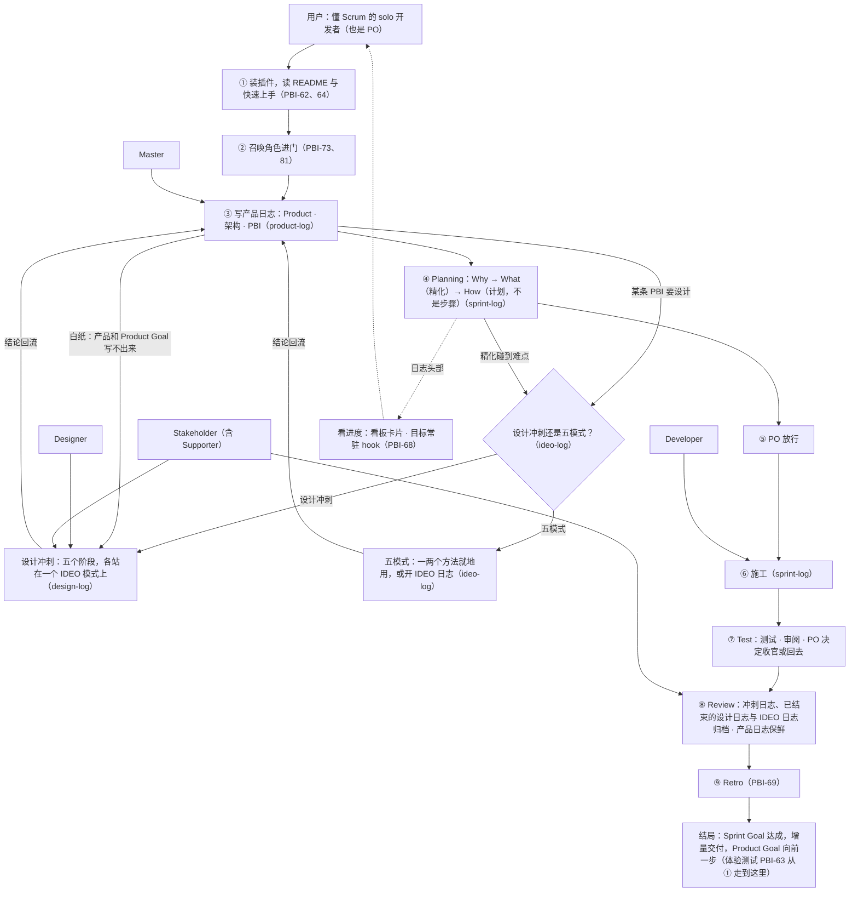

> 按 Scrum Guide Expanded v2026.1 的 Product / Increment / Product Backlog artifact 框架定义。
> Product Owner: SeaPawn

# 一、Product

## 1.1 Product

| 承诺 | IDEO-Scrum：把 Design Thinking 与 Scrum Sprint 装进 Claude Code。 |
| --- | --- |

**IDEO-Scrum** 是 Claude Code marketplace 插件，也是可从仓库根目录安装的 DeepSeek Harness（DSH）bundle。两者直接共用同一套 Design Thinking 与 Scrum Sprint 方法论正文，通过角色入口和技能提供结构化的引导与流程框架。

**边界**：不做项目管理工具本身，不做 JIRA/Linear 集成，也不做团队协作平台——只提供方法论引导和流程框架。看板只读日志、不另存状态，由便宜的模型生成，不是项目管理工具。

## 1.2 Product Goal

| 承诺 | 产品化：从作者能用到大家都好用；看板一眼看清进度，文档讲清规矩；懂 Scrum 的人照着就能走完第一个冲刺。 |
| --- | --- |

**常态**：优化插件——用的时候攒下的反馈，随时开小冲刺改进插件；熟手照着就能走。它不是目标，是一直在做的事，由副线承担（PO 2026-11-13）。

**远景**：让 Claude Code 成为一个随身的设计思维与敏捷教练——有方法论需求的人打开 Claude Code 调用 IDEO-Scrum，就能获得结构化、忠于原文、可操作的方法论引导。

**换目标**（2026-11-13）：「优化现有插件」（2026-11-12 定）换成产品化——PO 定产品化更要紧，优化转为常态。更早的目标见 git 历史。

**本轮与之后**：插件的记忆机制（PBI-51，Sprint 26）已收官，效果测试另开 PBI-101；公开方法论分享（PBI-12）留待以后。六期的分工、范围与反馈去向见[六期总表](documents/sprint-roadmap.md)。

## 1.3 Definition of Done

### Definition of Outcome Done

| 度量 | 目标信号 |
| --- | --- |
| 一次会话走通方法论环节：完整引导（结构化、忠于原文） | 用户不反复追问 |
| 懂 Scrum 的陌生人走完第一个冲刺 | 体验测试（PBI-63）里不问作者、没有卡死的点 |

### Definition of Output Done

| 维度 | 标准 |
| --- | --- |
| 内容忠实 | 忠于源材料（SGEP / d.school / Sprint）；方法论设计部分（融合、solo+AI）标注来源与依据 |
| 署名 | 第三方摘录带 Source / License 两行，与 ATTRIBUTION.md 一致 |
| 可导航 | 从 SKILL.md 入口 ≤2 跳到达任意 reference |
| 无死链 | 所有 markdown 内部链接可解析，无 404 |
| 插件校验 | `claude plugin validate --strict plugins/ideo-scrum` 通过 |
| 描述长度 | 每个技能的 description 不超过 1024 字符 |
| DSH 分发 | `node --test scripts/check_dsh.mjs` 通过，共用的正文无需同步；分发改动另验实际安装与角色入口 |

# 二、架构

> 2.1 是谁，2.2 一张 Map。流程怎么走，见插件的 Memory（`plugins/ideo-scrum/skills/memory/`）。

## 2.1 Stakeholders

> 召唤 Stakeholder 时报卡名，它按卡上的身份看、只看卡上写的东西；常驻会话另加「负责 / 不负责」两栏。派子代理做审阅、外部视角、测试、方案评议时，能用卡就用（PO 2026-11-08）。

| | 熟手 | 陌生人 | 读者 | Supporter（秘书，常驻会话） |
| --- | --- | --- | --- | --- |
| 是谁 | 像作者这样的 solo 开发者：用 Claude Code 和本插件做自己的项目，熟悉这套流程 | 懂 Scrum、第一次装本插件的 solo 开发者：会用 Claude Code，没见过本仓库，也没有作者的记忆和配置 | 不装插件、只看公开分享（文章、网页、视频）的人：想学 solo + AI 怎么用 Scrum 与设计思维 | 常驻的 Claude Code 会话，做不碰源码的杂活（SGEP 里 Stakeholder 的一种），也是 PO 的联络点 |
| 要什么 | 流程跟着插件走，不用每次口述规矩；会话断了、压缩了能接上 | 装上就知道第一句说什么；插件自己的词有解释；很快进入干活 | 一套讲得清、能照着做的方法 | PO 或 Master 交代的事说得清、有出处；等 PO 定的问题一次收齐、带着上下文问到 |
| 怎么算满意 | 不用反复提醒 AI 规矩；冲刺照约定开、记、收 | 不问作者也能走完第一个冲刺 | 读完能在自己的项目里用起来 | 产品日志与实际一致；PO 不用自己动手整理；要 PO 定的事不漏、不一件件追着问 |
| 看得到什么 | 全部：插件、产品日志、冲刺日志 | 插件、README，和 README 链到的文档（体验测试只给这些；Sprint 20 Master 定，快速上手和词汇表放在 `docs/`） | 只有公开发布的内容 | 全部：插件、产品日志、冲刺日志 |
| 何时召唤 | Review 看增量；改约定前看顺不顺手 | 体验测试（PBI-63）；Review 涉及入口、说明、术语时 | 分享内容的草稿（PBI-12） | PO 或 Master 要登记 PBI、改状态与备注、要进度汇总、要看板、要讲机制，或有事要找 PO 时 |
| 负责 | — | — | — | 照 PO 或 Master 的话改产品日志、写看板、汇总进度；收齐等 PO 的问题并把答复原话带回；转达 PO 的话（标明是 PO 的意见，附原话、日期、在哪里说的） |
| 不负责 | — | — | — | 排序、定目标、替 PO 拍板与答复；改插件文件；审阅；没问过不删条目；工具权限与设置、`CLAUDE.md`／`AGENTS.md`、推送发布这些要 PO 亲口确认的事，转达也不算 |

## 2.2 架构

> 照 Make a Map 画：上面是人，下面是结局，中间是步骤；括号里是挂在这一步上的 PBI。

# 三、Product Backlog Items

> 编号只是枚举序，不是优先级。行按三组排：主线（新功能）、副线（插件的规矩与讲规矩的文档）、以后；不加节（PO 2026-11-12、11-13）。备注只写决定和开放点，做法到做的时候写进冲刺日志（PO 2026-11-13）。七列写法见插件 Memory 的 `item-columns`（`skills/memory/details/product-log.md`）。

## 3.1 当前的 PBI

> 「规划：Sprint NN」表示已分配到该期，不表示已开工或已通过验收。新增项的规模由对应 Developer 在三方 Planning 时估量；F 编号对应[总表中的反馈对账](documents/sprint-roadmap.md#反馈对账)。

| 编号 | 标题 | 用户故事 | 架构定位 | 当前状态 | 规模 | 备注 |
| --- | --- | --- | --- | --- | --- | --- |
| PBI-98 | Memory：角色带上与验证 | 作为熟手，我想叫出任一角色就带上同一套规矩，以便不用每次手动说明 | 插件：角色入口与 DSH | 部分完成（Sprint 26 收官） | M | 部分完成（2026-11-23）：Claude Code 与 DSH 各验过（V1–V6），触发七格过、一格 Q11 字面未过（待研，PBI-103）。验收里的 Outcome「不用每次手动说明」未证：探路 33 条入选 0 条，对照臂不干净；PO 2026-11-23 定 A 收官，如实写未证。余下的效果测试重做见 PBI-101。 |
| PBI-87 | 调研：Stakeholder 角色是否可选自动登记为 Agent | 作为 PO，我想评估让 Stakeholder 角色按需或自动登记为项目 Agent 的可能，以便少手工操作又能守住边界 | 插件：`project-stakeholder`／产品日志 §2.1 | 待选 | S | 来源：PO 2026-11-21 原话：「你记得stakeholder角色是否自动登记agent，计入一个反馈PBI里面吧？还是一个PBI？我觉得可以一类可能反馈，因为我可能要测试一下，未来有可能放开去自动创建agent去，这个你要记得最好。」内容：先测手动登记的实际使用体验；若合适，再研究可选的批量／自动登记（默认关闭，逐张预览或规则化确认），不改变「PO 定角色、登记不改共享命令、Review 召唤权不变」的边界。按想法／反馈类登记，暂不排期。**未来需测试**：召唤 subagent 与 Workflow 时，是否会局限在已给的 agent 角色列表和产品日志 Stakeholder 表格之内；能否跳出这个约定，新建角色来做 subagent／Workflow。PO 2026-11-22：要先体验，本轮不收。 |
| PBI-100 | DSH：技能描述在技能清单里被截到 500 字符 | 作为用 DSH 的熟手，我想让各内核的描述在 DSH 的技能清单里完整可见，以便按名召唤和自然触发都不受截断影响 | 分发：DSH | 待选 | 待估 | 来源：Sprint 26 判据 ⑥ 的 DSH 实测（秘书会话，2026-11-23，DSH 0.2.3-alpha.2）：技能清单把每条描述截到 500 字符，design、ideo、scrum、sprint 四个内核都被截（scrum-kernel 原文 968 字符）。要查清截断对触发的影响，再定是缩短描述，还是给 DSH 另写一份短描述。 |
| PBI-101 | Memory 效果测试：重新设计 | 作为 PO，我想知道 Memory 是否让 AI 不用每次手动说明就照规矩做，以便决定要不要继续投入 | 插件：测试方法（Memory 效果） | 待选 | 待估 | 来源：Sprint 26 收官，PO 2026-11-23 定 A（Master 转述）。上一轮的对照臂不干净：M 臂的旧约定文件仍可读，探针测的是「会不会去读规矩」。做法要点：对照臂隔离规矩文件；先在改前版本上预演；判据先冻结再测。原 PBI-98 的 Outcome 验收移到这里。 |
| PBI-103 | Q11 类题的触发：设计类题用更多样本判 | 作为熟手，我想让设计类问题稳定触发设计内核，以便问「怎么做设计」时不漏加载 | 插件：design-kernel、ideo-kernel 的描述与触发 | 待选 | 待估 | 来源：Sprint 26 V4，Q11 直接（设计类题）字面判 B 5/6、C 4/6 未过；Master 定带着收官、登记（不改判）。先核对题面与 description 的口径是否一致，再用更多样本判。 |
| PBI-12 | 方法论分享——公开系列 | 作为读者，我想要一套公开的方法论分享（系列文章、网页或视频），讲清 solo + AI 怎么用 Scrum 和设计思维，以便不装插件也能学会、用到自己的项目里 | 产品之外：分享线（1.2「之后」） | 以后 | L | 决定：下一步做（PO 2026-11-13）；公开发布前过一遍授权（d.school 非商业）、经 PO 确认。素材：[ExpertNotes.md](documents/ExpertNotes.md)、`git show 3f43476:scrum/documents/five-stage-mapping.svg`（图里冲刺还是旧的三段，用前改成五个阶段；2026-11-14 PO 整理 documents 时从仓库删去）。来源：2026-10-24 PO 改为方法论分享 |
| PBI-102 | 远程并发跑测试 | 作为 Developer，我想让无头测试能远程并发跑，以便不被本机内存限制 | 分发：测试基础设施 | 以后 | 待估 | PO 2026-11-23 定：不做，记在以后。来源：Sprint 26 的测试里本机内存紧张时，系统多次收走后台任务。 |

## 3.2 已完成 / 已关闭的 PBI

> 每个冲刺一行，列出条目编号，细节见出处与 git 历史（PO 2026-11-13：条目多了按条列读不完，偏离 product-log 第 17 条的每条一行）。Sprint 08 起，出处是 `scrum/documents/` 里归档的冲刺日志。

| 冲刺 | 条目 | 结果 | 出处 |
| --- | --- | --- | --- |
| 1.x（至 2026-08-30） | PBI-1～11 | 1.x 以 v1.0.2 收官；PBI-7～11 于 08-30 废弃 | git 历史；记忆档 sprint-01～05 |
| Sprint 06（2026-08-31～10-24，v2.0.0→v3.2.0） | PBI-13 角色体系（撤销）、14 设计阶段快原则、15 ideo 与设计冲刺融合（关闭）、16 双内核联动；17、18 并入 23，19 并入 20 | 双内核成形 | tag `v2.0.0`、`v3.1.0`；记忆档 sprint-06-dual-kernel-refactor |
| Sprint 07（2026-10-25，v4.0.0） | PBI-20 角色重定义、21 ideo-kernel 改名、22 角色命令自动加载内核、24 全文英文化 | 角色与内核成体系 | tag `sprint-07-done`；记忆档 sprint-07-roles-kernels |
| 精化（2026-11-07） | PBI-26 并入 30（11-08 删去判据）、27 Bot 工作方式研究 | 研究结论用于架构 v1 | [documents/PBI-27-bot-research.md](documents/PBI-27-bot-research.md) |
| Sprint 08（2026-11-08，v5.0.0） | PBI-28 设计日志约定、29 ideo-kernel 收窄、34 新建 design-kernel、36 角色命令先加载 ideo-kernel | 设计冲刺进插件 | [documents/sprint/sprint-08-design-kernel.md](documents/sprint/sprint-08-design-kernel.md) |
| Sprint 09（2026-11-08，v5.0.1） | PBI-38 设计日志模板只记产出 | — | [documents/sprint/sprint-09-design-template.md](documents/sprint/sprint-09-design-template.md) |
| Sprint 10（2026-11-08，v5.1.0） | PBI-23 冲刺日志约定、31 产品日志约定、32 角色命令接上约定、37 开设计与接手、39 总览约定 | 流程全部进插件 | [documents/sprint/sprint-10-conventions.md](documents/sprint/sprint-10-conventions.md) |
| Sprint 11（2026-11-09，v5.1.1） | PBI-41 约定按 PO 审阅修订 | — | [documents/sprint/sprint-11-conventions-review.md](documents/sprint/sprint-11-conventions-review.md) |
| Sprint 12（2026-11-09，v5.1.2） | PBI-42 总览挪到 scrum-kernel 根目录 | — | [documents/sprint/sprint-12-overview-to-root.md](documents/sprint/sprint-12-overview-to-root.md) |
| Sprint 13（2026-11-10，版本不动） | PBI-43 Codex 版 | Codex 包由脚本生成，并入 main | [documents/sprint/sprint-13-codex.md](documents/sprint/sprint-13-codex.md) |
| Sprint 14（2026-11-10，v5.2.0） | PBI-40 约定第一次集中修订、47 构思先发散后收敛、48 设计阶段对上五模式、49 约定精调、50 什么时候必须开设计 | 约定精调；白纸题没过线，登记 PBI-52 | [documents/sprint/sprint-14-conventions-tuning.md](documents/sprint/sprint-14-conventions-tuning.md) |
| Sprint 15（2026-11-12，版本不动） | PBI-55 自我反馈 | 反馈进全局记忆 | [documents/design/design-feedback-loop.md](documents/design/design-feedback-loop.md)、[documents/sprint/sprint-15-feedback-loop.md](documents/sprint/sprint-15-feedback-loop.md) |
| Sprint 16（2026-11-12，版本不动） | PBI-44 内核结构统一、57 加载分层 | 四个内核、按需加载 | [documents/sprint/sprint-16-kernel-structure.md](documents/sprint/sprint-16-kernel-structure.md) |
| Sprint 17（2026-11-13，v6.0.0） | PBI-54 产品日志与冲刺约定修订、58 设计约定修订、56 设计冲刺与五阶段法分清、53 Developer 在别的工具里、52 白纸入口 | 约定改顺、IDEO 日志；题 9、10 的缺口登记 PBI-59 | [documents/sprint/sprint-17-conventions-rewrite.md](documents/sprint/sprint-17-conventions-rewrite.md) |
| 产品日志整理（2026-11-13） | PBI-30 产品化、25 插件小修、46 Codex 小修、59 分界题的直接路径、45 流程命令、33 方法库改写 | 30 拆成 62 教学、63 体验测试、64 发布包装（看板、hook 另有 35、61）；61 拆出 66；25 关闭（③ 删，图标转 64）；46 关闭（Codex 不是核心）；59 删（普通时候不触发是好事，测试结果转为 65 的来源）；45 删（角色命令加约定已够，陌生人真在哪一步迷路再带证据登记）；33 删（与原文优先相反） | git 历史 |
| Sprint 18（2026-11-13，随 Sprint 19 发 v6.0.2） | PBI-66 日志头部、65 加载边界、60 角色说明 | 日志头部统一（承诺小表、Now、Waiting for PO、✓ 完成标记、决定前引用目标）；scrum、sprint、design 召唤才来；Master 在书面授权内代行、PO 助手身份写清。C 组 ideo 自然触发 3/9 没过，转 PBI-67（PO 定）；白纸项目的直接路径不再自动进设计冲刺——65 有意的结果，PBI-52 的直接路径行为就此改变，从角色命令进来照旧 | [documents/sprint/sprint-18-rules-first.md](documents/sprint/sprint-18-rules-first.md) |
| Sprint 19（2026-11-14，发 v6.0.2，连同 Sprint 18） | PBI-35 看板、61 目标常驻 hook | 看板第 1 版：scrum-kernel 的 `conventions/board.md` 与 `board-template.html`，单文件网页，产品卡、冲刺卡、设计卡，只读日志、不存状态，便宜的模型照约定生成；hook：开会话、恢复、压缩后各注一次承诺原文，承诺变了再注，可关，Codex 一并同步。频率测试：不装 hook 也过线，约定是主力、hook 补位。PO 看过真实看板，第 1 版认可，要强审重做，登记 PBI-68 | [documents/sprint/sprint-19-board-hook.md](documents/sprint/sprint-19-board-hook.md) |
| Sprint 20（2026-11-14，v6.0.3） | PBI-68 看板改版、64 发布包装、62 教学、63 体验测试、70 约定小修（七处） | 看板照设计的第 3 版重做成「固定页面 + 一块数据」，三档屏、离线、跟着系统的深浅色，检查脚本 `scripts/board_check/check.py`，便宜的模型能写，PO 看过说「非常好」；README、快速上手、词汇表、CHANGELOG、图标、升级与反馈；七处约定小修；体验测试照 63-a 跑：一组 3 次里两次走完，没有文档的卡点，陌生人一路装插件、开冲刺、收官、看看板 | [documents/sprint/sprint-20-presentable.md](documents/sprint/sprint-20-presentable.md)、[documents/design/design-board.md](documents/design/design-board.md) |
| Sprint 21（2026-11-21，版本不动，仍 v6.0.3） | PBI-74 看板重做设计冲刺卡、PBI-71 服务产品日志／已收尾的 IDEO 日志处理 | 设计卡重做为「目标原文／地图主线／独立方案区（故事板可选折叠、未选定不编造）」，产品卡与普通 Sprint 卡不变；独立 Sonnet 盲读 B 卡过线，6 组离线环境 42 卡次通过；IDEO 归属按 `For` 实际开放宿主与 `Now` 收尾态对齐 `board-log.md` 第 11、16 条与 `check.py`（13 份独立夹具＋5 负例＋79 项自测）。PO 接受增量与品味并拍板 ①（接受 2010 *Design Process Mini-Guide* 维基存档证据、另立 PBI-84 补双源署名）；「熟手」Review 无阻塞落差，3 条非阻塞建议并入 PBI-79「21+23 合流回验」备注 | [documents/sprint/sprint-21-design-board.md](documents/sprint/sprint-21-design-board.md) |
| Sprint 22（2026-11-21） | PBI-73 独立参谋、PBI-75 项目 Stakeholder 登记 | 参谋只读、手动发起，不传旧评议、不代 PO 决定；登记先预览同意，普通 Agent 与 Workflow 交互双入口各自按名命中。两处入口仅 Claude Code；实际模型三态仍待验证，登记写入职责的口径并入 PO 秘书议题，文档导航留 25 合流。 | [documents/sprint/sprint-22-project-agents.md](documents/sprint/sprint-22-project-agents.md) |
| Sprint 23（2026-11-21） | PBI-76 DoD、PBI-77 阶段放行、PBI-78 承诺、PBI-79 设计归档、PBI-69 Retro | DoD、阶段授权、承诺按原文、设计工作材料保全、Retro 分条记忆；按冻结口径 10/10，s10 定向复测 3/3。跨期核对及 Sprint 21 熟手提出的非阻塞留项见归档。 | [documents/sprint/sprint-23-log-rules.md](documents/sprint/sprint-23-log-rules.md) |
| Sprint 24（2026-11-21） | PBI-80 起草前读原文、PBI-81 顺序加载、PBI-82 内联原文、PBI-83 承诺 hook | 候选四题首稿前读全 12/12 对基线 0/12；四角色 4／3／3／2；Sprint Backlog 原文加载 3/3。两夹具 hook 常态 P50 降约 91%，已测承诺语义不变；未重测全流程 Outcome。 | [documents/sprint/sprint-24-loading-reliability.md](documents/sprint/sprint-24-loading-reliability.md) |
| Sprint 25（2026-11-21） | PBI-72 DSH 分发：验收与跨宿主维护说明 | 两个宿主的 0.6.3 新装、6.0.3 迁移与共用规则读取均在隔离环境取证；保留各自迁移步骤及实调角色边界。Claude 与 DSH 本地候选同为 0.6.3，尚未发布。 | [documents/sprint/sprint-25-dsh-docs.md](documents/sprint/sprint-25-dsh-docs.md) |
| Sprint 26（2026-11-22～11-23，0.7.0 待发布） | PBI-51 ✓ 2026-11-23、92 ✓ 2026-11-23、93 ✓ 2026-11-22、94 ✓ 2026-11-22、95 ✓ 2026-11-22（board-log 不转，留 `board/`，Master 2026-11-23 定）、96 ✓ 2026-11-23、97 ✓ 2026-11-23（board-log 留原处，旧约定删）；98 部分（Outcome 未证，重做见 PBI-101）；登记 101、102、103 | Memory 进插件：`skills/memory/` 清单 103 行、细则 15 个；五份旧约定删；角色入口与 DSH 带上 Memory。验证：角色入口 15/15，DSH 预载 15/15、压缩后重载 3/3，触发七格过一格待研。Outcome 未证：探路 33 条入选 0 条，对照臂不干净；PO 2026-11-23「你决定即可」，Master 定 A 收官 | [documents/sprint/sprint-26-plugin-memory.md](documents/sprint/sprint-26-plugin-memory.md)；审阅 [documents/sprint/sprint-26-plugin-memory-review.md](documents/sprint/sprint-26-plugin-memory-review.md) |
| Sprint 27（2026-11-22～11-23，版本不动，仍是 0.6.3 的未发布候选） | PBI-84 署名（IDEO 五模式双源）、PBI-85 模板与看板归位、PBI-86 Supporter 角色与改称、PBI-89 看板收尾态、PBI-90 入口九条意见 | 新角色 Supporter（秘书）：杂活、PO 的联络点、转达的 PO 意见视同 PO 的、三级分流，各角色叫法统一；模板进插件根 `template/`、看板文件进 `board/`；看板认得收尾待归档的写法（检查脚本也认只在分支上的产品日志）；五个 IDEO 模式文件署名补齐 2010／2018 双源；项目 Agent 与参谋入口九条意见做了八条（不改召唤示例）。触发测试 A 组 9／9、B 组 4／9 对 3／9、C 组 9／9；无头加载 3／3；DSH 实装三条全过；Codex 与熟手视角各提的意见都已修；旧称法与旧路径 grep 只剩放行的归档里的历史记述。 | [documents/sprint/sprint-27-wrap-up.md](documents/sprint/sprint-27-wrap-up.md) |
