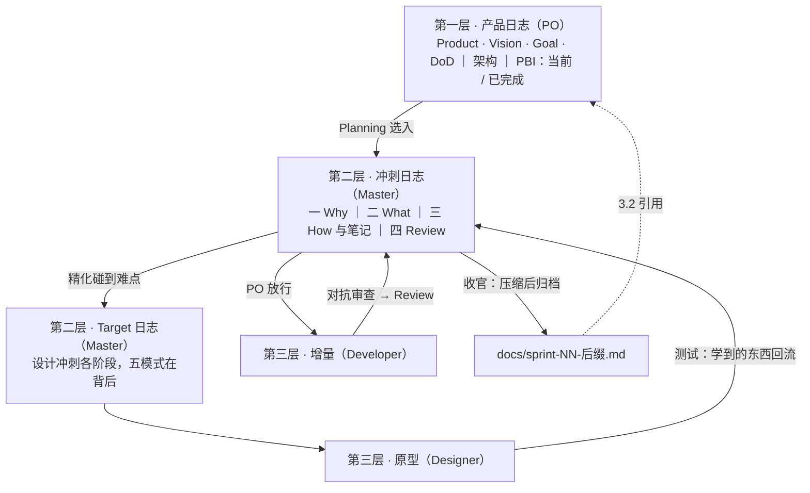
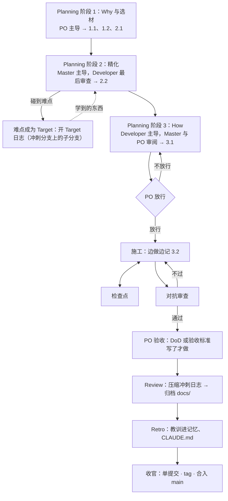

> 按 Scrum Guide Expanded v2026.1 的 Product / Increment / Product Backlog artifact 框架定义。
> Product Owner: SeaPawn

# 一、Product

## Product

**IDEO-Scrum** 是一个 Claude Code marketplace 插件：将 Design Thinking 与 Scrum Sprint 两套方法论集成到 Claude Code，通过 skills 和 commands 提供结构化的方法论引导与流程框架。

**边界**：不做项目管理工具本身，不做 JIRA/Linear 集成，也不做团队协作平台——只提供方法论引导和流程框架。

## Product Vision

让 Claude Code 成为一个随身的设计思维与敏捷教练——有方法论需求的人打开 Claude Code 调用 IDEO-Scrum，就能获得结构化、忠于原文、可操作的方法论引导。

## Product Goal

（2026-10-24 PO 定）IDEO-Scrum 4.0：让插件带着流程走——角色、内核、流程参考与模板成体系，新项目照着就能跑通。

（上一总目标「实现 IDEO-Scrum v2.0.0」已随 2026-08-31 发布达成，原文见 git 历史。）

## Definition of Done

### Definition of Outcome Done

| 度量 | 目标信号 |
| --- | --- |
| 一次会话走通方法论环节：完整引导（结构化、忠于原文），≤2 轮对话进入执行 | 用户不反复追问 |

### Definition of Output Done

| 维度 | 标准 |
| --- | --- |
| 内容忠实 | 忠于源材料（SGEP / d.school / Sprint）；方法论设计部分（融合、solo+AI）标注来源与依据 |
| 可导航 | 从 SKILL.md 入口 ≤2 跳到达任意 reference |
| 无死链 | 所有 markdown 内部链接可解析，无 404 |

# 二、架构（v1，2026-11-07 精化定稿）

> 本章是 2026-11-07 产品日志精化的结论：PO 口述，Master 整理；标「（补充）」的是 Master 的建议，PO 未逐条定。取代 2026-08-30 的「研究 → 实施」流水线草案（原文见 git 历史）。本章是本仓库的设计记录；写进插件时改成英文的「约定 v1」，见 2.5。

## 2.1 主线与分层

**主线是设计冲刺**（PO 2026-11-07 定）：以后写文件一律用设计冲刺的格式；IDEO 五模式退到背后，作为方法库与本质，归 Designer 使用，不再到前台。取舍：用户明说「用五模式」，拿到的也是设计冲刺格式的文件——换来一条统一的主线。PBI-21（v4.0.0 的「Two Schemes」）保持完成、不回改，改动归 PBI-29。

**两侧三层**，与 Scrum 的工件一一对应：

| 层 | Scrum 侧 | 承诺 | 设计侧 | 承诺 | 主场 |
| --- | --- | --- | --- | --- | --- |
| 1 | 产品日志 | Product Goal | 设计日志（很少出现） | 长期目标 | PO |
| 2 | 冲刺日志 | Sprint Goal | Target 日志 | Target 目标 | Master |
| 3 | 增量 | DoD | 原型 | 冲刺问题 | Developer / Designer |

- 第一层一般就是产品日志；设计日志只在定不出产品或 Product Goal 时才出现。
- Target 日志是第二层的「研究冲刺」：问题有难点、需要研究时开（见 2.4）。
- 第三层不是文档，也不规定方法——靠干活人自己的技能；做完在 Review 交回 PO 与 Master。增量累加进产品；原型用完即弃，只有学到的东西回流。

**第一层的对应**（设计冲刺 ↔ Scrum，有的较抽象）：挑战 ↔ Product；长期目标 ↔ Product Goal；冲刺问题 ↔ DoD；问专家 ↔ 精化；HMW 笔记 ↔ 开放点；Map ↔ PBI 清单与架构；Target ↔ Planning 选入。挑战保留：它判断要不要开设计冲刺（风险高、时间不够、做不下去），并且只挑最重要的问题。

## 2.2 角色与主场

- **PO**（唯一必须是人的角色，PBI-20）：主场是产品日志，以及产品日志向冲刺日志、Target 日志的交接；定价值方向、Sprint Goal、选入的 PBI；放行施工。PO 有时也动手施工，这时以 Developer 身份参与（Scrum Guide："If the Product Owner or Scrum Master are actively working on items in the Sprint Backlog, they participate as Developers."），How 必须和 PO 深入商量，不由 Developer 独自决定。
- **Master**（项目会话里的 scrum-master）：主场是冲刺日志与 Target 日志——主持 Planning 与精化、记录、跟进度；审阅 How 与增量。
- **Developer**：写 How、做增量；在 Planning 阶段 2 参与讨论，并做最后的「没有不明白的点」审查。
- **Designer**：做原型；五模式的方法是它的技能。
- **Stakeholder**：外部视角，Review 时由 PO 或 Master 召唤；Master 也可以把审阅委托给它（PO 2026-11-07）。
- 冲刺日志由 PO、Master、Developer 三方一起做；简单项目没有 Developer 时，Master 和 PO 直接走完。

## 2.3 一个 Sprint（第二层）

**工作区**：一个 Sprint 一个分支，一般配一个 worktree（不强制）；文件夹 `scrum/sprint-NN-后缀/`（序号两位，后缀说明这个冲刺做什么），里面一定有 `SprintBacklog.md`，开工时空白。

**冲刺日志结构**：

| 章 | 节 | 内容 | 谁 |
| --- | --- | --- | --- |
| 一 Why | 1.1 Sprint Goal | 这次要做成什么 | PO 定 |
| | 1.2 DoD | 从产品日志挑相关条目抄入；整份 DoD 照样适用（SGEP："The Definition of Output Done is not weakened during the Sprint."） | PO 选 |
| 二 What | 2.1 PBI | 选入的 PBI，直接摘抄；不够可以补 | PO 主导，Master、Developer 提「多了 / 少了」 |
| | 2.2 精化 | 精化需要的全部内容，含验收标准与测试 | Master 主导 |
| 三 How | 3.1 How | 每个点怎么做（还不动增量）；末行「PO 放行：日期」（补充） | Developer |
| | 3.2 笔记 | 全程记录，只追加 | 谁做的事谁记 |
| 四 Review | — | 收官时补 | 三方 |

不设 Retro 章：Retro 的结论写进记忆和 CLAUDE.md。

**流程**：

**各单元要点**：

1. **Planning 阶段 1（Why 与选材）**：PO 主导，通常和 Master 一起（也可三方）；定 Sprint Goal、选 PBI、选相关 DoD。选不出时可以用 IDEO 的方法引导（Master 进入时已加载两个内核）。产品日志不够时可以增补 PBI。完成后发给 Developer 看。
2. **Planning 阶段 2（精化）**：Master 主导，和 PO 一起，Developer 参与讨论。方法用精化七步（2026-11-06 定）：
   1. 取一条 PBI（PBI 就是 POV，不再另做 POV）；
   2. 确认 POV：从 Goal / PBI 抄来，不改；
   3. 把 PBI 打开成 HMW 和不明白的点；
   4. 每个点归位：PO 决定 / Developer 方案 / 研究任务；
   5. 切成几天能做完的小 PBI，写验收标准；
   6. 两个「不用再问」：Developer 不用再问「你指的是什么」，PO 不用再问「你做的是什么」；
   7. 精化结束由 PO 说。

   验收标准可以写在产品日志里，也可以在 2.2 补；产品日志已经写全的，2.2 不再写。归为研究任务的难点成为 Target（见 2.4），冲刺其余部分照常。最后 Developer 审查：没有不明白的点。
3. **Planning 阶段 3（How）**：Developer 主导，逐点写 How，这时还不动增量；Master 审阅，PO 审阅。
4. **PO 放行**：How 定稿、PO 放行后才能施工——计划批准不等于开工授权（2026-11-06 教训）。
5. **施工与笔记（3.2）**：冲刺日志是全程记录本——会话关了，新会话读日志就能接上；变长没关系。（补充）每行写：日期 · 做了什么 · 决定与理由 · 证据或提交号 · 下一步；接手的会话以笔记为准，不重新推导。
6. **检查点**（取代每日站会）：不定时。AI 停下来问 PO；或 PO 来问进度，看有没有偏离 Sprint Goal。
7. **对抗审查**：必须有审阅的一方——Developer 可能做偏。多数由 Master 自审；活重时委托 Stakeholder，或派子代理。
8. **PO 验收**：DoD 或验收标准里写了（例如端到端测试）才做；有时 PO 看一眼就过。
9. **Review**：备料（增量、DoD 逐条结果、验收标准、产品日志与 Product Goal 的调整、Retro 输入）→ 删除冲刺目录里除 `SprintBacklog.md` 以外的中间文件 → 冲刺日志压缩成关键决定、补上第四章 Review → 改名为 `sprint-NN-后缀.md` 移进 `docs/` → 更新产品日志：做完的 PBI 移入 3.2 并引用该文件，没做完的回 3.1。需要外部视角时，由 PO 或 Master 召唤 Stakeholder。
10. **Retro**：教训写进记忆、CLAUDE.md 等（Developer 落笔）；特别好的改进经 PO 同意写进 DoD。（补充）3.2 里记下的偏离与问题，同一类出现两次就改约定。
11. **收官**：全项目文件保持最新（README、CLAUDE.md、记忆）；改名、移动后全仓 grep 旧路径至零；Review 与 Retro 只出一个提交；tag 与冲刺文件夹同名（同名分支随即删除，避免 git 报名字有歧义）；合入 main，关分支与 worktree。

**特殊情况**：

| 情况 | 走向 |
| --- | --- |
| 对抗审查或 PO 验收不过 | 写明缺什么，回施工 |
| 外部阻碍 | Master 立刻报 PO |
| 精化碰到难点 | 难点成为 Target，开 Target 日志研究，其余照常 |
| 中途可以发版 | 照发，不结束 Sprint |
| 到截止日没做完 | 没做完的 PBI 回产品日志，不顺延 |
| Sprint Goal 作废 | 只有 PO 能取消 Sprint |

## 2.4 Target 日志（第二层·研究）——待 PO 细讲

- **何时开**：精化碰到难点，或冲刺中卡在问题没想清。拿出来的是难点，不是整条 PBI——它叫 Target，就是要击中的点。
- **在哪**：在冲刺分支上再开一个子分支，专做设计研究；可以有自己的 worktree（同一仓库的多个 worktree 共用一个 git 仓库，目录不要建在冲刺 worktree 里面）。
- **写什么**（暂套冲刺日志骨架）：Target 目标 → 选入的问题 → Map（抄来再细化）→ 发散、收敛出方案（五模式方法混用）→（原型、测试，可选）→ 学到的东西回流发起它的冲刺日志或产品日志。
- **待定**：完整写法；原型放哪、用完怎么处理；研究完怎么合回。

## 2.5 在插件里的载体：约定 v1

- **放哪**：scrum-kernel 与 ideo-kernel 下各新建 `conventions/`；不新建技能（新的描述会和两个内核抢触发）。Scrum 侧放冲刺日志、产品日志的模板与各单元约定；设计侧放 Target 日志的模板与约定；两侧共用的单元（检查点、审阅）只在 scrum-kernel 写一份。
- **三处分工**：模板为主（流程长在冲刺日志的章节里，AI 填日志时自然读到）；参考为辅（每个单元的理由、何时可以跳过，按需读）；角色命令里只放一句指路。
- **身份声明**（每份约定文件开头，英文）："These are working conventions, v1 — the author's reading of Scrum and design thinking for solo + AI teams. They are less precise than the official guides. Use them as reference: follow what fits, override what doesn't, and note why. Where a convention departs from the official guide on purpose, it says so and gives the reason."
- **来源标注**：每条标「作者实践」「补充（Master 推断）」「待定（当场判断）」之一；故意和官方不同的地方写明理由（见 2.6）。
- **写法**：约定文件长度不限，重点放前面；常驻部分（技能描述、SKILL.md 里的一张短表、命令里的一句指路）保持短；全英文、自足。
- **迭代**：偏离记进 3.2 → Retro 看 → 同一类两次就改项目里的约定 → 跨几个 Sprint 稳定后回写插件。
- **暂不做**：设计日志模板。
- **全局记忆**（`S:\SeaPawn-Memory\memory\GlobalMemory\` 里的 Sprint 收尾等条目）是过渡态；约定落地后，被取代的条目删除，以插件约定为准。

## 2.6 与官方故意不同之处（附理由）

| 不同之处 | 官方 | 理由 |
| --- | --- | --- |
| 只有 PO 必须是人 | SGEP：PO、SM 必须是人 | solo + AI 团队的作者设计（PBI-20） |
| PO 主导选 PBI，Master、Developer 提建议 | Scrum Guide：Developer 在和 PO 商量中选 | PO 定价值方向；能做多少由 Master、Developer 提醒 |
| How 经 Master 与 PO 审阅，PO 放行才施工 | Scrum Guide：How 由 Developer 全权决定 | AI 还不能完全信任；Developer 可能做偏；PO 有时也当 Developer |
| 检查点取代每日站会，PO 参加 | 每日站会：每天 15 分钟，只有 Developer 参加 | AI 按会话工作，不按天；停下来就问 PO |
| 必须有审阅方（Master / Stakeholder / 子代理） | 增量由 Developer 自己负责 | 同上；Stakeholder 接审阅时，现有命令只写了外部视角，不含对 DoD 的核验（待定） |
| 冲刺日志压缩后归档 `docs/` | — | 原文留在仓库里，产品日志 3.2 可直接引用 |

## 2.7 待细讲 / 待定

- Target 日志的完整写法（PO 回头细讲）。
- 产品日志各部分的细节，含 PBI 表的列（PO 回头细讲）。
- 设计日志模板（暂不做）。
- Designer 的范围是否收窄到原型。
- Stakeholder 接审阅时，要不要写进「对着 DoD 与验收标准核验」。

# 三、Product Backlog Items

> 编号只是枚举序，不是优先级；各 Sprint 的选材与排序由 PO 在 Sprint Planning 决定。各 PBI 的开放点不在日志里表态，执行中由 PO 与 Developer 敲定。

## 3.1 当前的 PBI

| # | 标题 | 意图 | 要点（seapawn.md） | 当前状态 | 备注（开放点，执行中敲定） |
| --- | --- | --- | --- | --- | --- |
| PBI-12 | 方法论分享——公开系列（原「专家笔记完善」） | 由「我的感悟」笔记升级为一套公开的方法论分享（如系列文章，发到 GitHub、X 等平台），对作者自己也是一次梳理；[ExpertNotes.md](../docs/ExpertNotes.md) 已落盘的使用方法为素材 | L3 将自己的感悟总结进一个笔记文件；2026-10-24 PO 定：不写成感悟，升级为方法论分享 | 待开始（排在 PBI-23 之后） | 公开发布前要过授权：d.school 有非商业限制，《Sprint》一书不能大段引用（见 [ATTRIBUTION.md](../ATTRIBUTION.md)）；公开发布属对外动作，发前经 PO 确认 |
| PBI-23 | 冲刺日志约定 v1——模板与各单元约定 | 把架构 2.3 定的冲刺流程写成插件里的约定：冲刺日志模板 + 各单元约定，放进 scrum-kernel 的 `conventions/`，角色进入后能照着开会、记录、收官 | #28 A4（PO 10-21：「非常重要，以后插件就这么定」）；PBI-17、18 并入；2026-11-07 精化改写范围（原「流程化参考与文件模板」：产品日志模板拆到 PBI-31，Target 日志归 PBI-28，角色命令归 PBI-32） | 待排序（2026-11-07 精化） | 见下方「精化记录」 |
| PBI-25 | 插件小修集合 | Sprint 07 Review 留下的四处小问题：① IDEO-modes 五份文件的许可行指向仓库根 ATTRIBUTION.md，插件单独分发后失效；② ideo-kernel、scrum-kernel 两个 SKILL.md 无 Source/License 头（先判定哪些段落属摘录）；③ Brainstorming 的 Trigger「Use after an HMW is clear」（HMW 已是可选方法）；④ ideo-kernel Use Protocol 第 2 步只说 mode，设计冲刺应说 stage | 源为 2026-10-25 Sprint 07 Review（PO 同意登记，排序待 Planning） | 待排序 | ③ 的新文字由 PO 定；① 的改法（指向仓库内 ATTRIBUTION.md 的链接，或插件内附署名）实现前定；④ 并入 PBI-29（2026-11-07，换主线时一并改） |
| PBI-26 | 两轮进入执行的验证与改进 | 验证并改进 Outcome Done「一次会话走通方法论环节，≤2 轮进入执行」：Sprint 07 Stakeholder 指出——「用 IDEO 五模式分析 X」可能多一轮才看到分析（先确认哪套、先读方法文档）；设计冲刺五阶段每段都要用户输入，Ask the Experts 没说明 AI 拿不到外部输入时怎么办；Outcome Done 至今未在真实会话里验证 | 源为 2026-10-25 Sprint 07 Review（Stakeholder 第 3、4、7 条；PO 授权 Master 定登记） | 待排序 | 验证方法（真实项目会话，还是无头模拟多轮）待定 |
| PBI-28 | Target 日志约定 v1 | 架构 2.4：难点成为 Target，在冲刺分支的子分支上研究；给它一份日志模板与单元约定，放进 ideo-kernel 的 `conventions/`；学到的东西回流冲刺日志或产品日志 | 源为 2026-11-06 PO 精化口述（原「DesignBacklog 模板」）；2026-11-07 改写：设计日志很少出现，模板暂不做，改做 Target 日志 | 待排序（待 PO 细讲 Target 日志） | 见下方「精化记录」 |
| PBI-29 | ideo-kernel 换主线——设计冲刺为主线，五模式退到背后 | 按架构 2.1 改 ideo-kernel：主线是设计冲刺，文件用设计冲刺格式；五模式作方法库与本质，归 Designer 用 | 源为 2026-11-06 PO 精化口述（「两入口、一工件、一交棒」）；2026-11-07 PO 定案改为「一条主线 + 背景」 | 待排序 | 见下方「精化记录」 |
| PBI-30 | 方法论产品化——内核完成后的完整体验 | 内核基本完成后，把整套方法论做成一个产品：考虑用户需求与使用习惯，借鉴 Grok Bot 的机制（身份、记忆、审批、Routine 等），做成可插件分发的完整体验；目标是舒服的对话、学习与协作，大家都能用 | 源为 2026-11-06 PO 口述；在内核完成后启动；与 PBI-12 的区别：PBI-12 是内容分享，PBI-30 是产品化与体验 | 待排序（内核完成后） | 借鉴 Grok Bot 的机制；用户需求、使用习惯、分发方式、插件化；不急着开工，先把内核做完 |
| PBI-31 | 产品日志约定 v1——模板与精化 | 产品日志模板（一 Product / Vision / Goal / DoD；二 架构；三 PBI：3.1 当前、3.2 已完成附引用）与精化约定（精化七步；验收标准两处可写），放进 scrum-kernel 的 `conventions/` | 源为 2026-11-07 精化（本产品日志的重排即首个样例） | 待排序（待 PO 细讲产品日志） | 见下方「精化记录」 |
| PBI-32 | 角色命令接上约定 | 四个角色命令各加一句指路（在 Sprint 里读哪份约定），并写进架构 2.2、2.6 的分工：审阅三档、How 经 Master 与 PO 审阅、PO 放行、检查点、PO 可兼 Developer | 源为 2026-11-07 精化；含 PBI-27 子项「角色卡重构（Owns / Does not own / Needs approval）」 | 待排序 | 见下方「精化记录」 |

### 精化记录（2026-11-07）

**PBI-23 冲刺日志约定 v1**

- 范围：冲刺日志模板（四章：Why / What / How 与笔记 / Review）；单元约定：Planning 三阶段与 PO 放行、施工与笔记、检查点、对抗审查、PO 验收、Review 与归档、Retro、收官；scrum-kernel 的 SKILL.md 加一张短表；每份文件开头写身份声明（架构 2.5）。
- 不含：产品日志模板（PBI-31）、Target 日志（PBI-28）、角色命令（PBI-32）。
- 验收草案（待 PO 在 Planning 定）：① 空目录冷启动——新会话只靠插件，能按约定开 Planning、建出冲刺日志骨架；② 两条路径（从角色命令进入 / 直接说）都能找到约定；③ 常驻不膨胀——技能描述不变，SKILL.md 只多一张短表；④ 全英文、自足，故意不同处写明理由；⑤ 对抗审查通过。
- 开放点：文件怎么拆（Developer 定）；回归测法（先写判定标准、单独提交）；约定落地后删除全局记忆里被取代的条目（PO 定哪些）。

**PBI-31 产品日志约定 v1**

- 范围：产品日志模板；精化约定（精化七步；验收标准在产品日志或冲刺日志 2.2 写）；已完成 PBI 在 3.2 留一行引用的规则。
- 开放点：PBI 表的列与其余细节（PO 回头细讲）；是否与 PBI-23 在同一个 Sprint 做。

**PBI-28 Target 日志约定 v1**

- 范围：Target 日志模板；子分支做法；回流规则。
- 开放点：完整写法（PO 回头细讲）；原型放哪、用完怎么处理；设计日志模板暂不做。

**PBI-29 ideo-kernel 换主线**

- 范围：SKILL.md 的「Two Schemes」改写为「主线 + 背景」；Method Catalog 加按设计冲刺阶段的索引；描述保留「IDEO / five modes / design thinking」等触发词（用户仍会这么说），行为走主线；designer 命令里写五模式的措辞随之调整；PBI-25 ④（Use Protocol 第 2 步补 stage）一并处理。
- 取舍（PO 接受）：用户明说五模式，拿到的也是设计冲刺格式的文件；PBI-21 不回改。
- 验收草案：同日对照、两条路径的触发回归（以 PBI-22 的 5/5 为基线）；SKILL.md 不变长。
- 开放点：设计侧第二层（Target 之后）用什么名字。

**PBI-32 角色命令接上约定**

- 范围：四个命令各一句指路；scrum-master 的「Review through fresh subagents」改为审阅三档（Master 自审 / 委托 Stakeholder / 派子代理）；PO 放行；检查点；PO 可兼 Developer；角色卡（Owns / Does not own / Needs approval）。
- 开放点：Designer 的范围是否收窄到原型；Stakeholder 接审阅时要不要写「对着 DoD 核验」（现有命令只写外部视角，跑测试归 Developer）。

## 3.2 已完成 / 已关闭的 PBI

> 每条一行，附出处；细节见出处与 git 历史。Sprint 08 起，出处是 `docs/` 里归档的冲刺日志。

| # | 标题 | 结果 | 出处 |
| --- | --- | --- | --- |
| PBI-1～11 | 1.x 与 2026-08-30 废弃的条目 | 1.x 以 v1.0.2 收官；PBI-7～11 于 08-30 废弃 | git 历史；记忆档 sprint-01～05 |
| PBI-13 | 角色体系——教学位与执行位 | 已撤销（2026-08-31） | `git show 3f81260:scrum/SprintBacklog.md`；记忆档 sprint-06-dual-kernel-refactor |
| PBI-14 | 设计阶段快原则与 output-style 重构 | 完成（2026-10-04，v3.1.0） | tag `v3.1.0`；记忆档 sprint-06-dual-kernel-refactor |
| PBI-15 | ideo 与设计冲刺融合重构 | 关闭（2026-10-24）：15-B、15-C 完成，15-D 撤销 | tag `v2.0.0`；记忆档 sprint-06-dual-kernel-refactor |
| PBI-16 | 双内核联动——描述字段互链 | 完成（2026-08-31，v2.0.0） | tag `v2.0.0` |
| PBI-17 | 流程规格——关键文档与元件的预先规格设计 | 并入 PBI-23（2026-10-24） | — |
| PBI-18 | 双内核执行模板——设计冲刺与 Scrum 配套模板 | 并入 PBI-23（2026-10-24） | — |
| PBI-19 | 验收双机制——DoD 自检与 SM 证据初验 | 并入 PBI-20（2026-10-24） | — |
| PBI-20 | 角色重定义 | 完成（2026-10-25，v4.0.0） | tag `sprint-07-done`；`git show 8f3fb44:scrum/SprintBacklog.md`；记忆档 sprint-07-roles-kernels |
| PBI-21 | ideo-kernel：改名并分清两套「五步」 | 完成（2026-10-25，v4.0.0）；2026-11-07 主线改为设计冲刺，见 PBI-29 | 同 PBI-20 |
| PBI-22 | 加载机制——角色命令自动加载内核 | 完成（2026-10-25，v4.0.0） | 同 PBI-20 |
| PBI-24 | 插件全文英文化 | 完成（2026-10-25，v4.0.0） | 同 PBI-20 |
| PBI-27 | Bot 工作方式研究——借鉴其思想指导改革 | 完成（2026-11-07）：结论用于架构 v1；子项「角色卡重构」并入 PBI-32 | [docs/PBI-27-bot-research.md](../docs/PBI-27-bot-research.md) |

# 修订记录（最近三条；更早的见 `git log -p -- scrum/ProductBacklog.md`）

- **2026-11-07**：Sprint 08 撤销（Planning 未完成、未开工），改做产品日志精化。架构 v1 定稿进第二章（主线改为设计冲刺；两侧三层与角色主场；冲刺流程与冲刺日志结构；插件载体为 `conventions/` 约定 v1），取代 08-30 流水线草案。PBI-23、28、29 改写，新增 PBI-31、32，PBI-27 完成。产品日志重排为三章：Product Goal 并入第一章，已完成的 PBI 移入 3.2 附出处，修订记录移到文末、只留最近三条。
- **2026-11-06**：新增 PBI-27（Bot 研究，PBI-23 的预研究）、PBI-28、29、30；Sprint 08 Planning 暂停。
- **2026-10-25**：Sprint 07 收官，发版 v4.0.0：PBI-20、21、22、24 完成；登记 PBI-25、26。
