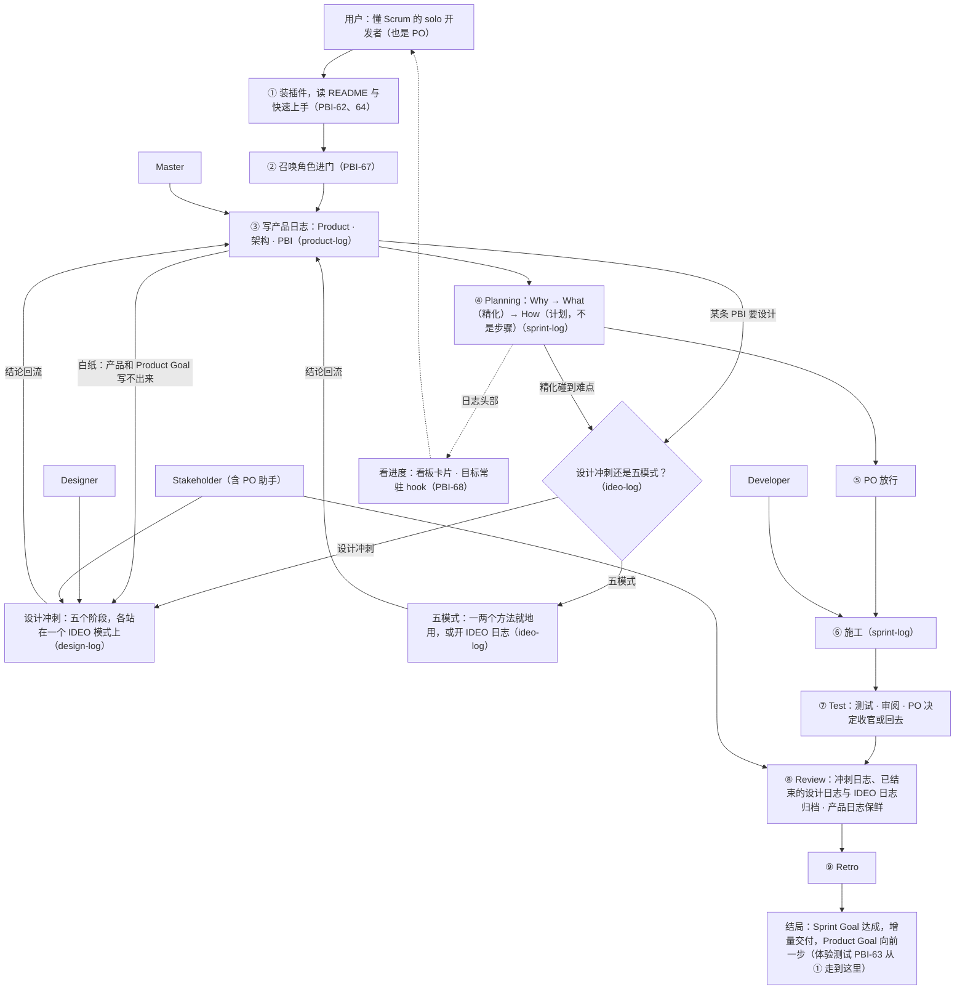

> 按 Scrum Guide Expanded v2026.1 的 Product / Increment / Product Backlog artifact 框架定义。
> Product Owner: SeaPawn

# 一、Product

## 1.1 Product

| 承诺 | IDEO-Scrum：把 Design Thinking 与 Scrum Sprint 装进 Claude Code。 |
| --- | --- |

**IDEO-Scrum** 是一个 Claude Code marketplace 插件：将 Design Thinking 与 Scrum Sprint 两套方法论集成到 Claude Code，通过 skills 和 commands 提供结构化的方法论引导与流程框架。Codex 版是脚本从插件本体生成的附带包，不是核心（PO 2026-11-13）。

**边界**：不做项目管理工具本身，不做 JIRA/Linear 集成，也不做团队协作平台——只提供方法论引导和流程框架。看板只读日志、不另存状态，由便宜的模型生成，不是项目管理工具。

## 1.2 Product Goal

| 承诺 | 产品化：从作者能用到大家都好用；看板一眼看清进度，文档讲清规矩；懂 Scrum 的人照着就能走完第一个冲刺。（PO 2026-11-13 定） |
| --- | --- |

**常态**：优化插件——用的时候攒下的反馈，随时开小冲刺改进插件；熟手照着就能走。它不是目标，是一直在做的事，由副线承担（PO 2026-11-13）。

**远景**：让 Claude Code 成为一个随身的设计思维与敏捷教练——有方法论需求的人打开 Claude Code 调用 IDEO-Scrum，就能获得结构化、忠于原文、可操作的方法论引导。

**换目标**（2026-11-13）：「优化现有插件」（2026-11-12 定）换成产品化——PO 定产品化更要紧，优化转为常态。更早的目标见 git 历史。

**之后**：插件的记忆机制（PBI-51）、方法论分享（PBI-12）。

## 1.3 Definition of Done

### Definition of Outcome Done

| 度量 | 目标信号 |
| --- | --- |
| 一次会话走通方法论环节：完整引导（结构化、忠于原文） | 用户不反复追问 |
| 懂 Scrum 的陌生人走完第一个冲刺 | 体验测试（PBI-63）里不问作者、没有卡死的点 |

### Definition of Output Done

| 维度 | 标准 |
| --- | --- |
| 内容忠实 | 忠于源材料（SGEP / d.school / Sprint）；方法论设计部分（融合、solo+AI）标注来源与依据 |
| 署名 | 第三方摘录带 Source / License 两行，与 ATTRIBUTION.md 一致 |
| 可导航 | 从 SKILL.md 入口 ≤2 跳到达任意 reference |
| 无死链 | 所有 markdown 内部链接可解析，无 404 |
| 插件校验 | `claude plugin validate --strict plugins/ideo-scrum` 通过 |
| 描述长度 | 每个技能的 description 不超过 1024 字符 |
| Codex 包 | 改了插件就跑 `scripts/sync_codex.py`，`scripts/check_codex.py` 通过 |

# 二、架构

> 2.1 是谁，2.2 一张 Map。流程怎么走，见插件 scrum-kernel 的 `overview.md` 与各内核的 `conventions/`。

## 2.1 Stakeholders

> 召唤 Stakeholder 时报卡名，它按卡上的身份看、只看卡上写的东西；常驻会话另加「负责 / 不负责」两栏。派子代理做审阅、外部视角、测试、方案评议时，能用卡就用（PO 2026-11-08）。

| | 熟手 | 陌生人 | 读者 | PO 助手（常驻会话） |
| --- | --- | --- | --- | --- |
| 是谁 | 像作者这样的 solo 开发者：用 Claude Code 和本插件做自己的项目，熟悉这套流程 | 懂 Scrum、第一次装本插件的 solo 开发者：会用 Claude Code，没见过本仓库，也没有作者的记忆和配置 | 不装插件、只看公开分享（文章、网页、视频）的人：想学 solo + AI 怎么用 Scrum 与设计思维 | 常驻的 Claude Code 会话，替 PO 整理产品日志 |
| 要什么 | 流程跟着插件走，不用每次口述规矩；会话断了、压缩了能接上 | 装上就知道第一句说什么；插件自己的词有解释；很快进入干活 | 一套讲得清、能照着做的方法 | PO 或 Master 交代的改动说得清、有出处 |
| 怎么算满意 | 不用反复提醒 AI 规矩；冲刺照约定开、记、收 | 不问作者也能走完第一个冲刺 | 读完能在自己的项目里用起来 | 产品日志与实际一致；PO 不用自己动手整理 |
| 看得到什么 | 全部：插件、产品日志、冲刺日志 | 只有插件和 README（体验测试只给这些） | 只有公开发布的内容 | 全部：插件、产品日志、冲刺日志 |
| 何时召唤 | Review 看增量；改约定前看顺不顺手 | 体验测试（PBI-63）；Review 涉及入口、说明、术语时 | 分享内容的草稿（PBI-12） | PO 或 Master 要登记 PBI、改状态与备注、要一份进度汇总时 |
| 负责 | — | — | — | 照 PO 或 Master 的话改产品日志；汇总进度给 PO |
| 不负责 | — | — | — | 排序、定目标、替 PO 拍板；改插件文件；审阅；没问过不删条目 |

## 2.2 架构

> 照 Make a Map 画：上面是人，下面是结局，中间是步骤；括号里是挂在这一步上的 PBI。

# 三、Product Backlog Items

> 编号只是枚举序，不是优先级。行按三组排：主线（新功能）、副线（插件的规矩与讲规矩的文档）、以后；不加节（PO 2026-11-12、11-13）。备注只写决定和开放点，做法到做的时候写进冲刺日志（PO 2026-11-13）。七列写法见插件 scrum-kernel 的 `conventions/product-log.md` 第 10 条。

## 3.1 当前的 PBI

| 编号 | 标题 | 用户故事 | 架构定位 | 当前状态 | 规模 | 备注 |
| --- | --- | --- | --- | --- | --- | --- |
| PBI-68 | 看板第 2 版——PO 强审，照 PO 的品味改 | 作为熟手（也是 PO），我想要亲自深入参与，照我的品味把看板整个改一遍，以便它真正成为我看进度、拍板的地方 | Map「看进度」 | 待选（主线，Sprint 20） | M～L | 来源：PO 2026-11-14 看过 Sprint 19 生成的真实看板：「作为第1版来说，我觉得还不错」；「我要修改看板……相当于是强审模式……符合我的品味来做这个看板」，打算开 Sprint 20 来改。第 1 版见 [documents/sprint-19-board-hook.md](documents/sprint-19-board-hook.md)。开放点（Sprint 19 的已知限制）：生成后没有自动核对，便宜的模型手抄长文会丢字——仓库里的检查脚本见 `git show 1bf5a94:scrum/sprint-19-board-hook/tests/board_check.py`；地图靠 Mermaid 的 CDN，离线只见源码；本仓库现状生成一次要 15～25 分钟 |
| PBI-63 | 体验测试——陌生人从装插件走到看板 | 作为懂 Scrum 的陌生人，我想要每版都有人替我从头走一遍，以便我装上就能用、不被卡住 | Map ①～⑨ 全程 | 待选（主线，Sprint 20） | M | 决定：用 2.1 的陌生人卡（只给 README、身份、任务），从装插件走到第一次收官，并在看板上看进度；只测 Claude Code；跑之前先写什么算卡住；每版都跑；发成熟版前 PO 和至少一个真人各走一遍。开放点：测试环境与测法。来源：PBI-30 拆出（2026-11-13）。PO 2026-11-14 定：Sprint 20 和看板第 2 版（PBI-68）一起做——「一个人进来能不能从头到尾走得好」还没测过，先在 v6.0.2 上跑一次基线；开冲刺等 PO 自己用过 v6.0.2、攒了问题再说 |
| PBI-64 | 发布包装 | 作为懂 Scrum 的陌生人，我想要插件有版本记录、发布渠道、授权说明、反馈渠道和图标，以便放心装、知道怎么升级和反馈 | Map ① | 待选（主线） | S～M | 范围：CHANGELOG 与升级提示、发布渠道、授权说明（d.school 非商业）、反馈渠道、图标（PO 2026-11-13 要）；对外发布前经 PO 确认。开放点：发布渠道、成熟版版本号。来源：PBI-30 拆出；图标原在 PBI-25 ⑦（Sprint 14 plugin-validator 的建议） |
| PBI-62 | 教学——README、快速上手、词汇表、示例项目 | 作为懂 Scrum 的陌生人，我想要一份讲清本插件规矩的 README、一页快速上手、一张词汇表和一个真实的示例，以便不读作者的仓库也能走完第一个冲刺 | Map ① | 待选（副线） | M | 决定（PO 2026-11-13）：不大改内核，不为迎合改规矩——用户懂 Scrum，插件管规矩，帮助放在内核外面；README 讲清和教科书 Scrum 不同的几处（overview 已列）；快速上手一页，讲第一个冲刺怎么走（一个会话、PO 加 Master 就够）；词汇表只解释插件自己的词，中英对照；中英两份，英文为准、中文跟着，同一提交改；示例项目就是本仓库的 `scrum/`（中文，先接受）；副线改了规矩，同一个冲刺里改文档；看板和 hook 的说明由主线写。依据：陌生人卡的意见——Sprint 10 Review（2026-11-08）：5 分钟上手、你就是 PO、术语表、不熟 git 怎么收官、哪些约定必须守；Sprint 17 Review（2026-11-13）：五模式与设计冲刺同名要读两遍，role cards、Five-Act Interview、rumble、Lightning Demos 找不到解释。来源：PBI-30 拆出。熟手卡在 Sprint 18 Review（2026-11-13）的意见：召唤要用户自己记得，入口要教；「书面授权」最简是什么（日志里一行：谁、范围、覆盖哪些阶段）要讲清；stakeholder 的描述是写给 AI 挑技能用的，人读要靠这里的说明。Sprint 19 交来的说明点：hook 的开关 `IDEO_SCRUM_COMMITMENTS=off`；没装 Git for Windows 的 Windows 用户 hook 不生效，macOS 未实测；Codex 要用户先在 `/hooks` 里信任 hook 才会跑；看板的架构图要联网才画得出来 |
| PBI-67 | ideo 的自然触发——发散、定义问题也先加载 | 作为懂 Scrum 的陌生人，我想要说「帮我发散几个方向」「从这几段访谈里理出要解决的问题」时，ideo-kernel 也会先加载，以便不用说出 IDEO 或设计思维这些词，也能用上它的方法 | Map ② | 待选（副线） | S～M | 来源：Sprint 18 第 2 轮触发测试（2026-11-13，magpie 的便宜模型，非 Haiku）：C 组 3/9，只和基线持平，没过 7/9——C3（做原型）3/3，C1（发散）、C2（从访谈里定义问题）各 0/3，模型不调任何工具、直接作答；描述里加了「命中就先加载」也没救回来。PO 2026-11-13 定：记成已知缺口，另登记本条，不为它在 Sprint 18 里一轮轮重跑。开放点：描述之外还能用什么办法——hook 带一句事实、入口教用户（PBI-62），或者重新想 ideo 的触发面；改之前照 CLAUDE.md 量描述长度（ideo 现在 1023，已经顶到线）。测试数据见 [documents/sprint-18-rules-first.md](documents/sprint-18-rules-first.md)，题目与报告见 `git show 3e8860b:scrum/sprint-18-rules-first/tests/`；README 已在 Sprint 18 收官时照实写（熟手卡 Review 的意见） |
| PBI-51 | 插件的记忆机制（研究） | 作为熟手，我想要插件有自己的记忆机制——必要时借鉴 llm-wiki 的 index 做法：规矩一行一条、链到细节、按名字引用，以便不用整份加载、一条规矩只写一处、增删不用改号 | 插件：四个内核 | 以后 | L | 决定：下一步做，值得研究，不只是 index（PO 2026-11-13）；做插件，不做全局记忆系统（PO 2026-11-12）。开放点：开做时先按分界定用设计冲刺还是五模式；和 PBI-61、35 是同一类事（61 是眼前的小块）。来源：反馈区（2026-11-12，conventions as an index）；Sprint 14 Stakeholder 的提议 |
| PBI-12 | 方法论分享——公开系列 | 作为读者，我想要一套公开的方法论分享（系列文章、网页或视频），讲清 solo + AI 怎么用 Scrum 和设计思维，以便不装插件也能学会、用到自己的项目里 | 产品之外：分享线（1.2「之后」） | 以后 | L | 决定：下一步做（PO 2026-11-13）；公开发布前过一遍授权（d.school 非商业）、经 PO 确认。素材：[ExpertNotes.md](documents/ExpertNotes.md)、`documents/five-stage-mapping.svg`（图里冲刺还是旧的三段，用前改成五个阶段）。来源：2026-10-24 PO 改为方法论分享 |

## 3.2 已完成 / 已关闭的 PBI

> 每个冲刺一行，列出条目编号，细节见出处与 git 历史（PO 2026-11-13：条目多了按条列读不完，偏离 product-log 第 17 条的每条一行）。Sprint 08 起，出处是 `scrum/documents/` 里归档的冲刺日志。

| 冲刺 | 条目 | 结果 | 出处 |
| --- | --- | --- | --- |
| 1.x（至 2026-08-30） | PBI-1～11 | 1.x 以 v1.0.2 收官；PBI-7～11 于 08-30 废弃 | git 历史；记忆档 sprint-01～05 |
| Sprint 06（2026-08-31～10-24，v2.0.0→v3.2.0） | PBI-13 角色体系（撤销）、14 设计阶段快原则、15 ideo 与设计冲刺融合（关闭）、16 双内核联动；17、18 并入 23，19 并入 20 | 双内核成形 | tag `v2.0.0`、`v3.1.0`；记忆档 sprint-06-dual-kernel-refactor |
| Sprint 07（2026-10-25，v4.0.0） | PBI-20 角色重定义、21 ideo-kernel 改名、22 角色命令自动加载内核、24 全文英文化 | 角色与内核成体系 | tag `sprint-07-done`；记忆档 sprint-07-roles-kernels |
| 精化（2026-11-07） | PBI-26 并入 30（11-08 删去判据）、27 Bot 工作方式研究 | 研究结论用于架构 v1 | [documents/PBI-27-bot-research.md](documents/PBI-27-bot-research.md) |
| Sprint 08（2026-11-08，v5.0.0） | PBI-28 设计日志约定、29 ideo-kernel 收窄、34 新建 design-kernel、36 角色命令先加载 ideo-kernel | 设计冲刺进插件 | [documents/sprint-08-design-kernel.md](documents/sprint-08-design-kernel.md) |
| Sprint 09（2026-11-08，v5.0.1） | PBI-38 设计日志模板只记产出 | — | [documents/sprint-09-design-template.md](documents/sprint-09-design-template.md) |
| Sprint 10（2026-11-08，v5.1.0） | PBI-23 冲刺日志约定、31 产品日志约定、32 角色命令接上约定、37 开设计与接手、39 总览约定 | 流程全部进插件 | [documents/sprint-10-conventions.md](documents/sprint-10-conventions.md) |
| Sprint 11（2026-11-09，v5.1.1） | PBI-41 约定按 PO 审阅修订 | — | [documents/sprint-11-conventions-review.md](documents/sprint-11-conventions-review.md) |
| Sprint 12（2026-11-09，v5.1.2） | PBI-42 总览挪到 scrum-kernel 根目录 | — | [documents/sprint-12-overview-to-root.md](documents/sprint-12-overview-to-root.md) |
| Sprint 13（2026-11-10，版本不动） | PBI-43 Codex 版 | Codex 包由脚本生成，并入 main | [documents/sprint-13-codex.md](documents/sprint-13-codex.md) |
| Sprint 14（2026-11-10，v5.2.0） | PBI-40 约定第一次集中修订、47 构思先发散后收敛、48 设计阶段对上五模式、49 约定精调、50 什么时候必须开设计 | 约定精调；白纸题没过线，登记 PBI-52 | [documents/sprint-14-conventions-tuning.md](documents/sprint-14-conventions-tuning.md) |
| Sprint 15（2026-11-12，版本不动） | PBI-55 自我反馈 | 反馈进全局记忆 | [documents/design-feedback-loop.md](documents/design-feedback-loop.md)、[documents/sprint-15-feedback-loop.md](documents/sprint-15-feedback-loop.md) |
| Sprint 16（2026-11-12，版本不动） | PBI-44 内核结构统一、57 加载分层 | 四个内核、按需加载 | [documents/sprint-16-kernel-structure.md](documents/sprint-16-kernel-structure.md) |
| Sprint 17（2026-11-13，v6.0.0） | PBI-54 产品日志与冲刺约定修订、58 设计约定修订、56 设计冲刺与五阶段法分清、53 Developer 在别的工具里、52 白纸入口 | 约定改顺、IDEO 日志；题 9、10 的缺口登记 PBI-59 | [documents/sprint-17-conventions-rewrite.md](documents/sprint-17-conventions-rewrite.md) |
| 产品日志整理（2026-11-13） | PBI-30 产品化、25 插件小修、46 Codex 小修、59 分界题的直接路径、45 流程命令、33 方法库改写 | 30 拆成 62 教学、63 体验测试、64 发布包装（看板、hook 另有 35、61）；61 拆出 66；25 关闭（③ 删，图标转 64）；46 关闭（Codex 不是核心）；59 删（普通时候不触发是好事，测试结果转为 65 的来源）；45 删（角色命令加约定已够，陌生人真在哪一步迷路再带证据登记）；33 删（与原文优先相反） | git 历史 |
| Sprint 18（2026-11-13，随 Sprint 19 发 v6.0.2） | PBI-66 日志头部、65 加载边界、60 角色说明 | 日志头部统一（承诺小表、Now、Waiting for PO、✓ 完成标记、决定前引用目标）；scrum、sprint、design 召唤才来；Master 在书面授权内代行、PO 助手身份写清。C 组 ideo 自然触发 3/9 没过，转 PBI-67（PO 定）；白纸项目的直接路径不再自动进设计冲刺——65 有意的结果，PBI-52 的直接路径行为就此改变，从角色命令进来照旧 | [documents/sprint-18-rules-first.md](documents/sprint-18-rules-first.md) |
| Sprint 19（2026-11-14，发 v6.0.2，连同 Sprint 18） | PBI-35 看板、61 目标常驻 hook | 看板第 1 版：scrum-kernel 的 `conventions/board.md` 与 `board-template.html`，单文件网页，产品卡、冲刺卡、设计卡，只读日志、不存状态，便宜的模型照约定生成；hook：开会话、恢复、压缩后各注一次承诺原文，承诺变了再注，可关，Codex 一并同步。频率测试：不装 hook 也过线，约定是主力、hook 补位。PO 看过真实看板，第 1 版认可，要强审重做，登记 PBI-68 | [documents/sprint-19-board-hook.md](documents/sprint-19-board-hook.md) |
