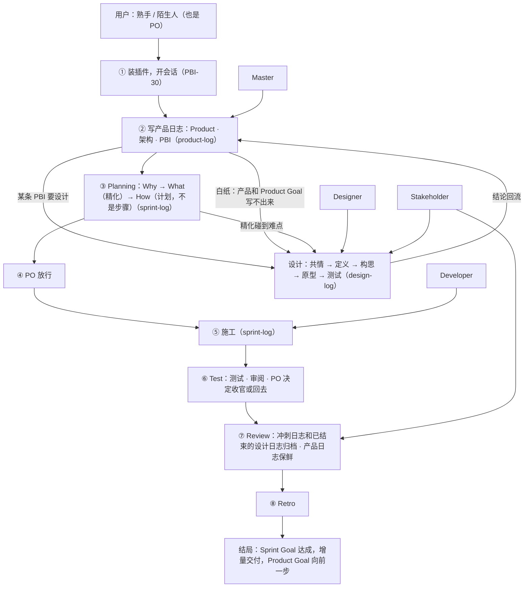

> 按 Scrum Guide Expanded v2026.1 的 Product / Increment / Product Backlog artifact 框架定义。
> Product Owner: SeaPawn

# 一、Product

## 1.1 Product

**IDEO-Scrum** 是一个 Claude Code marketplace 插件（另有同源的 Codex 分发包，Sprint 13 起）：将 Design Thinking 与 Scrum Sprint 两套方法论集成到 Claude Code，通过 skills 和 commands 提供结构化的方法论引导与流程框架。

**边界**：不做项目管理工具本身，不做 JIRA/Linear 集成，也不做团队协作平台——只提供方法论引导和流程框架。

## 1.2 Product Goal

**远景**（原 Product Vision 一节，2026-11-07 并入；SGEP：Vision 是 Product Goal 的输入）：让 Claude Code 成为一个随身的设计思维与敏捷教练——有方法论需求的人打开 Claude Code 调用 IDEO-Scrum，就能获得结构化、忠于原文、可操作的方法论引导。

（2026-10-24 PO 定，2026-11-12 已被下面的新目标替换）IDEO-Scrum 4.0：让插件带着流程走——角色、内核、流程参考与模板成体系，新项目照着就能跑通。这一目标随 Sprint 15 收官达成。

**优化现有插件**：不加新功能，用的时候攒下的反馈都改进插件里；熟手照着就能走。（PO 2026-11-12 定）

**之后的方向**（PO 2026-11-12）：本目标之后是产品化——从作者能用到陌生人好用（PBI-30），和分享——把方法论写成成熟的文档、网页或视频，发到博客、GitHub 等处（PBI-12）；新命令（PBI-45）、index（PBI-51）以后再做。开冲刺前核对 Product Goal：和本目标不合就先定新目标。

（上一总目标「实现 IDEO-Scrum v2.0.0」已随 2026-08-31 发布达成，原文见 git 历史。）

## 1.3 Definition of Done

### Definition of Outcome Done

| 度量 | 目标信号 |
| --- | --- |
| 一次会话走通方法论环节：完整引导（结构化、忠于原文） | 用户不反复追问 |

### Definition of Output Done

| 维度 | 标准 |
| --- | --- |
| 内容忠实 | 忠于源材料（SGEP / d.school / Sprint）；方法论设计部分（融合、solo+AI）标注来源与依据 |
| 可导航 | 从 SKILL.md 入口 ≤2 跳到达任意 reference |
| 无死链 | 所有 markdown 内部链接可解析，无 404 |

# 二、架构

> 本章分两节：2.1 Stakeholders（谁），2.2 架构（一张 Map）。流程怎么走，见插件 scrum-kernel 的 `conventions/`。2026-11-07 精化出的架构 v1 已全部写进插件（Sprint 10），原文见 `git show 3b24287:scrum/ProductBacklog.md`。

## 2.1 Stakeholders

> 角色卡借 Grok Bot（`roster/README.md`）：每张卡写是谁、要什么、怎么算满意、看得到什么、何时召唤。召唤 stakeholder 时报卡名，它按卡上的身份看，只看卡上写的东西。常驻会话（如看板维护）另加「负责 / 不负责」两栏（Grok Bot："The *does not own* list is … the part that stops sprawl"）；本项目的常驻会话：PO 助手（2026-11-09 起，见下表最后一列）。**派子代理时，能用角色卡就用**（PO 2026-11-08）：审阅、外部视角、测试、方案评议等，都可以拿这里的卡派全新子代理——正式做项目时产品日志里会写下很多利益相关者，正好用上。不是只能用角色卡，需要时用。

| | 熟手 | 陌生人 | 读者 | PO 助手（常驻会话） |
| --- | --- | --- | --- | --- |
| 是谁 | 像作者这样的 solo 开发者：用 Claude Code 和本插件做自己的项目，熟悉这套流程 | 第一次装本插件的 solo 开发者：会用 Claude Code，没见过本仓库，也没有作者的记忆和配置 | 不装插件、只看公开分享（文章、网页、视频）的人：想学 solo + AI 怎么用 Scrum 与设计思维 | 常驻的 Claude Code 会话，替 PO 整理产品日志 |
| 要什么 | 流程跟着插件走，不用每次口述规矩；会话断了、压缩了能接上 | 装上就知道第一句说什么；术语有解释；很快进入干活 | 一套讲得清、能照着做的方法 | PO 或 Master 交代的改动说得清、有出处 |
| 怎么算满意 | 不用反复提醒 AI 规矩；冲刺照约定开、记、收 | 不问作者也能走完第一个冲刺 | 读完能在自己的项目里用起来 | 产品日志与实际一致；PO 不用自己动手整理 |
| 看得到什么 | 全部：插件、产品日志、冲刺日志 | 只有插件和 README（体验测试只给这些） | 只有公开发布的内容 | 全部：插件、产品日志、冲刺日志 |
| 何时召唤 | Review 看增量；改约定前看顺不顺手 | 体验测试（PBI-30）；Review 涉及入口、说明、术语时 | 分享内容的草稿（PBI-12） | PO 或 Master 要登记 PBI、改状态与备注、要一份进度汇总时 |
| 负责 | — | — | — | 照 PO 或 Master 的话改产品日志；汇总进度给 PO |
| 不负责 | — | — | — | 排序、定目标、替 PO 拍板；改插件文件；审阅；没问过不删条目 |

## 2.2 架构

> 照 Make a Map 画：上面是人，下面是结局，中间是步骤。流程见插件 scrum-kernel 的 conventions/。

# 三、Product Backlog Items

> 编号只是枚举序，不是优先级；排序以后再调。PBI 由 PO 与 Master 一起定，七列写法见插件 scrum-kernel 的 `conventions/product-log.md` 第 10 条。各 PBI 的开放点不在日志里表态，执行中由 PO 与 Developer 敲定。2026-11-07 以前的「精化记录」原文见 `git show e53650e:scrum/ProductBacklog.md`。行按主题排：结构、约定、入口、小修、以后（PO 2026-11-12：不加节）。

## 3.1 当前的 PBI

| 编号 | 标题 | 用户故事 | 架构定位 | 当前状态 | 规模 | 备注 |
| --- | --- | --- | --- | --- | --- | --- |
| PBI-56 | 设计冲刺与 IDEO 五阶段法分清 | 作为熟手，我想要插件分清设计冲刺和 IDEO 五阶段法：小问题就地用五阶段法，大问题才开设计冲刺，由 PO 指定，以便不为小问题兴师动众 | 插件：ideo-kernel（新 `conventions/`）、design-kernel（design-log 第 1、26 条） | 待开始（本目标） | M | 定案（PO 2026-11-12）：用哪种由 PO 指定；PO 没指定时按默认分——要先做原型、拿角色卡测过才敢动手的，开设计冲刺，其余就地用五阶段法，按方法记录。设计冲刺重；五阶段法是基础，规矩少，所以 IDEO 的 conventions 写得轻。从聊天里开的设计，聊天已算作共情材料。写进 ideo-kernel 新的 `conventions/` 一份简短约定；design-log 第 1、26 条改成指向它。来源：PO 2026-11-11（design-feedback-loop 的 Retro）；旁测 P1（2026-11-11，3 次）说五阶段法时都只在对话里走五模式、没开设计——缺的不是触发，是分界；相关 PBI-54、PBI-52 |
| PBI-58 | 设计约定修订——PO 用设计时攒下的点 | 作为熟手，我想要设计约定补上用过一轮后攒下的点，以便下一个设计照着走更顺 | 插件：design-kernel 的 `conventions/` | 待开始（本目标） | M | 收进（PO 2026-11-12 定）：① 地图要粗——只有现在发生的事，五六个框、一个环，分支和方案不进地图；② 设计目标写成愿景，不写怎么做；③ 子代理发散时，主对话陪 PO 聊，PO 没想法就替他画一份，全部合并后再收敛；④ 三个环作为导读——共情和定义人进 AI 出，发散与收敛 AI 做、人选，原型和测试可以自动跑（「测试前 PO 先看原型」不进插件，PO 2026-11-12 定）；⑤ 一个 Designer 常常就够，有时也要 Master，兼不兼由 PO 定；⑥ 设计一开就开分支，现场定的只是从哪里开（原 PBI-54 ⑤）；⑦ 隔离草图的子代理不加载用户的 CLAUDE.md，简报里不给现状（原 PBI-54 ⑦）；⑧ Lightning Demos 给每份草图不同的一部分，或先画再看（原 PBI-54 ⑧）。约定可以大改，不在原文上打补丁。来源：2026-11-11、11-12 全局记忆 Feedback；Sprint 14 Review 的熟手意见 ⑤–⑧ |
| PBI-54 | 产品日志与冲刺约定修订 | 作为熟手，我想要产品日志和冲刺的约定用过一轮后再集中修一次，补上用起来卡手的地方 | 插件：scrum-kernel 的 `conventions/` | 待开始（本目标） | S | 收进：① 冲刺日志模板头部加一行 Now，断线后一眼看到最后一个 PO 的决定；② sprint-log 的 Checkpoints 写明什么算卡住；③ sprint-log 的 Review 写明怎么判「过时」；④ sprint-log 第 5 条写明：落盘条目时对照 Sprint Goal 查够不够，缺就增、多就减（PO 2026-11-12）；⑤ 约定可以大改，不在原文上打补丁。设计部分（原 ⑤–⑧）拆到 PBI-58。「Why 不写 PBI」不用改：插件里已是这样（模板 1.1、1.2 与 sprint-log 第 4 条都没有 PBI 条目）。来源：Sprint 14 Review 的熟手意见；SEAPAWN Feedback（Why 不写 PBI） |
| PBI-53 | 约定写明 Developer 在别的工具里时怎么协作 | 作为熟手，我想要约定写明 Developer 在别的工具（如 Codex）里干活时，它和 Master 怎么协作，以便不用口述 Sprint 13 的做法，换工具也能照着走 | Map ③～⑧ | 待开始（本目标） | S | 来源：PBI-40 ⑧（熟手意见，2026-11-08 Sprint 10 Review），Sprint 14 收官时从 PBI-40 拆出；Sprint 13 的做法：通道只有冲刺日志，两边共用一个工作目录、轮流动手，每轮提交、在笔记里记一行并写明轮到谁，Master 的审阅写在 plan 文件里由 PO 转交；Sprint 14 的 Developer 是 `/fork` 出的独立会话，与 Master 用跨会话消息直接通讯（PO 2026-11-10），约定里也还没写，改约定时一并定；改完要重跑 `scripts/sync_codex.py`；与 PBI-46 ③（并入 PBI-54）相关 |
| PBI-52 | 白纸入口——新想法、还没有产品日志时带到设计 | 作为陌生人，我想要说出「我有个想法、还没有产品日志」时，插件就把我带到先开设计、由设计结论去填产品日志这条路上，以便不会一上来就硬写产品日志或直接出方案 | Map ①（装插件，开会话） | Sprint 17 | S～M | 测试结论（Sprint 16，路径一 0/3→2/3，两条路径的行为栏都 3/3：都加载了设计、读了约定；内容缺必答 ③「设计的结论会流回产品日志」，路径二 1/3）。Master 2026-11-12（PO 委托）定：不补跑，移 Sprint 17 接着做，Sprint 17 的流程测试跑题 3 两条路径与题 2 两条路径。Sprint 14 四轮 12 次 0 次过线（缺口在触发和先读约定）。与 PBI-30、PBI-44 相关 |
| PBI-25 | 插件小修集合 | 作为陌生人，我想要单独装上的插件里链接、署名、触发句和标题层级都对，以便不被死链和过时的说法误导 | 插件文件 | 待开始（本目标） | S | Sprint 16 已做：①（16 份设计摘录的许可行改成自足）、②（三个 SKILL.md 加 Source/License 头）、⑥（查明 v2026.1 标签本来就对，assets 是全文除 Artifacts、Events 两章，已改「全文」说法）、⑦（括号与裸路径、三处引用、命令说法都改；图标这次不做，留在本条）、⑧（marketplace 顶层说明，--strict 通过）。③ 留着。原记录：① IDEO-modes 五份文件的许可行指向仓库根 ATTRIBUTION.md，插件单独分发后失效（design-kernel 16 份摘录的文件头同样如此）；② ideo-kernel、scrum-kernel 两个 SKILL.md 没有 Source/License 头（先判定哪些段落属摘录）；③ Brainstorming 的触发句「Use after an HMW is clear」（HMW 已是可选方法；新文字由 PO 定）；⑥ scrum-kernel 的 Artifacts、Events 两章注明出自 SGEP v2026.1，但插件里 v2026.1 原文没有这两章，内容与 2025.6 版一致，先查清楚再定出处；⑦ plugin-validator 的小建议（Sprint 14）：开头括号的位置、overview 里裸写的路径、三处引用贴合得宽松、plugin.json 没有图标——跟着 PBI-44 一起改；⑧ marketplace.json 缺顶层 description，`claude plugin validate --strict` 会报错（不加 --strict 只是警告）；来源：2026-10-25 Sprint 07 Review；⑦⑧ 2026-11-10 登记 |
| PBI-46 | Codex 版后续小修 | 作为熟手，我想要 Codex 包的同步和说明再顺一点，以便以后每次发版重跑同步都不用多想，陌生人在 Codex 里也能起步 | Map ①（装插件，开会话） | 待开始（本目标） | S | Sprint 16 已做 ①（只差换行不算差异）④（简介用「Guide Scrum, refinement, tracking, review; PO decides value」）；③ 在 Sprint 17；②⑤⑥ 留着。原记录：① 同步脚本比较生成文件时忽略换行差异（Windows `autocrlf=true` 的新克隆第一次会重写 6 个文件，内容不变，`git status` 显示 M）——在 PBI-44 重新同步之前先做；② Codex 里内核的自动触发没测过；③ 约定里「派全新子代理」在 Codex 里怎么做没核对——并入 PBI-54；④ scrum-master 简介补回「价值由 PO 决定」（现有 64 字符上限）；⑤ 「陌生人」对 Codex 入口的意见（Sprint 13 Review）：Codex 段加首句示例、写明你就是 PO、术语链到说明、迁移说明教怎么确认旧装的名字（`codex plugin list`）、README 写明测过的 Codex 版本（0.167.0）；⑥ 测 Codex 的脚本要不要整理成可重跑的工具；来源：Sprint 13 Review |
| PBI-45 | 流程命令——关键步骤各有入口 | 作为熟手，我想要 Planning、Review、构思这些关键步骤各有一个命令或 skill，以便到了那一步直接调用，不用口述该读哪份约定 | Map ③～⑧ | 以后 | M | 来源：原同名文件两条（关键步骤写成命令或 skill；多加命令，比如 Planning，看好不好用；文件 2026-11-12 清空），PO 原话「也可以成熟成熟」；Codex 没有 command，Codex 端只能做成 skill；冲刺分五个阶段（Why、What、How、Increment、Test），入口可以按阶段设；Review 和 Retro 是收官动作，不是日志里的章 |
| PBI-51 | 技能做成 index 引领的记忆系统 | 作为熟手，我想要每个技能由一个 index 引领——像记忆系统那样每行一条规矩，链到细节文件，按名字互相引用，以便不用整份加载，一条规矩只写一处，增删约定不用改号 | 插件：四个内核 | 以后 | L | 来源：Sprint 14（2026-11-10）Stakeholder 的提议；PO：「真的想把它设成 index 那种引领的」；PO 2026-11-12：以后要做，这次不做；引用写法（`convention N`、`../` 路径）这次也不改。Master 的看法：index 按流程排、最上面放图，一行说得清的不另开文件，用普通相对链接；好处在按名字引用（不再改号）、一条规矩只写一处、index 一页就是全部规矩；省加载的作用不大。同日 PO 另开会话讨论过「做插件还是做全局记忆系统」，PO 定：做插件 |
| PBI-30 | 产品化——从作者能用到陌生人好用 | 作为陌生人，我想要装上插件就知道第一句说什么、术语有解释、会话断了能接上，以便不读作者的仓库也能顺利走完第一个冲刺 | Map ①（装插件，开会话） | 以后 | L | 范围：入口（没有产品日志就按模板建；白纸、连产品都写不出时从设计开始，见 PBI-52）、由浅入深（默认 PO + Master 一个会话走完，需要时再加 Developer、审阅、worktree）、说人话（术语第一次出现时解释，附词汇表）、接手不丢、体验测试、发布包装（用户 README、样例、CHANGELOG 与升级提示、发布渠道、授权说明、反馈渠道）；体验测试：Stakeholder 扮「陌生人」（只给 README、身份、任务），Developer 搭环境、跑、记卡点，Master 监督，跑之前先写好什么算卡住；每版都跑，发成熟版前 PO 和至少一个真人各走一遍；开放点：测试环境与测法（PO：到时候再说）、发布渠道、成熟版版本号；Codex 版已做完（PBI-43），体验测试要连 Codex 入口一起测；与 PBI-12 的区别：12 是内容分享，30 是产品本身；「陌生人」的意见（2026-11-08 Sprint 10 Review）：① 一页「5 分钟上手」② 明说「你就是 PO，开一个会话就够」③ 术语表 ④ 不熟 git 的人怎么收官 ⑤ 哪些约定必须守；Codex 入口的意见（Sprint 13 Review）见 PBI-46 ⑤；来源：2026-11-06 PO 口述，2026-11-07 改写 |
| PBI-12 | 方法论分享——公开系列（原「专家笔记完善」） | 作为读者，我想要一套公开的方法论分享（系列文章、网页或视频），讲清 solo + AI 怎么用 Scrum 和设计思维，以便不装插件也能学会、用到自己的项目里 | 产品之外：分享线（1.2「之后的方向」） | 以后 | L | 作者自己也借此梳理一遍；素材：[ExpertNotes.md](documents/ExpertNotes.md) 里的使用方法，和附录图 `documents/five-stage-mapping.svg`（图里冲刺还是旧的三段，用前要改成五个阶段，Sprint 14 Review）；公开发布前过一遍授权（d.school 非商业；版权声明由 PO 负责）；发布是对外动作，发前经 PO 确认；来源：原同名文件的待办（文件 2026-11-12 清空），2026-10-24 PO 改为方法论分享 |
| PBI-33 | 方法库改写——解除非商业限制 | 作为陌生人（在商业项目里用），我想要方法库不带非商业限制，以便商业项目里也能用 | 插件：ideo-kernel 方法库 | 以后 | L | d.school Bootleg 是 CC BY-NC-SA，插件因此带非商业限制；PO 定：先接受（README 已写明），以后再做；注意：改写成自己的话与「原文优先」相反——写进 CLAUDE.md 的规约是能用原文就用原文，做之前先定还做不做；改写范围、署名怎么处理，实现前定；来源：2026-11-07 精化 |
| PBI-35 | 看板（Scrum Board） | 作为熟手，我想要一块看板，一眼看到正在进行的冲刺、设计和各自的状态，以便不用翻各份日志就知道全局 | `scrum/` 下（overview 第 4 条） | 以后 | M | 主要对 PO 负责，做记录用；可以交给常驻的 Stakeholder 会话维护，在 2.1 加一张带「负责 / 不负责」的卡；可以开成第一份设计日志，试设计模板；来源：2026-11-07 精化第四轮（PO 登记，这次不做） |

## 3.2 已完成 / 已关闭的 PBI

> 每条一行，附出处；细节见出处与 git 历史。Sprint 08 起，出处是 `scrum/documents/` 里归档的冲刺日志。

| # | 标题 | 结果 | 出处 |
| --- | --- | --- | --- |
| PBI-1～11 | 1.x 与 2026-08-30 废弃的条目 | 1.x 以 v1.0.2 收官；PBI-7～11 于 08-30 废弃 | git 历史；记忆档 sprint-01～05 |
| PBI-13 | 角色体系——教学位与执行位 | 已撤销（2026-08-31） | `git show 3f81260:scrum/SprintBacklog.md`；记忆档 sprint-06-dual-kernel-refactor |
| PBI-14 | 设计阶段快原则与 output-style 重构 | 完成（2026-10-04，v3.1.0） | tag `v3.1.0`；记忆档 sprint-06-dual-kernel-refactor |
| PBI-15 | ideo 与设计冲刺融合重构 | 关闭（2026-10-24）：15-B、15-C 完成，15-D 撤销 | tag `v2.0.0`；记忆档 sprint-06-dual-kernel-refactor |
| PBI-16 | 双内核联动——描述字段互链 | 完成（2026-08-31，v2.0.0） | tag `v2.0.0` |
| PBI-17 | 流程规格——关键文档与元件的预先规格设计 | 并入 PBI-23（2026-10-24） | — |
| PBI-18 | 双内核执行模板——设计冲刺与 Scrum 配套模板 | 并入 PBI-23（2026-10-24） | — |
| PBI-19 | 验收双机制——DoD 自检与 SM 证据初验 | 并入 PBI-20（2026-10-24） | — |
| PBI-20 | 角色重定义 | 完成（2026-10-25，v4.0.0） | tag `sprint-07-done`；`git show 8f3fb44:scrum/SprintBacklog.md`；记忆档 sprint-07-roles-kernels |
| PBI-21 | ideo-kernel：改名并分清两套「五步」 | 完成（2026-10-25，v4.0.0）；2026-11-07 主线改为设计冲刺，见 PBI-29 | 同 PBI-20 |
| PBI-22 | 加载机制——角色命令自动加载内核 | 完成（2026-10-25，v4.0.0） | 同 PBI-20 |
| PBI-23 | 冲刺日志约定 v1——模板与各单元约定 | 完成（2026-11-08，v5.1.0）：scrum-kernel 的 `conventions/sprint-log.md`（21 条）与冲刺日志模板 | [documents/sprint-10-conventions.md](documents/sprint-10-conventions.md) |
| PBI-24 | 插件全文英文化 | 完成（2026-10-25，v4.0.0） | 同 PBI-20 |
| PBI-26 | 两轮进入执行的验证与改进 | 并入 PBI-30（2026-11-07）：成为体验测试的一项判据；2026-11-08 PO 删去这条判据 | — |
| PBI-27 | Bot 工作方式研究——借鉴其思想指导改革 | 完成（2026-11-07）：结论用于架构 v1；子项「角色卡重构」并入 PBI-32 | [documents/PBI-27-bot-research.md](documents/PBI-27-bot-research.md) |
| PBI-28 | 设计日志约定 v1 | 完成（2026-11-08，v5.0.0）：design-kernel 的 `conventions/`（约定 20 条与五章模板） | [documents/sprint-08-design-kernel.md](documents/sprint-08-design-kernel.md) |
| PBI-29 | ideo-kernel 收窄——只留 IDEO 五模式与方法库 | 完成（2026-11-08，v5.0.0）：ideo-kernel 成为整个插件共用的工具箱、各阶段的基础 | [documents/sprint-08-design-kernel.md](documents/sprint-08-design-kernel.md) |
| PBI-31 | 产品日志约定 v1——模板与精化 | 完成（2026-11-08，v5.1.0）：scrum-kernel 的 `conventions/product-log.md`（18 条）与产品日志模板 | [documents/sprint-10-conventions.md](documents/sprint-10-conventions.md) |
| PBI-32 | 角色命令接上约定 | 完成（2026-11-08，v5.1.0）：四个命令各加指路、改掉过时的说法；stakeholder 身份从利益相关者表读一行，被指定审阅时对照 DoD 核对 | [documents/sprint-10-conventions.md](documents/sprint-10-conventions.md) |
| PBI-34 | 新建 design-kernel——设计冲刺 | 完成（2026-11-08，v5.0.0）：按 IDEO 五阶段放《Sprint》原文摘录（只删不改，例图改画） | [documents/sprint-08-design-kernel.md](documents/sprint-08-design-kernel.md) |
| PBI-36 | 角色命令按新规则加载内核 | 完成（2026-11-08，v5.0.0）：四个命令都先加载 ideo-kernel | [documents/sprint-08-design-kernel.md](documents/sprint-08-design-kernel.md) |
| PBI-37 | 开设计与接手——设计日志第一次就跑得起来 | 完成（2026-11-08，v5.1.0）：design-log.md 的 Open a design、Resume from the header（文件头 Now 一行）、Goal fixed, plan flexible | [documents/sprint-10-conventions.md](documents/sprint-10-conventions.md) |
| PBI-38 | 设计日志模板改正——只记产出 | 完成（2026-11-08，v5.0.1）：设计日志只记产出；不设选靶；构思写明 IDEO 的方法同样要用 | [documents/sprint-09-design-template.md](documents/sprint-09-design-template.md) |
| PBI-39 | 总览约定——三层、文件与 docs | 完成（2026-11-08，v5.1.0）：scrum-kernel 的 `conventions/overview.md`（16 条），文档文件夹定为 `scrum/documents/` | [documents/sprint-10-conventions.md](documents/sprint-10-conventions.md) |
| PBI-40 | 约定 v1 第一次集中修订 | 完成（2026-11-10，v5.2.0）：熟手的八条意见——② Ask the PO（sprint-log 25、design-log 20）、④ 越过约定时把做了什么、为什么写进日志的笔记（overview 15）、⑤ 每份约定先一张图、一条规矩只写一处、七步精化并入 sprint-log、⑥ 没有记忆文件也没有说明文件就新建说明文件（sprint-log 18）、⑦ 老项目怎么写（product-log 1）做了；③ 做了一半（阶段结束、AI 卡住、PO 问进展三个触发点写明，「卡住」没说清，进 PBI-54）；① 不再需要（设计不做 Review）；⑧ 拆成 PBI-53 | [documents/sprint-14-conventions-tuning.md](documents/sprint-14-conventions-tuning.md) |
| PBI-41 | 约定 v1 按 PO 审阅修订 | 完成（2026-11-09，v5.1.1）：PO 审出的 19 处改了 18 处（1 处是译文问题），另有连带改动；design-log 改号为 1–21 | [documents/sprint-11-conventions-review.md](documents/sprint-11-conventions-review.md) |
| PBI-42 | 总览挪到 scrum-kernel 根目录 | 完成（2026-11-09，v5.1.2）：`overview.md` 与 SKILL.md 并列，各处说法改对（PO 当天提出，小冲刺） | [documents/sprint-12-overview-to-root.md](documents/sprint-12-overview-to-root.md) |
| PBI-43 | Codex 版——与 Claude Code 版一致 | 完成（2026-11-10，版本不动，仍 v5.1.2）：Codex 包 `codex/plugins/ideo-scrum/` 并入 main，`scripts/sync_codex.py` 一条命令从插件本体生成、`scripts/check_codex.py` 核对；五题在 Codex 里 5/5；旧 `codex` 分支退役，存档 tag `codex-v3.2.0` | [documents/sprint-13-codex.md](documents/sprint-13-codex.md) |
| PBI-47 | 设计的构思——先发散后收敛 | 完成（2026-11-10，v5.2.0）：design-log 的 Diverge before you converge 与 Isolated solutions——每个草图至少用两种方法发散（至少一种来自 ideo-kernel 的构思方法），再收敛成自己那一份；五阶段表的构思一行同步 | [documents/sprint-14-conventions-tuning.md](documents/sprint-14-conventions-tuning.md) |
| PBI-48 | 设计各阶段的重心对上 IDEO 五模式 | 完成（2026-11-10，v5.2.0）：design-kernel 五阶段表改成「IDEO 模式和重心｜书的步骤」；design-log 的 Gates between stages 每个阶段一道门，按 IDEO 的重心检查；IDEO in every stage | [documents/sprint-14-conventions-tuning.md](documents/sprint-14-conventions-tuning.md) |
| PBI-49 | 约定精调——PO 逐条审定 | 完成（2026-11-10，v5.2.0）：四份约定（overview 17 条、product-log 18 条、sprint-log 25 条、design-log 26 条）和冲刺、设计两份模板经 PO 逐份强审改定；冲刺日志五章；设计不做 Review 和 Retro；白纸入口；验收 6 的流程题里题 3（白纸项目）四轮都没过线，登记为 PBI-52 | [documents/sprint-14-conventions-tuning.md](documents/sprint-14-conventions-tuning.md) |
| PBI-50 | 什么时候必须开设计 | 完成（2026-11-10，v5.2.0）：design-log 的 Open a design for a question with no ready answer；product-log 的 Blank page 与 sprint-log 的 Refine in seven steps（第 4 步）指向它；scrum-kernel `SKILL.md` 的分工一段写明 | [documents/sprint-14-conventions-tuning.md](documents/sprint-14-conventions-tuning.md) |
| PBI-55 | 自我反馈——用自己的产品时冒出的想法，更新时都用得上 | 完成（2026-11-12，版本不动）：设计 design-feedback-loop 定「反馈进全局记忆」，三轮 Haiku 测试问题 1–5 是、6 还没有；Sprint 15 装进 S:\SeaPawn-Memory——SEAPAWN.md 与全局记忆各加 Feedback 一节，迁入 PO 的 6 个点；PO 看后改成全英文、产品表先只写 IDEO-Scrum | [documents/design-feedback-loop.md](documents/design-feedback-loop.md)、[documents/sprint-15-feedback-loop.md](documents/sprint-15-feedback-loop.md) |
| PBI-44 | 内核结构统一——四个技能形状一致 | 完成（2026-11-12，版本不动）：scrum-kernel 留 SKILL.md 与 overview.md，assets/ 放两份源材料，conventions/ 放产品日志，references/ 放四个工件；新建 sprint-kernel（conventions/ 冲刺日志、events/ 五个事件）；design-kernel 16 份进 steps/（阶段-步骤序号）；ideo-kernel 的 conventions/ 由 Sprint 17 建 | [documents/sprint-16-kernel-structure.md](documents/sprint-16-kernel-structure.md) |
| PBI-57 | 加载分层——角色全加载 IDEO 和 Scrum，按需加载设计冲刺与 Sprint | 完成（2026-11-12，版本不动）：四个命令与 overview 第 8 条——ideo 与 scrum 全加载，design 与 sprint 在工作涉及时加载（接手、进行中、收官都算），派出的子代理同 | [documents/sprint-16-kernel-structure.md](documents/sprint-16-kernel-structure.md) |
