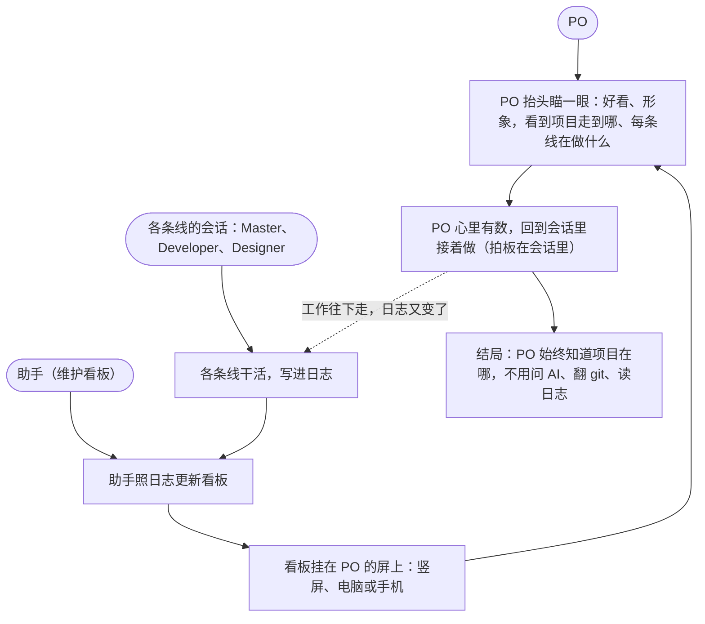

# Design Backlog — board

> Opened 2026-11-14 | From: PBI-68 看板改版——Sprint 20（`sprint-20-presentable`）的 68 等本设计的原型交接，再做 68-b；同日先开过一条设计线，PO 叫停、日志已删，这是重开 | Branch: `worktree-design-board`（PO 建的原生 worktree，基于 main） | Product Owner: SeaPawn | Designer: 原型和测试由 Designer 会话做，到 Prototype 时开；共情、定义、构思由 PO 和 Master 定、Master 落盘（PO 2026-11-14 的分工） | Scrum Master: 会话 IDEO # [master]-[main]-[management sprint]
> Now: Test：照 PO 的修改出了故事板第 3 版（路线改成条目和地图，How 只分做完没做完），等 PO 说过
> Waiting for PO: 1 故事板第 3 版过不过（过了就结束设计，进 68-b）
> Ends when the design questions are answered or the Product Owner stops the design (convention 19 in `design-log.md`); its conclusions flow back to the product log — a blank page's design fills it — and the first Sprint Review after that archives this file (convention 17 in `sprint-log.md`, in the sprint-kernel skill's `conventions/` folder).
> Methods: the stage excerpts in the design-kernel skill (excerpt paths below are relative to that skill's folder), and in every stage the ideo-kernel's IDEO mode and methods, as the design-kernel `SKILL.md` requires.
> This log records what each stage produced, not every step taken to get there (convention 22 in `design-log.md`).
> How to write this log: `design-log.md` in the design-kernel skill's `conventions/` folder.

## 1. Empathize

### 1.1 Challenge

一个人带着几个 AI 会话并行做项目，PO 想随时知道「现在走到哪了、每条线在做什么、哪里在等我」。现在只能问 AI、翻 git 历史、读日志：日志晦涩，历史不够明确，费时也看不清。第 1 版看板丑、不形象，看一次就不想再看第二次。

为什么是现在：Sprint 20 的目标是「拿得出手」，看板是其中最显眼的一块；今天 PO 同时开着 Master、Developer、Designer、助手四个会话，自己说「我们这次我都不知道在干嘛了」。

听到的（一手 = PO 自己说的，2026-11-14 在 Master 会话里答共情的提问，语音转写，方括号是 Master 补的字）：

- **怎么知道走到哪**（一手）：「打开这个项目啊，我就不知道就走到哪了，然后我就问 A[I]」；「主要是看一下 G[it] 的历史，然后还有……设计冲刺日志」；「日志的话太晦涩了，很难懂」「历史有时候也不够明确」；「花了一点点时间了，而且不是那么明确」。
- **几个会话一起跑**（一手）：「还是蛮多对话的，因为他们很多都让我来决策嘛……然后我也不知道他们做到哪儿了」。
- **第 1 版看板**（一手）：「太丑了，实在是太丑了」；「没有任何的……图像化、形象化」；「我看到之后我就不想再看第 2 次」。
- **竖屏挂着**（一手）：挂在另一块屏上，或者从这块屏「拆一点面积」给它，「一直是显示着……当前做到哪儿了」；「一般都是会和 stakeholder 的对话放在一块的，因为一般都是 stakeholder 的对话去维护他」；「过了半个小时……我看一眼，然后让这个[助手]更新一下」。
- **拍板**（一手）：「拍版就是在你这的呀。就是你问我……我才排版的呀。这个好像关系不是很[大]」。和 PBI-68 用户故事里的「拿它拍板」对不上：拍板发生在 Master 的会话里，看板管的是「知道走到哪」。

Master 的读法（PO 认了：「差不多」）：看板是一块挂着的「仪表」，不是打开来查的文件；它的活是让 PO 隔一阵瞄一眼就找回方位，尤其是几条线并行时；好看、形象是它能被一直挂着的前提；它旧不旧要看得出来，因为更新要靠助手。

### 1.2 Design goal

| Commitment | 一眼就知道：看板挂在 PO 的屏上，好看、形象；PO 隔一阵瞄一眼，就知道项目走到哪、每条线在做什么；不用再问 AI、翻 git、读日志，看着就想一直挂着。 |
| --- | --- |

### 1.3 Design questions

都从「它会怎么失败」反过来问；按 PO 说的轻重排（PO 2026-11-14 认）。

1. 好看、形象到 PO 愿意一直挂着吗？（PO：「最关键的」；第 1 版看一次就不想再看。）
2. 几条线并行时，每条在做什么，一眼分得清吗？（PO：「也很重要」。）
3. 隔一阵、离屏幕有段距离瞄一眼，看得出「走到哪」吗？还是要凑近读字？
4. 竖屏、电脑全屏、手机上都读得顺吗？（PO：「也很重要」。）
5. 条目很少、甚至一张白纸的项目，也像样吗？（PO：「条目很少的时候也得……有点这个样子」。）
6. 比起问 AI、翻 git、读日志，真的更省事、更清楚吗？晦涩的日志概括得出看得懂的样子吗？

PO 的决定和去掉的问题：

- **「在等 PO 的事」第一版不上看板**：PO 先说「当然要显示」，接着说：「如果是要显示这个的话，那就说明其他的点也要去更新看板，那其实我就不是那么喜欢……第一版可以先不写，因为只有 stakeholder 才会更新看板呀，所以它主要是要来同步整个过程。等我的……不如写个[hook]来提醒我呢……不如 stakeholder 他来提醒我直接」。设计目标里原有的「哪里在等他」据此去掉。这会动到 68-4 的照抄清单（Waiting for PO 不再上页面），交接时写给 Developer。
- **「过时了会不会骗人」不列为设计问题**：PO：「要靠 AI 更新了。不是那么关心」。生成时间照看板约定照样写在页面上。
- **拍板跟看板关系不大**：PO：「它做到哪儿了？我会用它辅助[拍板]。但是确实是一般，关系不是很大」。PBI-68 用户故事里的「拿它拍板」，设计结束、结论回流产品日志时改。

PO 的决定（2026-11-14）：课题照 Master 写的，PO 不审（「反正你直接写上去吧，我就是挑战，我就不用审了」）；设计目标、设计问题见上。「在等 PO 的事」由 hook 或助手提醒，不登记成 PBI（「不用登记成新的 [PBI]……他后碰到问题肯定会向我反映的」）。关卡：共情这一章行，进定义（「我觉得可以，可以往下走定义」）。

## 2. Define

### 2.1 Map

约定覆盖（PO 2026-11-14）：地图画想达到的愿景，不画现在发生的事（design-log 第 8 条写的是只画现在）；PO 在叫停的那条设计线里说：「你画现在的有什么意义呢」。愿景只写想达到的体验，不写做法；现在的样子（问 AI、翻 git、读晦涩的日志）和哪里疼，在第 1 章。

### 2.2 How Might We

对着 2.1 的地图和第 1 章写，按主题分，括号里是它对着地图的哪一步。PO 挑的打 ✓：2、3、4、5、9、11；没挑的不丢，当作做的时候要顾到的条件。

- 好看、形象（D）
  1. HMW 让 PO 第一眼看到的是一幅图，不是一串字？
  2. HMW 让它好看到 PO 愿意一直挂着，一眼不像模板？ ✓
  3. HMW 让这幅图本身就说出项目的结构：产品、条目、冲刺、设计怎么连着？ ✓
- 几条线并行（A、D）
  4. HMW 让每条线现在在做什么，一眼分得清？ ✓
  5. HMW 让每条线走到哪个阶段，像进度一样看得出来？ ✓
  6. HMW 让几条线同时跑也不乱？
- 瞄一眼（C、D）
  7. HMW 让隔着一段距离也看得清「走到哪」？
  8. HMW 让瞄一眼就够，不用凑近读字？
- 不同的屏（C）
  9. HMW 让同一页在竖屏、电脑、手机上都读得顺？ ✓
  10. HMW 让竖屏挂着看是主角，手机顺带？
- 少与空（D）
  11. HMW 让条目很少、甚至一张白纸的项目，看起来也像设计过？ ✓
- 概括（B）
  12. HMW 让晦涩的日志被概括成一眼看得懂的样子，又不加日志里没有的事？
  13. HMW 让想看某条线的细节时，一步就到日志里对应的地方？

PO 的决定（2026-11-14）：愿景地图行，挑 Master 建议的 6 个 HMW（2、3、4、5、9、11）——「认同，非常认同你的看法……这两个点我都同意」。关卡：定义这一章行，进构思（PO：「OK，我们后续的方案……」，并定画方案的子代理要拿现有材料）。

## 3. Ideate

### 3.1 Solution

**PO 的方案：总览流向图 + 三层卡片**（PO 2026-11-14 定，取代 Master 先定的「项目流水线」：「你这个确实设计得不错……但是跟我想的还是不一样……我觉得你这个方案没有我的好」；风格沿用：「你的这个风格我觉得还是蛮不错的」）。

- **总览**：一张竖着的流向图。产品是圆圈，「分出去外面所有东西」；它先分出没做完的条目（一列方块）；条目流进冲刺，也可能流进设计，冲刺里也可能关联设计；几条线可以并行。
- **点节点跳卡片**：点产品、冲刺、设计，跳到它自己的卡片，有返回。
- **每张卡片三层**：
  - 产品：① 两个承诺（产品、Product Goal）② 路线：架构图，只要主干，「一定要简练」③ 没做完的条目。
  - 冲刺：① Sprint Goal ② 路线：PBI 往前走的路线 ③ How：竖着排的小节点。
  - 设计：① 设计目标 ② 地图，主线 ③ 方案：大概怎么走，可以是一个故事。

Master 照调研加的（PO 要「结合着我们调研的内容进行改进」）：条目流进冲刺、设计的连线照 GitHub Actions 的依赖线画，点一条条目就亮出它流向哪；条目按远近排（在冲刺里 → 待选 → 以后，越往后越淡，借 Now-Next-Later）；全页只有「现在」一种亮色，其余安静（借状态页、壁挂屏）；产品卡的架构画成一条线路、标出冲刺停在哪一段（借地铁线路图）；电脑上左边总览、右边卡片并排（借 GitHub Projects、Linear 的先概括后下钻）；手机上同一张图缩窄、卡片占满屏。

PO 看第 2 版后的修改（2026-11-14）：冲刺和设计的路线不要画五个阶段——「那种都是众所周知的呀，你用它没有用的……冲刺的，那你就是几个 [PBI] 这样排列，然后一个箭头往前走……设计的，那你可能就是一个地图……为什么什么还有怎么做，然后增量这些也不需要的」；How 照旧，「做好了就……标好，然后没做好的就不标」。据此：冲刺卡的路线是条目排成一列、箭头往前，每条下面是它做完了几块；设计卡的路线就是它的地图；总览的冲刺节点里是条目顺序和做完的块数，不再有阶段点；How 只分做完和没做完。

先前的草图（工作材料，在 `sketches/`）：两个 Haiku 子代理各画一个，都选了地铁线路图（甲、乙）；Master 替 PO 画了「项目流水线」（丙），先定过它（故事板第 1 版 `prototype/storyboard.html`），PO 看后换成自己的方案。

PO 的话（2026-11-14）：「我们现在就当设计师吧」——构思到原型由 Master 和 PO 代 Designer 做；原型「根本都不需要把那个网页做出来」，故事板就够。

### 3.2 Storyboard (optional)

第 3 版（照 PO 的修改），见 `prototype/storyboard-v3.html`；帧和第 2 版一样，只改了路线和 How。第 2 版八帧，见 `prototype/storyboard-v2.html`：① 总览流向图 → ② 点条目，亮出它流向哪 → ③ 点 Sprint 20，跳到冲刺卡片（Goal · 五阶段路线和条目顺序 · How 工作块）→ ④ 点设计，跳到设计卡片（设计目标 · 五阶段和主干地图 · 方案小故事）→ ⑤ 点产品圆圈，跳到产品卡片（两个承诺 · 线路式架构 · 分组条目）→ ⑥ 电脑：左总览右卡片 → ⑦ 手机：同图缩窄、卡片占满屏 → ⑧ 白纸：产品圆圈下一个虚线空位。

## 4. Prototype

| Part | The design question it tests | Where it is |
| --- | --- | --- |
| 故事板 v3（当前，八帧同 v2，路线改成条目和地图） | 同下 | `prototype/storyboard-v3.html` |
| 故事板 v2 ① 总览流向图 | 1 好看形象、2 几条线分得清、3 瞄一眼看得出走到哪 | `prototype/storyboard-v2.html` |
| ② 点条目亮出去向 | 2、6 | 同上 |
| ③ 冲刺卡片、④ 设计卡片、⑤ 产品卡片 | 6 比问 AI、翻 git、读日志更省事；1 形象（架构简练） | 同上 |
| ⑥ 电脑、⑦ 手机 | 4 三种屏都读得顺 | 同上 |
| ⑧ 白纸 | 5 条目很少、白纸也像样 | 同上 |
| 故事板 v1（Master 的项目流水线，已被 PO 的方案取代） | — | `prototype/storyboard.html` |

故事板是静态画面（数据是本仓库 2026-11-14 的样子），PO 说不用做真网页（见 3.1）。

## 5. Test

**事先写的标准**（第 18 条）：PO 看完故事板，逐帧说感觉。每个设计问题：PO 说「行」「可以」算是；PO 说不行、要换样子算否；PO 拿不准、要先看真页面算还没定。故事板测不出的：真屏上隔一段距离看的效果、字号够不够、动起来顺不顺——这些留到 68-b 做出真页面后，PO 看真实看板时验（68-6）。

（待做。）约定覆盖（PO 2026-11-14）：测试只由 PO 来——看板只给 PO 用，熟手卡就是他本人——不另派角色卡（第 17 条）；陌生人会在 Sprint 20 的 63 体验测试里读到看板。
