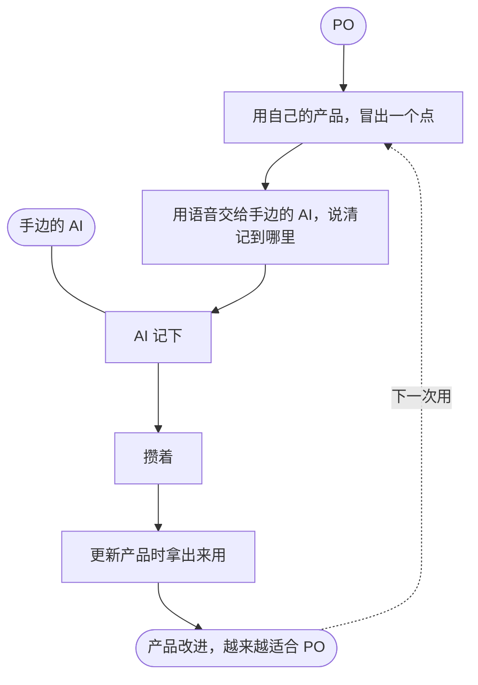

# Design Backlog — feedback-loop

> Opened 2026-11-11 | From: PBI-55（PO 2026-11-11 口述：用插件时冒出很多想法，很快就忘掉；想要一个自我反馈机制，产品才能越来越适合自己） | Branch: design-feedback-loop（从 main 开） | Product Owner: SeaPawn | Designer: IDEO # [master]-[main]-[研究反馈机制]（主对话，兼 Scrum Master；PO 2026-11-11 定）；辅助：IDEO # [designer]-[main]-[辅助设计]（Stakeholder 身份：落盘、发散、原型、测试） | Scrum Master: IDEO # [master]-[main]-[研究反馈机制]
> Now: Ideate — 辅助会话派子代理发散（Lightning Demos、四份隔离草图），主对话同时问 PO 的方案；之后收敛
> Ends when the design questions are answered or the Product Owner stops the design (convention 18 in `design-log.md`); the first Sprint Review after that archives this file (convention 17 in `sprint-log.md`, in the scrum-kernel skill's `conventions/` folder).
> Methods: 各阶段的原文见 design-kernel skill；每个阶段同时用 ideo-kernel 的 IDEO 模式与方法（design-kernel `SKILL.md` 的要求）。
> This log records what each stage produced, not every step taken to get there (convention 21).
> How to write this log: `design-log.md` in the design-kernel skill's `conventions/` folder.

## 1. 共情（Empathize）

### 1.1 挑战

PO 用自己做的产品时，随时会冒出改进的点，而且很多（访谈 一-3，一手）。他想到就立刻交给手边正在干活的 AI 记下来，不会等（访谈 二-1，一手），等更新产品时再看（访谈 三-3，一手）。他说「很快就忘掉」，可他实际是想到就交出去，所以会忘的只是没交出去的那些；卡住的是交出去的这一步（访谈 一-3 与 二-1 对照，Master 的判断）：每一次都要用语音说出记到哪里，路线长、别扭，而且常常这样（访谈 二-4、三-2，一手）。语音还会把名字认错：本次对话里，IDEO-Scrum 被识别成「Ido Scrum」，main 成了「MNN」，Designer 成了「desire」（Master 观察 PO 的语音输入，一手）。

记在哪里不限，不一定在产品的仓库里，更新产品时能一起拿出来就行（访谈 三-5，PO 的判断）。现在的办法能用，PO 也觉得不坏，但他想要更优雅的办法，不想顺着现在的做法改（访谈 二-4、三-4，一手）。哪个产品不重要：他做的任何产品都需要这样的自我反馈（访谈 三-1；开设计时的口述，一手）。

为什么是现在：插件就是靠这些点一轮轮改进的，PBI-47～50 都是这样来的（产品日志，二手）；点越多，这一步走得越勤。

### 1.2 设计目标

我做的每一个产品，都照我自己用它时的想法一轮轮改进，越来越适合我。

（PO 2026-11-11 定。出处：开设计时的口述「越来越适合自己」、访谈 三-1。原稿写成了怎么做，修正记录见 `scrum/documents/design-goal-vision.md`。）

### 1.3 设计问题

1. 不说位置时，手边的 AI 记下的每一个点，更新那个产品时都找得回来吗？（访谈 二-4、三-1、三-5）
2. 交出一个点，能不能一句话就完，不打断手上的活？（访谈 二-1）
3. PO 记完不回头查，记下的东西靠得住吗？内容够不够让后来的人看懂？（访谈 二-2）
4. 更新产品时，攒下的点能不能找全、读得懂，直接拿来定要改什么？（访谈 一-4、三-3）
5. 换成别的产品，同一个办法照样能用吗？（访谈 三-1）

PO 2026-11-11：第 1 章定；设计目标改写成愿景；不找专家、不另做研究（Master 建议，PO 同意），进 Define。

## 2. 定义（Define）

### 2.1 地图

（只画现在发生什么：五六个框、一个环；做法照 `scrum/documents/design-map-rough.md`。）

### 2.2 How Might We

- **交出去**：★① HMW 让交出一个点，和随口说一句话一样轻？★② HMW 让 PO 根本不用说记到哪里？③ HMW 让说错、听错的名字也不碍事？④ HMW 让交出去这一步不打断手上的活？★⑤ HMW 让没说出口的点也不白想？
- **记下和攒着**：★⑥ HMW 让 PO 记完不查也放心？⑦ HMW 让一个点隔了一周再看也看得懂？⑧ HMW 让每个产品都有地方攒它的点？
- **更新时**：★⑨ HMW 让更新产品时，攒下的点一次拿全？⑩ HMW 让攒下的点拿来就能定要改什么？
- **环**：⑪ HMW 让 PO 看得到哪个点已经变成了改进？

PO 2026-11-11：地图定；How Might We 由 Master 代挑（PO 授权）：①②⑤⑥⑨，①② 是现在卡住的地方，⑤ 对应 PO 最初说的「AI 自动记」，⑥ 因为 PO 记完不查，⑨ 因为记录在更新产品时才用；进 Ideate。

## 3. 构思（Ideate）

### 3.1 方案

### 3.2 故事板（可选）

## 4. 原型（Prototype）

| 部件 | 检验哪个设计问题 | 在哪 |
| --- | --- | --- |

## 5. 测试（Test）
