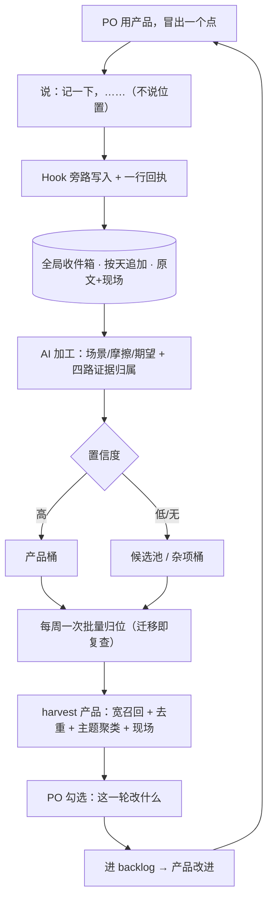
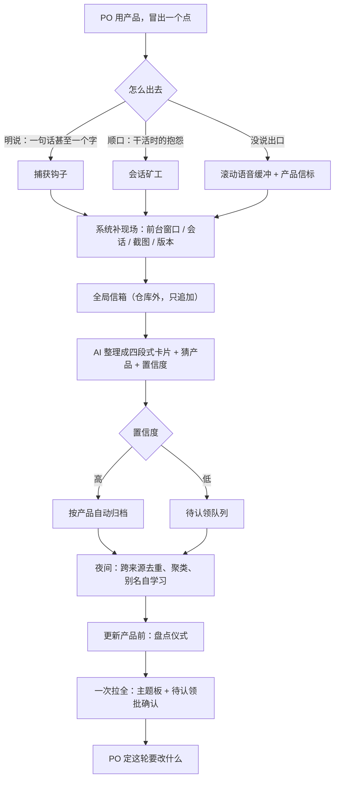
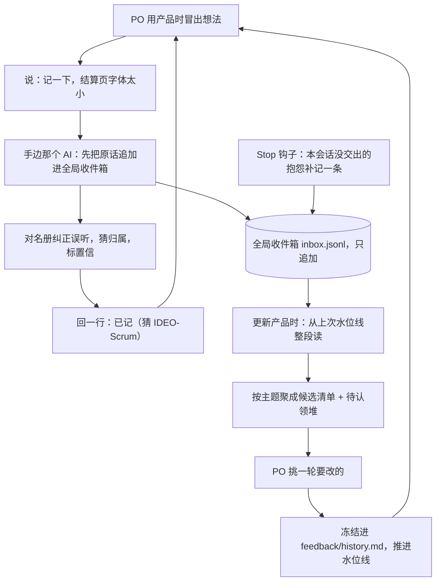
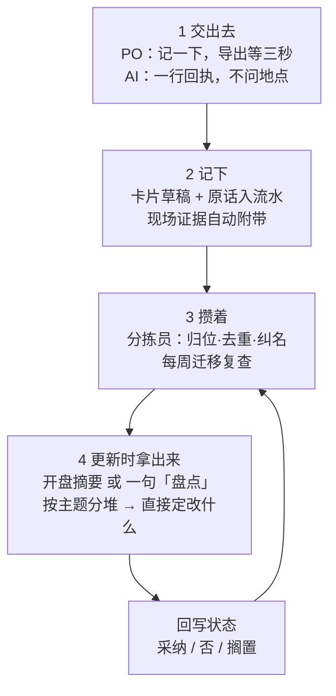

# 四份隔离草图（工作材料）

> 2026-11-11，design-feedback-loop 的构思·发散。四个 Plan 子代理（haiku）各自发散后收敛成一份方案草图，互相看不到；原文收在这里，供主对话收敛时用。工作材料，不进设计日志。

## 草图 A：不用说记到哪里（起点 HMW ②）

## 一、先发散

### 用了哪两个方法、为什么适合这一步

**Impose Constraints**（`S:\IDEO-Scrum\.claude\worktrees\design-feedback-loop\plugins\ideo-scrum\skills\ideo-kernel\methods\impose-constraints.md`）
我的起点 HMW ②「让 PO 根本不用说记到哪里」本身就是一个约束。我把它再收紧成四条，故意把“把现在的做法改得更顺手”这条路堵死：
- C1：说的人永远不说位置，一个字都不说。
- C2：交出一个点只允许“一句话 + 零额外动作”，且不打断手上的活。
- C3：不新增一个要 PO 定期维护的界面或应用。
- C4：假设语音一定把名字认错，方案必须在“名字是错的”前提下成立。

约束在这里不是限制，而是逼出“位置根本不需要被说出来”的方案，而不是“把报地址的句子缩短”。

**Crazy 8s**（同一份 `sketch.md` 的第三步）
先用第一步 Notes 把地图、五个设计问题、A/B/C 三组现成点子收成笔记，第二步把粗点子铺开；再用 Crazy 8s 围绕最强的一个念头——“给所有点一个默认落点”——快速做变体，专门变“落点从哪里来”：从会话、从窗口、从产品自己、从触发词、从日期、从杂项桶、从第二候选、从夜间摘要。Crazy 8s 不求怪，只求越过第一个合理答案。

### 点子清单（26 条，一行一个，不评判）

1. 全局收件箱：所有产品共用一个 append-only 日志，说「记一下」就追加，地址这个概念不存在。
2. 会话即地址：用当前会话所在的仓库自动打产品标签，说的人不说。
3. 窗口即地址：捕获时取前台窗口的标题和应用名，自动判断你正在用哪个产品。
4. 产品自报：产品里嵌一个反馈入口，点一下自动带上产品、版本、界面、截图。
5. 触发词旁路：hook 听到「记一下」就把原句写走，主任务继续，不弹确认。
6. 一行回执：AI 只回「记下了 · 猜是 X」，不回问、不要求点确认。
7. 别名词典：每个产品登记语音错名（Ido Scrum → IDEO-Scrum），落库时归一。
8. 双份留存：原文（含错字）和整理稿各存一份，原文永不可改。
9. 四格事实：每条落库即填「场景 / 摩擦 / 期望 / 证据」，填不满就留空。
10. 日期即收件箱：按天成页，今天说的都落在今天，产品标签后补。
11. 杂项桶：归属失败的一律进「杂项」，收割时必须带出来。
12. 候选二：每条最多挂两个候选产品，两边收割都能看到。
13. 每周归位：一次批量把未归位的分到产品，重复合并，只问一次。
14. 迁移即复查：归位时顺手决定留、并、丢，像子弹笔记的月度迁移。
15. 会话收尾捞点：会话结束时从对话里挑出“像反馈的句子”，生成候选。
16. 夜间摘要：每晚把当天关于各产品的抱怨和纠正提炼成几条候选。
17. 收割命令：`/harvest 产品`，按别名、界面词、语义宽召回，不做精确匹配。
18. 主题聚类：收割按主题分堆，不按时间排队，重复的合并计数。
19. 现场随行：每条带当时的时间、界面、原话、会话，后来的人不用猜。
20. 产品名片：每个仓库一份别名、界面词、口味，归属和收割都读它。
21. 口味回流：收割后把反复出现的偏好写回名片，下一轮设计默认照着来。
22. 多门同一口井：手机快捷指令、桌面热键、任何 AI 会话，都投同一个收件箱。
23. MCP 开放：收件箱用 MCP 暴露，任何产品、任何工具都能读写同一份。
24. 错也不丢：归属、整理、聚类都允许出错，唯独“丢”不允许发生。
25. 两层分离：捕获层只追加、永不编辑；整理层可以随便重写。
26. 追问后置：捕获时不问，把所有“是哪个产品”的问题推迟到收割那一刻再问。

---

## 二、再收敛：方案草图

### 标题
**《回声》——不报地址的反馈收件箱**
说的时刻只往一口井里丢，更新的时候按产品打捞。

### 一句话主张
把“记到哪里”从**写入时的地址**，改成**读取时的查询**：捕获时不选产品，归属推迟到 PO 正在更新那个产品、最方便判断的那一刻。

### 铺路（只做一次，不在每一轮里）
- **PO 说什么**：不用说什么，只同意装一次。
- **PO 做什么**：在机器或账户层装一个捕获入口；每个产品仓库放一份“产品名片”（正式名、语音别名、界面词、口味）。
- **AI 做什么**：建一个全局 append-only 收件箱（按天一个文件，所有产品共用）；装一个 `UserPromptSubmit` hook，任何会话里听到触发词就旁路写入；建一个 `/harvest` 命令；从每个仓库自动起草产品名片，PO 扫一眼即可。

### 第一格（交出去）：一句话，手不停
- **PO 说什么**：「记一下，详情页筛选一点就卡。」——不报产品、不报路径、不报格式。
- **PO 做什么**：说完继续用产品、继续手上的活；不看回执、不等确认、不回答追问。
- **AI 做什么**：捕获入口把这句连同现场（时间、前台窗口、会话所在仓库、会话 id、原文）追加进全局收件箱；主会话只回一行 `记下了 · 猜 IDEO-Scrum · 可改`；不追问、不弹窗、不把原来的活停下来。捕获是说话的副产品，不是一件新任务。

### 第二格（记下）：AI 当场加工，PO 不参与
- **PO 说什么**：不用说。
- **PO 做什么**：不查、不管、不整理。
- **AI 做什么**：原文原样保留（含语音错字），另生成一条整理稿；整理稿填四格——场景（我在哪个界面做什么）、摩擦（哪里别扭）、期望（我想怎样）、证据（窗口、原话、截图）；用四路证据投票做归属——话里的产品词和别名、前台窗口、会话所在仓库、最近使用记录——给出产品标签、置信度、第二候选；读产品名片的别名表把 `Ido Scrum` 归一成 `IDEO-Scrum`，模糊匹配而不硬匹配；状态标成 `auto-filed` 或 `needs-triage`。

### 第三格（攒着）：系统兜底，不靠记性
- **PO 说什么**：平时不用说；一周最多收到一次「3 条没归位，扫一眼？」。
- **PO 做什么**：大多数时候什么都不做；愿意时花 30 秒批量点一下。
- **AI 做什么**：未归位队列永远存在，归不上的进“杂项”，绝不丢；每周一次批量归位，分产品、合并重复，低置信度的只问一次；会话收尾时从对话里挑出“像反馈的句子”生成候选，夜间再把当天关于各产品的抱怨和纠正汇成一页——**没说出口的点靠会话的尾巴捞回来**；同一条被多次提到就合并计数，热度自己浮上来。

### 第四格（更新时拿出来）：一次拿全，直接定改什么
- **PO 说什么**：「`/harvest IDEO-Scrum`」或「把 IDEO-Scrum 攒的点收一下」。
- **PO 做什么**：看一份按主题聚好的清单，勾这一轮要改的——价值判断留给 PO。
- **AI 做什么**：宽召回（标签匹配、别名词和界面词匹配、语义相近、低置信度候选池，宁可多带不可漏）；去重、按主题聚类而不按时间，每条附现场（什么时候、在哪个界面、原话怎么说）；输出三块——反复出现的、单点快改的、存疑待确认的；PO 勾选后直接变成这一轮的候选 backlog；顺手把反复出现的偏好写回产品名片的“口味”，下一轮设计默认照着来；条目打上 `harvested` 标记，原文永久保留，下一轮还能再捞。

### 它怎样回答五个设计问题

1. **不说位置也找得回吗？** 找得回——每个点都先落进同一个全局追加日志，“在哪”从写入时的地址变成读取时的查询：产品由四路证据投票推断，错名由别名表归一，猜不准的进候选池和杂项桶，收割时宽召回一并带出，所以不存在“记到别处就找不到”。
2. **一句话能不能完、不打断？** 能——「记一下 + 内容」一句话就完，hook 旁路写入、AI 只回一行、不追问不确认，PO 说完就继续手上的活。
3. **记完不查靠得住吗？** 靠得住——原文永久保留，AI 当场补上场景、摩擦、期望和现场，归属错了只是放错格子而不是丢掉，每周一次批量归位再把错的收拢；PO 不查也不会丢，查一次只是让归属更准。
4. **更新时能不能找全、读懂、直接定改什么？** 能——收割按产品宽召回（含低置信度），去重、按主题聚类并附现场，直接产出“反复出现的、单点快改的、存疑的”三块清单，PO 勾完就是这一轮要改的。
5. **换个产品还能用吗？** 能——入口装在账户或机器层，收件箱和收割逻辑跟产品无关，换产品只需加一份产品名片（别名、界面词），名片还能由 AI 从仓库自动起草。

### 最大的风险
“不用报地址”把一次说清的成本推迟成以后必须做的一次归位——如果错归属和未归属静默堆积，收割看起来成功，却恰好漏掉最该改的那几条。

### Critical Files for Implementation
- S:\IDEO-Scrum\.claude\worktrees\design-feedback-loop\plugins\ideo-scrum\skills\ideo-kernel\methods\impose-constraints.md
- S:\IDEO-Scrum\.claude\worktrees\design-feedback-loop\plugins\ideo-scrum\skills\design-kernel\ideate\sketch.md

（本次只读了这两份文件；实现落点是插件的 skill 与 hook 目录，未在本机读取，不臆造具体路径。）

## 草图 B：没说出口的点（起点 HMW ⑤）

## 一、发散

### 用了哪两个方法，为什么

**Analogous Empathy（类比共情）**：这个挑战真正卡住的地方，不是「怎么记」——记的办法很多；而是「怎么让没被特意交出去的东西也留下来」。如果只盯着笔记软件看，看到的都是同一类做法。把这件事类比到经验结构不同、但同样需要「留下痕迹」的场景：飞机黑匣子（一直录，出事才取）、消防电台（常开频道，后台有人记）、医院诊室里的 AI 抄写员（医生只管说话）、酒店意见卡（写什么不用管谁来收）、快递签收（动作完成就有回执）、Shazam（听一小段就替你报出名字，不用你报）。借的是这些场景里「持续留痕、事后回捞、默认落点、现场自动附带、身份自动识别」的结构，而不是某个具体产品。适合发散之前先把视野打开。

**Brainstorming（头脑风暴）**：HMW ⑤（怎样让没说出口的点也不白想）已经很明确，这一步需要的是数量和变体，而不是马上挑最优解。所以先不评判、不停下来分类：先沿「捕获路径」做八个走法，相当于 Crazy 8s 的一次快跑；再沿「归位 / 可读 / 可信 / 拿回」四条轴继续铺开。

另外轻轻用了 **sketch.md 的前三步**：Notes 把地图五步、五个设计问题、现成的 A/B/C 清单收成素材；Ideas 粗写成卡片；Crazy 8s 对同一个「捕获得不依赖 PO 报地址」的机制，快速做了八种不同走法。第四步留到收敛时用。

### 点子（一行一个，括号里是借来的类比）

**Crazy 8s：一个点从冒出来到进箱，有哪八种走法**

1. 明说一句：在任意会话里说「记：搜索太慢」，钩子抓整句，不要求报项目。（Claude Code hooks / Drafts 白纸入口）
2. 一个字触发：只说「记」加内容，余下的由钩子补全。（Siri 默认落点 / Todoist 自然语言）
3. 连「记」都不说：钩子自动从当轮对话里判出像反馈的句子。（Claude Code auto memory）
4. 事后回捞：麦克风滚动缓存最近 30 分钟，说「刚才那个」就把没特意记的话捞回来。（飞机黑匣子 / Limitless）
5. 会话矿工：定期扫所有正在干活的会话，把「这破接口真别扭」这类顺口抱怨蒸馏成反馈点。（Granola 后台听 / 诊室抄写员）
6. 产品信标：每个自研产品内置热键或悬浮球，按下自动截屏并带上版本、日志，再说一句。（BugHerd / dogfood 的发送反馈）
7. 截屏即记录：只发一张「这里不对」的图，AI 自己读懂画面和上下文。（Marker.io 钉在元素上）
8. 窗口嗅探加内容兜底：捕获瞬间记下前台窗口的进程名和标题，让屏幕来决定是哪个产品。（Feedback Assistant 自动打包现场）

**归位轴**

9. 全局收件箱：所有产品、所有会话共用一个仓库之外的只追加日志，落点由系统定，PO 永远不说地址。（GTD 收集篮 / 酒店意见卡）
10. 内容定产品：AI 从话里抽产品名做模糊匹配，「Ido Scrum」自动纠成 IDEO-Scrum。（Shazam 听一小段认名字）
11. 别名自学习表：从仓库列表生成产品名和常见语音误识别变体，每纠正一次就多一条。（通讯录模糊搜索）
12. 夜间归位：捕获时不分类，夜里一个分拣代理按产品聚类，高置信自动归档，低置信留下。（Linear Triage 先全收后归位）
13. 待认领批处理：低置信的不在当场问，攒到更新时一次摊开批量认领。（收据鞋盒，报税时才分拣）
14. 一句拆多条：一句话提到两个产品，AI 拆成两条分别归位。（自然语言多意图解析）
15. 一句落两个桶：一条点既是产品的也是工具的，复制成两条引用同一个原文，不分主次。（双向链接）

**可读轴**

16. 四段式卡片：「我在干什么 / 哪里不顺 / 我想要什么 / 现场证据」，后来人不用猜。（AudioPen 口语变结构文 / mem0 压成一条事实）
17. 现场自动附：抓截图、版本号、最近日志，内容不够时由现场补。（macOS Feedback Assistant 的 sysdiagnose）
18. 语音原声留档：转写文本和原始音频一起存，重听能还原语气，也防转写丢词。（通话录音 / Q 留言）

**可信轴**

19. 一行收据：记完只回「记下了：X 的搜索太慢」，是陈述不是提问，不打断，可看可不看。（快递签收短信）
20. 无感仪表：只显示「已捕获 / 待认领 / 已归位」三个数字，PO 不必逐条查，看数字就知道没漏。（未读角标）
21. 漏点兜底：任何会话只要提到某产品关键词，就自动往该产品的「未完的点」清单追一条索引。（RSS 订阅自动收齐）
22. 静默日报：每天生成一页「今天冒出来的点」只存档不推送，更新时回看，也是没说出口的点的捞回网。（日志轮转 / 日记）

**拿回轴**

23. 主题板：更新时把所有来源去重后按主题聚成几堆，不是按时间排成一长串。（Canny 反馈池）
24. 盘点仪式：每次更新产品前固定跑一遍，把未处理的点重新过一遍，过一遍就是复查。（子弹笔记月度迁移 / bug bash 固定时段）
25. 反向拉取：更新时除信箱外，还自动扫该仓库的 git 记录、issue 和会话，把散落的点一并拉进来。（代码考古）
26. 产品注册表：新产品只登记一次仓库、别名、信标地址，之后所有捕获自动认识它。（域名注册 / 通讯录）

---

## 二、收敛：方案草图

### 标题

**「一句话信箱」——说一句就归位，没说出口也有底**

和现在的做法差在哪：现在要求他在交出的那一瞬间就把地址说出来；新办法把「捕获」和「分类」在时间上拆开——捕获只要内容，地址由系统事后推断。他不是顺着旧做法在改，而是那一步根本不再存在。

### 第 0 步：一次搭好（只做一次，之后每个产品复用）

PO 做：建一个**仓库之外**的全局信箱目录；装一个 Claude Code 插件（钩子加一个「盘点」skill）；每个产品引入一个几行的信标包；维护一份产品注册表，登记「仓库 + 别名」。

AI 做：从注册表生成别名表（含语音常见误识别）；挂上 `UserPromptSubmit` / `Stop` / `SessionStart` 三个钩子。之后新增产品只登记一次，逻辑不变——这就是设计问题 5 的答案。

### 第 1 步：交出去

PO 说：在手边任意一个会话里说一句「记：搜索太慢，想要能按标签筛」，甚至只说内容、不说「记」，也不说记到哪；或者干脆什么都不说，继续干活、继续抱怨。

AI 做：钩子接住这一句，不问、不确认、不打断，只回一行收据「记下了：搜索太慢」。与此同时另两条通道不依赖他做任何动作——**顺口通道**由会话矿工从任意会话里挖出抱怨，**没说出口通道**由滚动语音缓冲（说「刚才那个」就能回捞最近几分钟）和产品信标（按一下热键自动截屏）接住。HMW ①（像随口一句话一样轻）和 ⑤（没说出口也不白想）在这里被回答。

### 第 2 步：记下

系统补现场：时间、前台窗口的进程名和标题、会话所在的 cwd 和仓库、截图（若有信标）、版本和构建号、最近一段会话、原始转写与纠正后文本。产品身份**以内容和前台窗口判定，cwd 只作参考**——因为他很可能正在用产品 X，而手边会话干的是产品 Y，这正是现在最容易记错的地方。

AI 做：把口语整理成四段式卡片（我在干什么 / 哪里不顺 / 我想要什么 / 现场证据），猜出产品并打置信度，顺手纠正听错的名字，写进全局信箱。信箱只追加、按天分文件，不改旧账。

### 第 3 步：攒着

PO 做：什么都不做，也不回头查。

AI 做（夜间或空闲）：按产品聚类；高置信自动归档；低置信进「待认领」；跨来源去重合并；从他的每一次纠正里更新别名表；生成静默日报存档；维护每个产品的「未完的点」索引。可信度靠结构，不靠他复查——卡片本身能自解释、现场自动附带、关键词有漏点兜底、界面上有一个「待认领」数字。这是设计问题 3 的答案。

### 第 4 步：更新时拿出来

PO 做：开工更新产品 X，说一句「盘点 X」；或者在 X 的仓库里开会话时，skill 由 `SessionStart` 自动触发。

AI 做：一次拉全所有来源（信箱卡片、会话矿工、信标、语音回捞、仓库的 git 和 issue），去重后按主题聚成一块板，每条标出证据和置信度，把待认领的几条摊在最上面等他批量确认。

PO 做：扫一眼主题板，批量认领几条，挑出这轮要改的，进 backlog。找全、读懂、直接能定要改什么——设计问题 1 和 4 都在这一步合上。

### 五个设计问题，各一句

1. **不说位置也能找回来吗？** 能——归档时按「产品」而不是按「仓库或会话」来分，捕获时由内容和前台窗口定产品，更新时按产品一次拉全；实在定不了的进待认领，会在更新时被摊开，不会静默消失。
2. **一句话就能交完吗？** 能——只给内容，连「记到哪」都不用说，钩子负责接住，回执是一行陈述而不是提问，说完就能接着干活。
3. **记完不查靠得住吗？** 靠得住——不是靠他复查，而是卡片自带现场和四段式结构，加夜间自检、低置信待认领、关键词漏点兜底，看不懂或定不了的一定会在更新时冒出来，沉不下去。
4. **更新时能找全、读懂吗？** 能——固定的盘点仪式把多路来源一次拉全、去重、按主题聚板，卡片本身就是给后来人看的决策材料。
5. **换个产品照样能用吗？** 能——信箱、插件、别名表、盘点仪式都是系统级的，新产品只登记一次仓库、别名、信标，捕获和归位逻辑完全复用。

### 最大的风险

最大的风险是「静默归错」：因为他从不回头查，一条被分到别的产品名下的点，和根本没记下来的点一样等于丢了，而且没有任何人会察觉——所以「低置信待认领」和「更新时摊开」这两个动作，是整套办法里最不能省的一环。

### Critical Files for Implementation

按任务限定只读了以下三个方法文件，本机其他文件未读：

- S:\IDEO-Scrum\.claude\worktrees\design-feedback-loop\plugins\ideo-scrum\skills\ideo-kernel\methods\analogous-empathy.md
- S:\IDEO-Scrum\.claude\worktrees\design-feedback-loop\plugins\ideo-scrum\skills\ideo-kernel\methods\brainstorming.md
- S:\IDEO-Scrum\.claude\worktrees\design-feedback-loop\plugins\ideo-scrum\skills\design-kernel\ideate\sketch.md

实现落点应为 `plugins/ideo-scrum` 下的钩子与 skill，但未核实具体文件。

## 草图 C：一句话那么轻（起点 HMW ①）

## 一、发散

我用了两个方法：

- **Powers of Ten**：这个挑战之所以难，是因为“地图”把“交出去”画成了一个有地点的时刻：一个想法、一次投递、一个目的地。放大看，所有产品其实用的是同一条底层信息流，收件箱应该存在于所有仓库之外；缩小看，捕获可以压缩到一句话、一行回执、一个触发词。一放大一缩小，“记到哪里”这个问题就显得没必要了，它只是这个画法的产物。再加一条极端的约束（“如果捕获花 0 个字”“如果这个篮子比所有产品活得都久”），能逼出更彻底的方案。
- **Yes, And! Brainstorm**：现在最容易被提前否定的正是最关键的点（“那他还是得说记到哪”“AI 猜错了怎么办”）。先接受、只往上加，旧机制就可以继续往上叠加：收集篮 + 钩子 + 误听词表 + 水位线 + 更新仪式，五样拼在一起就是一个完整方案，不用在发散阶段评判它们。

另外照 sketch.md 前三步：先把地图、五个设计问题和 HMW 当“笔记”读一遍，再散写点子，最后对最强的几个做 Crazy 8s 变形（触发词、回执、归属、清点、补漏各出多种变体）。

点子（26 条，[微] 表示一句话以内的尺度，[中] 表示一次会话的尺度，[系统] 表示所有产品的共性做法）：

1. [系统] 全局唯一收件箱：所有会话、所有产品都往同一个只追加文件里写，位置由默认值决定，永不询问。
2. [微] 触发词极短：说「记一下」就开始，甚至只说「记」；后面跟的那句话就是内容。
3. [微] 允许只说关键词：「导出 慢」三个字就够，由 AI 扩写成完整记录。
4. [微] 一行回执：AI 只回「已记：结算页字体太小（猜 IDEO-Scrum）」，不提问、不停手上的活。
5. [中] 捕获时零分类：先只写入时间、会话、当前目录和原话，归属留给读取的那一刻再判断。
6. [系统] 全局产品名册：一份共享文件列产品正名、别名和语音误听（Ido Scrum → IDEO-Scrum），捕获时自动纠正，并保留原文。
7. [中] 两段式记录：逐字原文 + AI 整理的「当时在做什么、期望、实际」，四行一条，后来的人不靠回忆也能懂。
8. [中] 归属猜测分三档：很可能、可能、不明；不明的就承认不懂，进待认领堆，不硬猜。
9. [系统] 每条一个单调递增 id，每产品记一个已读水位线；更新时读水位线之后全段，不靠检索。
10. [中] 钩子兜底：UserPromptSubmit 扫触发词、Stop 扫本会话里的抱怨语气，模型忘了写也丢不了。
11. [中] 现场自动带上：写条目时附当前 git 分支、最近提交、会话里最近一条用户消息。
12. [系统] 更新开场仪式：一条命令吐出「自上次更新以来 37 条，本产品 31，归属不明 6」。
13. [中] 按主题聚类而不是按时间流水：更新时把点聚成「结算 / 导出 / 登录」几堆，一屏看完。
14. [中] 待认领堆：归属不明的集中一区，更新时一句话批量认领（「这 6 条都是 IDEO-Scrum 的」）。
15. [中] 回执里只加一个价值词（比如「大」），标记值得优先看的点；捕获时仍不排序、不判断。
16. [系统] 静默巡检：每天第一次开会话时，把昨夜新增压成 5 行摘要，只在有「不明」条目时提一句。
17. [中] 疑似误听标记：听着别扭的条目挂「疑似误听」，附原始转写，更新时一眼纠正。
18. [系统] 产品自带反馈口：自己做的产品内置「PO 想法」快捷键，自动带上当前界面、版本、时间。
19. [中] 插播式捕获：记完不切换话题、不开新任务，句末一个记号，原来的活继续。
20. [系统] 新产品一条命令接入：初始化时注册名字和误听词，之后全局收件箱对它自动生效。
21. [中] 更新时冻结快照：已归属条目抄进仓库内 `feedback/history.md`，产品自带完整历史。
22. [系统] 周期迁移：每月把超过 30 天仍未认领的点重抄给 PO 看一遍，抄的时候决定留还是丢。
23. [系统] 常开留痕（放大到系统尺度）：原始会话记录本身保留，更新时可回捞“抱怨过但没交出”的段落。
24. [微] 白纸入口：任何应用里一个固定快捷键弹出空白一行，回车即入全局收件箱。
25. [系统] 归属误差自愈：猜错不改内容只改归属标记，点永不因为分类错而丢。
26. [中] 内容不可解才问，且只问内容不问位置（「是导出慢还是打开慢？」），别的都不问。

## 二、收敛：方案草图

### 「一只篮子，一句就够」

一只所有产品共用的篮子，说话时不用想它属于谁；更新产品时，篮子自己倒出来。

**第一步：交出去**

- PO 说：一句「记一下，结算页金额看不清，字体太小」。不说产品、不说是哪个界面，说完接着说下一件事。
- PO 做：继续用产品、继续跟 AI 说别的需求。不打开任何应用，不点任何地方，不回任何提问。
- AI 做：听到触发词就地插入三段动作，先写入原话（两秒内，先保证不丢），再用名册纠正听错的名字，再猜归属和置信；回一行「已记：结算页字体太小（猜 IDEO-Scrum，高）」，然后接回原本手上的活。只有一句话完全不可解时才问一句，而且只问内容不问位置。

**第二步：记下**

- PO 说什么都不额外说。
- AI 做：写一条结构化短记录，不是一段流水账。字段是：id、时间、会话、当时目录、原话（含听错的写法）、整理成「当时在做什么 / 期望 / 实际」三行、归属猜测与置信、疑似误听标记。原话永远保留，所以 AI 判断错也不会伤到内容。
- 系统做：钩子在底层兜底。UserPromptSubmit 扫到触发词就追加原话；Stop 钩子扫本会话里带抱怨或期望语气的句子，把没被交出的补成「未交出」条目，进同一个篮子。捕获不依赖模型的记性，也不依赖人记得说。

**第三步：攒着**

- PO 做：什么都不做，不回头看，不整理。
- 系统做：收件箱只追加、不修改，按时间自然排序，日期就是收件箱的页码。名册和收件箱都放在所有产品仓库之外（例如 `~/.claude/feedback/`），所以哪个会话开着都能写进去。每天早上第一次开会话时，SessionStart 钩子把新增压成最多五行摘要，只在这几天积了「归属不明」的条目时提一句，让 PO 用一句话批量认领；不提也不影响任何东西。

**第四步：更新时拿出来**

- PO 说：更新这个产品时只说一句「看看攒了什么」，或者这个动作直接被写进更新流程的第一步。
- AI 做：读仓库里的水位线，把水位线之后的所有条目整段读出来（不是检索、不是凭印象），按主题聚成几堆，吐出一份「本轮候选」：每条一句话、附原话和当时现场、标上出现次数和「大」标记；归属不明的单列一小堆等一句话认领。然后报数：「共 37 条，本产品 31，待认领 6，全部在上。」PO 只做挑选，不做查找。
- 系统做：选中的条目冻结进仓库的 `feedback/history.md`，当场推进水位线并更新已读点，所以下一轮读到的一定是没看过的部分。

### 它怎样回答五个设计问题

1. **不说位置也能找回来吗**：能，因为位置不是在说话那一刻决定的：所有点都进同一个只追加的篮子，更新时按水位线整段读、不靠检索，归属猜错也只改标记不丢内容。
2. **一句话能交完、不打断吗**：能，一句触发词加内容就够，回执只有一行且不提问，捕获是插播的，AI 记完立刻回到手上的活。
3. **不回头查也靠得住吗**：靠得住，捕获有钩子兜底、内容当场扩成四行且留下原话和现场，错误在更新时批量暴露并一次纠正，不靠人复查。
4. **更新时能找全、读懂、直接定改什么吗**：能，更新开场就是一次全量清点和主题聚类，带计数、原话和现场，直接产出一份可挑选的「本轮候选改动」。
5. **换个产品还成立吗**：成立，篮子、名册、钩子、更新仪式都在产品之外共用，新产品只需注册名字和误听词、在说明里加一行，同一个办法原样生效。

### 最大的风险

最大的风险是「随手」变成「随手淹」：捕获太容易持续涌入低价值条目，清点越来越重，PO 干脆跳过清点这一步，回路就断了；对策是把清点第一步固定为「先聚类、后逐条」，并允许一句话批量认领，让每次清点控制在十分钟以内。

### Critical Files for Implementation
- S:\IDEO-Scrum\.claude\worktrees\design-feedback-loop\plugins\ideo-scrum\skills\design-kernel\ideate\sketch.md
- S:\IDEO-Scrum\.claude\worktrees\design-feedback-loop\plugins\ideo-scrum\skills\ideo-kernel\methods\powers-of-ten.md
- S:\IDEO-Scrum\.claude\worktrees\design-feedback-loop\plugins\ideo-scrum\skills\ideo-kernel\methods\yes-and-brainstorm.md
- S:\IDEO-Scrum\.claude\worktrees\design-feedback-loop\plugins\ideo-scrum\skills\ideo-kernel\
- S:\IDEO-Scrum\.claude\worktrees\design-feedback-loop\plugins\ideo-scrum\skills\design-kernel\ideate\

## 草图 D：更新时一次拿全（起点 HMW ⑨，兼顾 ⑥）

读完了三个方法文件（sketch.md 只看第一到第三步用于发散、第四步用于收敛）。以下全部是文字，没有写任何文件。

---

# 一、发散

## 用了哪两个方法，为什么

**Why-How Laddering**：⑨ 本身就是一个「How」——「怎样一次拿全」。单在这个高度上想，只会想出「做一个更好的清单」，很快就到底。往上问 Why，能把真正的需求挖出来：为什么要拿全？因为不想重想已经想过的东西；再往上：因为产品要一轮轮变合手靠的是积累，不是记性；到顶：因为我只想用脑子想新东西，不想用脑子保管旧东西。再往下爬 How，就得到不同高度的解法——从「一个共享信箱」这种机制，到「清点时把待归属置顶」这种细节。它保证我的点子不全是同一层的变体。

**I Like, I Wish, What If**：它天生是「对现状给建设性反馈、且不许评判」的工具，正好用来把 PO 现在的流程拆成一句句「我希望……／要是……会怎样」。而且它的话式就是 PO 自己的口气（语音里他本来就会说「我希望它别问我」），点子直接活在他的语言里，不会变成我的术语。两者一竖一横：梯子给深度和层次，IL/IW/WI 给数量和开放度。

**sketch 前三步的用法**：第一步「笔记」＝把设计目标、地图四步、五个 HMW、现成点子里的可用件先抄成一份「精选」；第二步「点子」＝不管好坏地铺开；第三步「Crazy 8s」＝只对整条链上最弱的一环（更新时怎么把点取出来）快速做八个变体。

## 第一步 笔记（精选，只给自己看）

- 设计目标：每个产品照我自己用它时的想法一轮轮改进，越来越适合我。
- 地图四步：交出去 → 记下 → 攒着 → 更新时拿出来。
- 五个问题里最硬的：位置不用说、交出要一句话、记完不查也得可靠、更新时要拿全读懂。
- 可借件：GTD 收集篮（先收后分）、Drafts（入口永远同一张白纸）、每日笔记（日期当收件箱）、闪念笔记（捕捉只给原料）、子弹笔记迁移（迁移即复查）、AudioPen（口语→可读、顺手纠名）、Linear Asks（一个动作投递、去向由现成上下文决定）、Linear Triage（先全收、后按主题归位）、Cline Memory Bank（更新时必读的固定入口）、mem0（落库即压成一条事实并去重）、Claude Code hooks（把动作绑在事件上，不靠记性）、Limitless（不依赖「交出去」那一刻的持续留痕）、BugHerd / dogfood 反馈（现场信息自动长出来）。

## 第二步 点子（不评判，一行一个）

1. 所有产品共用一个中央信箱，捕获时零选择，落点问题从「每次说」变成「从不说」。
2. 日期当收件箱：每条点先落进「今天」这页流水，产品归属由 AI 事后切分。
3. 产品别名表：IDEO-Scrum、Ido Scrum、「那个 Scrum 的」都映射到同一个 slug，语音错名自动归位。
4. 捕获时自动附带现场：cwd、仓库 remote、分支、构建号、会话 id、时间，身份靠证据推而不靠 PO 报。
5. 判不准就进「待归属」夹，附前三个候选与证据，绝不打断 PO 追问。
6. 设一个「分拣员」：每天一次、每次会话开工一次、更新前必一次，负责归位、去重、合并、纠名。
7. 每个产品仓库里放一个固定入口文件（如 `.feedback/INBOX.md`），更新时必读，散点定期汇入。
8. 更新时说一句「盘点」，输出该产品全部未处理的点，按主题聚合而非按时间排。
9. SessionStart 钩子：一打开某产品的会话，该产品的来信摘要已经躺在开场上下文里。
10. 主题分堆而不是长流水：更新时看到「导出」「搜索」「速度」「文案」几堆，不是九十条。
11. 自动去重合并：语义相近的合成一条，保留全部原话，合并次数当热度。
12. 卡片自解释：一句现象、一句期望、一句当时场景、来源链接，后来的人不看原话也懂。
13. 原话永存、整理稿并列：口语和错字不丢，好读的那份在上。
14. 捕获回执一行：AI 说「记下了：导出慢 · IDEO-Scrum · 已入库」，陈述句，不带问号。
15. 回执绝不要求确认，错判由后台纠正，手上的活不停。
16. 常开兜底流水：每条用户原话都被钩子无条件追加进当天流水，模型没认出「这是个点」也不丢。
17. 漏网捞取：清点时把「流水里像点却没成卡」的段落列出来，请 PO 一句话认领。
18. 每周迁移：未处理的点重排一遍再出现，抄的过程就是复查（子弹笔记式）。
19. 每条点带状态：新 / 已采纳 / 已否 / 已实现，更新时默认只看「新」和「否了但情况变了」。
20. 每周给每个产品生成一封「来信摘要」，更新时读最近几封即可。
21. 版本锚点：每条点记下当时的产品版本或构建号，更新时能判断是否已被后来的版本解决。
22. 跨产品共点：同一句抱怨出现在两个产品时标为「共性」，改一处时提示另一处。
23. 一行入库语法：唯一要记的咒语是「记一下」，其余全自动。
24. 语音纠名：按别名表和上下文纠正听错的名字，并用正确名字在回执里确认。
25. 更新开场「一叠纸」：把该产品的点摊成一页 checklist，放在计划的第一步，天然被读到。
26. 决策挂接：定要改什么时，每条改动旁挂来源点，形成「反馈→改动」的闭环记录。
27. 版本前的时间盒仪式：固定二十分钟「读信」，像 bug bash，有明确起止。
28. 中央库 + 仓库只读视图：真身一处可跨产品查，每个仓库放一个视图或软链，本地也看得全。
29. 不可变追加 + 可重建索引：流水只追加，索引随时从流水重建，坏了也不丢。
30. 待归属置顶：清点时没归属的点放最上面，逼一次归属，避免永远沉底。

## 第三步 Crazy 8s（只打最弱一环：更新时怎么取出来）

- C1 一句话「盘点」，输出该产品全部待处理点。
- C2 打开会话即摘要，靠 SessionStart 注入，不靠人想起来查。
- C3 产品仓库里一页 `INBOX.md`，每次分拣后整页重写，更新时打开就是全部。
- C4 清点输出按主题分堆，先给「几堆」，再给堆里的条目。
- C5 版本前固定时间盒「读信」，有开始有结束，像仪式。
- C6 每周一封摘要信，更新时只读最近几封，信里已有合并与去重。
- C7 决策旁挂来源，没挂来源的空位自动提示「还有信没读」。
- C8 反向提问「我上一轮想过什么」，AI 从信箱按当时场景回放。
- C9 把点变成一叠实体卡片或看板列，物理上真的「一叠」。

---

# 二、收敛：方案草图

## 标题

**《一个信箱，一叠来信》**——所有产品共用一个信箱，更新时间读一叠已经分好堆的来信。

用四格故事板讲（地图有四步，所以是四格不是三格）。

## 第一格：交出去

**PO 说什么、做什么**：一边用产品一边说，只说内容和「记一下」——「记一下，导出等了三秒，太慢」。不说记到哪里；就算顺口说了「Ido Scrum 那个导出」，也不去纠正。说完立刻回到手上的活。

**AI 做什么**：认触发词，抽出「现象＋期望」；用别名表和上下文判产品；判不准也只落「待归属」并附候选，**不追问**；立刻回一行陈述句回执——「记下了：导出慢 · IDEO-Scrum · 已入库」或「已收：导出慢 · 归属待核对」。回执里永远是正确拼写的产品名，这就是纠名生效的地方。

## 第二格：记下

**PO 做什么**：什么都不做。

**AI 做什么**：写一张卡片草稿（现象、期望、当时场景、原话、证据、日期、来源会话）。证据包括 cwd、仓库 remote、分支、构建号、时间——这些是它自己知道的，不占 PO 一句话。同时，**钩子无条件把这条原话追加进当天流水**，哪怕模型没认出这是个点。卡片是在流水之上加的一层，不是唯一的一层。

## 第三格：攒着

**PO 做什么**：不查、不问。

**AI（分拣员）做什么**：每天一次、每次会话开工一次、更新前必一次——把草稿卡片归位、语义去重合并、纠名、更新每个产品仓库里的只读视图 `.feedback/INBOX.md` 和可重建索引；待归属的附候选并置顶；每周做一次「迁移」，把未处理的点重排后再出现，直到被采纳或明确否掉。这一步替 PO 完成他本来不做的那次复查。

## 第四格：更新时拿出来

**PO 说什么、做什么**：打开那个产品的会话，或者只说一句「盘点」。然后从一页清单里挑要改的。

**AI 做什么**：开场就把该产品的来信摘要注入（SessionStart），或响应「盘点」，输出：按主题分堆的清单（导出 / 搜索 / 速度 / 文案），每条带现象、期望、当时场景、来源、状态、合并次数；**顶部固定两栏：待归属、低置信归属**；附上一轮的结果（「上次 5 条，改了 3 条，2 条搁置」）。PO 挑中的点直接挂进 backlog 或设计问题；本轮结束回写状态。分拣员下一轮据此更新，闭环成立。

## 它怎样回答五个设计问题

1. **不说位置时，每个点都找得回来吗？**——找得回：归属由别名表、现场证据和后台分拣补齐，判不准的进待归属并在每次清点时置顶，永远回到 PO 眼前，从不依赖他说位置。
2. **交出一个点能不能一句话就完？**——能：唯一要记的是「记一下」，产品名、分类、元数据全由 AI 抽或补，回执是一行陈述而不是一个提问。
3. **记完不查，东西靠得住吗、后来的人看得懂吗？**——靠得住：每条点都有原话、现场证据和 AI 整理出的自解释卡片，回执当场给底，复查由分拣员和每周迁移代劳。
4. **更新时能找全、读懂、直接定要改什么吗？**——能：清点输出已去重、已分堆、带状态与「上轮结果」，一页就能直接变成要改的清单。
5. **换个产品照样能用吗？**——能：信箱与任何产品无关，产品只是别名表里的一个名字，新产品登记一个 slug 就能接入，机制一字不改。

## 最大的风险

**归属判错却没人发现**——错误被后台分拣固化，PO 在更新时看到的是别处的点或少了自己的点，而他又不回头查，于是可能很久都不知道；缓解靠清点顶部永远列出「低置信 / 待归属」并保留可回溯的原始流水。

### 本方案依赖的关键文件
（本轮只读、未改动；以下为若要实现时最相关的现有文件）
- S:\IDEO-Scrum\.claude\worktrees\design-feedback-loop\plugins\ideo-scrum\skills\design-kernel\ideate\sketch.md
- S:\IDEO-Scrum\.claude\worktrees\design-feedback-loop\plugins\ideo-scrum\skills\ideo-kernel\methods\why-how-laddering.md
- S:\IDEO-Scrum\.claude\worktrees\design-feedback-loop\plugins\ideo-scrum\skills\ideo-kernel\methods\i-like-i-wish-what-if.md

## 草图 E（PO）：全局记忆里按产品分区

PO 2026-11-11 在主对话里口述。在全局记忆里按产品分区（例如给 IDEO-Scrum 建一个文件夹）；在每个会话都加载的全局说明（SEAPAWN.md）里写明这套机制。PO 只说「记一下」，手边的 AI 照全局说明，把这个点写进对应产品的分区；更新那个产品时，读它的分区。

## 草图 F（Master）：会话记录就是收件箱

Master 2026-11-11 起草；Master 知道现在的做法，所以给自己加了一条限制：交出去时不新建任何存储。PO 照常说话，什么都不用加；Claude Code 本来就留着每个会话的记录（桌面版的会话默认一直保留）。更新产品时，派一个子代理翻这段时间的会话记录，把关于这个产品的话（纠正、抱怨、「这其实就是一个反馈」）连原话捞出来，按主题列给 PO。好处：交出去时零动作，没说出口的也接得住。风险：翻记录费 token；记录是 Claude Code 的内部格式，会随版本变；可能漏。
