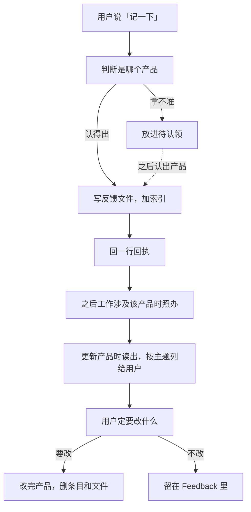
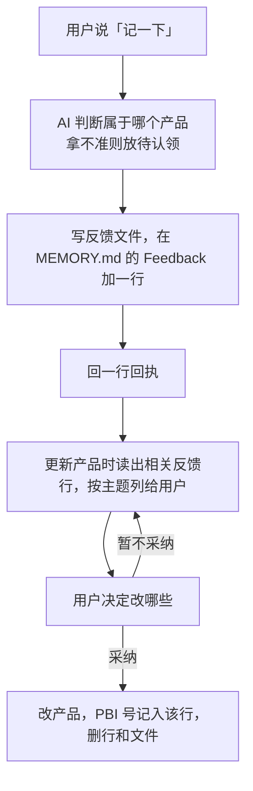
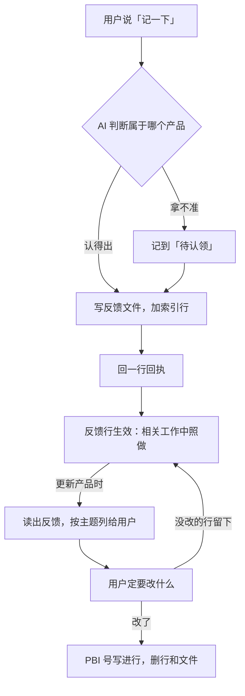
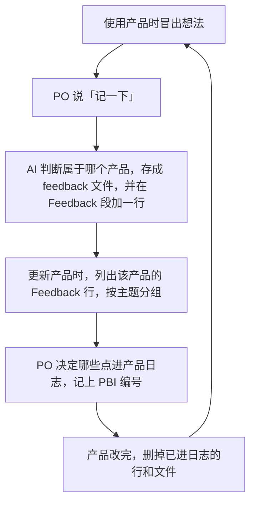
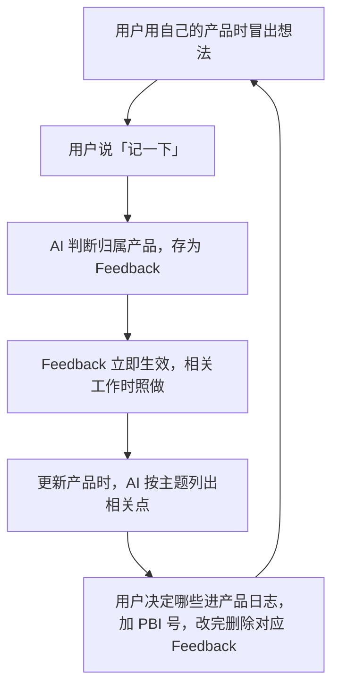
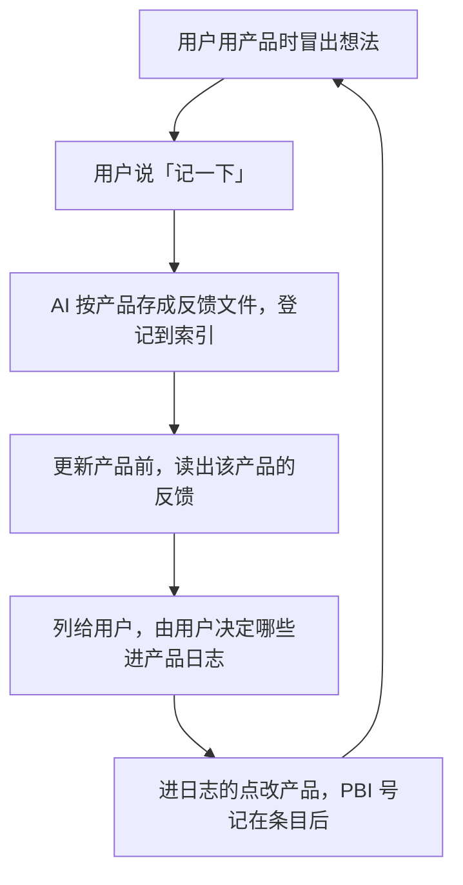
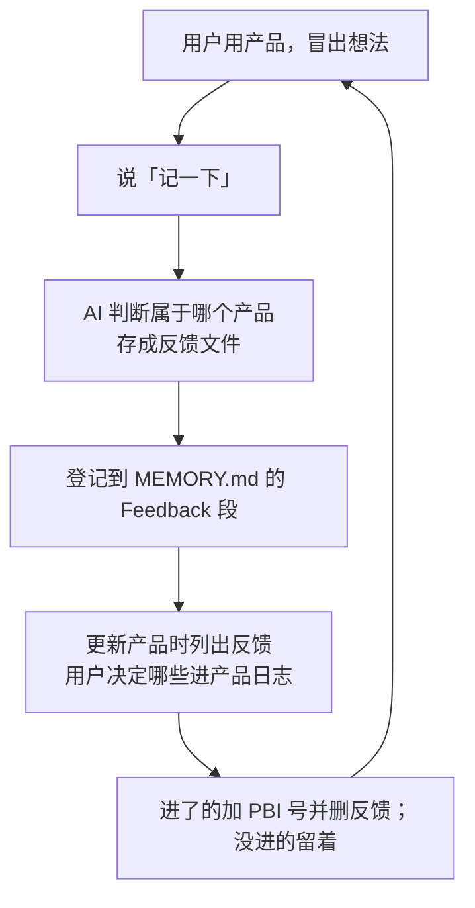
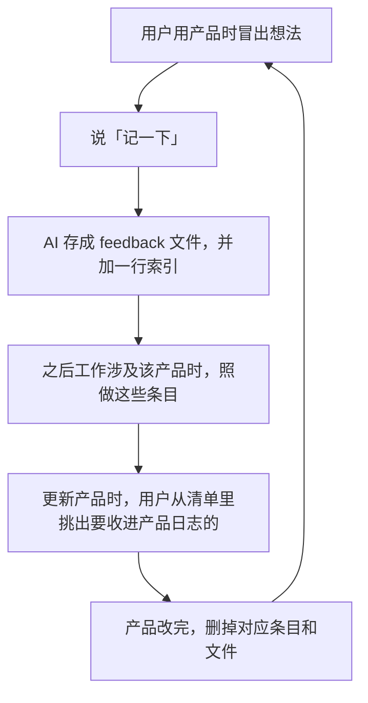
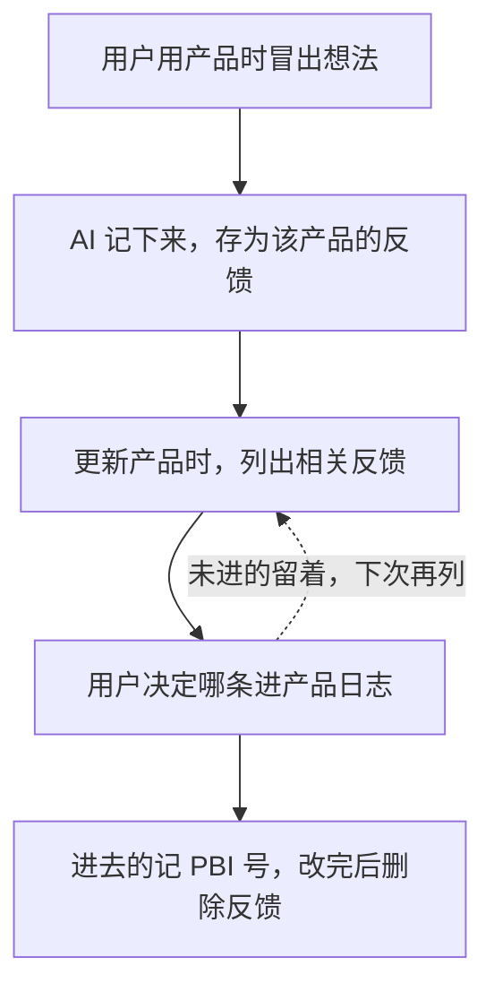

# 测试结果汇总（33 次 + 旁测 P1 3 次）

> 2026-11-11，design-feedback-loop 的 Test。判定标准在 `DesignBacklog.md` 第 5 章，测之前写定、出结果后不改；本文件只记结果和原文，最终判定和第 5 章结论由 Master 写。
> 原始输出（每次的回复、写出的文件、MEMORY.md）在仓库外：`S:\IDEO-Scrum-Archives\design-feedback-loop\raw\`。

## 跑法与环境

- 每次跑新建一个系统临时根目录，照 `prototype/sandbox.md` 建 `GlobalMemory/`；在临时项目文件夹里跑 `claude -p --model haiku`，`--disallowedTools Bash,PowerShell`，PreToolUse 守卫 hook 只允许写这次的临时根目录（守卫单独做过单元测试：根目录外的写入被拦，退出码 2）。用户级 CLAUDE.md 和已装的插件照常加载。
- **冒烟**：C1 先跑一次，通过（写进 IDEO-Scrum、回执一行、五项齐全、守卫拦住了根目录外的写入）。冒烟不计入 33 次。
- **偏离 1（@ 导入）**：临时项目 CLAUDE.md 用 `@` 导入两份文件时，在这台机器的无头模式下不加载（探针验证：纯文本 CLAUDE.md 会加载，`@` 绝对路径导入不会）。改为把 `feedback-section.md`（路径已换成临时 GlobalMemory）和临时 `MEMORY.md` 的内容直接内联进临时项目的 CLAUDE.md；测到的输入相同。
- **偏离 2（登录与 hook）**：子进程要剥掉桌面端管理的四个环境变量（`ANTHROPIC_BASE_URL`、`CLAUDE_CODE_PROVIDER_MANAGED_BY_HOST`、`CLAUDE_CODE_CHILD_SESSION`、`CLAUDE_CODE_HOST_AUTH_ENV_VAR`）才有登录态；另设 `CLAUDE_CODE_GIT_BASH_PATH` 供 hook 执行。

## 逐次结果

行为与内容分两栏。「回复行数」是最后一条回复里非空行的行数；「五项」= 日期、项目、逐字原话、当时在做什么、理解。

| 场景 | 次 | 行为：写到哪 | 行为：Feedback 行 | 行为：回执 | 行为：提问 | 行为：回复行数 | 内容：五项 |
| --- | --- | --- | --- | --- | --- | --- | --- |
| C1 | 1 | IDEO-Scrum | 有 | 记下了 · IDEO-Scrum · 可改 | 无 | 1 | 全 |
| C1 | 2 | IDEO-Scrum | 有 | 记下了 · IDEO-Scrum · 可改 | 无 | 1 | 全 |
| C1 | 3 | IDEO-Scrum | 有 | 记下了 · IDEO-Scrum · 可改 | 无 | 2（多一行 Note） | 全 |
| C2 | 1 | IDEO-Scrum | 有 | 记下了 · IDEO-Scrum · 可改 | 无 | 3（多文件路径两行） | 全 |
| C2 | 2 | IDEO-Scrum | 有 | 记下了 · IDEO-Scrum · 可改 | 无 | 2（多文件路径） | 全 |
| C2 | 3 | IDEO-Scrum | 有 | 记下了 · IDEO-Scrum · 可改 | 无 | 1 | 全 |
| C3 | 1 | 待认领 | 有 | 记下了 · 待认领 · 可改 | 无 | 2（多一句解释） | 全 |
| C3 | 2 | 待认领 | 有 | 记下了 · 待认领 · 可改 | 无 | 1 | 全 |
| C3 | 3 | 待认领 | 有 | 记下了 · 待认领 · 可改 | 无 | 3（多文件路径与解释） | 全 |
| C4 | 1 | IDEO-Scrum | 有 | 记下了 · IDEO-Scrum · 可改 | 无 | 1 | 全 |
| C4 | 2 | IDEO-Scrum | 有 | 记下了 · IDEO-Scrum · 可改 | 无 | 1 | 全（用「当时的情况」） |
| C4 | 3 | IDEO-Scrum | 有 | 记下了 · IDEO-Scrum · 可改 | 无 | 1 | 全 |
| C5 | 1 | IDEO-Scrum | 有 | 记下了 · IDEO-Scrum · 可改 | 无 | 1 | 全（用「当时情况」） |
| C5 | 2 | IDEO-Scrum | 有 | 记下了 · IDEO-Scrum · 可改 | 无 | 1 | 全 |
| C5 | 3 | IDEO-Scrum | 有 | 记下了 · IDEO-Scrum · 可改 | 无 | 3（多文件路径两行） | 全 |
| C6 | 1 | 无写入 | — | — | 无 | 多行 | 列出 3 + 1，未列 ClaudeDream，未写产品日志 |
| C6 | 2 | 无写入 | — | — | 有 | 多行 | 列出 3 + 1，未列 ClaudeDream，未写产品日志 |
| C6 | 3 | 无写入 | — | — | 有 | 多行 | 列出 3 + 1，未列 ClaudeDream，未写产品日志 |
| C7 | 1 | 无写入 | — | — | 无 | 1 | — |
| C7 | 2 | 无写入 | — | — | 无 | 1 | — |
| C7 | 3 | 无写入 | — | — | 有 | 多行 | — |
| C8 | 1 | ClaudeDream | 有 | 记下了 · ClaudeDream · 可改 | 无 | 1 | 全 |
| C8 | 2 | ClaudeDream | 有 | 记下了 · ClaudeDream · 可改 | 无 | 2（多一行英文说明） | 全 |
| C8 | 3 | ClaudeDream | 有 | 记下了 · ClaudeDream · 可改 | 无 | 1 | 全（用「情况」） |
| C9 | 1 | 无写入 | 没进 Feedback | — | 无 | 多行（说明这条规矩已在全局记忆里） | — |
| C9 | 2 | 无写入 | 没进 Feedback | — | 无 | 多行 | — |
| C9 | 3 | 无写入 | 没进 Feedback | — | 无 | 多行 | — |
| C10 | 1 | 无写入 | — | — | 无 | 多行 | 地图 6 框、0 个判断分支 |
| C10 | 2 | 无写入 | — | — | 有 | 多行 | 地图 17 框、4 个判断分支（B、C、F、N） |
| C10 | 3 | 无写入 | — | — | 有 | 多行 | 两张图共 18 框、4 个判断分支（B、C、D、Q） |
| C11 | 1 | 无新文件、无新行 | 没加行 | 已有这一条 · IDEO-Scrum · 补了原话 | 无 | 1 | 原话补进 `2026-11-10-map-rough.md` |
| C11 | 2 | 无新文件、无新行 | 没加行 | 已有这一条 · IDEO-Scrum · 补了原话 | 无 | 1 | 原话补进 `2026-11-10-map-rough.md` |
| C11 | 3 | 无新文件、无新行 | 没加行 | 已有这一条 · IDEO-Scrum · 补了原话 | 无 | 1 | 原话补进 `2026-11-10-map-rough.md` |

## 按六个设计问题的初步数字（按第 5 章标准字面）

| 问题 | 数字 | 字面初判 |
| --- | --- | --- |
| 1. 不说位置，记下的点更新时找得回来吗？ | C1、C2、C4、C8 12/12 写对；C3 3/3 进待认领；C5 3/3 进 IDEO-Scrum；C9 3/3 没进 Feedback。共 21/21 | 是 |
| 2. 一句话就完，不打断手上的活？ | C1–C5、C8、C11 的 21 次里，7 次回复不止一行（C1.3、C2.1、C2.2、C3.1、C3.3、C5.3、C8.2），0 次提问；C7 3/3 不写反馈 | 按「只有回执一行」字面：不是（7 次没做到）；若只看「不提问、不打断」：是。**要 Master 判定** |
| 3. 记完不查也靠得住、后来看得懂？ | 每个写出的文件五项齐全（部分用「当时情况」「情况」「我的理解」「会话所在项目」等同义写法）；每行 Feedback 都以产品名开头（C3 以「待认领」开头，与种子一致）；C11 3/3 不重复记 | 是 |
| 4. 更新时找全、读得懂、能定要改什么？ | C6 3/3：先读 Feedback 行与待认领，按主题列 3 + 1，不列 ClaudeDream 的，不擅自写产品日志 | 是 |
| 5. 换成别的产品照样能用吗？ | C3（MTGP）3/3、C8（ClaudeDream）3/3，均符合第 1 题 | 是 |
| 6. 记下的点，产品改之前就能照着做吗？ | C10 1/3 做到（C10.2、C10.3 画出了完整流程，框数和判断分支都超） | 不是 |

## 判不准或需要人看的原文

- **C9 三次都没有回执**：它把「以后派子代理都用 Haiku」认作已在全局记忆里的规矩，回复「这条规矩已经记过了……这次没有新增或改动文件」。按标准「不写进 Feedback 一节」算对，但它是否该写一条普通记忆，留给 Master 看。
- **C10.2 原文（节选）**：`B{"对照产品表（含别名）能对上哪个产品？"}`、`C{"是关于产品的意见，还是通用工作规则？"}`、`F{"## Feedback 里已有同一点？"}`、`N{"用户决定改不改"}`——四个判断分支，17 个框；它还在回复末尾提出两个设计问题（待认领何时归类、拿不准要不要先问）。
- **C10.3 原文（节选）**：画了两张图（记录反馈一张、更新时读取一张），共 18 个框、4 个判断分支；末尾问「这张图还没存成文件。要存的话……」。只有 C10.1 按「设计地图要粗」画成 6 个框、一个环。
- **C10.1 原文**：`地图只画现在发生什么：六个框，一个环。待认领、补原话这些分支没画，按地图的规矩不进图里。`
- **C11 的补充块**：只记了日期、项目、原话、理解，没写「当时在做什么」；第 5 章对 C11 没有五项要求。
- **C3 的回执**：写成「记下了 · 待认领 · 可改」，把「待认领」放在产品名的位置；与种子的标签写法一致。

## 旁测 P1（不计分，给 PBI-56 当证据）

在临时项目 `SeaPawn`（没有 `scrum/`，CLAUDE.md 留空，插件照常加载）里跑 3 次，提示原样：`我们用 IDEO 五阶段法研究一下这个问题：我每次开新会话都要先交代一遍背景，怎么才能少说几句？`

| 次 | 加载的技能 | 建了什么 | 结果一句话 |
| --- | --- | --- | --- |
| 1 | `ideo-scrum:ideo-kernel` | 无文件、无设计文件夹 | 在对话里按五个模式走：共情看记忆链路、定义要开场就知道背景、构思四条（设 autoMemoryDirectory 等）、原型、测试；没开设计冲刺，没提议开设计或开分支 |
| 2 | `ideo-scrum:ideo-kernel` | 无文件、无设计文件夹 | 同样在对话里按五个模式走，给了推荐的第一步；没开设计冲刺 |
| 3 | `ideo-scrum:ideo-kernel` | 无文件、无设计文件夹 | 同样按五个模式走；读了真项目记忆（只读），没写；没开设计冲刺 |

三次都**没有**加载 `design-kernel`，没有建 `scrum/design-*` 或 `DesignBacklog.md`，也没有提议开设计或开分支。

## 附：一份完整的 C6 回复（第一次）

> 下一期是 Sprint 08。我还没开，因为 Sprint 目标和入册的反馈要你定。
>
> **待定的反馈（IDEO-Scrum，3 条）**，按主题归在一起：
>
> - **设计阶段的产出粒度和方向**
>   - 构思：「四份方案都差不多，没发散开」（11-08）。隔离草图之前要先发散。
>   - 地图：「地图不该画这么细，应该粗一点」（11-10）。只画现在发生什么，五六个框。
>   - 设计目标：「目标说的是一种愿景，你这个带有很强的执行性」（11-11）。写为什么做、想到哪里，不写怎么做。
>
> **待认领（1 条）**
> - 报位置太长：「每次都要报一长串位置，太别扭」（11-11，会话在 MTGP，当时在用语音让 AI 记东西）。说不清是哪个产品，留在待认领。
>
> 请你定两件事：
> 1. 上面 3 条哪些进产品日志。我的建议是三条都进，同一主题。
> 2. Sprint 08 的目标。遗留 PBI 有 PBI-23（流程化参考与文件模板）、PBI-25（插件小修集合）、PBI-26（两轮进入执行的验证与改进）、PBI-12（方法论分享）。我的建议是以 PBI-26 为目标，因为它和 Stakeholder 的外部视角直接相关。
>
> 另外，产品日志原文在仓库的 `scrum/` 下，这个临时目录里只有 CLAUDE.md，所以我没读到 PBI 的原文，上面的遗留清单来自 Sprint 07 的蒸馏档案。你定了之后，我再读原文，按 scrum-master 的流程开 Sprint 08。

## 第二轮（2026-11-11/12，原型第二版，Haiku，33 次）

> 跑法、环境、种子与第一轮相同；P1 不重跑。判定标准不改。原型第二版只改了三条：回执只许一行；Feedback 行是马上生效的规矩、用到产品或它的方法时照做并点名；点进产品日志后标 PBI 号、产品改完才删。

| 场景 | 次 | 行为：写到哪 | 行为：Feedback 行 | 行为：回执 | 行为：提问 | 行为：回复行数 | 内容：五项 |
| --- | --- | --- | --- | --- | --- | --- | --- |
| C1 | 1 | IDEO-Scrum | 有 | 记下了 · IDEO-Scrum · 可改 | 无 | 1 | 全 |
| C1 | 2 | IDEO-Scrum | 有 | 记下了 · IDEO-Scrum · 可改 | 无 | 1 | 全 |
| C1 | 3 | IDEO-Scrum | 有 | 记下了 · IDEO-Scrum · 可改 | 无 | 1 | 全 |
| C2 | 1 | IDEO-Scrum | 有 | 记下了 · IDEO-Scrum · 可改 | 无 | 1 | 全 |
| C2 | 2 | IDEO-Scrum | 有 | 记下了 · IDEO-Scrum · 可改 | 无 | 1 | 全 |
| C2 | 3 | IDEO-Scrum | 有 | 记下了 · IDEO-Scrum · 可改 | 无 | 1 | 全 |
| C3 | 1 | 待认领 | 有 | 记下了 · 待认领 · 可改 | 无 | 1 | 全 |
| C3 | 2 | 待认领 | 有 | 记下了 · 待认领 · 可改 | 无 | 1 | 全 |
| C3 | 3 | 待认领 | 有 | 记下了 · 待认领 · 可改 | 无 | 1 | 全 |
| C4 | 1 | IDEO-Scrum | 有 | 记下了 · IDEO-Scrum · 可改 | 无 | 1 | 全 |
| C4 | 2 | IDEO-Scrum | 有 | 记下了 · IDEO-Scrum · 可改 | 无 | 1 | 全 |
| C4 | 3 | IDEO-Scrum | 有 | 记下了 · IDEO-Scrum · 可改 | 无 | 1 | 全 |
| C5 | 1 | IDEO-Scrum | 有 | 记下了 · IDEO-Scrum · 可改 | 无 | 1 | 全 |
| C5 | 2 | IDEO-Scrum | 有 | 记下了 · IDEO-Scrum · 可改 | 无 | 1 | 全 |
| C5 | 3 | IDEO-Scrum | 有 | 记下了 · IDEO-Scrum · 可改 | 无 | 1 | 全 |
| C6 | 1 | 无写入 | — | — | 无 | 多行 | 列出 3 + 1（第四条只提标题），未列 ClaudeDream，未写产品日志 |
| C6 | 2 | 无写入 | — | — | 无 | 多行 | 列出 3 + 1，未列 ClaudeDream，未写产品日志 |
| C6 | 3 | 无写入 | — | — | 无 | 多行 | 列出 3 + 1，未列 ClaudeDream，未写产品日志 |
| C7 | 1 | 无写入 | — | — | 有 | 多行 | — |
| C7 | 2 | 无写入 | — | — | 无 | 多行 | — |
| C7 | 3 | 无写入 | — | — | 无 | 多行 | — |
| C8 | 1 | ClaudeDream | 有 | 记下了 · ClaudeDream · 可改 | 无 | 1 | 全 |
| C8 | 2 | ClaudeDream | 有 | 记下了 · ClaudeDream · 可改 | 无 | 1 | 全 |
| C8 | 3 | ClaudeDream | 有 | 记下了 · ClaudeDream · 可改 | 无 | 1 | 全 |
| C9 | 1 | GlobalMemory 根（普通记忆） | 没进 Feedback | 记下了：子代理一律用 Haiku。 | 无 | 多行 | —（普通条目，不是反馈五项） |
| C9 | 2 | 无写入 | 没进 Feedback | — | 无 | 多行 | — |
| C9 | 3 | 无写入 | 没进 Feedback | — | 无 | 多行 | — |
| C10 | 1 | 无写入 | — | — | 无 | 多行 | 地图 10 框、2 处判断分支（B、H）、1 个环 |
| C10 | 2 | 无写入 | — | — | 无 | 多行 | 地图 7 框、1 处判断分支（F，两个出口）；点名「照 Feedback：设计地图要粗」 |
| C10 | 3 | 无写入 | — | — | 无 | 多行 | 地图 9 框、2 处判断分支（B、G）；点名照 Feedback |
| C11 | 1 | 无新文件、无新行 | 没加行 | 已有这一条 · IDEO-Scrum · 补了原话 | 无 | 1 | 原话补进 `2026-11-10-map-rough.md` |
| C11 | 2 | 无新文件、无新行 | 没加行 | 已有这一条 · IDEO-Scrum · 补了原话 | 无 | 1 | 原话补进 `2026-11-10-map-rough.md` |
| C11 | 3 | 无新文件、无新行 | 没加行 | 已有这一条 · IDEO-Scrum · 补了原话 | 无 | 1 | 原话补进 `2026-11-10-map-rough.md` |

### 按六个设计问题的数字（第二轮，按第 5 章标准字面）

| 问题 | 数字 | 字面初判 |
| --- | --- | --- |
| 1. 找得回来吗 | C1、C2、C4、C8 12/12 写对；C3 3/3 进待认领；C5 3/3 进 IDEO-Scrum；C9 3/3 没进 Feedback（其中一次写成普通记忆）。共 21/21 | 是 |
| 2. 一句话就完吗 | C1–C5、C8、C11 的 21 次全部只有回执一行，0 次提问；C7 3/3 不写反馈 | 是 |
| 3. 靠得住、看得懂吗 | 每个文件五项齐全（「当时的情况」「所在项目」等同义标签）；Feedback 行都以产品名开头；C11 3/3 不重复记 | 是 |
| 4. 更新时找全吗 | C6 3/3 列出 3 + 1，不列 ClaudeDream，不写产品日志；C6.1 的第四条只提标题没列内容 | 是（C6.1 留给人看） |
| 5. 换产品能用吗 | C3 3/3、C8 3/3 | 是 |
| 6. 产品改之前能照着做吗 | C10 0/3：第一张 10 框、两处判断分支（还写着「分支和解法先不画」）；第二张 7 框但有一处判断分支；第三张 9 框、两处判断分支。第二、三张都点名了「照 Feedback：设计地图要粗」 | 不是 |

### 判不准或需要人看的原文

- **C10 三张地图都超过「五六个框、一个环、没有判断分支」**：C10.1 十个框、B 和 H 两处分支，开头还写着「分支和解法先不画」；C10.2 七个框，F 一处两个出口；C10.3 九个框，B、G 两处分支。C10.2、C10.3 点名了「照 Feedback：设计地图要粗」，C10.1 没点名。三张的原文见下。
- **C6.1 的「待认领」那条只提了标题**（「另有一条『待认领：报位置太长』……我没列进来」），没列原话；C6.2、C6.3 列了原话。按「列出 3 + 1」字面，C6.1 是否算过，留给人定。
- **C9.1** 把「以后派子代理都用 Haiku」写成普通记忆（`GlobalMemory/subagents-use-haiku.md` 加索引行，不在 Feedback 一节），并试图更新 `S:\SeaPawn-Memory` 的真记忆被守卫拦下、没有绕过。按标准「写成普通记忆算对」，判对。
- **C7.1** 有提问（「哪个命令？」），C7.2、C7.3 也追问了命令名；C7 的标准只要求「不写反馈」，三次都没写。

### 附：C10 三张地图原文

C10.1：

C10.2：

C10.3：

### 附：一份完整的 C6 回复（第二轮第一次）

> 开冲刺前我先做了两件事，有一件卡住了。
>
> **卡住的：找不到 IDEO-Scrum 的产品日志。** 当前目录 `IDEO-Scrum` 里只有 `CLAUDE.md`，没有 `scrum/product-log.md`，在 `S:\SeaPawn-Memory` 和用户目录下也没搜到。Sprint 要从产品日志选 PBI，所以需要你告诉我 IDEO-Scrum 仓库的路径（或者日志在哪）。
>
> **已完成：IDEO-Scrum 的 Feedback 清单，待你定哪些进产品日志。** 三条都属于设计阶段的方法，可以归为一组：
>
> - **构思要先发散**（2026-11-08，SeaPawn 的 design-apikey）：隔离草图之前没有先发散，四份方案同质。
> - **设计地图要粗**（2026-11-10，SeaPawn 的 fact-first 设计）：地图只画现在发生什么，五六个框，分支和解法不进地图。
> - **设计目标写愿景**（2026-11-11，IDEO-Scrum 自己的设计）：目标写为什么做、想到哪里，不写怎么做。
>
> 另有一条「待认领：报位置太长」（2026-11-11，MTGP 语音记录场景），不属于 IDEO-Scrum，我没列进来。
>
> 这三条在你定进产品日志之前已经生效：碰到设计地图、构思或设计目标时，我会照做并点名。
>
> **开冲刺还需要你来定：**
> 1. IDEO-Scrum 仓库路径。
> 2. 这三条里哪些进产品日志。
> 3. Sprint Goal（PO 定）。
> 4. 要选的 PBI。

## 旁测 P2（不计分）：不往细里引时，地图收不收得住

提示（两组相同，原样）：`我们在做一个设计：用户用自己的产品时冒出想法，让 AI 记下来，更新产品时再拿出来用。帮我画一下这个设计的地图。`

- **P2**：测试用的全局记忆照 `sandbox.md`，不变。
- **P2 对照**：去掉 MEMORY.md 里「IDEO-Scrum：设计地图要粗」那一行和它的文件，其余不变。

| 组 | 次 | 框数 | 判断分支 | 点名那一行 | 备注 |
| --- | --- | --- | --- | --- | --- |
| P2（有那一行） | 1 | 6 | 0 | 有 | 一个环 |
| P2（有那一行） | 2 | 6 | 0 | 有 | 一个环 |
| P2（有那一行） | 3 | 6 | 0 | 有 | 一个环 |
| P2 对照（去掉那一行） | 1 | 6 | 0 | 有 | 一个环 |
| P2 对照（去掉那一行） | 2 | 6 | 0 | 有 | 一个环 |
| P2 对照（去掉那一行） | 3 | 5 | 0 | 有 | 一个环 |

**这组对照没隔开**：对照组的 `MEMORY.md` 那一行和文件都去掉了，六次里却没有一次画出分支，框数还是 5–6，而且每次仍点名「照 Feedback：设计地图要粗」——因为第二版的 `feedback-section.md` 在 **Use them now** 一条里就拿「照 Feedback：设计地图要粗」当例子，那句话本身就是提示。两组实际是同一条件；要真正对照，得把例子也换掉，或换成别的条目的例子。

**与 C10 对照**：C10 的提示自己列了一串步骤和分支（「AI 要判断是哪个产品、拿不准时放待认领、写文件、加索引、回一行回执；更新产品时再读出来」），地图就长成 7–10 个框、带判断分支；P2 的提示不列这些，六次都是 5–6 个框、没有分支。就这六次看，地图的粗细主要跟着用户的话走；这一行能把地图收在「只画现在发生的事」上，但收不过用户自己列出的步骤（P2 里模型还明确写了「分支和解法没画，等细化时再加」）。

### 六张地图原文

P2 第 1 次：

P2 第 2 次：

P2 第 3 次：

P2 对照 第 1 次：

P2 对照 第 2 次：

P2 对照 第 3 次：

