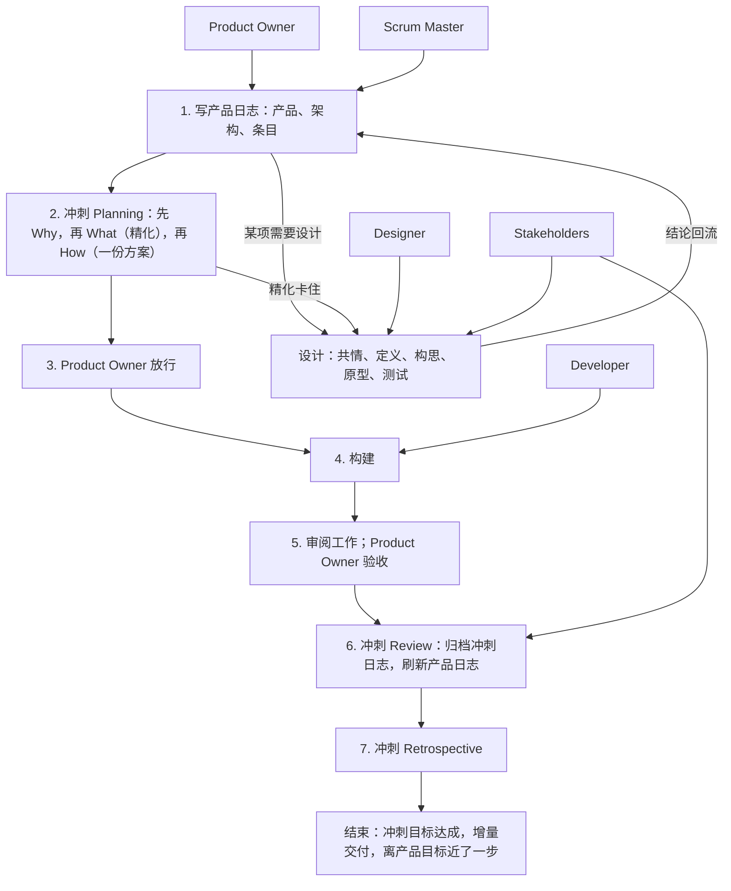

# scrum-kernel/conventions/overview.md 中文直译（供审阅）

原文：`S:\IDEO-Scrum\plugins\ideo-scrum\skills\scrum-kernel\conventions\overview.md`（109 行，v1，插件 5.1.0）
译法：直译，不改写、不增删、不按我的判断调整表述；术语沿用仓库现有叫法（产品日志 / 冲刺日志 / 设计日志 / 精化 / 增量 / 检查点 / Review / Retro）。
用途：你逐段批注，定稿后转交 IDEO-Scrum 的 Master。原文不动。

> 已按 2026-11-09 的审阅改过四处，逐条见同目录 `conventions-review-log.md`。

---

# 概览 —— 各部分如何拼在一起（v1）

> 这些是工作约定 v1——作者对 Scrum 与设计思维的理解，面向"单人 + AI 团队"。它们不如官方指南精确。当参考资料用：合适的照做，不合适的改掉，并记下原因。某条约定故意偏离官方指南的，会写明并给出理由。

> 出处：引自《Scrum Guide 2020》（Ken Schwaber & Jeff Sutherland）与《Scrum Guide Expansion Pack v2026.1》（Ralph Jocham、John Coleman、Jeff Sutherland），出现处有标注；其余是作者的工作约定。
> 许可：引文为 CC BY-SA 4.0（© 2020 Ken Schwaber 与 Jeff Sutherland；© 2025 Ralph Jocham、John Coleman、Jeff Sutherland）。

出处标签与短名见约定 13。

其余文件：`product-log.md` 与 `product-backlog-template.md`；`sprint-log.md` 与 `sprint-backlog-template.md`；设计相关的，见 `../design-kernel/conventions/design-log.md` 与 `../design-kernel/conventions/design-backlog-template.md`（以 `../` 开头的路径相对于 scrum-kernel 技能目录；设计那两份属于 design-kernel 技能，开设计时才去读）。

## 地图

## 各放在哪

1. **一份产品日志** —— *作者做法。* 每个项目，新的旧的，都从一份产品日志开始。
2. **冲刺与设计并排** —— *作者做法。* 产品日志之下，冲刺和设计平级并列：冲刺归 Developer，交付增量；设计归 Designer，交付原型与结论。某个条目需要设计、或冲刺精化卡住时，开设计；设计不属于冲刺。逐条判断是否需要设计；设计的结论仍要经由冲刺落地；增量不必是代码，完成定义说它是什么。
   *故意偏离 Scrum Guide*，后者说一切工作"发生在冲刺内"：设计不交付增量，可以跨多个冲刺，Designer 与 Developer 平级。
3. **三层** —— *作者做法。*

   | 层 | 文件 | 承诺 | 负责 | 主持 |
   | --- | --- | --- | --- | --- |
   | 1 | 产品日志 | 产品目标 | Product Owner，与 Scrum Master 一起 | — |
   | 2 | 冲刺日志 | 冲刺目标 | Developer | Scrum Master |
   | 2 | 设计日志 | 设计目标 | Designer | Scrum Master |
   | 3 | 增量：代码或文档，由完成定义决定 | 完成定义 | Developer | — |
   | 3 | 原型：存在设计文件夹里，永不进入增量 | 设计问题 | Designer | — |

   第三层不是日志，没有规定方法；它靠做事的人的本事。增量累加成产品；设计收尾时原型丢弃，只有学到的东西回流。
4. **文件夹** —— *作者做法。* `scrum/` 装全部 Scrum 工作：`ProductBacklog.md`；每个进行中的冲刺或设计一个文件夹——`sprint-NN-<后缀>/`，含其 `SprintBacklog.md` 与工作文件；`design-<后缀>/`，不编号，含其 `DesignBacklog.md` 与原型；以及 `documents/`（约定 5）。这是作者的布局；你的项目有自己的地方就用自己的。
5. **文件放哪** —— *作者做法。* 只服务某一个冲刺或设计的文件留在它自己的文件夹里，收尾时删除；git 会留着它。服务整个 Scrum 的文件放进 `scrum/documents/`，日志引用它：设计文档、背景材料、为产品日志写的长内容，以及收尾时做的归档——压缩后的冲刺日志与设计 Review。每次 Review 时看一眼 `scrum/documents/`，删掉过时的。项目自己的文档，比如用户手册或 API 说明，不在这些约定范围内；放在项目惯常放的地方，比如根目录的 `docs/`。
6. **名词** —— *作者做法。* 所有约定里用到的术语在此一次性定义：
   - **产品日志**是 Product Backlog，存在 `ProductBacklog.md`；**冲刺日志**是 Sprint Backlog，存在 `SprintBacklog.md`；**设计日志**存在 `DesignBacklog.md`——由模板做成的文件都取这些名字，不管模板叫什么；
   - **产品待办项（PBI）**是产品日志条目表里的一行；
   - **角色卡**是产品日志干系人表里的一行。

## 谁做什么

7. **角色** —— *作者做法。* 每个 AI 角色都先加载 ideo-kernel 技能，那是共用的工具箱。

   | 角色 | 主场 | 负责什么 | 加载的内核 |
   | --- | --- | --- | --- |
   | Product Owner | 产品日志与它的交接 | 价值方向；产品目标与冲刺目标；哪些条目进入冲刺；放行；与 Scrum Master 一起定条目 | —（是人） |
   | Scrum Master | 冲刺日志与设计日志 | 主持 Planning 与精化；记录；跟踪；审查 How 与增量；Product Owner 的秘书 | ideo、scrum、design |
   | Developer | 冲刺 | 冲刺日志、How、增量；精化里没有不清楚之处的最后一道检查 | ideo、scrum |
   | Designer | 设计 | 设计研究与原型；把结论送回产品日志与提出请求的冲刺 | ideo、design |
   | Stakeholder | 外部视角 | 照产品日志干系人表里的某一行来看；在 Review 时被召唤，或在 Product Owner 指定时做审查 | ideo |

   Product Owner、Scrum Master、Developer 一起维护冲刺日志；没有 Developer 时，Product Owner 与 Scrum Master 两人跑这个冲刺。
8. **只有 Product Owner 必须是人** —— *作者做法。* 其余角色都可以是 AI。*故意偏离 Scrum Guide Expansion Pack*，后者说 Product Owner 与 Scrum Master"必须是人""至少一名产品开发者应当是人"：这里是一个人跟 AI 合作，由他保留价值决策。
9. **问 Product Owner** —— *作者做法。* 谁拿不准就问 Product Owner，除非 Product Owner 已把这类问题指到别处。
10. **Product Owner 当 Developer** —— *作者做法。* Product Owner 动手构建时，以 Developer 的身份参与，How 与他一起定。

## 会话

11. **每个项目一个 Scrum Master** —— *作者做法。* 每个项目有一个会话当它的 Scrum Master，带自己的 Developer、Designer 与 Stakeholder。统辖多个项目的会话只做汇总；每个项目的事实留在自己的日志里。
12. **活怎么分** —— *作者做法。* Review 默认交给 Scrum Master（`sprint-log.md` 约定 16）。长期维护——看板、汇总、跟踪——交给一个常驻 Stakeholder 会话，用项目写下的工作身份。一两个文件的小改，Scrum Master 自己动手。构建交给新的 Developer 会话（当一段话就能交代清楚），或交给与 Scrum Master 共享上下文的 Developer（当这活需要大量讨论）；这样的 Developer 不能审自己的工作。

## 关于这些约定

13. **工作约定** —— *作者做法。* 是参考，不是法条。每条约定有一个短名，方便对话中用，并带一个出处标签：**作者做法**——作者怎么干；**补充**——作者助手推断的，尚未在实践中确认；**临场决定**——没有固定规矩，遇到再说。模板承载流程；约定文件说怎么做、以及哪一步可以跳过。它们描述角色与步骤，不描述任何工具的实现机制。
14. **修订何时生效** —— *作者做法。* 记下不合适的地方；改一次约定，从下一个冲刺起生效，绝不在冲刺中途改。
15. **模板记录产出** —— *作者做法。* 模板的章跟着流程走，每节只放那一步产生的东西；怎么做属于约定。由模板做成的日志保留模板的全部标题，包括后来才填的章，不自己另加节；备注写进 notes。

## 什么不变

16. **目标固定，计划灵活** —— *作者做法。* 每份日志有一个固定的承诺：产品目标、冲刺目标、设计目标；完成定义也不得削弱。承诺之下的一切——条目、精化点、验收标准、How、选定的设计方案——可以随着你的了解而变，每份日志记下变了什么、为什么。只有 Product Owner 改承诺，也只有 Product Owner 取消那些目标已经无法达成的冲刺。
    Scrum Guide 是这样说的。关于产品目标："They must fulfill (or abandon) one objective before taking on the next." 冲刺期间："No changes are made that would endanger the Sprint Goal""Quality does not decrease""Scope may be clarified and renegotiated with the Product Owner as more is learned." 还有："Only the Product Owner has the authority to cancel the Sprint."

## 对官方指南的偏离

每条理由见末列点名的约定。

| 这里 | 官方指南 | 见 |
| --- | --- | --- |
| 只有 Product Owner 必须是人 | SGEP：Product Owner 与 Scrum Master 必须是人，且至少一名产品开发者应当是人 | 约定 8 |
| 设计坐在冲刺旁边 | Scrum Guide：一切工作都在冲刺内发生 | 约定 2 |
| 条目编号，不排名 | Scrum Guide：产品待办是排序的 | `product-log.md` 约定 11 |
| Product Owner 与 Scrum Master 一起定条目 | Scrum Guide：开发者与产品负责人一起选条目 | `product-log.md` 约定 12 |
| How 是一份方案，构建要等放行 | Scrum Guide：怎么做由开发者决定 | `sprint-log.md` 约定 7 与 8 |
| 检查点取代每日站会 | Scrum Guide：面向开发者的每日活动 | `sprint-log.md` 约定 10 |
| 必须有审阅者 | Scrum Guide：开发者自己注入质量 | `sprint-log.md` 约定 16 |
| 冲刺没有结束日期 | Scrum Guide：固定长度，一个月以内 | `sprint-log.md` 约定 2 |
| 收尾的日志存进 `scrum/documents/` | — | 约定 5 |

---

## 翻译时我注意到、但按"直译"没有改的地方

放着备查，你说改不改；不改就是照原样。

| 位置 | 原文 | 我的疑问 |
| --- | --- | --- |
| 开头两段 | 两段都是 blockquote | 出处和许可是注释性质，跟"工作约定"那段并列成同一种引用块，读起来分不出层次 |
| 约定 2 | "an Increment need not be code — the Definition of Done says what it is" | 跟约定 3 的表格重复表达了一次 |
| 约定 10 | "the How is worked out with them" | them 指 Product Owner；中文"与他一起定"是我按上下文补的，原文没说清楚对象 |
| 约定 12 | "A small edit to one or two files the Scrum Master makes itself" | 原文语序倒装，直译后中文略拗口 |
| 约定 16 引文 | 四条英文原文 | 引文没译，因为它们是 SGEP 的原文引用，翻译会失去可核对性。要不要附中译另说 |
