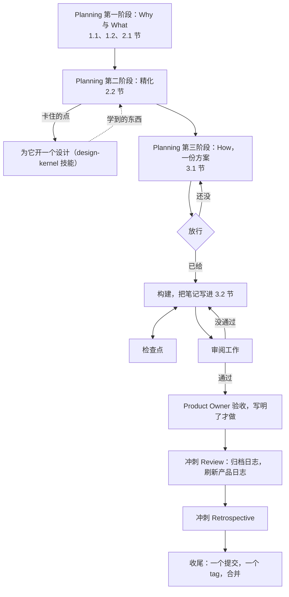

# 冲刺日志约定（v1）——中文直译

原文：`plugins/ideo-scrum/skills/scrum-kernel/conventions/sprint-log.md`（86 行，插件 5.1.0）
译法：直译，术语同 `conventions-overview-zh.md`。原文不动。
用途：PO 在这份上批注；定稿后由 IDEO-Scrum 的冲刺照着改原文。

## 本轮（2026-11-09）按 PO 批注改的地方

| 位置 | 改了什么 |
|---|---|
| 约定 3 目标固定 | "与 Product Owner 重新谈"→"与 Product Owner 或 Scrum Master" |
| 约定 3 目标固定 | 删掉"笔记只增不减"这条硬规定 |
| 约定 5 第一阶段 | "什么都挑不出来"→"目标都定不出来"；补 IDEO 是基础、结果要与 Master 和 Developer 同步 |
| 约定 16 必须有审阅者 | 把"Master 自己构建"和"Developer 与 Master 共享上下文"分成两种情形，后者仍由这个 Master 审 |
| 约定 18 Review | 补"把整个 `scrum/` 过一遍"；调整删文件与移日志的顺序；"第 4 章"注明是 Review 章 |
| 约定 20 收尾提交 | "主要是产品日志"→直接说看 `scrum/` 就够 |
| 约定 9 边做边记 | 删掉"每行给日期、做了什么、决定及理由、证据、下一步"这条格式规定；改成 3.2 就是写笔记，想写什么写什么；How 本身也是笔记，3.2 可以是 How 的细化 |

没改：约定 21「冲刺目标过时→只有 Product Owner 能取消冲刺」按原文保留（PO 确认没写错）。

---

# 冲刺日志约定（v1）

> 工作约定 v1：是参考，不是法条——合适的照做，不合适的改掉，并记下原因。出处标签及其余：`overview.md` 约定 13。

> 出处：引自《Scrum Guide 2020》（Ken Schwaber & Jeff Sutherland），出现处有标注。
> 许可：引文为 CC BY-SA 4.0（© 2020 Ken Schwaber 与 Jeff Sutherland）。

冲刺把选中的条目变成增量。它的模板是 `sprint-backlog-template.md`；每一节的注释写明谁来写。

## 开一个冲刺

1. **一条分支，一个文件夹** —— *作者做法。* 每个冲刺一条分支，需要的话加一份独立工作副本，一个文件夹 `scrum/sprint-NN-<后缀>/`：两位数字——上一个冲刺的数加一，从 01 起——加一个说明这个冲刺做什么的后缀。文件夹的名字也是分支的名字，收尾时也是 tag 的名字。
2. **没有结束日期** —— *作者做法。* 冲刺在目标达成、或 Product Owner 叫停时结束。*故意偏离 Scrum Guide*，后者说冲刺是"长度固定、一个月或更短的事件"：AI 按会话干活，所以拖长的冲刺由 Product Owner 在检查点盯着。
3. **目标固定，计划灵活** —— *作者做法。* 冲刺目标和完成定义不动。How 随时可以改；精化点和验收标准可以与 Product Owner 或 Scrum Master 重新谈。每次改动和原因写进笔记（`overview.md` 约定 16）。
4. **小活，小冲刺** —— *作者做法。* 半小时到一次会话的活也开一个冲刺，每一步缩成一两行；放行、审阅、收尾照样走。

## Planning

5. **第一阶段：Why 与 What** —— *作者做法。* Product Owner 主持，通常与 Scrum Master 一起。定冲刺目标，用 Product Owner 自己的笔法起草；选条目，把每条原样抄进 2.1 节，五列——编号、标题、用户故事、位置、规模；挑出在意的完成定义条目。产品日志里没有的条目，先补进去。目标都定不出来时，用 IDEO 的方法引导选择；遇到难点时也可以用——IDEO 是所有的基础。结果出来后，与 Scrum Master 和 Developer 都同步。
6. **第二阶段：精化** —— *作者做法。* Scrum Master 与 Product Owner 主持；Developer 加入。用七步（`product-log.md` 约定 15），把定下来的东西、谁定的、验收标准、以及怎么测，写进 2.2 节。需要调研的点变成一个设计。最后，Developer 确认没有不清楚的地方。
7. **How 是一份方案，不是步骤** —— *作者做法。* Developer 写进 3.1 节：按顺序的工作条目，每条在一个会话内做完，每条写产出和怎么判断做完了；关键选择及其理由；已知风险和未决点。不写逐步操作，不写文件内容，不把方案打磨光：能写出步骤，就去做。Scrum Guide 的尺子是"把产品待办项拆成一天或更小的条目"，这里改成一次会话。*故意偏离 Scrum Guide*，后者说怎么建"完全由开发者自行决定"：Scrum Master 和 Product Owner 要看这份方案，因为 AI 会跑偏。
8. **放行** —— *作者做法。* 构建在 Product Owner 放行之后才开始；批准一份方案不等于放行。放行写进 3.1 节的最后一行，带日期和放行范围：提交、合并、打 tag、发布、推送。Product Owner 可以把 How、新结构、全文的审阅交给 Scrum Master；交接写在日志里。

## 构建

9. **边做边记** —— *作者做法。* 3.2 节是完整记录，好让一个新会话只凭日志就能接手这个冲刺。接手冲刺的会话照笔记走，不重新推一遍。
   3.2 就是写笔记，想写什么写什么，不规定成"做了什么"那种流水账。How（3.1）本身也是笔记，3.2 可以写成 How 的细化。
10. **检查点，不是站会** —— *作者做法。* 不固定在某个钟点，AI 停下来问 Product Owner，或者 Product Owner 来问进展；两种都行，都对照冲刺目标核工作。*故意偏离 Scrum Guide*，后者说每日站会是"面向开发者的 15 分钟事件"：AI 按会话干活，不按天。
11. **新活要登记** —— *作者做法。* 新活先作为条目进产品日志；Product Owner 决定它进不进这个冲刺。范围可以重新谈；冲刺目标不变。
12. **先结构，后全文** —— *作者做法。* 新的模板或结构，先把章节目录单独拿给审阅的人看（约定 8），再写全文。
13. **全文供审阅** —— *作者做法。* 新的长期文档的全文——逐字，不是提纲——放到审阅者（约定 8）能批注的地方，附上你发现的问题和每条的建议；批准之后才改源文件。以盘上的版本为准：覆盖之前先读。
14. **日志就是交接** —— *作者做法。* 不另写交接文档：会话结束或上下文被压缩之前，把要紧的写进日志，提交，停在一个完整的点上。
15. **测试：先定标准** —— *作者做法。* 跑之前先把测试方法和过线标准提交进 2.2 节；看到结果之后不改；脚本判错的调用逐条核，并写下原因。

## 审阅与验收

16. **必须有审阅者** —— *作者做法。* 由构建者以外的人审：默认是 Scrum Master，Product Owner 指定时也可以是 Stakeholder 或一个全新子代理。指定为审阅者的 Stakeholder 拿完成定义和验收标准逐条核。有两种情形要分清：Scrum Master 自己参与了构建时，必须由全新子代理审，只核做得对不对；Developer 与 Scrum Master 共享上下文（比如从 Master fork 出来的会话）时，仍由这个 Scrum Master 审，把他当独立的 Master 看待——共享上下文不等于同一个人。当然，这时也可以委任子代理去审，不影响。给审阅子代理交代：任务、项目的规矩、已经发出的决定。Scrum Master 可以派子代理读长 diff，结论仍由自己下。*故意偏离 Scrum Guide*，后者说开发者负责"遵守完成定义以注入质量"：Developer 会跑偏，第二双眼睛能抓住。
17. **写明了才验收** —— *作者做法。* 正式验收只在完成定义或验收标准要求时才做；有时看一眼就够了。

## 收尾

18. **Review** —— *作者做法。* 准备增量、逐条对照完成定义和验收标准、产品日志的改动、Retrospective 的输入。把日志压缩到关键决定、写第 4 章（Review 章），改名为 `sprint-NN-<后缀>.md` 移到 `scrum/documents/`，然后删掉其余工作文件。看一眼 `scrum/documents/`，删掉过时的（`overview.md` 约定 5）；刷新产品日志（`product-log.md` 约定 17），并把整个 `scrum/` 文件夹过一遍，保持整体新鲜健康。要外部视角时，由 Product Owner 或 Scrum Master——绝不是构建者——从产品日志的表里召唤 Stakeholder。
19. **Retrospective** —— *作者做法。* 日志没有 Retrospective 章。Developer 把教训写进项目的记忆或指令文件，写成原则——什么坏了、为什么、规矩是什么——好让不在场的人也能用。特别好的改进，经 Product Owner 同意后写进完成定义。检查产品日志是否还新鲜。
    *补充：* 问一问 Product Owner 在哪里被 AI 挡住了——等一个决定、等一个放行。
20. **一个收尾提交** —— *作者做法。* 按这个顺序收尾：
    1. 收尾提交之前，全项目搜一遍旧路径，搜到没有为止；修的地方进同一个提交。
    2. 做一个提交，装下 Review 和 Retrospective。
    3. 用冲刺文件夹的名字打 tag；tag 的说明写这个冲刺达成了什么。
    4. 合并进主分支。
    5. 关掉工作副本。
    6. 删掉同名分支。

    判断项目健不健康看 `scrum/` 就够——产品日志、各类日志、`documents/`、看板都在里面；其余地方通常只有 README 需要更新。推送和别的对外动作要 Product Owner 同意。

## 事情变了怎么办

21. **特殊情况** —— *作者做法。*

    | 情况 | 怎么办 |
    | --- | --- |
    | 审阅或验收没过 | 写下缺什么，回到构建 |
    | 团队外的东西挡住了 | Scrum Master 立刻告诉 Product Owner |
    | 精化卡住 | 为它开一个设计；冲刺其余部分照走 |
    | 冲刺中途有东西可以发布了 | 发；冲刺不因此结束 |
    | 收尾时条目没做完 | 回产品日志；不结转 |
    | 冲刺目标过时了 | 只有 Product Owner 能取消冲刺 |
    | 活很小 | 开一个小冲刺（约定 4） |

---

## 翻译时我注意到、但按"直译"没有改的地方

| 位置 | 问题 |
| --- | --- |
| 约定 20 第 1 步 | 「搜到没有为止」——AI 执行时没有终止条件，实际要靠人判断 |
| 约定 7 | 「能写出步骤，就去做」直译后语气很冲，原文 `if you can write the steps, do the work` 也是这个强度 |
| 约定 4 小活小冲刺 | PO 提到"小冲刺可以不建那么多角色"。已由 `overview.md` 约定 7 末句覆盖（没有 Developer 时 PO 与 SM 两人跑），故此处不重复 |
