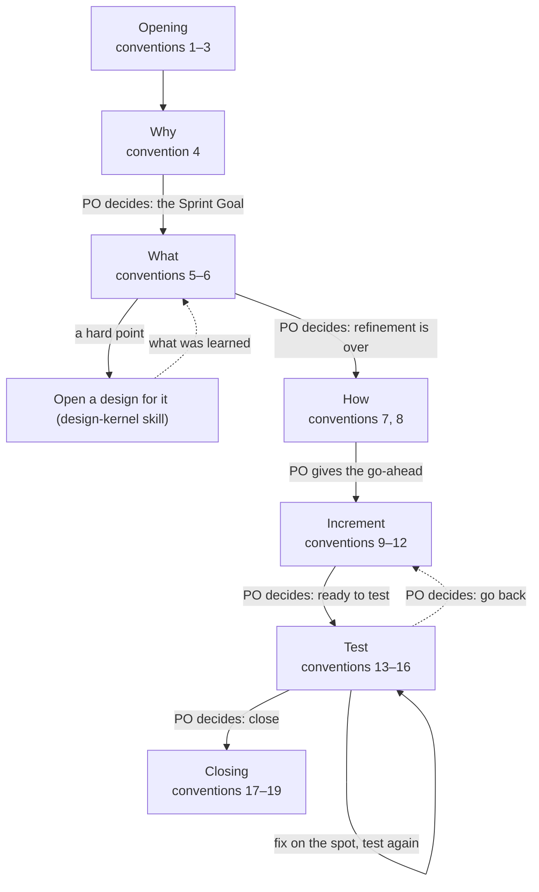
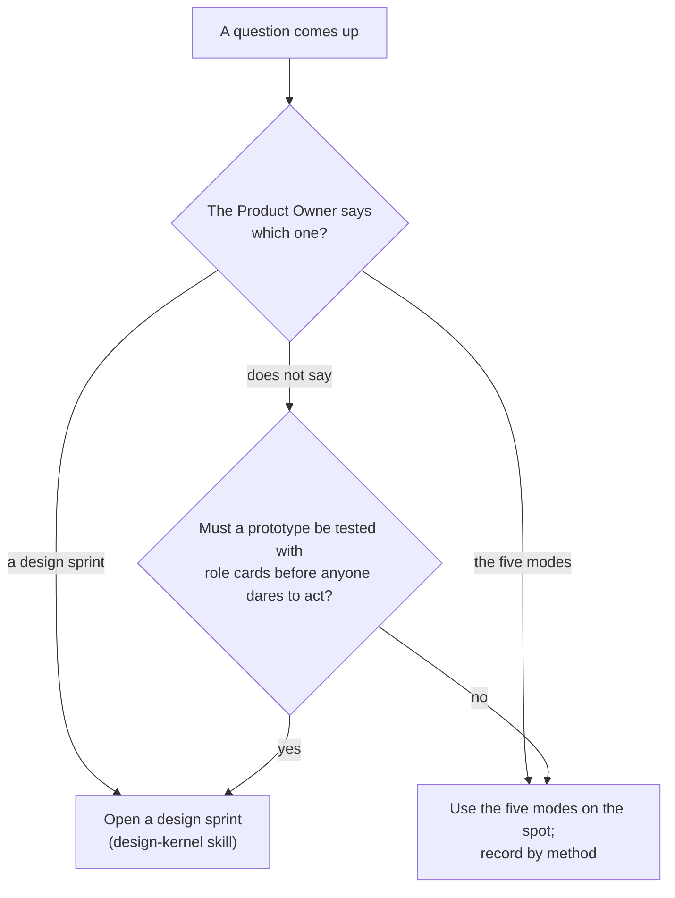
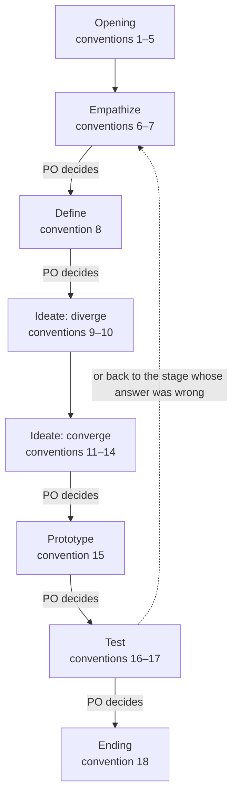

# Sprint 17 大纲（送 Master 审）

> 照 sprint-log 第 11 条：新写或重写的文件先给大纲——图和每条一行，同意了再写全文。模板另给章节清单。
> 图一律 `flowchart TD`；条号是现行的号，标「新」的排在末尾，不重排；标「改」的只换那一条的正文。

## 1. `sprint-kernel/conventions/sprint-log.md`

Throughout 20–26（图不变，只把贯穿全程的范围写到 26）。

| 条 | 短名 | 动 |
| --- | --- | --- |
| 1 | One branch, one folder | 不动 |
| 2 | No end date | 不动 |
| 3 | Small work, small Sprint | 不动 |
| 4 | Set the Sprint Goal | 不动 |
| 5 | Select the items | 改（54 ④）：照抄进 2.1 时对照 Sprint Goal 查够不够，缺就增、多就减 |
| 6 | Refine in seven steps | 不动 |
| 7 | How is a plan, not steps | 不动 |
| 8 | Go-ahead | 不动 |
| 9 | Notes as you go | 不动 |
| 10 | Checkpoints, not stand-ups | 改（54 ②）：写明什么算卡住——等一个只有 PO 能给的决定、缺一个只有 PO 能给的信息、外部阻塞；其余算计划内的调整 |
| 11 | Outline before full text | 不动 |
| 12 | Full text for review | 不动 |
| 13 | Tests: criteria first | 不动 |
| 14 | A reviewer is required | 改（46 ③）：工具没有子代理时，开一个新的会话、只给简报，就是全新子代理；fork 不算；标明只查过 `codex-cli 0.167.0` 的 help |
| 15 | Product Owner acceptance when written | 不动 |
| 16 | Record the tests | 不动 |
| 17 | Review | 改（54 ③）：怎么判过时——现在不真了，或现在没人要读（历史在 git） |
| 18 | Retrospective | 不动 |
| 19 | One closing commit | 不动 |
| 20 | Goal fixed, plan flexible | 不动 |
| 21 | New work gets registered | 不动 |
| 22 | The log is the handoff | 改（54 ①）：日志头部一行 Now，记当前阶段和最后一个 PO 的决定；接手先读它 |
| 23 | Special cases | 不动 |
| 24 | The Product Owner decides at the end of each stage | 不动 |
| 25 | Ask the PO | 不动 |
| 26 | Developer in another tool | 新（53）：写成角色和步骤——谁在什么时候做什么；工具做法只当例子 |

## 2. `sprint-kernel/conventions/sprint-backlog-template.md`

章节清单（不增不减）：

- 头部：Started… 一行（不动）；**加一行 Now**（54 ①）
- 1. Why — 1.1 Sprint Goal；1.2 Definition of Done
- 2. What — 2.1 Product Backlog Items；2.2 Refinement
- 3. How
- 4. Increment notes
- 5. Test

注释改一处：头部 Now 行的注释指向第 22 条。第 2 章注释不改（54 ④ 的规矩在第 5 条，不在模板里重写）。

## 3. `scrum-kernel/conventions/product-log.md`

只动两条，不重画图：

| 条 | 动 |
| --- | --- |
| 12 Items with the Scrum Master | 改（54 ④）：那句「The measure is the Sprint Goal…」收成指向 sprint-log 第 5 条——查够不够的规矩只写一处 |
| 17 Fresh at every Review | 改（54 ③）：删「怎么判过时」的隐含说法，指向 sprint-log 第 17 条 |

## 4. `scrum-kernel/overview.md`

只动一条：第 14 条 Who gets which work 加一句指向 sprint-log 第 26 条（Developer 在别的工具里时怎么协作）。第 15 条不动，但 53 的写法照它——不写工具操作。

## 5. `ideo-kernel/SKILL.md`

加一行（Master 必补）：在「The Shared Toolbox」一节末尾，指向新约定——一个小问题就地用五模式还是开设计冲刺，见 `conventions/design-sprint-or-five-modes.md`。

## 6. `ideo-kernel/conventions/design-sprint-or-five-modes.md`（新）

| 条 | 短名 | 内容 |
| --- | --- | --- |
| 1 | Design sprint or the five modes | 用哪种由 PO 指定；PO 没指定时按默认分：要先做原型、拿角色卡测过才敢动手的开设计冲刺，其余就地用五模式、按方法记录。设计冲刺重；五模式是基础、规矩少。聊着聊着碰到要研究的事，当场开设计——聊天已算共情材料 |

## 7. `design-kernel/conventions/design-log.md`

图下加一段导读「The three loops」（58 ④，不编号）：共情和定义人进 AI 出；发散和收敛 AI 做、人选；原型和测试可以自动跑。

Throughout 19–26。

| 条 | 短名 | 动 |
| --- | --- | --- |
| 1 | Open a design for a question with no ready answer | 改（56）：先分设计冲刺还是五模式（ideo-kernel 的约定，第 1 条），要开冲刺的才开设计 |
| 2 | Hard point, not the whole item | 不动 |
| 3 | Who | 改（58 ⑤）：一个 Designer 常常就够；兼不兼 Master 由 PO 定 |
| 4 | Branch | 改（58 ⑥）：设计一开就开分支；现场定的只是从哪里开 |
| 5 | Open a design | 不动 |
| 6 | Start from the people | 改（58 ②）：设计目标写愿景——为什么做、想到哪，不写怎么做 |
| 7 | Experts when needed | 不动 |
| 8 | Map and questions in the log | 改（58 ①）：地图只画现在发生的事——五六个框、一个环；分支和方案不进地图 |
| 9 | Lightning Demos | 改（58 ⑧）：每份草图给不同的一部分，或先画再看 |
| 10 | Diverge before you converge | 不动 |
| 11 | Isolated solutions | 改（58 ③ 主对话陪 PO 聊、没想法就替他画一份、全部合并后再收敛；58 ⑦ 全新非 fork、简报只给第 1、2 章和收集的点子、局限写明） |
| 12 | Choosing is the key step | 不动 |
| 13 | Combine or rumble | 不动 |
| 14 | Storyboard | 不动 |
| 15 | Just enough prototype | 不动 |
| 16 | Role-card test | 不动 |
| 17 | Write the criteria before the test | 不动 |
| 18 | When the design ends | 不动 |
| 19 | IDEO in every stage | 不动 |
| 20 | Ask the PO | 不动 |
| 21 | Five chapters, not five days | 不动 |
| 22 | Renamed terms | 不动 |
| 23 | Resume from the header | 不动 |
| 24 | Goal fixed, plan flexible | 不动 |
| 25 | Gates between stages | 不动 |
| 26 | A small design is still a design | 改（56）：小问题用五模式（ideo-kernel 的约定，第 1 条），不是小设计；PO 开的设计再小也照走五阶段 |

## 8. `design-kernel/conventions/design-backlog-template.md`

章节清单（不增不减）：

- 头部（Opened、Now、Ends、Methods、How to write）
- 1. Empathize — 1.1 Challenge；1.2 Design goal；1.3 Design questions
- 2. Define — 2.1 Map；2.2 How Might We
- 3. Ideate — 3.1 Solution；3.2 Storyboard (optional)
- 4. Prototype — 各部分表
- 5. Test

注释改两处：1.2 加「写愿景，不写怎么做」；2.1 加「只画现在发生的事，五六个框、一个环，分支和方案不进地图」。

## 待 Master 定的五处

1. **58 ④ 三个环**：我建议放图下的一段导读、不编号（它讲谁进谁出，不是步骤）。另一条路是 Throughout 新增一条，12–26 要顺延。
2. **58 ③ 主对话**：我建议并进第 11 条（同一时刻、两拨人），不动号；另一条路是单开一条，12–26 顺延。
3. **54 ③ 的「过时」定义**：我建议写进 sprint-log 第 17 条，product-log 第 17 条指向；反过来也行，只写一处。
4. **53 的落点**：我建议 sprint-log 第 26 条 + overview 第 14 条指向；命令里不写（命令归 Sprint 16 改加载）。
5. **56 改不改描述**：我建议两处都改一句——ideo-kernel 的 description 加「聊天里的小问题就地用五模式」，design-kernel 的 description 加「小问题不是设计冲刺」；改了就把触发测试排进第 10 项（基线是 Sprint 16 合入后的 main）。只改一处也行。
