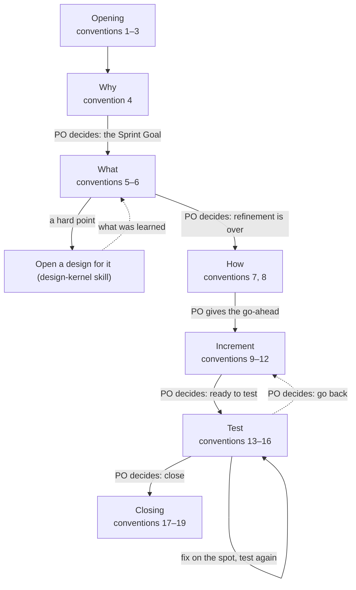
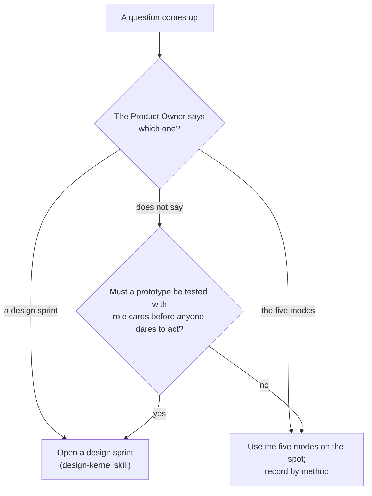
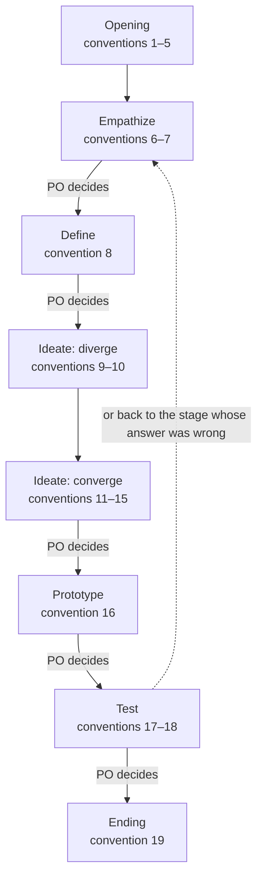

# Sprint 17 大纲（送 Master 审；2026-11-12 按 Master 的定案改过）

> 照 sprint-log 第 11 条：新写或重写的文件先给大纲——图和每条一行，同意了再写全文。模板另给章节清单。
> 图一律 `flowchart TD`；条号是现行的号。Master 已定：56 不改描述；46 ③ 的定义放 overview 第 7 条；58 ③ 拆开；58 ④ 放导读；54 ③ 定义放 sprint-log 17；53 放 sprint-log 26。

## 1. `sprint-kernel/conventions/sprint-log.md`

Throughout 20–26（图不变）。

| 条 | 短名 | 动 |
| --- | --- | --- |
| 1 | One branch, one folder | 不动 |
| 2 | No end date | 不动 |
| 3 | Small work, small Sprint | 不动 |
| 4 | Set the Sprint Goal | 不动 |
| 5 | Select the items | 改（54 ④）：照抄进 2.1 时对照 Sprint Goal 查够不够，缺就增、多就减 |
| 6 | Refine in seven steps | 改（56 的连带）：第 4 步的「which opens a design」改成指向 ideo-kernel 的约定第 1 条，不重复分界 |
| 7 | How is a plan, not steps | 不动 |
| 8 | Go-ahead | 不动 |
| 9 | Notes as you go | 不动 |
| 10 | Checkpoints, not stand-ups | 改（54 ②）：什么算卡住——等一个只有 PO 能给的决定、缺一个只有 PO 能给的信息、外部阻塞、同一个做法试了两次都不行、照现在的 How 看不出怎么达成 Sprint Goal；其余算计划内的调整 |
| 11 | Outline before full text | 不动 |
| 12 | Full text for review | 不动 |
| 13 | Tests: criteria first | 不动 |
| 14 | A reviewer is required | 不动（「全新子代理」的定义放 overview 第 7 条，46 ③） |
| 15 | Product Owner acceptance when written | 不动 |
| 16 | Record the tests | 不动 |
| 17 | Review | 改（54 ③）：怎么判过时——现在不真了，或现在没人要读（历史在 git） |
| 18 | Retrospective | 不动 |
| 19 | One closing commit | 不动 |
| 20 | Goal fixed, plan flexible | 不动 |
| 21 | New work gets registered | 不动 |
| 22 | The log is the handoff | 改（54 ①）：日志头部一行 Now，记当前阶段和最后一个 PO 的决定；接手先读它 |
| 23 | Special cases | 不动 |
| 24 | The Product Owner decides at the end of each stage | 不动 |
| 25 | Ask the PO | 不动 |
| 26 | Developer in another tool | 新（53）：写成角色和步骤——谁在什么时候做什么；工具做法只当例子 |

## 2. `sprint-kernel/conventions/sprint-backlog-template.md`

章节清单（不增不减）：

- 头部：Started… 一行（不动）；**加一行 Now**（54 ①，注释指向第 22 条）
- 1. Why — 1.1 Sprint Goal；1.2 Definition of Done
- 2. What — 2.1 Product Backlog Items；2.2 Refinement
- 3. How
- 4. Increment notes
- 5. Test

第 2 章注释不改（54 ④ 的规矩在第 5 条，不在模板里重写）。

## 3. `scrum-kernel/conventions/product-log.md`

只动三条，不重画图：

| 条 | 动 |
| --- | --- |
| 2 Blank page | 改（56 的连带）：加一句指向 ideo-kernel 的约定第 1 条；白纸仍是设计冲刺，不冲突 |
| 12 Items with the Scrum Master | 改（54 ④）：那句「The measure is the Sprint Goal…」收成指向 sprint-log 第 5 条 |
| 17 Fresh at every Review | 改（54 ③）：删「怎么判过时」的隐含说法，指向 sprint-log 第 17 条 |

## 4. `scrum-kernel/overview.md`

动三条：

| 条 | 动 |
| --- | --- |
| 2 Sprints and designs side by side | 改（56 的连带）：加一句指向 ideo-kernel 的约定第 1 条——要不要开设计冲刺由它分 |
| 7 Names | 改（46 ③）：定义「全新子代理」——只从简报起步；fork 出来的、复制出来的都不算；工具没有子代理时，开一个只给简报的新会话 |
| 14 Who gets which work | 改（53）：加一句指向 sprint-log 第 26 条 |

## 5. `ideo-kernel/SKILL.md`

两处：

- 「The Shared Toolbox」一节末尾加一行（Master 必补）：指向 `conventions/design-sprint-or-five-modes.md`。
- Use Protocol 第 6 条（56 的连带）：要不要整个设计，见本技能 `conventions/` 第 1 条。

## 6. `ideo-kernel/conventions/design-sprint-or-five-modes.md`（新）

| 条 | 短名 | 内容 |
| --- | --- | --- |
| 1 | Design sprint or the five modes | 用哪种由 PO 指定；PO 没指定时按默认分：要先做原型、拿角色卡测过才敢动手的开设计冲刺，其余就地用五模式、按方法记录。设计冲刺重；五模式是基础、规矩少。聊着聊着碰到要研究的事，当场开设计——聊天已算共情材料（PO 原话，保留） |

## 7. `design-kernel/conventions/design-log.md`

图下加一段导读「The three loops」（58 ④，不编号）：共情和定义人进 AI 出；发散和收敛 AI 做、人选；原型和测试可以自动跑——PO 可以把这两段之间的阶段决定交给 Scrum Master（overview 第 12 条），这样两段就能自己往下跑。**这一处与 PO 原话的差别列进全文的问题与建议，停点 ② 请 PO 看。**

Throughout 20–27。

| 条 | 短名 | 动 |
| --- | --- | --- |
| 1 | Open a design for a question with no ready answer | 改（56）：先分设计冲刺还是五模式（ideo-kernel 的约定，第 1 条），要开冲刺的才开设计 |
| 2 | Hard point, not the whole item | 不动 |
| 3 | Who | 改（58 ⑤）：一个 Designer 常常就够；兼不兼 Master 由 PO 定 |
| 4 | Branch | 改（58 ⑥）：设计一开就开分支；现场定的只是从哪里开 |
| 5 | Open a design | 不动 |
| 6 | Start from the people | 改（58 ②）：设计目标写愿景——为什么做、想到哪，不写怎么做 |
| 7 | Experts when needed | 不动 |
| 8 | Map and questions in the log | 改（58 ①）：地图只画现在发生的事——五六个框、一个环；分支和方案不进地图 |
| 9 | Lightning Demos | 改（58 ⑧）：每份草图给不同的一部分，或先画再看 |
| 10 | Diverge before you converge | 不动 |
| 11 | Isolated solutions | 整条重写（58 ⑦）：全新、非 fork 的子代理，简报只给第 1、2 章和收集的点子，叫它不要读项目里的文件；局限用通用说法（有的工具会把项目说明自动带给每个子代理，遇到就在设计日志里记一笔） |
| 12 | While they sketch, talk with the Product Owner | 新（58 ③）：主对话问 PO 有没有想法、聊着不急着收敛；PO 没想法就替他画一份；所有线（子代理的、PO 的、主对话的）合并后再收敛 |
| 13 | Choosing is the key step | 原 12，顺延 |
| 14 | Combine or rumble | 原 13，顺延 |
| 15 | Storyboard | 原 14，顺延 |
| 16 | Just enough prototype | 原 15，顺延 |
| 17 | Role-card test | 原 16，顺延 |
| 18 | Write the criteria before the test | 原 17，顺延 |
| 19 | When the design ends | 原 18，顺延 |
| 20 | IDEO in every stage | 原 19，顺延 |
| 21 | Ask the PO | 原 20，顺延（其中的「convention 25」等指向要跟着改） |
| 22 | Five chapters, not five days | 原 21，顺延 |
| 23 | Renamed terms | 原 22，顺延 |
| 24 | Resume from the header | 原 23，顺延 |
| 25 | Goal fixed, plan flexible | 原 24，顺延 |
| 26 | Gates between stages | 原 25，顺延 |
| 27 | A small design is still a design | 原 26，顺延（56）：小问题用五模式（ideo-kernel 的约定，第 1 条），不是小设计；PO 开的设计再小也照走五阶段 |

改号单独提交：内容提交先按旧号写、新条暂排 27，再用脚本把 12–26 顺延、每处「convention N」对到短名，逐处读。

## 8. `design-kernel/conventions/design-backlog-template.md`

章节清单（不增不减）：

- 头部（Opened、Now、Ends、Methods、How to write）
- 1. Empathize — 1.1 Challenge；1.2 Design goal；1.3 Design questions
- 2. Define — 2.1 Map；2.2 How Might We
- 3. Ideate — 3.1 Solution；3.2 Storyboard (optional)
- 4. Prototype — 各部分表
- 5. Test

注释改两处，各只加几个字和条号（一条规矩只写一处）：1.2 加「愿景，不是怎么做（第 6 条）」；2.1 加「只画现在发生的事，五六个框、一个环（第 8 条）」。

## 9. `scrum-kernel/SKILL.md`（56 的连带，Master 补）

「Working with the Design and IDEO Kernels」一节：把「always goes to a design first」与「open a design first」改成指向 ideo-kernel 的约定第 1 条，不重复分界；白纸一句保留（指向 product-log 第 2 条）。Sprint 16 不改这段，我起草，16 合入后搬。

## 已定与遗留

- Master 已定：五处见上；56 不改描述（P1 旁测三次都只加载了 ideo-kernel，缺的是分界；流程测试若因行为栏没过再议）；46 ③ 定义放 overview 第 7 条，sprint-log 第 14 条不动；58 ⑦ 只写目标与通用局限，Claude Code 的细节记笔记、收官写进 PBI-46。
- 停点 ② 要请 PO 看的一处：58 ④ 导读里「原型和测试可以全自动」与 design-log 第 26 条（原 25）的门之间有 PO 的决定；导读写「PO 可以把这一处的阶段决定交给 Scrum Master」，关卡不删。
