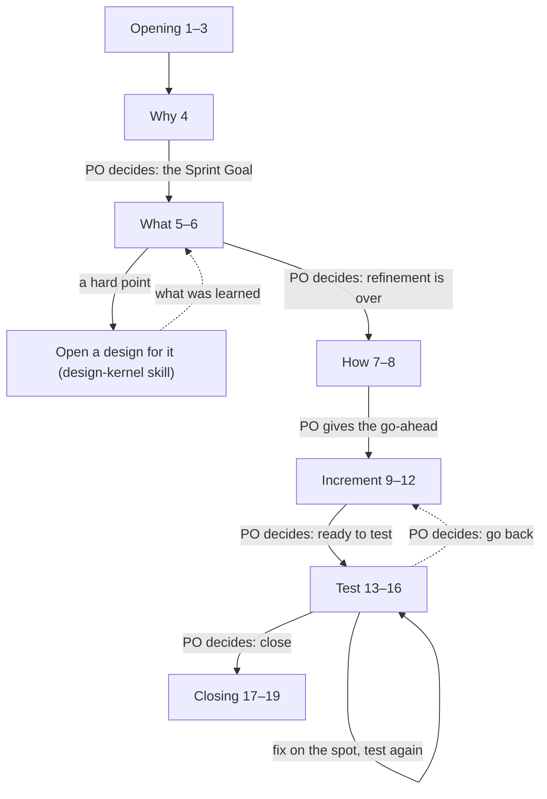
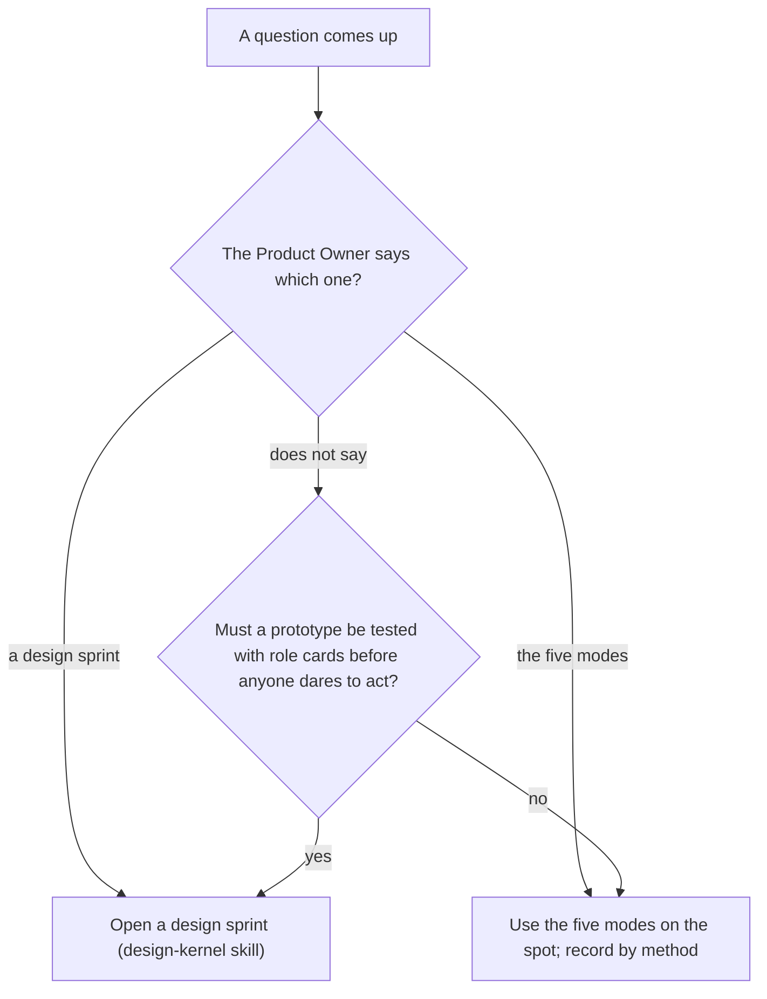
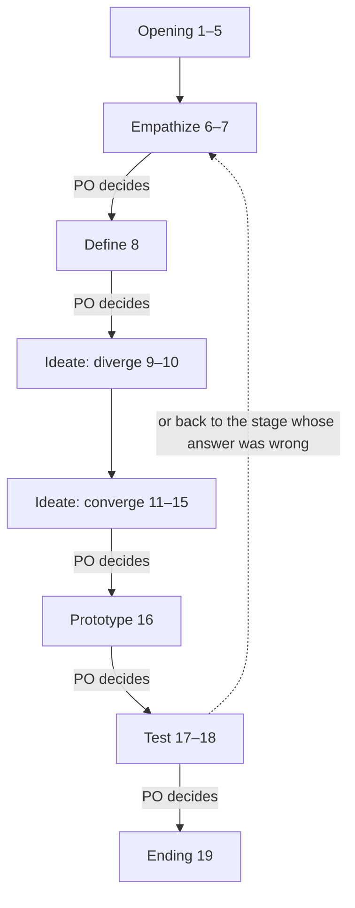

# 停点 ②：Sprint 17 约定审阅稿

> 给 PO 读的。**先看结构清单，再看全文**；全文是英文原文（在 `drafts/` 里），译文由 Master 安排。读完说行即可，不用逐行勾；要改的地方指出来就行。
> 审查快照是 `7426b3d`；对抗审查正在进行，结果出来若有改动，会另附。

## 一、结构清单

### 1. `sprint-kernel/conventions/sprint-log.md`（26 条）

Throughout 20–26。改动：5（照抄 2.1 时查够不够）、10（什么算卡住）、17（怎么判过时）、22（头部 Now 行）；新增 26（Developer 在另一个会话或工具里）。

| 条 | 短名 |
| --- | --- |
| 1–4 | One branch, one folder；No end date；Small work, small Sprint；Set the Sprint Goal |
| 5 | Select the items（**改**：写 2.1 时对照 Sprint Goal 查够不够） |
| 6–9 | Refine in seven steps（第 4 步改指 ideo 约定）；How is a plan；Go-ahead；Notes as you go |
| 10 | Checkpoints, not stand-ups（**改**：五种卡住） |
| 11–16 | Outline before full text；Full text for review；Tests: criteria first；A reviewer is required；PO acceptance when written；Record the tests |
| 17 | Review（**改**：过时 = 现在不真了或没人要读） |
| 18–21 | Retrospective；One closing commit；Goal fixed, plan flexible；New work gets registered |
| 22 | The log is the handoff（**改**：头部 Now 行） |
| 23–25 | Special cases；PO decides at the end of each stage；Ask the PO |
| 26 | Developer in another session or tool（**新**：能直接通话的、只能靠日志的） |

### 2. `sprint-kernel/conventions/sprint-backlog-template.md`

章节不变：头部（Started…，**加一行 Now**）、1 Why（1.1 Sprint Goal、1.2 DoD）、2 What（2.1 PBI、2.2 Refinement）、3 How、4 Increment notes、5 Test。

### 3. `scrum-kernel/conventions/product-log.md`（18 条，只动三条）

- 2 Blank page（**改**：加一句指向 ideo 约定第 1 条）
- 12 Items with the Scrum Master（**改**：「查够不够」收成指向 sprint-log 第 5 条）
- 17 Fresh at every Review（**改**：「过时」指向 sprint-log 第 17 条）

### 4. `scrum-kernel/overview.md`（17 条，只动四条）

- 2 Sprints and designs side by side（**改**：加一句指向 ideo 约定第 1 条）
- 7 Names（**改**：定义「全新子代理」）
- 12 Product Owner decides between stages（**改**：design-log 的条号 25→26）
- 14 Who gets which work（**改**：指向 sprint-log 第 26 条）

### 5. `ideo-kernel/conventions/design-sprint-or-five-modes.md`（新，1 条）

| 条 | 短名 |
| --- | --- |
| 1 | Design sprint or the five modes（**新**） |

### 6. `design-kernel/conventions/design-log.md`（27 条）

图下加一段「The three loops」导读（不编号）：共情定义人进 AI 出；发散收敛 AI 做、人选；原型测试可以自动跑——PO 可以把这两段之间的阶段决定交给 Scrum Master（overview 第 12 条）。

| 条 | 短名 |
| --- | --- |
| 1 | Open a design for a question with no ready answer（**改**：先分设计冲刺还是五模式） |
| 2 | Hard point, not the whole item |
| 3 | Who（**改**：一个 Designer 会话常常就够，兼不兼 Master 由 PO 定） |
| 4 | Branch（**改**：一开就开分支，现场定的是从哪里开） |
| 5 | Open a design |
| 6 | Start from the people（**改**：设计目标写愿景，不写怎么做） |
| 7 | Experts when needed |
| 8 | Map and questions in the log（**改**：地图要粗，五六个框、一个环） |
| 9 | Lightning Demos（**改**：点子清单之后分给各份草图） |
| 10 | Diverge before you converge |
| 11 | Isolated solutions（**改**：每份草图拿点子的一部分或先画后看；简报只给第 1、2 章和点子、不给现状、叫它别读项目文件） |
| 12 | While they sketch, talk with the Product Owner（**新**：主对话陪 PO 聊、没想法就替他画一份、全部合并后再收敛） |
| 13–18 | Choosing is the key step；Combine or rumble；Storyboard；Just enough prototype；Role-card test；Write the criteria before the test |
| 19 | When the design ends |
| 20–25 | IDEO in every stage；Ask the PO；Five chapters, not five days；Renamed terms；Resume from the header；Goal fixed, plan flexible |
| 26 | Gates between stages |
| 27 | A small design is still a design（**改**：只指向 ideo 约定第 1 条） |

### 7. `design-kernel/conventions/design-backlog-template.md`

章节不变：头部、1 Empathize（1.1 Challenge、1.2 Design goal、1.3 Design questions）、2 Define（2.1 Map、2.2 How Might We）、3 Ideate（3.1 Solution、3.2 Storyboard 可选）、4 Prototype（各部分表）、5 Test。注释只改两处：1.2 加「愿景，不是怎么做」；2.1 加「只画现在发生的事，五六个框、一个环」。

### 8. `scrum-kernel/SKILL.md`（一段）

「Working with the Design and IDEO Kernels」一段：把「open a design first」改成指向 ideo 约定第 1 条；「这类问题不能先出方案，要先走设计冲刺或五模式」。

## 二、请 PO 看的两处

1. **三个环与原型到测试之间的门**：导读说原型和测试可以自动跑，但设计日志第 26 条和图上，原型到测试之间有一道 PO 的决定。写法：门不删，导读写「PO 可以把这一处的阶段决定交给 Scrum Master（overview 第 12 条）」，这样两段就能自己往下跑。**这样写行不行？**
2. **就地用五模式时记在哪**：ideo 约定第 1 条写「record by method — each method's output goes into the log it serves (a Sprint's Increment notes, the product log's Notes)」。**这两个举例对不对？**（拿不准，所以先问。）

## 三、全文（英文原文，按上面的顺序）

- `drafts/sprint-kernel/conventions/sprint-log.md`
- `drafts/sprint-kernel/conventions/sprint-backlog-template.md`
- `drafts/scrum-kernel/conventions/product-log.md`
- `drafts/scrum-kernel/overview.md`
- `drafts/ideo-kernel/conventions/design-sprint-or-five-modes.md`
- `drafts/design-kernel/conventions/design-log.md`
- `drafts/design-kernel/conventions/design-backlog-template.md`
- `drafts/scrum-kernel/SKILL.md`（只有一段是本次改的，其余是现行原文）
