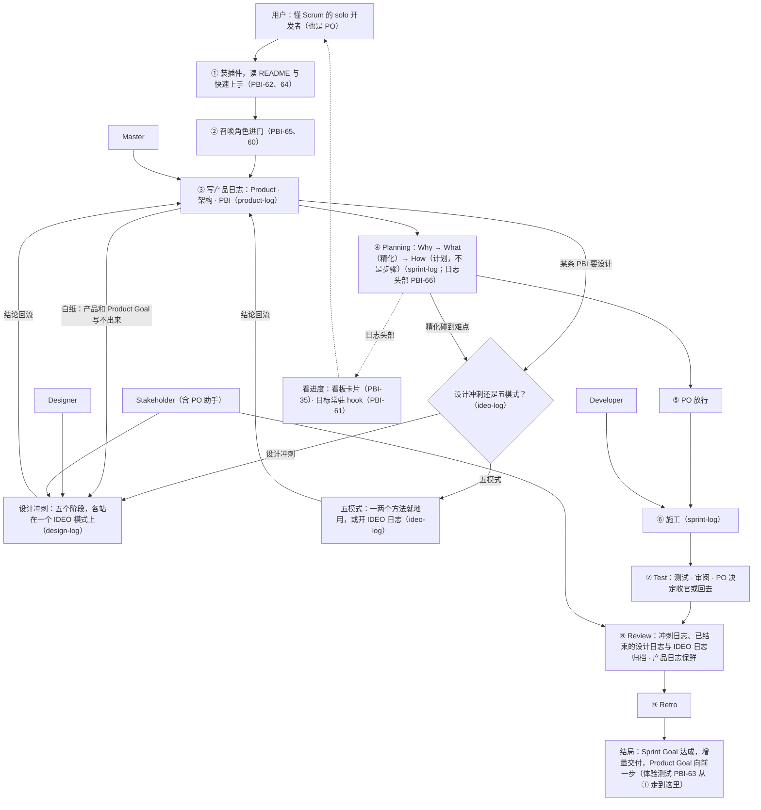

# IDEO-Scrum 看板 · 产品卡（原型 A：Markdown）

> **原型，用完即弃。** 版式手排，数据由一次性脚本从真实日志填入；不是看板成品，也不是生成器的输出。
>
> 生成于 2026-11-13 21:16（UTC+8） · 读了：`main` @ 74b929b（产品日志） · `claude/youthful-payne-b1e139` @ df88e67（Sprint 18） · `worktree-golden-orbiting-bachman` 工作区（Sprint 19）

---

## 等 PO 拍板（1 项）

- **Sprint 19**：35-2 看板形式（[冲刺卡](#sprint-19)）

---

## 产品卡

| Product | IDEO-Scrum：把 Design Thinking 与 Scrum Sprint 装进 Claude Code。 |
| --- | --- |
| Product Goal | 产品化：从作者能用到大家都好用；看板一眼看清进度，文档讲清规矩；懂 Scrum 的人照着就能走完第一个冲刺。（PO 2026-11-13 定） |

日志原文：[ProductBacklog.md](../../../../../../scrum/ProductBacklog.md)（`main` @ 74b929b）

### 架构图

### 未完成的条目（10）

**主线**（4）

| 条目 | 规模 | 状态 |
| --- | --- | --- |
| PBI-35　看板——卡片化，一眼看清进度 | M | [在 Sprint 19（主线）](#sprint-19) |
| PBI-61　目标常驻——hook 把承诺放进上下文 | M | [在 Sprint 19（主线）](#sprint-19) |
| PBI-63　体验测试——陌生人从装插件走到看板 | M | 待选（主线） |
| PBI-64　发布包装 | S～M | 待选（主线） |

**副线**（4）

| 条目 | 规模 | 状态 |
| --- | --- | --- |
| PBI-65　加载边界——ideo 放开，其余召唤才来 | M | [在 Sprint 18（副线）](#sprint-18) |
| PBI-60　角色说明——PO 助手是谁，Master 能替你做到哪 | S | [在 Sprint 18（副线）](#sprint-18) |
| PBI-66　日志头部——承诺、Now、等 PO 的事，决定前引用目标 | M | [在 Sprint 18（副线）](#sprint-18) |
| PBI-62　教学——README、快速上手、词汇表、示例项目 | M | 待选（副线） |

**以后**（2）

| 条目 | 规模 | 状态 |
| --- | --- | --- |
| PBI-51　插件的记忆机制（研究） | L | 以后 |
| PBI-12　方法论分享——公开系列 | L | 以后 |

---

## 冲刺卡（开着的 2 张）

### Sprint 18 · rules-first

| Sprint Goal | 规矩先顺：日志头部统一，scrum、sprint、design 召唤才来，角色说明写清；看板和 hook 照着就能读，文档照着就能写。（PO 2026-11-13 定） |
| --- | --- |
| Now | How：Developer 起草施工方案 · Master 2026-11-13 定精化结束（PO 授权，见第 4 章） |
| 等 PO | None |

截至提交 df88e67 · [日志原文](../../../../youthful-payne-b1e139/scrum/sprint-18-rules-first/SprintBacklog.md)

### Sprint 19 · board-hook

| Sprint Goal | 看得见：看板把产品日志和开着的冲刺、设计浓缩成卡片，hook 把承诺放进上下文；PO 照着就能一眼看清进度，AI 照着就不忘目标。（PO 2026-11-13 定） |
| --- | --- |
| Now | Increment：块 1 两版原型已交，等 PO 挑形式（35-2）；先做块 2（hook 小研究） · Master 2026-11-13 放行 How（PO 授权，见第 4 章） |
| 等 PO | 35-2 看板形式 |

读自工作区（本分支） · [日志原文](../SprintBacklog.md)

---

本版没做：设计卡、冲刺卡里的 PBI 路线图与 How 进度（只放了承诺、Now、等 PO）。
