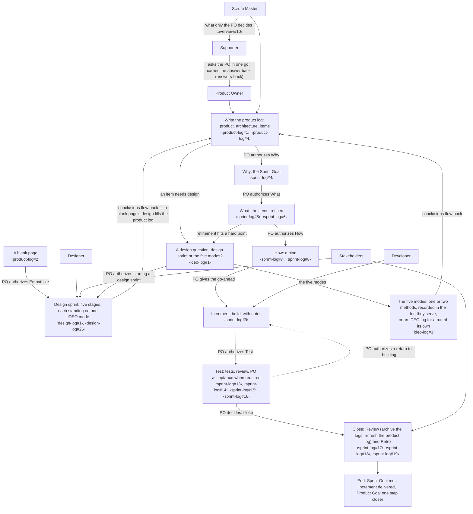
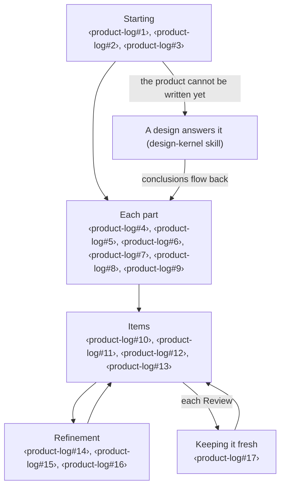
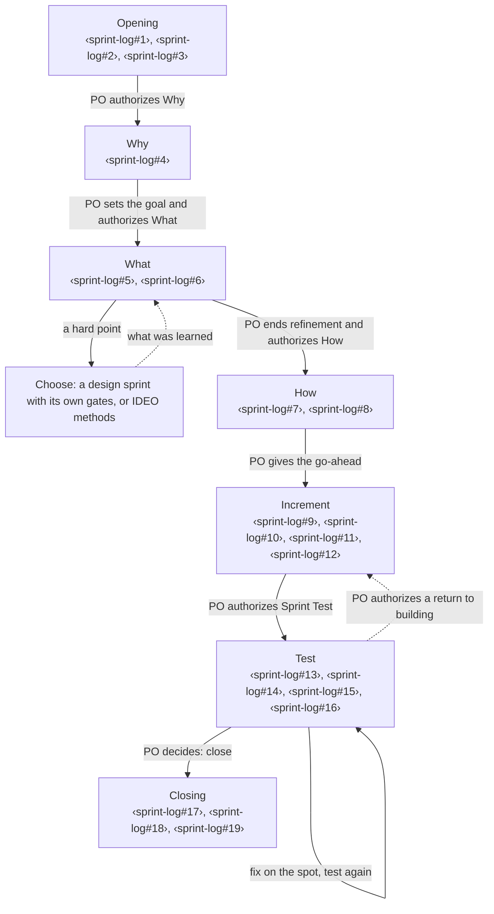
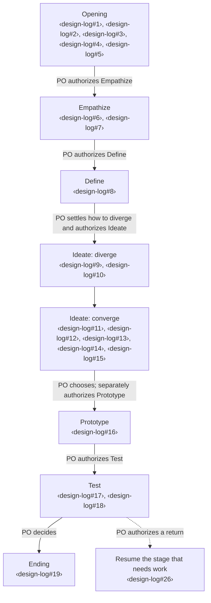
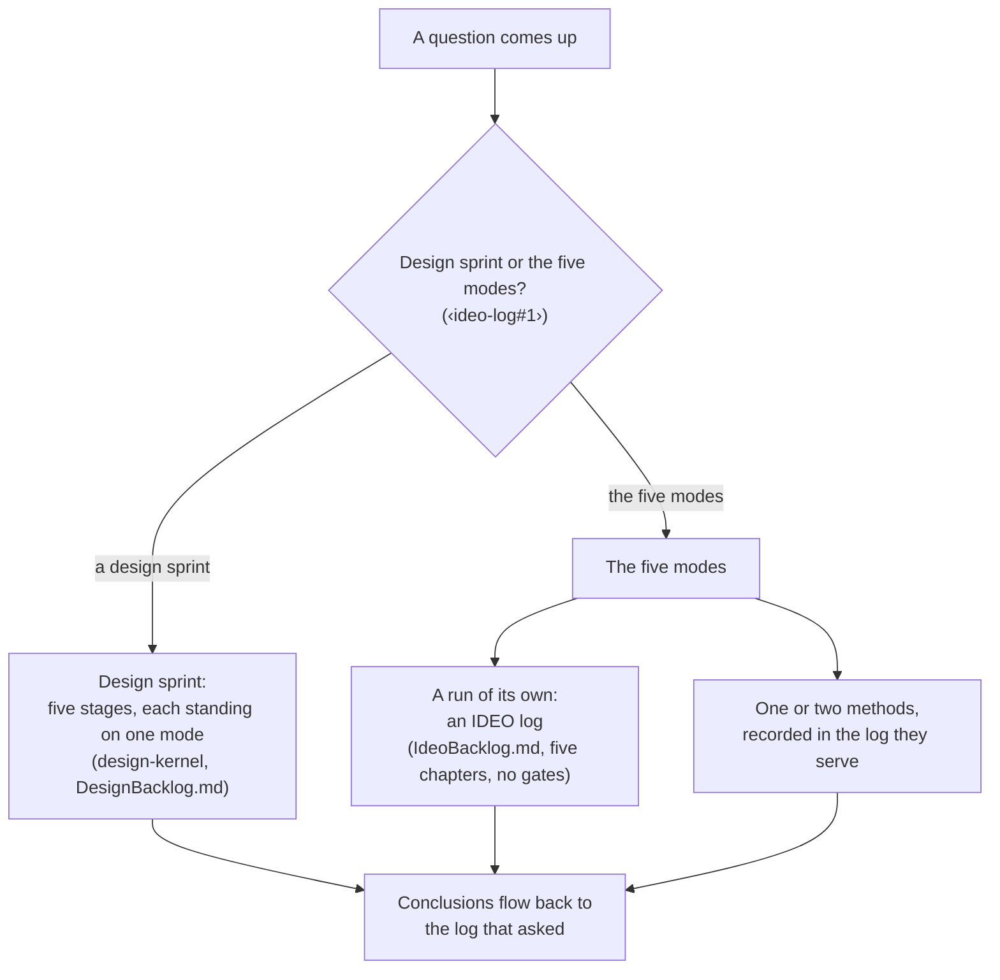
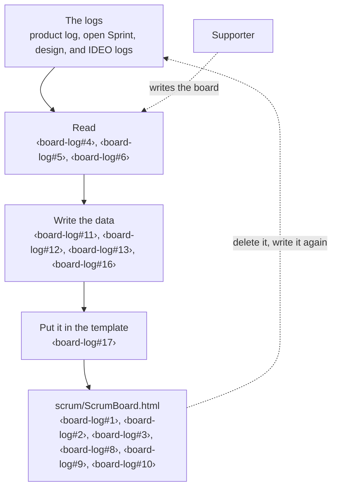

# The process maps

The process maps of the six old convention files, with the lines (handles) that apply at each step written into the boxes, so each map is also an index. Read it to see where a rule sits in the flow.

## The whole flow

## The product log

## A Sprint

## A design

## The five modes and the IDEO log

## The board

## Open points for the Product Owner

- None.
